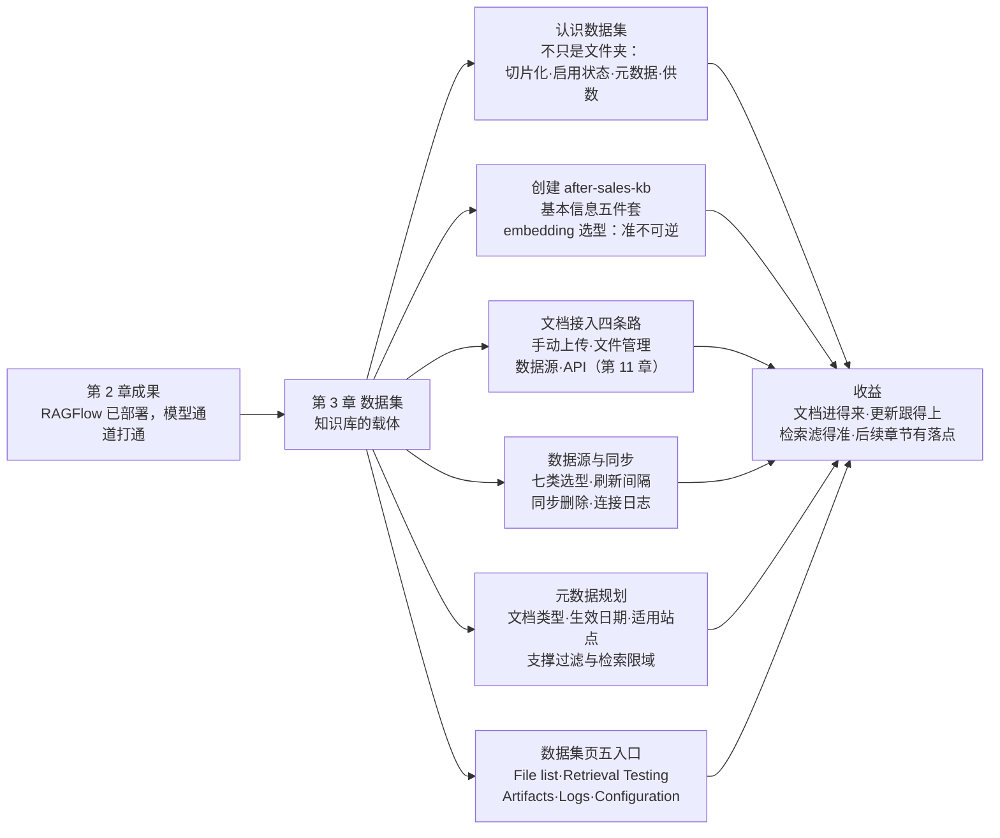

# 第 3 章 数据集：知识库的载体

> 本章导读：第 2 章的 RAGFlow 已经跑起来，模型通道也已打通——现在的问题是，知识从哪里进来。本章为贯穿案例「售后知识底座」创建数据集 `after-sales-kb`:50 页含表格的《售后政策手册》、约 200 行的《商品 FAQ》表格、随物流商调整变动的《物流时效公告》，三类文档更新节奏完全不同，接入路线也应不同。本章帮你做四个决定：数据集怎么建——embedding 选型为什么是「准不可逆」的；文档从哪进来——四条接入路线怎么按更新频率选；外部系统怎么自动同步——数据源的七类选型与刷新节奏；检索过滤的地基怎么打——元数据字段的事先规划。读完本章，你能：创建一个选型有依据的数据集；为每类文档选对接入路线；接通一个数据源并说清同步节奏；规划一组支撑检索过滤的元数据字段。

*本章导览图*

## 你什么时候需要它

三种典型处境，对应本章三种用法。

**我有一批文档要灌进 RAGFlow，从哪开始**——按 3.2（创建数据集）与 3.3（文档接入）顺序走。特别注意 3.2 的 embedding 选型：数据集一旦有了切片，换模型就要过兼容性检查，而且切换不会自动重嵌已有切片——创建时多想五分钟，省掉日后全量重新解析。

**文档在外部系统里（在线表格、Confluence、网盘），不想每周手动搬运**——直接看 3.4（数据源与同步）。创建连接只是第一步，还要回到数据集里关联并启动同步；「改了内容怎么没更新」的排查入口也在那一节。

**检索结果总混进过期政策或别的站点的内容**——看 3.5（元数据管理）。元数据是检索过滤的地基，它的规划要在建库时做，而不是等检索出问题再补（过滤在检索侧的完整用法见第 7 章）。

前置：第 2 章完成部署，且至少一个 embedding 模型可用（模型从哪来见第 2 章）。

## 3.1 概述：数据集不只是文件夹

**数据集（Dataset）是 RAGFlow 中承载知识源与检索内容的工作区**。它通常对应一组业务资料、一个文档集合或一个外部数据源。用户在数据集里导入文件、解析文件、把文件切成切片（Chunk）、维护元数据、验证召回；之后，聊天助手（第 8 章）、搜索应用（第 9 章）与 Agent（第 10 章）都拿这些内容做检索增强。

版本演进一句带过：v0 时代这个对象叫知识库（Knowledge Base),v1 更名为数据集（Dataset）。本书统一用「数据集」指称核心对象，叙述性场景偶尔用「知识库」泛指——你在官方文档与社区讨论里见到这两个词，指的是同一个东西。

官方文档给这个定义加了一个重要的反向读法：数据集**不只是「文件夹」**。文件夹只负责存放文件；数据集在存放之外还承担四件事：

| 职责 | 含义 | 展开章节 |
|------|------|---------|
| **切片化** | 把原始文档转换为可检索的切片——文档必须经过解析才能被检索 | 第 4 章 |
| **启用状态** | 存储文档与切片的启用/停用状态——停用的文档还在库里，但不再作为检索源 | 本章 3.3 |
| **元数据** | 维护文档级与切片级的结构化信息——过滤与限域检索的地基 | 本章 3.5 |
| **供数** | 为知识工件（Artifact）与日志追踪提供基础数据 | 第 6 章、第 12 章 |

这张表也预告了本书的结构：数据集是后续所有能力（检索测试、知识工件、聊天助手、Agent）的地基，地基打得稳不稳，取决于本章的几个决定。

贯穿案例的 `after-sales-kb` 就按这个职责清单来设计。它承载跨境电商售后域的三类文档：

| 文档 | 形态 | 内容特点 | 更新节奏 |
|------|------|---------|---------|
| 《售后政策手册》 | `after-sales-policy.pdf`,50 页 | 含大量表格，政策条款为主 | 低频（季度级改版） |
| 《商品 FAQ》 | `product-faq.xlsx`，约 200 行 | 列为 Title/Content/Category/Year | 高频（商品目录每周更新） |
| 《物流时效公告》 | `shipping-notice.html` + `shipping-notice.eml` | 短公告，时效敏感 | 中频（物流商调整时） |

三类文档的读者都是客服与店铺运营，但更新节奏完全不同——这个差异将决定 3.3 的接入路线选择，也是第 13 章知识库运营的起点。

## 3.2 创建数据集：五件套信息与一个准不可逆决定

### 创建入口与最小三件套

在数据集列表页点击 **Create dataset** 打开创建弹窗。列表页以卡片展示当前用户可访问的数据集（自己创建的与他人共享的），卡片上有人像或首字母、名称、文档数与创建时间。创建时必设三项：

| 必设项 | 说明 |
|--------|------|
| **Name** | 名称，不能为空；建议使用能反映业务或资料范围的名字 |
| **Embedding model** | embedding 模型，下拉列表展示系统中已添加且当前可用的模型（见下文，本章最重要的决定） |
| **Parse type** | 解析类型，二选一：**Built-in** 或 **Pipeline** |

- **Built-in**：使用 RAGFlow 内建的解析方法。系统预设了 General、Q&A、Manual、Table、Paper、Book、Laws、Presentation、One、Audio、Email 等方法，按文档内容与结构选——11 种方法的选型是第 4 章的主题。
- **Pipeline**：使用自定义摄取管线（Ingestion Pipeline）解析文档。管线须提前在 **Agent** 中创建并配置好，数据集里只负责选中它（见第 10 章）。

创建只是第一步。官方文档建议：创建后到数据集配置页，按实际场景进一步检查并配置语言、解析方法、自动元数据、数据源关联等选项，再批量上传文档。`after-sales-kb` 走的正是「先创建、后配置」——弹窗里定名称、embedding 与解析类型，随后进配置页补齐下面的五件套。

### 基本信息五件套

配置页的基本信息包含五件套加两项检索相关设置。五件套：

| 字段 | 官方作用 | `after-sales-kb` 的取值与理由 |
|------|---------|------------------------------|
| **Name** | 名称，创建后仍可修改，显示在卡片与详情页标题 | `after-sales-kb`，全书统一的售后知识底座 |
| **Language** | 数据集主语言，影响解析与模型处理时的语言假设 | 中文——政策手册与 FAQ 均为中文语料 |
| **Avatar** | 头像，支持图片上传，最大 4 MB | 售后图标，列表里一眼认出 |
| **Description** | 说明资料范围、业务用途或维护信息 | 「售后域三类知识：政策手册 / 商品 FAQ / 物流公告；客服与店铺运营使用」 |
| **Permissions** | 控制数据集的访问与允许的操作范围 | Team——客服与各店铺运营共用（权限体系全貌见第 13 章） |

### embedding 模型与 PageRank

**Embedding model** 是给切片向量化的模型：检索时，用户查询与切片要在同一个向量空间里算相似度——模型不同，空间就不同。**PageRank** 则与模型无关：给数据集设一个 PageRank 分数，检索时该分数会加到来自这个数据集的匹配切片的混合相似度得分上，提升其排名权重；适用场景是多数据集检索时想让某个数据集的内容优先（多数据集检索的完整玩法见第 7 章）。

#### 切换 embedding 模型会发生什么

这是本章最重要的一组行为，官方文档写得非常明确（依据 v1.0.0-rc2 文档，核实日期 2026-10-27):

1. 数据集**还没有切片**时，可以直接更换模型；
2. 一旦**已有切片**，在配置页选择不同模型会触发**兼容性检查**：对已有向量采样，要求**向量维度必须一致**，且**平均余弦相似度不低于 0.9**；检查失败则恢复原来的选择；
3. 保存模型变更**不会自动重新嵌入**已有切片——已解析的切片保持旧模型的向量，之后新解析的文档才用新模型。

第三条最容易被忽略，后果也最实在：换模型后如果不重新解析，库里就是新旧两种向量混住，检索质量不可预期；要让旧文档吃到新模型的向量，只能重新解析（重新解析的场景清单见 3.3 与第 4 章）。

所以本书把它称为**准不可逆**决定（**本书立场**）：技术上提供了带检查的切换通道，工程上应当在创建时把 embedding 选型当作一次定终身来对待——先用小批量样本解析并到检索测试里验证（第 7 章），确认召回效果，再全量上文档。

> **本书立场**:embedding 选型的三个考量——语料语言（中文语料选中文或多语言模型）、表格等特殊内容的表现、部署成本（本地模型还是在线 API，接入方式见第 2 章）。三个考量里，前两个都能用第 7 章的检索测试事实验证，不要凭模型排行榜拍板。

### `after-sales-kb` 的创建决策

| 决策项 | 取值 | 依据 |
|--------|------|------|
| Name | `after-sales-kb` | 全书统一，见贯穿案例约定 |
| Language | 中文 | 语料以中文为主 |
| Permissions | Team | 客服与各店铺运营共用，共享机制见第 13 章 |
| Embedding model | BAAI/bge-m3（案例选择） | 多语言模型，中文语料表现好；接入方式见第 2 章，最终以检索测试验证为准 |
| Parse type | Built-in | 三类文档均可被内建方法覆盖；自定义管线留到第 10 章按需引入 |
| PageRank | 暂不设置 | 当前单数据集检索用不上；未来与商品知识库并行检索时再启用（见第 7 章） |

注意决策顺序：embedding 在创建时定，语言、权限等在配置页补齐，FAQ 的数据源关联放到 3.4——一次只做一个决定，每个决定都有它的时间点。

## 3.3 文档接入：四条路线

一句前置事实：**文档只有经过解析生成切片，才成为可检索内容**。本节只解决「进得来」；点下解析按钮之后发生什么，是第 4 章的全部内容。

| 路线 | 入口 | 适合什么 | `after-sales-kb` 的落点 |
|------|------|---------|------------------------|
| 手动上传 | 数据集 **Files** 页 → **Add file** → **Upload file** | 本地文档、低频更新 | 政策手册、物流公告 |
| 文件管理关联 | **File** 页 → 行内 **Add to Knowledge Base** | 文件先集中管理、再按需关联一个或多个数据集 | 备用路线（见下文坑点） |
| 数据源 | 配置页关联数据源后，从 **Files** 页添加或自动同步 | 外部系统内容、持续更新 | 商品 FAQ(3.4 展开） |
| API | HTTP / Python API | 程序化批量写入、系统集成 | 第 11 章展开（→ mcp 书） |

### 手动上传

进入目标数据集的 **Files** 页，点击 **Add file** 选择 **Upload file**，选中本地文档确认上传；可选开启 **Parse on creation**（创建即解析），上传完成后在文档列表查看状态。政策手册改版是季度级事件，每次改版本就应该走一次人工评审再入库——手动上传把「人」留在流程里，正是这里要的效果。

### 从文件管理关联

**File** 页是 RAGFlow 的个人文件系统：用嵌套文件夹按项目、业务主题或数据源组织文件，支持上传单个文件或整个文件夹。文件行的操作包括 **Add to Knowledge Base**（关联知识库）、**Move**、**Rename**、**Download**、预览与 **Delete**；把文件关联到数据集后，解析、切块、检索都从数据集侧继续，处理状态以数据集文档页为准。

两个容易踩的坑，官方文档明确写了：

1. **单文件关联是「替换」语义**——操作会把该文件的知识库关联替换为当前选择；**批量操作才是「追加」**。同一个文件服务多个数据集时，保存前确认目标名单，别把已有关联覆盖掉。
2. **删除文件或文件夹可能影响已关联的数据集**——删除前确认文件不再被业务流程、知识库解析或 Agent 检索使用。

### 从关联数据源添加

数据集在配置页关联了外部数据源后，也可以从文档管理页手动把数据源中的文档添加进来；添加后同样要完成解析才有切片。这条路线与 3.4 的自动同步是同一机制的手动档，实践中用自动档就够了。

### 文件页能做什么

文件页（文档列表）是数据集的日常工作台，九个字段各有含义：

| 字段 | 含义 | 日常用法 |
|------|------|---------|
| **Name** | 文档名 | 点击进入文档详情，查看解析结果、切片与元数据 |
| **Size** | 文件大小 | —— |
| **Source** | 来源：本地上传 / 关联数据源 / 文件管理 | 与四条接入路线一一对应，溯源靠它 |
| **Enabled** | 是否参与检索 | 停用不停删：文档与解析结果保留，只是不再作为检索源；临时下架用停用，不要用删除 |
| **Chunks** | 已生成的切片数 | 为 `0` 通常意味着：未解析、解析失败、或解析后无可用内容——排查从这里开始 |
| **Metadata** | 文档级元数据字段数 | 点击可查看或编辑元数据（3.5) |
| **Parse** | 当前解析方法与解析入口 | 单文档可改解析方法，只影响该文档，不动数据集默认配置（第 4 章） |
| **Status** | 解析任务状态：waiting / running / completed / failed / canceled | 失败时去 **Logs** 查原因，排障后重新解析 |
| **Action** | 重命名、查看信息、下载、删除 | 删除会连同切片、元数据与解析结果一起移除，操作前确认 |

列表还支持按名称搜索、按解析状态/启用状态/来源过滤，勾选复选框后出现批量操作条：**Enabled** / **Disabled** / **Run**（批量解析）/ **Cancel**（取消解析）/ **Metadata**（批量维护元数据）/ **Delete**。重新解析的典型场景——解析方法或参数变更、切片配置变更、自动元数据配置变更、表列角色变更、源文档更新替换、解析结果不正确——会在第 4 章逐一遇到。

## 3.4 数据源与同步：更新的机械化部分

### 数据源是什么

数据源（Data Source）用于连接外部系统，把其中的文档、记录、邮件或消息同步到 RAGFlow 知识库——配置好之后，手动上传的工作量大幅下降，外部系统的内容可以直接在知识库里检索和问答。

### 七类选型

官方文档建议：先按内容来源选大类，再进对应的数据源配置。七类：

| 类别 | 代表连接 | 适合场景 |
|------|---------|---------|
| 文档与协作平台 | Confluence、Notion、飞书 Wiki、Google Drive、OneDrive、SharePoint、Box、Dropbox、WebDAV、SeaFile | 团队文档、wiki、云盘——企业知识库、项目库 |
| 对象存储 | S3、Google Cloud Storage、Oracle Storage、R2、Azure Blob Storage | 大批量文件——历史归档、批量导入、云文件集中管理 |
| 数据库与数仓 | MySQL、PostgreSQL、BigQuery | 结构化记录或查询结果——业务数据问答、指标知识 |
| 代码仓库与项目管理 | GitHub、GitLab、Bitbucket、Azure DevOps、Jira、Asana | 代码协作、issue、任务——技术知识沉淀、项目历史 |
| 邮件、消息与协作沟通 | Gmail、Outlook、IMAP、Microsoft Teams、Slack、Discord | 邮件、频道消息——客服沟通、商务函件 |
| 业务系统与表格 | Salesforce、Airtable、Dingtalk AI Table、Zendesk、Moodle | CRM、工单、在线表格——业务台账、服务知识库 |
| 通用 API 与订阅 | REST API、Xquik、RSS、Sitemap | 无标准连接器的业务系统、公开内容采集 |

一个容易误读的细节：文档中的 Personal Edition / Enterprise Edition 指的是**外部系统**的账户版本，不是 RAGFlow 的许可——能否同步，最终取决于外部系统是否允许当前账户访问目标内容与 API。

### 两步走：建连接，再关联同步

**第一步，创建连接**：从 **User Settings** 进入 **Data Source** 页，上半区管理已连接的数据源，下半区添加新的。创建连接通常填四样：连接名；连接信息（账号、token、地址、路径或存储范围，随数据源类型而异）；同步参数（同步删除、刷新间隔、清理间隔、超时）；保存前先 **Test connection** 验证账户权限与连接参数。

**第二步，关联数据集并启动同步**：创建连接只是保存了外部系统的访问配置，**数据不会自己进来**。回到目标数据集的配置页，在数据源区点击 **Link data source** 关联连接，按页面提示选择同步范围、解析方法或切块参数，保存并启动同步，等待同步任务完成。

### 同步节奏

同步开始后，RAGFlow 从外部系统读取内容，把可解析的内容写入知识库索引。三条节奏规则：

1. **首次同步**导入当前同步范围内的已有内容；
2. 外部系统**新增或修改**的内容，通常在下一个**刷新间隔**(refresh interval）到达时同步进来；
3. 开启**同步删除**后，外部删除的内容会在后续同步或**清理任务**中从知识库索引移除（清理间隔只在开启同步删除时生效）。

「明明改了，知识库里怎么还是旧的」——先查三样：刷新间隔到没到、同步状态、数据源日志。数据源设置页底部就是日志区，字段包括开始时间、状态（成功/失败/进行中）、写入的知识库、任务类型（初始同步、增量同步、清理任务）与摘要（错误描述，用来定位权限、字段、网络、限流问题）。日志为空通常说明该连接还没被任何知识库使用，或尚未触发同步。

### `after-sales-kb`：为什么 FAQ 走数据源

《商品 FAQ》由商品部维护在钉钉 AI 表格里，随商品目录**每周更新**。手动上传意味着每周都有人记得搬、有人检查搬没搬——这是典型的流程负债。接一个业务系统与表格类数据源（本例为 Dingtalk AI Table）：首次同步全量导入，之后增量随刷新间隔自动到达，开启同步删除后，表格里删掉的过期 FAQ 也会跟随移除。

政策手册则相反：改版低频，每次改版本来就应该走人工评审再入库（内容错了，客服会照着错的答案回复用户）。手动上传不是落后，是把「人」留在正确的位置。

> **本书立场**：数据源同步解决的是更新流程里「搬运」这个机械化部分——何时该更新、谁来审、更新前要不要评审，是流程治理问题，机械化替代不了。完整的更新流程 SOP 与质量巡检见第 13 章。

## 3.5 元数据：检索过滤的地基

### 元数据是什么，从哪来

元数据（Metadata）是与文档或切片关联的结构化信息，描述内容的来源、类别、时间、归属或业务属性，用于文档管理、过滤、限制检索范围与结果分析。它有四个来源：

| 来源 | 说明 | 管理入口 |
|------|------|---------|
| 系统内建字段 | 系统预设的结构化信息 | 自动 |
| 解析时自动生成 | 数据集开启 **Auto Metadata** 后，解析时按规则生成 | 配置页 |
| 表格列角色配置 | Table 解析下列的 Indexing / Metadata / Both 角色 | 第 4 章展开 |
| 手动维护 | 逐文档添加字段名、数据类型、值 | 文档列表或详情页 |

### 手动添加与自动生成

**手动添加**时指定字段名、数据类型与值。官方文档的建议值得当作团队规范：**保持字段名、数据类型与值格式一致**——同一个含义一会儿写「政策」一会儿写「policy」，过滤时就对不上了。

**自动生成**(Auto Metadata）在数据集配置页设置，分两类：

- **Generation**：自定义要生成的字段，每个字段配四项——Field（字段名）、Description（描述，说明要从文档提取或生成什么）、Type（数据类型）、Values（允许的取值范围）；
- **Built-in**：系统内建字段，当前支持 `update_time`（文档更新时间）与 `file_name`（文件名），开关即用。

一个时间差要注意：**自动元数据配置的变更只影响之后新解析的文档**；要让已有文档吃到新规则，只能重新解析。

### 元数据怎么用

两层用法：

1. **文档列表过滤**：文件页的 **Metadata field** 按字段值筛文档；可用字段与取值取决于当前数据集已有的元数据——所以字段规划要先行，库里没有的字段，过滤时也无从选起。
2. **检索限域**：配置元数据条件后，检索只搜索满足条件的内容——「只检索生效日期在有效期内的政策」「只检索本站点的 FAQ」，都是它的用武之地（过滤在检索测试与调优中的完整用法见第 7 章）。

风险同样写在文档里：元数据条件过严或字段值不准确，可能把相关内容排除在检索范围之外——过滤是把双刃剑，字段值的质量决定它是护栏还是墙。

### `after-sales-kb` 的元数据规划

建库时规划三个字段，配进 Auto Metadata 的 Generation（或对手动上传的文档逐篇维护）：

| 字段 | 类型 | 取值 | 撑什么场景 |
|------|------|------|-----------|
| `doc_type` | 枚举 | 政策 / FAQ / 公告 | 「只在政策里找」这类范围限定 |
| `effective_date` | 日期 | 文档生效日期 | 过期政策排除出检索范围 |
| `site` | 枚举 | 各站点标识 | 多站点差异——「只看本站点的答案」 |

三个字段对应售后域最高频的三类过滤需求。第 4 章讲 Table 解析的列角色时，`product-faq.xlsx` 的 Category、Year 两列会按官方示例配置为元数据角色——表格类内容的元数据可以不靠生成，列本身就是。

## 3.6 数据集页五入口

进入数据集详情页，五个入口各管一摊：

| 入口 | 管什么 | 本章哪节 | 展开章节 |
|------|--------|---------|---------|
| **File list** | 文档、解析状态、启用状态、chunk 计数、元数据字段数与文档级操作；数据集的默认入口 | 3.3 | 第 4 章 |
| **Retrieval Testing** | 输入测试问题、调整检索参数，验证当前数据集的召回效果 | —— | 第 7 章 |
| **Artifacts** | 查看与当前数据集相关的知识工件入口：**Wiki**、**Navigation**、**Graph** | —— | 第 6 章 |
| **Logs** | 文档解析与数据集级任务记录（文档日志与数据集级日志） | 3.3 | 第 4 章 |
| **Configuration** | 基本信息、embedding 模型、解析方法、数据源关联等配置 | 3.2、3.4 | 第 4 章、第 10 章 |

一个马上会用到的提示，官方文档专门强调：**Retrieval Testing 里调整的参数不会自动保存**——要在 **Chat Assistant** 或 **Retrieval Agent** 组件中单独应用。测试页是「试验田」，不是配置的落点；在试验田里调出的好参数，记得抄回真正服务用户的组件（第 7 章、第 8 章）。

本章只带你认门；五个入口背后的房间，从第 4 章起逐一打开。

## 本章小结

1. **数据集不只是文件夹**：切片化、启用状态、元数据、为知识工件与日志供数——四个职责决定它是一切检索能力的载体（v0 知识库 → v1 数据集，同一个对象）。
2. **创建时最重要的决定是 embedding 模型**：有切片后切换要过兼容性检查（向量维度一致 + 平均余弦相似度 ≥ 0.9，失败回退），且切换不会自动重嵌已有切片——本书立场：把它当作一次定终身的选型，先检索测试验证再上量。
3. **文档接入四条路，按更新频率选**：低频走手动上传，持续更新走数据源，先集中后分发走文件管理，程序化走 API（第 11 章）；文件页的 Source、Enabled、Chunks、Status 四个字段是日常巡检的主仪表盘。
4. **数据源同步是两步走**：建连接（连接信息 + 同步参数 + Test connection）只是保存配置，回数据集关联并启动同步才真正进数；增量跟随刷新间隔，删除跟随清理任务，排障看连接日志。
5. **元数据是过滤的地基**：四种来源（内建 / 自动生成 / 列角色 / 手动），既过滤文档列表，也限制检索范围；字段规划在建库时做，自动元数据变更只影响新解析的文档。
6. **五入口对应后续章节**:File list 与解析切片（第 4 章）、Artifacts 与知识编译（第 6 章）、Retrieval Testing 与调优（第 7 章）、Configuration 里的 Pipeline（第 10 章）。

下一步：文档进了库，还没有切片。第 4 章打开 File list 里点 **Run** 之后发生的事——11 种内建解析方法怎么选、Parser 与视觉模型怎么配、Chunker 参数怎么调，《售后政策手册》的 50 页 PDF 就等在那里。

## 验收清单

读到这里，你应该能：

- ☐ 说出数据集与「文件夹」的四个职责差异，并指出每个职责分别服务于哪类后续能力；
- ☐ 完成 `after-sales-kb`（或你自己的）数据集创建：名称、语言、权限、embedding 模型、解析类型五项全部有依据地选定；
- ☐ 向同事解释 embedding 切换的兼容性检查条件（维度一致、平均余弦相似度 ≥ 0.9）与「不自动重嵌」的后果；
- ☐ 上传一份文档，走通「列表可见 → 状态变化 → Chunks 计数出现」的链路，并说出 Chunks 为 0 的三种可能原因；
- ☐ 说出四条接入路线各自匹配的更新频率，并解释 FAQ 走数据源、政策手册走手动上传的理由；
- ☐ 为一个数据集规划三个元数据字段（名称/类型/取值），并在文档列表用其中一个完成过滤；
- ☐ 指出数据集页五个入口各自解决什么问题，并说出 Retrieval Testing 参数「不自动保存」这个坑。

## 延伸阅读

- **第 4 章（解析与切片）**——File list 里点 **Run** 之后发生什么：11 种内建解析方法选型、表列角色（FAQ 的 Category/Year 元数据化在等你）。
- **第 2 章（部署与模型通道）**——embedding 模型从哪来：在线 API 与本地模型的接入。
- **第 7 章（检索测试与调优）**——Retrieval Testing 入口背后的完整调优方法；PageRank 在多数据集检索中的用法；元数据过滤的检索侧展开。
- **第 13 章（团队协作与知识库运营）**——权限（Team）体系全貌；数据源同步之上「何时更新、谁来审」的更新流程 SOP 与质量巡检。
- **第 11 章（对外集成：API 与 MCP)**——第四条接入路线的展开，RAGFlow 的知识能力如何被外部程序消费（→ mcp 书）。

## 复核清单（发布前）

- [ ] 全章界面项与行为对照官方文档 v1.0.0-rc2(docs/guides/dataset、docs/guides/file、docs/guides/data_source），核实日期 2026-10-27;
- [ ] 创建弹窗实测：必设三项（Name / Embedding model / Parse type）与 Built-in / Pipeline 选项；
- [ ] embedding 切换兼容性检查实测：向量维度不一致与相似度不足两个失败分支均回退原选择；
- [ ] 在线表格类数据源接入实测：创建连接 → Test connection → Link data source → 首次同步 → 增量刷新与同步删除；
- [ ] Auto Metadata 的 Generation 字段实际生成效果与 Built-in(update_time / file_name）实测；
- [ ] 文件管理单文件关联「替换」语义与批量「追加」语义实测；
- [ ] 章首导览图 GitHub 网页端渲染检查。
