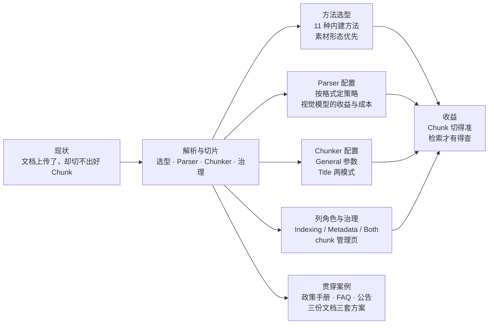
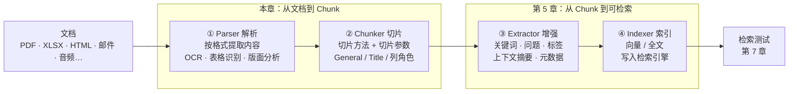
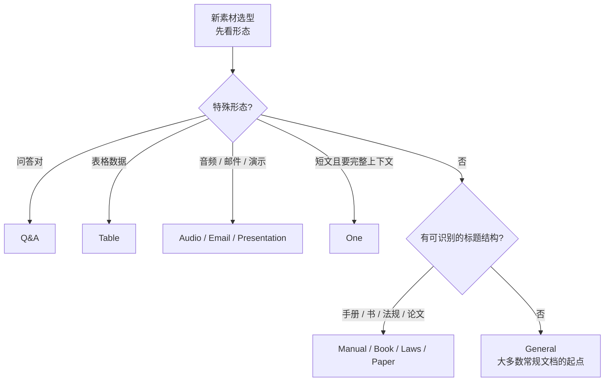

# 第 4 章 解析与切片：从文档到 Chunk

> 本章导读：第 3 章把售后知识底座的三类文档传进了数据集 `after-sales-kb`，但上传不等于可用——文档要经过解析与切片，才能变成检索引擎能命中的切片(Chunk)。这一步决定知识库的上限：切片切得太碎，答案失去上下文；切得太整，命中回来的是一片噪声。本章讲解析管线四段中的前两段：Parser 怎么按格式提取内容(内建解析器还是请视觉模型)、Chunker 怎么把内容切成大小合适的片(11 种内建切片方法选型、General 与 Title 两种切片器、表列角色配置)，再用贯穿案例为售后政策手册、商品 FAQ、物流时效公告各配一套方案。读完本章，你能：为新素材选定切片方法并配好 Parser 与 Chunker；用列角色让表格既可检索又可过滤；在 chunk 管理页完成切片级的查看、修正与停用，并走通「改配置 → 重解析 → 检索测试」闭环。

*本章导览图*

## 你什么时候需要它

三种典型处境，对应本章三种用法。

**文档解析完了，检索测试命中的却是碎片或整块**——先回 4.2 检查切片方法是否与素材形态匹配，再到 4.4 调 Chunker 参数。方法选错，后面怎么调参数都是补丁。

**扫描件、多栏 PDF、图文混排的 PPT 切出来乱七八糟**——直接看 4.3(Parser 配置)。这一节回答两件事：选哪个解析器，以及什么时候值得为它打开视觉模型。

**表格知识库检索不进、过滤不动**——看 4.5(表列角色)。表格每一列该参与检索、只做元数据还是两者兼顾，是列级决定，不是数据集级开关。

另外两种情况也常见：解析失败或改了配置却「不生效」，看 4.6——多数不是故障，是重解析语义没吃透。

前置：第 3 章的数据集创建与文件上传；第 2 章的模型通道——本章要用到的视觉模型、ASR 模型都来自那里配置的模型服务。

## 4.1 概述：解析管线的四段

先立一个本书的立场：**切片方法是本书的主战场**。RAG 系统的最终问答质量，一半以上在切片定型的那一刻就被决定了——模型再强，也只能在检索喂给它的切片里找答案。所以本章篇幅是全书最重的一章，值得。

从文档到可检索的切片，RAGFlow 的解析管线分四段：

*解析管线四段：本章管前两段，后两段见第 5 章*

| 段 | 职责 | 关键配置 | 展开位置 |
|----|------|---------|---------|
| ① Parser 解析 | 把各类文档转成文本与结构：OCR、表格结构识别、版面分析 | 解析器选择、视觉模型、去目录/页眉页脚、页范围 | 本章 4.3 |
| ② Chunker 切片 | 把解析产物切成大小合适、语义完整的切片 | 切片方法、chunk size、overlap、上下文窗口、标题规则 | 本章 4.4 |
| ③ Extractor 增强 | 给切片补关键词、问题、标签、上下文摘要、元数据 | 增强开关与模型选择 | (见第 5 章) |
| ④ Indexer 索引 | 把切片写入检索引擎：向量、全文 | 检索方式、索引字段 | (见第 5 章) |

两点阅读提示。其一，官方明确「不同内建方法显示的配置项不同，以界面实际显示为准」——本章表格是全景图，你的界面上未必全部出现。其二，内建解析配置页右侧有 **View built-in parser details**(查看内建解析器详情)入口，可查看每种方法支持的文件格式、详细切片规则与示例，是官方给的第一手对照材料。

## 4.2 内建切片方法选型

切片方法(Chunk method)是数据集处理上传文档、把文档转成切片的总策略。配置页的 **Parse type**(解析类型)提供两条入口：**Built-in**(内建解析)与 **Pipeline**(自定义摄取管线(Ingestion Pipeline))。进配置页前还有一件小事值得核对：数据集(Dataset)基本信息的 **Language** 设置影响解析与模型处理的语言假设(基本信息的其余字段见第 3 章)——素材语言与设置不符，切片质量先折一层。

| | Built-in(内建解析) | Pipeline(自定义摄取管线) |
|---|---|---|
| 形态 | 选定内建切片方法 + 配置页内调参 | 预先在 **Agent > Ingestion Pipeline** 创建并编排的画布管线 |
| 配置位置 | 数据集配置页完成全部配置 | 处理节点在 Agent 侧编排；数据集里只选择管线，不再配置管线内部节点 |
| 适用场景 | 绝大多数文档形态 | 需要自定义文档处理逻辑或复杂处理流程 |
| 前置条件 | 无 | 管线须先创建并配置好；尚无管线时可从配置页入口跳去 Agent 创建 |
| 展开位置 | 本章 4.3-4.5 | (见第 10 章) |

**本书立场：拿不准时先走 Built-in。**内建方法覆盖绝大多数文档形态，Pipeline 是「内建满足不了」之后的升级项，不是默认选项。

### 11 种内建切片方法

| 方法 | 适用素材 | 切片行为(官方口径) |
|------|---------|---------------------|
| General | 大多数常规文档的通用方法 | 识别文档内容，按配置的切片规则生成切片 |
| Q&A | 问答对组织的数据 | 每对问答独立成片 |
| Manual | 层级章节结构清晰的 PDF，如产品手册、操作指南 | 按章节(section)结构切片 |
| Table | XLSX、CSV/TXT 等结构化表格数据 | 通常每行一片 |
| Paper | PDF 论文、研究报告等学术文档 | 按摘要、章节、子节等结构元素切片 |
| Book | DOCX/PDF/TXT 书籍等有章节结构的长文档 | 面向章节结构的长文档设计 |
| Laws | DOCX/PDF/TXT 法律文书 | 按法律文本的结构特征识别切片边界 |
| Presentation | PDF/PPTX 演示文稿 | 通常每页/每张幻灯片独立成片 |
| One | 相对较短、需要保留完整上下文的文档 | 整个文档作为单个切片 |
| Audio | WAV/MP3/AAC/FLAC/OGG 等音频 | 先经 ASR 模型转写为文本，再从转写文本切片 |
| Email | EML/MSG 等邮件文件 | 提取发件人、收件人、主题、正文与附件后切片 |

### 选型决策：素材形态优先

官方选型建议一句话：按素材本身的形态选方法——常规文档先用 General，表格素材先用 Table，问答集、手册、论文、图片、音频、邮件各选对应方法，以减少后续的切片调整成本。

**本书立场：选型先看素材形态，再看检索期待。**形态决定「能不能切对」——问答对用 General 切，问答的完整性就靠运气；检索期待决定「切得合不合用」——同样是手册，想让每条命中自带「章节 > 条款」路径，就要走标题结构切片。据此给一条决策路径：

*切片方法决策路径：形态问题先于结构问题*

选错的代价要认识清楚：**方法不匹配通常不报错，而是安静地切出糟糕的切片**——问答集被切成语义碎片，手册被切成无结构的文本块。发现时唯有重解析(见 4.6.3)，所以在数据集里先传一两份样本、跑一次检索测试(Retrieval Testing)再全量上传，是本书推荐的低成本试错法(检索测试详见第 7 章)。

## 4.3 Parser 配置：按格式定解析策略

选定切片方法后，可进一步配置文档解析、切片与内容增强。本节讲 Parser：它决定不同格式的内容怎么被提取。注意区分两层——4.2 的切片方法是「数据集怎么切」，本节的解析器是「某种格式的内容怎么读出来」，例如 Table 切片方法下的表格单元格，仍要选一个解析器去识别表格结构。

### 4.3.1 PDF：格式最多、配置最重

PDF 是现实中问题最多的格式，配置项也最多，分两组看。

**解析器选择**(**Parsing method**)，内建六种，外加外部模型：

| 解析器 | 特点(官方口径) | 适用 |
|--------|----------------|------|
| DeepDOC | RAGFlow 默认文档解析器；执行 OCR、表格结构识别与版面分析 | 版面复杂、含图片、扫描内容或表格的 PDF |
| Naive | 面向以纯文本为主的 PDF；减少 OCR、表格识别与复杂版面分析，速度更快 | 纯文本型 PDF |
| Docling | 开源文档解析工具，可解析 PDF 等文档并抽取结构化内容 | 作为替代解析器 |
| OpenDataLoader | 抽取文本、版面与结构化信息 | 作为其他内建方法的替代 |
| TCADP Parser | 腾讯开源解析器，可解析 PDF 内容 | 作为替代解析器 |
| MonkeyOCRv2 | 视觉方式解析，结合 OCR 与视觉理解 | 扫描件、复杂版面、图文混排 |
| 外部模型 | 系统中已配置的视觉语言模型(Vision-Language Model,VLM)等文档理解模型 | 复杂版面、扫描件、图片、无边框表格、图文混排；产生额外模型调用与 token 消耗 |

**行为开关**：

| 配置项 | 作用 | 何时打开 |
|--------|------|---------|
| Multi-column layout recognition(多栏版面识别) | 识别双栏/多栏页面，按合适阅读顺序提取文本区域 | 论文、期刊、报告等多栏文档 |
| Remove original table of contents(移除原目录) | 解析时移除 PDF 自带目录，使其不以正文身份进入切片与检索结果 | 目录页会被当正文时 |
| Remove headers and footers(移除页眉页脚) | 识别并移除每页重复的页眉页脚，减少知识库中的无关内容 | 每页都有页眉/页脚/页码时 |
| Page range(页范围) | 设起止页并可添加多个范围，跳过不需要处理的页 | 长文档只取部分章节 |
| Disable vision model(禁用视觉模型) | 开启后解析不调用视觉模型；关闭时视觉模型可辅助理解复杂版面或图文内容 | 按文档复杂度取舍(见 4.3.7) |
| Model(视觉模型) | 选择解析所需的视觉模型；模型能力越强，对复杂版面的理解可能越完整，质量与 token 消耗随之变化 | 需要视觉模型时 |

外部模型在解析器下拉列表中按模型提供商分组展示，可用性取决于已配置的提供商及其能力——表格解析与图片解析的外部模型同理，后文不再重复。

### 4.3.2 Table：表格内容的结构识别

这里说的是文档内表格的识别，与 4.2 的 Table 切片方法是两层。可配 **Parsing method**(DeepDOC / TCADP Parser / 外部模型)、**Disable vision model**、**Model** 三项。官方口径：DeepDOC 识别表格结构并抽取单元格内容，适合多数标准表格；边界清晰的常规表格用内建解析器即可，复杂表格、无边框表格、合并行列或需要视觉解读的表格，再考虑有视觉能力的模型——同样以额外的模型调用与 token 为代价。

### 4.3.3 Image：OCR 与外部模型二选一

图片解析解决「视觉内容转文字」，**Parsing method** 二选一：

| 方式 | 能做什么 | 适用 |
|------|---------|------|
| OCR | 光学字符识别(Optical Character Recognition,OCR)，提取图中文字 | 文字清晰的截图、扫描件、照片 |
| External model | 有视觉理解能力的已配置模型；除文字外还能解读版面、图表、物体及图文关系 | 图表、复杂版面、界面截图、需要视觉理解的内容 |

官方提醒：解析质量还取决于图像清晰度、文字大小、版面与整体质量——图片本身太糊，换什么模型都救不回来。

### 4.3.4 Markdown、HTML、DOC、DOCX：去重的四种组合

这四种格式的配置围绕两件事：**去重复**(目录、页眉页脚)与**是否用视觉模型**：

| 格式 | 可配项 | 要点 |
|------|--------|------|
| Markdown | 移除原目录；Disable vision model；Model | 视觉模型用于处理文档内需要视觉理解的图片等内容 |
| HTML | 移除原目录(含导航列表)；移除页眉页脚 | 针对网页另存/导出的文件；若页眉页脚或目录本身含你需要的信息，则保留 |
| DOC | 移除原目录；移除页眉页脚；Disable vision model；Model | 视觉模型辅助解析图片、复杂版面等 |
| DOCX | 同 DOC 四项 | **Model 仅列已配置的外部模型**——DOCX 不提供 DeepDOC、Naive、Docling 等内建解析器选项 |

### 4.3.5 PPTX 与音视频

PPTX 的 **Parsing method** 三选一：DeepDOC(抽取幻灯片文本、表格与版面，适合多数标准文件)、TCADP Parser(腾讯开源，抽取文本与结构化内容)、External model(按提供商分组的已配置模型)。文字与标准表格为主，从 DeepDOC 或 TCADP 起步；复杂版面、图文混排、大量图片或需要视觉解读的内容，选能力匹配的外部模型。

**Video 与 Audio 只支持外部模型**——没有内建解析器可选。视频需具备视频或多模态理解能力的模型(分析视频帧、可见文字、语音与上下文后生成文本)；音频需具备自动语音识别(Automatic Speech Recognition,ASR)能力的模型。模型之间在语言支持、口音、多说话人、背景噪声与长音频转写上差异明显，选型时按素材特征核对模型能力。

### 4.3.6 视觉模型：收益与 token 成本

把 4.3.1-4.3.5 反复出现的一句话抽出来单独立规矩。官方口径始终是同一个句式：「普通文本型内容从内建解析器起步；扫描件、多栏、复杂表格、图文混排，视觉模型可能提升解析质量；因为视觉模型产生额外的调用与 token，按文档类型启用。」

**本书立场：视觉模型是「按文档病下药」，不是「全员保健品」。**同一数据集里，纯文本 PDF 开视觉模型只会烧 token 不提质量；而赔偿标准表那种无边框表格，不开就是识别成乱码。把 4.3 各格式反复出现的官方建议收成一张对照表，按素材特征对号入座：

| 素材特征 | 建议路径 |
|---------|---------|
| 纯文本 PDF | Naive 起步(提速)，视觉模型关闭 |
| 多栏论文 / 期刊 / 报告 | 开多栏识别；版面复杂再上视觉模型 |
| 扫描件 / 复杂版面 / 图文混排 | MonkeyOCRv2 或外部视觉模型 |
| 标准表格(边界清晰) | DeepDOC，视觉模型可关 |
| 无边框 / 合并行列的复杂表格 | 有视觉能力的外部模型 |
| 文字清晰的截图 / 扫描照片 | OCR |
| 图表 / 界面截图 / 需视觉解读的图 | 外部视觉模型 |

官方 FAQ 还给出一个性能视角：解析比 LangChain 慢，正是因为版面分析、表格结构识别与 OCR 动用了视觉模型——v0.17.0+ 起纯文本 PDF 可选 Naive 显著提速，且开源 1.0 的 DeepDoc 以 CPU 推理执行这些操作。全库无脑开视觉模型，等于把最贵的路径当默认路径。

## 4.4 Chunker 配置：切多大、怎么切

Chunker 决定解析产物的切分方式。内建配置里两组切片器：**General Chunker**(按大小与分隔符)与 **Title Chunker**(按标题结构)。

### 4.4.1 General：通用切片器

| 参数 | 默认值 | 作用 |
|------|--------|------|
| Recommended chunk size(推荐切片大小) | **512**(tokens) | 每片的目标大小。系统会把相邻内容组合到该大小，但它是目标而非硬上限——超过目标且不可再分的段落，可能保持为一片 |
| Overlap ratio(%)(重叠比例) | — | 相邻切片共享的内容比例。开启重叠时，前一片末尾的内容复制到下一片开头，减少边界处的上下文丢失、改善语义连续性；设 **0** 为不重叠 |
| Table context window(表格上下文窗口) | — | 附着到表格切片的前后上下文量(tokens)，保留表格与周边文字的关系；设 **0** 不附加 |
| Image context window(图片上下文窗口) | — | 附着到图片切片的前后上下文量(tokens)，适合需要周边文字才能理解的图；设 **0** 不附加 |
| Delimiters(分隔符) | 换行符 `\n`、句号、问号、感叹号、分号等 | 参与切分的分隔符集合 |
| Split by delimiter(按分隔符切分) | — | 先按分隔符切开文本，再按推荐切片大小组合相邻片段，尽可能在保留语义的前提下凑出合适大小 |
| Split positions(切分位置) | — | 展示当前全部分隔符，便于确认用了哪些边界 |
| Add(添加) | — | 添加自定义分隔符——用文档中有意义的边界标记，如标题符、段落符 |
| Use sub-chunks for retrieval(用子切片检索) | — | 开启父子切片(parent-child)：从较大父片生成更小的子片，检索用子片；子片命中后，父片提供更完整的上下文 |

官方的四句使用建议值得原文照录进团队规范，再转成「现象 → 动哪个参数」的动作表：

| 现象 / 需求 | 动哪个参数 |
|------------|-----------|
| 普通文档，从零起步 | 默认 512 + 与文档结构匹配的分隔符 |
| 上下文频繁在切片边界被切断 | 加大 Overlap ratio |
| 表格、图片多，周边文字与图表脱节 | 配 Table / Image context window |
| 既要精准检索，又要保留完整上下文 | 开启 Use sub-chunks for retrieval |

**本书立场：三个窗口类参数(chunk size、表上下文、图上下文)是同一道权衡的三张脸**——都花 token，都换上下文完整性。表格前后正文被切走是表格类知识最常见的检索失败原因(命中了表、丢了适用条件)，所以赔偿条款这类「表格 + 前置条件」文档，表上下文窗口的优先级应高于 overlap。

### 4.4.2 Title Chunker：按标题结构切片

Title Chunker 从标题层级识别文档结构并组织切片，提供 **Hierarchy** 与 **Group** 两种模式：

| | Hierarchy(层级模式) | Group(分组模式) |
|---|---------------------|------------------|
| 切片形态 | 从标题层级构建文档树，生成独立切片 | 在选定标题层级生成更扁平的切片，合并相邻小节 |
| 标题路径 | **每片保留完整父标题路径**，如 `Part 1 > Chapter 3 > Section 2` | 不添加完整父标题路径 |
| 强调什么 | 片的可定位性：脱离原文档被检索时，仍知道身处何处 | 相邻内容的语义连续性 |
| 适用文档 | 章节相对独立、标题结构有意义的文档：法条、法规、合同、技术规范 | 书籍、用户手册、报告、文章等相邻段落/小节相互依赖的文档 |
| 特有参数 | Separate parent heading content；Set first chunk as global context | Heading level 支持 Automatic |

共用参数：**Chunk token limit**(切片最大 token 数，超限继续切分，避免过大切片)、**Heading level**(用哪一级标题生成切片，如 H3——系统按标题规则识别 H1、H2、H3 等层级后在所选层级组织切分)、**Rules**(标题识别规则，下节展开)。Hierarchy 的 **Separate parent heading content** 控制父标题直属正文是否单独处理——开启后父节自己的正文不与子节混入一片；**Set first chunk as global context** 把文档第一个切片作为文档级背景供后续切片使用。Group 的 Heading level 额外支持 **Automatic**，由系统按检测到的文档结构自选层级。

一句话选模式：**位置感优先选 Hierarchy，连贯感优先选 Group。**条款类内容(「第七条 违约责任」)命中时必须带出条款路径，否则用户无法核对原文——Hierarchy；叙事类内容(操作步骤跨小节衔接)被切成独立片会断脉络——Group。

### 4.4.3 标题识别规则：正则与规则集

两种模式共用的 **Rules** 决定「什么算标题」。每条规则可包含 H1 到 H5 五级正则表达式，可匹配 Markdown 标记(`#`、`##`、`###`)、中文编号标题(如「第一章」「三、」)，也可匹配英文标题词(`PART`、`Chapter`、`Section`、`Article`)。**Add regular expression** 向当前规则添加一个层级及其正则；**Add rule** 添加整套新规则，用于不同语言、编号体系或文档格式。

**本书立场：标题正则是标题类切片的「地基工程」，值得为一套手册写全五级再上线。**层级识别一旦漏配——比如手册混用「第一章」与「1.1」两套编号而规则只配了其一——漏网标题降级为正文，切片边界随之塌掉。写完正则先传样本验证层级树，再谈 token limit。

## 4.5 表列角色：让表格既可检索又可过滤

数据集使用 **Table** 作为内建切片方法时，可用 **Column mode**(列模式)设置表格每列在解析与检索中的用途：进切片文本参与检索、只作元数据、或两者兼顾。

**Auto(自动)**：默认设置。所有列既进入切片文本，也存储为元数据——适合不需要区分列用途、希望全部表格内容参与检索且同时可作元数据的场景。

**Manual(手动)**：RAGFlow 识别表格的列并按原列名逐一展示——界面上出现 `CRIM`、`ZN`、`INDUS`、`CHAS` 这类名称，来自当前表格的列名，**不是 RAGFlow 预定义字段**。每列通过下拉菜单三选一：

| | Auto | Manual |
|---|------|--------|
| 配置粒度 | 数据集级默认，零配置 | 逐列指定角色 |
| 进入切片文本的列 | 全部 | 仅 Indexing 与 Both 列 |
| 存为元数据的列 | 全部 | 仅 Metadata 与 Both 列 |
| 适用场景 | 不需区分列用途 | 有明确检索内容列与过滤维度列的划分 |

| 角色 | 行为 | 适用列 |
|------|------|--------|
| Indexing(索引) | 列内容进入切片文本，参与向量检索与全文检索 | 承载主检索内容的列 |
| Metadata(元数据) | 列仅存为元数据，不进入切片文本；可作过滤字段缩小检索范围 | 类别、年份等过滤条件列 |
| Both(两者) | 既进切片文本参与检索，又可作元数据过滤 | 标题等「要检索也要能过滤」的列 |

官方给的四列示例，直接可套用到商品 FAQ 类表格：

| 列 | 角色 | 理由 |
|----|------|------|
| Title | Both | 标题参与检索，也可作元数据 |
| Content | Indexing | 正文主要用于内容检索 |
| Category | Metadata | 按类别过滤检索结果 |
| Year | Metadata | 按年份过滤检索结果 |

效果：不需要参与内容检索的字段不进切片文本，同时保留为检索过滤条件——切片文本更干净，过滤维度一个不少。

**生效时机要牢记**：列角色配置作用于表的列结构，而非单个单元格；修改后仅对**后续解析**的文档生效，已解析文档必须重新解析，新角色才生效。顺带把同页的 **Auto Metadata**(自动元数据)一并交代：它配置解析时自动生成的元数据，分两类——**Generation** 自定义生成字段(Field 字段名、Description 描述、Type 类型、Values 取值范围)与 **Built-in** 内置字段(当前支持 `update_time` 文档更新时间与 `file_name` 文件名，开关即用)。它的变更同样只对之后新解析的文档生效，不会自动更新已完成解析的文档。

## 4.6 切片质量治理：从解析结果到可用切片

配置再好也只是「出厂设置」，切片质量的最后一公里在 chunk 管理页。本节讲三件事：切片级的人工修正、解析日志与故障定位、重解析语义。这套治理动作在第 7 章会被检索测试反复触发、在第 13 章升格为运营巡检例行项。

**本书立场：chunk 管理页是「解析质量」与「检索质量」之间的缓冲区。**解析切得不完美是常态，逐片修正比反复调参重解析便宜得多；但人工修正是打在具体切片上的补丁，重解析会重新生成切片、补丁不随迁移——所以它的定位是「小修小补」，系统性问题仍要回配置层解决。

### 4.6.1 chunk 管理页：切片级的查看与修正

解析完成后，在 **Files** 页点击文档名进入解析结果页。切片是文档解析产出的可检索知识片段，也是 RAGFlow 检索与问答的基本单元。能力全景：

| 操作 | 做法 | 用途 |
|------|------|------|
| 查看切片列表 | 每片含正文、关键词、问题、启用状态 | 核对内容是否被正确解析、切分、存储 |
| 源文联动预览 | 点击切片文本，文档预览区跳到对应源位置 | 与原文对照检查切分；无法定位源文的类型则以切片正文为主查看 |
| 搜索与过滤 | 关键词搜索；按启用状态过滤；长正文全显/折叠切换 | 大文档里快速定位目标内容 |
| 查看详情 | 正文、关键词、问题、启用状态 | 确认内容完整、语义连贯、适合检索 |
| 编辑切片 | 双击打开编辑窗口，可改 Content、Keywords、Questions、Tags | 修正解析不准或补充内容；保存后用于后续检索 |
| 添加切片 | 手动新增，存于当前文档下 | 补充知识片段，同样参与检索与问答 |
| 启用 / 停用 | 启用状态决定该切片是否参与数据集检索 | 过时、错误或暂不需要的内容**停用而非删除**——停用的切片保留在解析结果中，只是检索不再召回 |
| 删除 | 从当前文档解析结果中移除 | 仅确认不再需要时使用；想临时排除出检索，用停用 |

### 4.6.2 解析日志与故障定位

解析失败的排查顺序，官方给的是一条三段路径：**文档状态 → 配置 → Logs**。先确认文档还在解析中还是已失败；再检查解析方法、模型与数据源配置；最后打开文档日志详情看错误原因。

一个高频报错值得单独认识：**「File not found in object storage.」**——解析时在对象存储里找不到源文件(原始存储错误仍在文档日志中)。可能原因：MinIO 数据目录所在磁盘空间不足，导致此前的上传未能写入成功；或文件上传后又被删除。注意官方的提醒：仅凭这条消息不能断定就是磁盘满——应检查 MinIO 所在机器/卷的剩余空间，并回看上传时段的 MinIO 日志有无写入失败；默认 Docker Compose 部署中，MinIO 数据存放在挂载于 `/data` 的 `minio_data` 卷。修复存储问题后要**重新上传文件再解析**——只重试解析，救不回已丢失的文件。

### 4.6.3 重解析语义：改配置不会自动追溯

本节是全书最容易踩的认知坑，提前在这里钉死，第 13 章的更新流程 SOP 会再收编它。

**改了解析配置，旧文档会自动更新吗?**官方口径：通常要重新解析。解析配置决定文档如何被转成切片；对已解析的文档，修改配置**不会自动重写旧切片**——要让新配置作用于既有文档，必须对相关文档重新解析。

元数据是半个例外：手动修改后，界面过滤通常可以直接用上新值；但如果元数据参与检索过滤或影响索引结果，就可能需要结合重解析、索引刷新或重新检索测试来确认最终效果。

**本书立场：把「改配置 → 重解析 → 检索测试」当成一个动作，而不是三步。**只改配置不重解析，你以为在调参，其实在自我安慰；重解析后不跑检索测试，你以为修好了，其实没验证。

### 4.6.4 常见坑速查

| 现象 | 根因(官方口径) | 处置 |
|------|-----------------|------|
| 解析比 LangChain 慢 | 版面分析、表格结构识别、OCR 动用视觉模型 | 纯文本 PDF 选 Naive(v0.17.0+)；预期内开销 |
| 解析整体耗时长 | RAPTOR、知识图谱(GraphRAG)、自动关键词、自动问题都是重开销项 | 按需关闭；关键词/问题生成见第 5 章 |
| 检索测试检索不到内容 | 文档未解析、无可用切片、元数据过滤太严、Similarity threshold 过高、Top K 过小 | 按「文档状态 → chunk → 元数据 → 检索参数」排查(见第 7 章) |
| 源文件丢失报错 | MinIO 磁盘满致上传失败，或文件被删 | 修复存储 → 重新上传 → 再解析 |
| 改配置后行为没变 | 重解析语义：配置不追溯 | 对相关文档重新解析(4.6.3) |
| 列角色改了没生效 | 仅对后续解析的文档生效 | 已解析表格重新解析(4.5) |

## 4.7 贯穿案例：三份文档的切片方案

回到数据集 `after-sales-kb`。三类素材形态迥异，正好各代表一条选型路径。先看总览，再逐份拆解「为什么这么选」与「预期失败模式」——后者是方案的组成部分，不是免责声明。

| 文档 | 素材形态 | 切片方法 | 关键配置 |
|------|---------|---------|---------|
| `after-sales-policy.pdf` | 50 页 PDF，章节结构 + 赔偿表格 | Manual | Title Chunker(Hierarchy)；标题正则；表上下文窗口 |
| `product-faq.xlsx` | XLSX，约 200 行问答 | Table | 列角色 Manual：问题 Both、答案 Indexing、类目/更新时间 Metadata |
| `shipping-notice.html` | 网站公告页另存 | General | 去目录(导航)、去页眉页脚；默认 512 起步 |
| `shipping-notice.eml` | 同一公告的邮件版 | Email | 方法自带发件人/主题/正文/附件提取 |

### 4.7.1 售后政策手册：Manual + Title Chunker(Hierarchy)

**为什么这么选。**政策手册的特征是「条款即知识单元」：客服问「跨境订单退货的运费谁承担」，期望命中的是「售后政策 > 退货与退款 > 运费承担」下的那一条款，而不是邻近条款的混合体。这正是 Hierarchy 模式的主场——每个切片保留完整父标题路径，脱离原文档被检索时仍可定位。配套动作：标题规则为手册的编号体系配全 H1-H5 正则——假设这本手册用「第一章 / 1.1 / 1.1.1」三级编号，规则集可以长这样(本书示例，正则按实际编号体系调整)：

| 层级 | 示例正则 | 匹配目标 |
|------|---------|---------|
| H1 | `^第[一二三四五六七八九十百]+章` | 章级标题 |
| H2 | `^\d+\.\d+(?!\.)` | 节级标题(负向前瞻，避免误匹配 1.1.1 的前缀) |
| H3 | `^\d+\.\d+\.\d+(?!\.)` | 条级标题 |

另开两个开关：**Set first chunk as global context** 开启，让总则成为后续切片的文档级背景；**Separate parent heading content** 开启，章标题下的导语不与条款混片。赔偿标准表(如「商品类别 × 赔偿比例」)是该手册的检索热点，给表上下文窗口配上前后正文，让「适用条件」不与表格失联。

**预期失败模式。**其一，标题正则漏配编号体系——手册若混用「三、」与「3.1」两套层级而规则只配其一，漏网标题降级为正文，章节路径塌掉，命中切片失去定位感。其二，Chunk token limit 设得过大，一片塞进多条无关条款，命中即噪声。其三，赔偿表若无边框或含合并单元格，内建表格解析吃力，需要上视觉模型(4.3.2)。其四，目录页与页眉页脚未去除，「第 X 章……页码」成为高频命中的垃圾切片。

### 4.7.2 商品 FAQ：Table + 列角色

**为什么这么选。**约 200 行问答的 XLSX，Table 方法每行一片，天然对齐「一问一答即一个知识单元」。列角色走 Manual，按官方四列范式映射：问题列 → Both(用户的问题要与预置问题做匹配，标题式列同时值得作过滤维度)、答案列 → Indexing(纯检索内容)、类目列 → Metadata(按品类过滤，如只搜「物流」类问题)、更新时间列 → Metadata(运营按新旧过滤)。不用默认 Auto 的理由：**本书立场——类目与时间戳混进切片文本会稀释向量表征**，200 行的小表影响尚可，但规范要趁早养成。

**预期失败模式。**其一，改列角色后忘记重解析，旧行为依旧，误判「配置无效」——4.5 的生效时机条款。其二，答案列偶有超长行，「每行一片」遇上超长内容的行为需以界面实测为准(已挂复核清单)。其三，类目列取值不规范(同一类目多种写法)，Metadata 过滤形同虚设——这是数据治理问题，切片救不了。

### 4.7.3 物流时效公告：General 与 Email 各就各位

**为什么这么选。**公告是短文档，无需标题结构切片，General + 默认 512 起步即可。HTML 另存件的配置重点在 Parser：开启移除原目录(含导航列表)与移除页眉页脚——公告页往往带着站点导航栏与版权栏，不清理，这些重复文本会污染每一个切片。同一公告的邮件版走 Email 方法，由方法自带发件人、收件人、主题、正文与附件的提取。

**预期失败模式。**其一，HTML 版与邮件版同内容重复入库，同一公告在检索结果中出现两次，挤占 Top N 名额——**本书立场：同一内容多载体入同一数据集时，只保留一份为主检索源，另一份停用或单独建数据集**；若保留邮件版，注意其附件(可能是另一份完整 PDF)也会被提取生成切片，评估它是否该按文档形态单独入库。其二，公告更新频繁且新旧版本并存，旧版必须停用或删除——「时效」类知识的新鲜度错误比缺失更危险，这条留给第 13 章的更新流程。

三份文档解析完成后，先在 chunk 管理页抽查切片质量(4.6.1)，再统一跑检索测试验证(见第 7 章)——那是下一个战场。

## 本章小结

1. **解析管线四段**：Parser → Chunker → Extractor → Indexer；本章管前两段，Extractor 与 Indexer 在第 5 章，验证手段是第 7 章的检索测试。
2. **选型素材形态优先**：11 种内建方法按形态对号入座；选错的代价不是报错，而是安静地切出糟糕切片，所以先传样本再全量。
3. **Parser 按格式定策略**：PDF 配置最重(六种内建解析器 + 视觉模型)；视觉模型按文档病下药——扫描件/复杂版面/无边框表格才值得它的 token。
4. **Chunker 两把刀**：General 管「切多大」(默认 512、overlap、表/图上下文窗口、分隔符、子切片)；Title Chunker 管「按什么结构切」——位置感选 Hierarchy，连贯感选 Group，地基是标题正则。
5. **表格列角色三选一**：Indexing / Metadata / Both；列角色只对后续解析的文档生效，改完必须重解析。
6. **治理有页面、生效有语义**：chunk 管理页支持查看/编辑/添加/停用；「改配置 → 重解析 → 检索测试」是一个动作，不是三步。

→ 切片已经产出。第 5 章沿管线往下走：Extractor 怎么给切片加关键词、问题、标签与上下文，Indexer 怎么选择向量与全文索引——让切好的片变得「更好查」。

## 验收清单

读到这里，你应该能：

- ☐ 为一份新素材在 11 种内建切片方法中选定方法，并说出选型依据(素材形态优先，结构次之)；
- ☐ 为一份多栏扫描 PDF 配置解析：选定解析器、开多栏识别、去目录与页眉页脚、设页范围，并说出视觉模型开关的取舍理由；
- ☐ 配置一组 General 切片参数：调整 chunk size、设置 overlap、为表格配上下文窗口、按文档结构添加分隔符；
- ☐ 为一份有章节结构的文档配置 Title Chunker：写出覆盖其编号体系的标题正则，并在 Hierarchy 与 Group 之间做出有理由的选择；
- ☐ 为一张四列表格设置列角色(Indexing/Metadata/Both)，并说明修改后的生效时机；
- ☐ 在 chunk 管理页完成一次「查看 → 编辑/停用」修正，并走通「改配置 → 重解析 → 检索测试」闭环。

## 参考速查

| 项 | 值 |
|----|----|
| 解析类型入口 | Built-in(内建)/ Pipeline(自定义摄取管线，见第 10 章) |
| 内建切片方法 | General / Q&A / Manual / Table / Paper / Book / Laws / Presentation / One / Audio / Email |
| PDF 解析器 | DeepDOC(默认)/ Naive / Docling / OpenDataLoader / TCADP Parser / MonkeyOCRv2 / 外部模型 |
| Table / PPTX 解析器 | DeepDOC / TCADP Parser / 外部模型 |
| Image 解析 | OCR 或 External model(二选一) |
| 仅外部模型 | Video(视频/多模态理解)、Audio(ASR) |
| Recommended chunk size | 默认 512 tokens(目标值，非硬上限) |
| Overlap ratio | 相邻切片共享内容；0 为不重叠 |
| Table / Image context window | 切片前后附加上下文(tokens)；0 为不附加 |
| Title Chunker 两模式 | Hierarchy(完整标题路径，法条/合同类)、Group(相邻合并，书/报告类)；均支持 H1-H5 正则规则与多规则集 |
| 列角色 | Auto(默认，全列进切片 + 元数据)；Manual 下 Indexing / Metadata / Both |
| 生效时机 | 配置与列角色变更仅对后续解析文档生效；既有文档须重新解析 |
| 排查顺序 | 解析失败：文档状态 → 配置 → Logs；检索不到：文档状态 → chunk → 元数据 → 检索参数 |

## 延伸阅读

- **第 3 章(数据集：知识库的载体)**——本章配置页的前置：数据集创建、文件上传与 Embedding model 选择；Embedding model 的兼容检查在那里讲。
- **第 5 章(检索增强与索引)**——管线后两段：Extractor 四件套与 Indexer 索引策略；子切片与检索的联动效果也在那里展开。
- **第 7 章(检索测试与调优)**——切片好不好，检索测试说了算；「检索不到」的完整排查法与相似度参数在本章只点了名。
- **第 10 章(Agent 与工作流)**——Built-in 满足不了时的自定义摄取管线：画布编排处理节点。
- **第 13 章(团队协作与知识库运营)**——本章的切片治理动作升格为运营巡检 SOP；新旧文档更替流程在「更新流程」一节。

## 复核清单(发布前)

- [ ] 全章对照官方 configuration.md 原文(v1.0.0-rc2，核实日期 2026-10-27)
- [ ] 界面操作全部未实测：11 种方法选型、PDF 解析器切换、General/Title 参数、列角色 Manual 三角色、chunk 管理页编辑与停用——待环境就绪逐项补测
- [ ] General Chunker 的 Overlap ratio、Table context window、Image context window 默认值未在文档中给出，以界面实测补录
- [ ] 「切片方法 ↔ Chunker 配置组的对应关系」(如 Manual/Book/Laws 是否对应 Title Chunker)官方文档未明说，以界面实测确认
- [ ] Table 方法「每行一片」遇超长行(>512 tokens)的切分行为，以界面实测确认
- [ ] 贯穿案例三份文档实际制作并上传解析，验证标题正则与列角色方案
- [ ] 章首导览图与 4.1 管线图在 GitHub 网页端原生渲染检查
