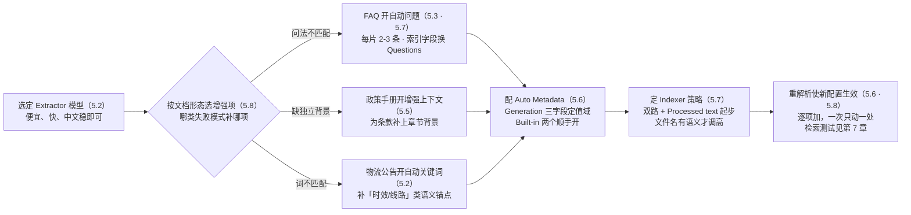
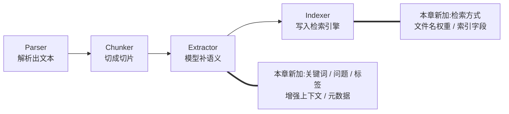

# 第 5 章 检索增强与索引

> 本章导读：第 4 章结束时，`after-sales-kb` 的三份文档已经切成了像样的切片（Chunk）——但切片质量合格不等于检索能命中。用户问「退货的钱多久到账」，政策手册里的原文写的是「退款时效」，词都对不上；FAQ 切片是标准问句，用户的问法却千奇百怪；政策条款被切成独立切片后，脱离了所属章节，单独看不知所云。本章讲解析切片之后的第二战场：Extractor（提取器）用模型给切片补语义（自动关键词、自动问题、标签、增强上下文、元数据），Indexer（索引器）决定用哪种检索方式、把哪些字段写进索引。读完本章，你能：为每类文档选择该开的增强项并说明成本；配置 Auto Metadata 的 Generation 与 Built-in 字段；选定检索方式与索引字段，并说清前置依赖与生效时机。



*本章操作流程图*

## 你什么时候需要它

三种典型处境，对应本章三种用法。

**切片内容没问题，检索测试（Retrieval Testing）却总召不回**——先分清是「词不匹配」还是「问法不匹配」：换同义说法召不回，看 5.7 的检索方式（开 Embedding 双路）；用户问句与陈述式原文形态对不上，看 5.3 自动问题与 5.7 的 Questions 索引字段。

**召回了，但切片单独看不懂**——条款、短段落类内容脱离原文丢背景，看 5.5 增强上下文。

**知识库大了，要按类目、日期、站点收窄检索**——看 5.4 标签与 5.6 Auto Metadata：本章把字段准备好，过滤动作在第 7 章检索测试里验证。

前置：第 4 章的解析方法与 Chunker 参数；第 3 章的数据集（Dataset）创建与 Embedding 模型。

## 5.1 概述：解析切片之后的第二战场

先定位本章在管线中的位置。第 4 章讲完了前两段，本章是后两段：



*四段管线：第 4 章交付前两段，本章交付后两段*

按官方文档的分工：**Extractor 在切片之后为切片添加信息**——用模型生成关键词、问题、标签、上下文摘要与元数据，「这些添加物可以改进后续的检索与问答」；**Indexer 决定切片如何被索引并写入检索引擎**——用哪种检索方式、哪些内容字段参与索引。

为什么需要这两段？本书把「切片切得很好，检索还是召不回」归纳为四种失败模式（本书立场，官方文档按功能逐一描述，未给出此框架）：

| 失败模式 | 症状 | 病因 | 解法 | 见 |
|---------|------|------|------|----|
| 词不匹配 | 换个说法就召不回 | 索引只认关键词，同义改写匹配不上 | Embedding 向量检索 | 5.7 |
| 问法不匹配 | 用户问句对不上陈述式原文 | 索引里只有内容，没有「能答它的问题」 | 自动问题 + Questions 字段 | 5.3 / 5.7 |
| 缺分类维度 | 召回太宽，无法按类目收窄 | 切片只有内容，没有分类属性 | 标签 + 元数据 | 5.4 / 5.6 |
| 缺独立背景 | 召回了，切片单独看不懂 | 切片脱离原文，丢失上下文 | 增强上下文 | 5.5 |

四种模式的分工：Extractor 负责「补内容」（问法、分类、背景都要先存在于切片上），Indexer 负责「定策略」（词不匹配靠换检索方式；补出来的内容是否入索引也由它决定）。两段都做完，才有第 7 章检索测试的可调之物——先有增强，后有调优。

这里有一条贯穿全书排查思路的原理，官方检索测试文档把它写成排查顺序：**文档解析 → 切片 → 元数据 → 检索参数**——先确认知识内容本身已正确进入数据集，再调检索参数。原因很朴素：检索参数只能在**已入索引的内容**里挑，索引里没有的东西，阈值调到多低、权重怎么配都召不回。所以遇到「召不回」，先回到本章问「该在切片上的内容在不在」，再去第 7 章动参数。本章就是这条排查链第三环之前的全部工程。

## 5.2 Extractor：模型与自动关键词

Extractor 各增强项共用一个模型入口：**Model** 下拉框选定 Extractor 所用模型。官方文档明确：自动关键词、自动问题、增强上下文、以及需要模型生成的元数据，**都调用这个选定的模型**。可选范围取决于系统已配置的模型供应商（→ 第 2 章模型通道）。

**本书立场**：Extractor 的活是「读一段切片、输出结构化短文本」，对推理能力要求不高、对调用量敏感——选一个便宜、快、中文拿得稳的模型即可，不必把最好的推理模型耗在这里。真正的模型分级，留给 PDF 解析的视觉模型（第 4 章）。

### Automatic Keywords：给切片加语义线索

开启后，系统自动为每个切片提取能代表其主要内容的关键词或短语：

| 参数 | 作用 |
|------|------|
| `Number of automatic keywords` | 每个切片生成的关键词数量；设为 **0** 禁用 |
| `System prompt` | 发给模型的指令，可定制 |

默认 prompt 的逻辑（官方文档）：让模型分析文本，提取最重要的 `{{ topn }}` 个关键词或短语。你可以改写它来指定关键词的类型、输出语言或格式——比如要求只输出产品词、限定中文、或强制 `key: value` 格式。

关键词的价值官方一句话说清：「生成的关键词为切片添加语义信息，帮助检索与内容匹配」。本书的理解：关键词是从切片内容里**显式化**的语义锚点——原文写「退款会在审核通过后 3-5 个工作日原路退回」，关键词把「退款时效」「原路退回」拎到明面上，让改写过的用户查询有词可撞。它与 5.7 的 Embedding 是互补关系：向量管「意思相近」，关键词管「字面可对」。

两个使用边界：

- **数量克制**：关键词是索引的补充信号，不是切片摘要——每片三五个足矣，数量堆高会让噪声词稀释真正有区分度的锚点；拿不准就从更少起步；
- **prompt 定制对准检索**：改 `System prompt` 最有价值的方向是**对准你用户的用词**——比如要求关键词包含业务术语与俗语两种写法（「退款」与「钱退回来」），或限定输出语言与查询语言一致。定制是为匹配服务的，偏离这一点，再漂亮的关键词也只是切片上的装饰。

## 5.3 自动问题（Automatic Questions）：为每片生成可答问题

**Automatic Questions** 为每个切片自动生成「这片内容能回答的问题」——官方的定位是「为内容添加查询式的表达」。

| 参数 | 作用 |
|------|------|
| `Number of automatic questions` | 每个切片生成的问题数量；设为 **0** 禁用 |
| `System prompt` | 默认让模型理解文本，生成 `{{ topn }}` 个与主要内容相关的问题 |

官方对生成质量有两个要求：问题应**覆盖切片的重要信息**，且**不重复同义**。生成的意义在官方文档里同样直接：「让文档内容更容易与用户的自然语言问题匹配」。

这里有一个贯穿本章的关键衔接：生成的问题不只是切片上的「注释」——它是一个**可入索引的字段**。5.7 会看到，Indexer 的 `Fields` 可以选 `Questions`，让用户的提问直接与预生成问题做匹配。这就是问答式知识库的核心配合：**素材是陈述句，查询是问句，自动问题在两者之间架桥**。

容易混淆的一点：自动问题与第 4 章的 **Q&A 解析方法**不是一回事。Q&A 解析方法处理的是「素材本身就是问答对」的文档——每对问答切成一个切片；自动问题则是**给任何已切成型的切片补问题**，素材可以是陈述句、条款甚至表格行。两者可以叠加：`product-faq.xlsx` 用 Table 方法把每行 FAQ 切成切片（素材本身是问答对），再开自动问题为每个答案生成多种问法——前者决定「切什么」，后者补「还能怎么问」。

`after-sales-kb` 的落地：商品 FAQ `product-faq.xlsx` 的切片本就是问答对，但用户的真实问法千奇百怪——「钱什么时候到」「怎么还不退款」「退款进度哪里查」指向同一条 FAQ。对这份文档开自动问题，让模型把同一答案的多种问法预演出来，问题字段入索引后，问法层面的召回率不再依赖 FAQ 原文的措辞。而政策手册、物流公告是陈述性文档，本书立场：**先不开**，等第 7 章测试证明问法召回确有问题再加。

## 5.4 标签（Tags）：分类维度的前置准备

**Tags** 用一份**预先准备好的标签文件**为切片提取或匹配标签。与其他增强项不同，它不是凭空生成——系统基于你选定的标签集，为切片**匹配或生成**标签。

| 参数 | 作用 |
|------|------|
| `Number of automatically extracted tags` | 每个切片自动提取的标签数量；设为 **0** 禁用 |
| `Tag file` | 选择用于标签提取的文件 |

官方对使用前提写得明确：**使用此功能前，先为知识库准备一份合适的标签文件**；并给了一句值得记住的判断——「设计良好的标签体系可以支撑内容分类、检索与过滤」。

「前置准备」是这一节的重点。标签的价值不在提取那一刻，而在你设计的标签体系：

- **分类要闭环**：标签集应覆盖业务的全部分支（如售后域的「退换货 / 物流 / 支付 / 账户 / 发票」），而不是等模型自由发挥；
- **粒度要克制**：标签是过滤维度，不是摘要——一个切片挂 2-4 个标签足够，挂太多等于没挂；
- **文件先行**：先写好标签文件、再开提取，模型在给定的标签集里做选择，结果才可控。

准备标签文件的两个实用来源（本书立场）：一是从既有业务分类抄——工单系统的问题分类、客服团队的话术分组，这些分类经过了真实流量的检验；二是从检索测试的失败样本归纳——第 7 章里「召回了但答非所问」的切片，聚一聚类，往往就是缺的那个分类维度。标签文件的具体格式以界面支持的规格为准（待实测，见章末复核清单）。

标签与 5.6 的元数据都提供分类维度，分工不同（本书立场）：标签是**切片级**的内容分类，模型逐片打；元数据是**文档级**的结构属性，解析时一次生成、可人工维护。要按「这份文档是什么」过滤，用元数据；要按「这段内容讲哪类事」过滤，用标签。

## 5.5 增强上下文（Augmented Context）：治切片失忆

切片是把文档**切碎**的艺术，而切碎有代价：切片脱离原文后，丢失了它所处的背景。政策手册里「时限为 30 个自然日」这样一个切片，单独看根本不知道在说什么的 30 天——退货？换货？还是退款申请？

**Augmented Context** 针对的就是这个问题：为每个切片生成一段简洁的上下文摘要，作为补充信息附在切片上，让它在脱离源文档时仍保有必要的背景。官方给的适用描述正是上面这类场景：「切片可能在切分后丢失重要背景，例如只含一个短段落的切片，可以获得其主题与上下文的摘要，帮助检索与模型理解」。

| 参数 | 作用 |
|------|------|
| `Enable augmented context` | 开关；开启后调用所选模型为切片生成上下文信息 |
| `System prompt` | 默认要求生成**忠实于源内容**的简洁摘要，**不引入原文没有的信息** |

默认 prompt 的两个约束值得留意：「忠实」「不引入原文没有的信息」——增强上下文的定位是**背景补全**，不是观点发散。若你改写 prompt，守住这条底线。

**成本提醒**（官方原文）：开启此功能会增加模型调用与 token 消耗——每个切片都要过一次模型，50 页政策手册切出的切片数量乘上去，是一笔实打实的账。本书立场：**只对「脱离背景就难懂」的文档开**，不是所有文档的默认项。

判断「要不要开」的一个快速自查（本书立场）：随机抽三个切片，盖住文档名只看切片正文，问自己三个问题——这片在讲哪个文档的哪部分？它约束的对象是谁？它和相邻切片是什么关系？三问有两个答不上来，这片内容就依赖背景，值得开增强上下文；三问都答得上来（FAQ、独立公告就是典型），省下这笔调用。

拿两片真实感的切片对照一遍：

```text
切片 A:「卖家应在签收后 7 个自然日内发起换货申请,逾期系统自动关闭入口。」
  讲哪个文档的哪部分?——不知道(换货政策?物流政策?)
  约束谁?——不知道(卖家还是买家?哪个站点?)
  → 两问答不上,依赖背景,值得开增强上下文

切片 B:「问:退款多久到账?答:3-5 个工作日原路退回。」
  三问都能答——FAQ 自带问答结构与主语
  → 不需要增强上下文,预算留给切片 A 这样的内容
```


`after-sales-kb` 的落地：售后政策手册 `after-sales-policy.pdf` 按章节结构切片后，条款经常独立成片——「时效」「适用范围」「责任划分」散在各自切片里，没有章节语境就读不懂。这份文档开增强上下文，让每个条款切片带上「本条属于退货政策第 X 节，规范……」式的背景；而 FAQ 切片自带问答结构、公告切片短小自足，都不需要。

## 5.6 Auto Metadata：自动元数据

元数据（Metadata）为解析产出的内容添加结构化属性，官方列举的用途：**检索、过滤与内容管理**——比如按文档类型、部门、作者、主题、日期或业务分类收窄检索范围。第 3 章已介绍元数据的管理界面（见第 3 章），本节讲**自动生成**：让系统在解析时把元数据填出来，而不是人工逐份录入。

入口有两层：**Extractor 配置里的 `Enable metadata` 开关与 `Settings` 入口**，以及独立的 **Auto Metadata** 配置区。后者的两类字段是本节主体：

### Generation：自定义字段

**Generation** 定义要从文档内容生成的元数据字段。点击 **Add** 添加字段，按四要素配置：

| 要素 | 说明 |
|------|------|
| `Field` | 元数据字段名 |
| `Description` | 字段描述——向模型说明要从文档中提取或生成什么信息 |
| `Type` | 字段的数据类型 |
| `Values` | 字段的允许值，限制生成结果的值域 |

保存后，系统在**后续的文档解析**中，按这些字段定义从文档内容生成元数据。三个要素里，`Description` 与 `Values` 直接决定生成质量：描述写得越具体（「文档适用的站点，如全站/Shopee/Temu」，而不是「站点」两个字），值域收得越紧，模型越不容易生成五花八门的值。

拿 `after-sales-kb` 的 `doc_type` 字段走一遍生成流程：解析一份政策手册时，模型读到的是手册全文与字段定义——`Field: doc_type`，`Description: 本文档的类别,反映其在售后知识体系中的角色`，`Type: string`，`Values: 政策/FAQ/公告`——然后输出 `doc_type: 政策`。值域在这里兜底：即便模型一时犹豫「这是指南还是政策」，**Values 限定了它只能三选一**，不会自创「操作指引」「规范」之类的第四种答案。元数据要当过滤条件用，值域失控的过滤条件比没有更糟。

另有 **Built-in parser template** 选项：直接复用解析阶段已提供的结构化信息作为元数据源，不必重复定义同样的字段。

### Built-in：内建字段

**Built-in** 提供系统预定义的元数据字段，无需配置规则，用右侧开关选择是否在解析时生成：

| 字段 | 含义 |
|------|------|
| `update_time` | 记录文档更新时间 |
| `file_name` | 记录文档文件名 |

选好字段、打开开关、**Save** 即可。生成的元数据可用于文档管理与检索过滤；查看与编辑走 **Metadata management**（第 3 章）。

Built-in 字段看着朴素，却是巡检场景的基石：`update_time` 回答「这份文档多久没更新了」，`file_name` 回答「这条切片出自哪份文档」——第 13 章的质量巡检与文件治理都以这两个字段为盘点起点。它们不耗模型调用，没有理由不开。


### 生效时机：只管后来者

官方文档用一段专门的 Note 强调生效语义：**元数据生成设置的变更，只对之后新解析的文档生效，不会自动更新已解析完成的文档**；要把新配置应用到已有文档，必须**重新解析**这些文档。

这个语义与第 4 章表列角色的生效规则一致（改配置不动存量），是全书反复出现的模式：**解析期配置一律不追溯**。运营上的推论（→ 第 13 章）：调整元数据方案时，先在小范围文档上重解析验证，再批量重解析——「重解析」是元数据变更落地的唯一通道，别等上线后才发现字段没填上。

`after-sales-kb` 的落地：全部文档统一加三个 Generation 字段——`doc_type`（文档类型，值域：政策/FAQ/公告）、`effective_date`（生效日期）、`site`（适用站点，值域：全站/Shopee/Temu/1688）。这三个字段在第 7 章检索测试的 **Metadata** 过滤里直接可用（「只查 Shopee 站点的政策」），也是第 13 章质量巡检的盘点维度（「哪些政策文档超过一年未更新」）。`update_time` 与 `file_name` 两个 Built-in 字段顺手打开——零模型成本，见 5.8。

## 5.7 Indexer：索引策略

Extractor 把内容补在切片上，Indexer 决定**怎么索引、索引什么**。先记一个官方说明：Indexer 使用数据集已配置的 Embedding 模型（第 3 章），**此处无需再选模型**。三个决策点，建议按序过一遍：


*Indexer 三个决策点的顺序：先定路，再定权，最后定字段*


### 检索方式：三选一或多选

`Search methods` 决定建立哪种索引：

| 方式 | 机制 | 适用场景 |
|------|------|---------|
| `Embedding` | 生成向量表示与向量索引，语义检索 | 查询与原文用词不同也应召回——问法多样、表述自由的场景 |
| `Full-text` | 建全文索引，关键词匹配 | **精确词**：货号、品名、技术术语、代码——必须字面对上的内容 |
| `Embedding + Full-text` | 双索引，语义与关键词都参与 | 两者都要；官方对多数知识库的默认建议 |

官方建议原文值得抄录：「对多数知识库，可以同时启用 **Embedding** 与 **Full-text**，并索引 **Processed text**」。本书立场：**默认双路起步**，只在有明确理由时收窄——纯精确词查询（配件货号库）可只留 Full-text 省资源；纯语义问答库可考虑只留 Embedding。双路的得分权重（`Vector similarity weight`）是第 7 章的调优对象，此处先把两路都建上。

### Filename embedding weight：文件名的语义权重

`Filename embedding weight` 控制文件名在**向量表示**中的权重——文件名与切片内容一起贡献语义，值越高影响越大。官方给的调整准则：

- **调高**：文件名明确表达文档主题时——`after-sales-policy.pdf`、`product-faq.xlsx` 这类「看名知义」的命名，文件名是免费的语义信号；
- **调低**：文件名是随机标识符或无实义时——`scan_20260301_0042.pdf`、`doc_final_v3.pdf`，高权重只会往向量里注噪声。

本书立场：这个参数的前提是**命名纪律**（→ 第 13 章运营规范）——文件名有语义才谈权重；团队做不到规范命名，就把它调低，别让坏名字污染向量。

### 索引字段：三选与前置依赖

`Fields` 指定用于索引与检索的内容：

| 字段 | 索引的内容 | 前置依赖 | 适用 |
|------|-----------|---------|------|
| `Processed text` | Parser、Chunker 等前置步骤产出的切片正文 | 无 | 最直接；**默认选择** |
| `Questions` | Extractor 自动问题生成的问题 | **须先配置自动问题提取**（5.3） | 问答式知识库：用户提问直接匹配预生成问题 |
| `Augmented context` | Extractor 生成的上下文，而非仅原切片内容 | 须先开启增强上下文（5.5） | 切片需要额外背景才能有效检索 |

官方建议：若已启用 Automatic Questions 或 Augmented Context，「按你预期的查询类型，考虑索引 Questions 或 Augmented context」。注意两个前置依赖都指向本章前文：**索引字段不是自由选项，开哪个字段取决于你先开了哪个 Extractor 功能**——没开自动问题却想索引 Questions，是无米之炊。

`after-sales-kb` 三份文档的增强配置差异表（本书配置立场）：

| 文档 | Extractor 增强 | Indexer 选择 | 理由 |
|------|---------------|-------------|------|
| `product-faq.xlsx` | 自动问题（每切片 2-3 条） | 双路检索 + `Questions` 字段 | 用户问法千奇百怪，问句对问句匹配 |
| `after-sales-policy.pdf` | 增强上下文 | 双路检索 + `Processed text` | 条款需背景，但查询以语义陈述为主 |
| 物流时效公告 | 自动关键词 | 双路检索 + `Processed text` | 短文档，仅补「时效/线路」类语义锚点 |
| 全部文档 | 元数据：3 个 Generation 字段 + 2 个 Built-in | —— | 文档级属性，为第 7 章过滤、第 13 章巡检铺路 |

三份文档配置各不相同——这正是本章的方法论：**增强按文档形态定制，不做全库一刀切**。基线仍是双路 + `Processed text`，增强项在其上按需叠加。表中的每一格都不是拍脑袋定下的，而是 5.8 的上线顺序在 `after-sales-kb` 上逐项测出的结果；测法与回退判据见 5.8。

## 5.8 成本账与生效语义

增强不是免费的。开每一项之前，先过一遍这张账（依据官方文档对各功能的模型调用说明整理）：

| 功能 | 模型调用 | 官方成本表述 | 起点建议（本书立场） |
|------|---------|-------------|---------------------|
| 自动关键词 | 每切片一次，走 Extractor 模型 | 帮助检索与内容匹配 | 检索测试有词不匹配时再开，数量从少起步 |
| 自动问题 | 每切片一次 | 更易与自然语言问题匹配 | 问答式文档才开 |
| 标签 | 逐片提取，基于已备标签文件 | 支撑分类、检索与过滤 | 有过滤需求再开，标签文件先行 |
| 增强上下文 | 每切片一次 | **明确注明：增加模型调用与 token** | 仅「脱离背景难懂」的文档 |
| 元数据 Generation | 解析时按字段生成 | **可能增加模型调用与 token** | 按过滤需求定义，字段宁少勿多 |
| 元数据 Built-in | 无（系统预定义） | —— | `update_time`/`file_name` 顺手开 |
| Indexer 配置 | 无额外（复用数据集 Embedding 模型） | —— | 双路 + `Processed text` 默认 |

算量级的方法：每项「每切片一次」的功能，成本 ≈ 切片总数 × 单次调用 token。50 页政策手册切 200 片，五项增强全开就是上千次模型调用——这也是「按文档形态定制」的经济学依据。

**上线顺序，本书立场**：先裸切片基线 → 再逐项加增强 → 每次只动一处。

1. **基线**：第 4 章的解析切片产物，Indexer 用官方默认（双路 + `Processed text`），先跑第 7 章的检索测试，拿到「什么都没增强」的召回基线；
2. **逐项加**：基线暴露哪类失败模式，就补哪项增强——问法不匹配加自动问题，缺背景加增强上下文，每加一项重跑同一组测试问题对比；
3. **一次一处**：同时开三项再测，好坏说不清归因；单变量改动才有结论。

放到 `after-sales-kb` 上，这个顺序就是五步：①三份文档裸切片入索引，跑测试问题组，记下哪些问法召不回；②FAQ 召回弱在问法 → 只给 `product-faq.xlsx` 开自动问题、索引字段换 `Questions`，重跑；③政策条款召回对但「看不懂」投诉多 → 只给 `after-sales-policy.pdf` 开增强上下文，重解析，重跑；④发现无法按站点收窄 → 加三个 Generation 元数据字段，重解析全部文档；⑤每一步的前后对照留在测试记录里，成为增强投入的依据。若测到某一步增强无收益，就回退它——增强清单是测出来的，不是开出来的。

这套流程让第 7 章的检索测试从「验证工具」变成「增强效果的度量衡」——每次配置变更都有前后对照。若要把对照沉淀为长期指标（召回率趋势、增强项各自的贡献），在上线时埋评估点位，trace 细节（→ langfuse 书）一句带过：字段级召回对比是增强投入是否值得的最终裁决。

生效语义在此收拢：本章所有配置——Extractor 增强、元数据、索引字段——都遵循「**改动只对新解析生效**」（5.6 的官方 Note；索引字段随下次解析写入）。改完配置记得重解析，再进第 7 章测试；测试参数只影响当次测试、不同步到应用，定了参数要去应用侧配置——这个衔接第 7 章展开。

## 本章小结

1. **四段管线的后两段**：Extractor 给切片补语义，Indexer 定索引策略——切片合格只是入场券，召回要靠这两段（承第 4 章）。
2. **四种召回失败模式各有其药**：词不匹配→Embedding；问法不匹配→自动问题；缺分类维度→标签+元数据；缺独立背景→增强上下文（本书归纳）。
3. **Extractor 一个模型入口**：关键词/问题/标签/上下文/元数据生成全走选定模型；prompt 均可定制，默认逻辑围绕 `{{ topn }}` 与忠实摘要。
4. **自动问题与 Questions 字段是问答式知识库的核心配合**：问题先被生成，才谈得上被索引——索引字段受 Extractor 前置约束。
5. **元数据两类字段**：Generation 四要素（字段/描述/类型/值域），Built-in 零成本；变更只对新解析生效，存量靠重解析。
6. **索引策略默认双路 + `Processed text`**：文件名权重跟着命名纪律走；增强按文档形态定制，不全库一刀切。
7. **成本与顺序**：每项增强都是模型调用量 × 切片数；先基线、逐项加、一次一处，用第 7 章测试度量每步收益。

## 验收清单

读到这里，你应该能：

- ☐ 说出四种召回失败模式的症状与各自对应的增强手段，并指出哪几种由 Extractor 解决、哪种由 Indexer 解决；
- ☐ 为 `after-sales-kb` 三份文档复述增强配置差异表，并解释「为什么 FAQ 开自动问题、政策手册开增强上下文」；
- ☐ 改写一次自动关键词的 `System prompt`（如限定输出语言与格式），并说明默认 prompt 中 `{{ topn }}` 的含义；
- ☐ 配置一个含值域限制的 Generation 元数据字段，并解释 `Description` 写法的质量影响；
- ☐ 解释「为什么改了元数据配置、已有文档没变化」，并完成一次重解析使其生效；
- ☐ 为一个数据集选定检索方式与索引字段，说出 `Questions` 与 `Augmented context` 字段的前置依赖；
- ☐ 估算给定文档集在开启三项增强后的模型调用量级。

## 延伸阅读

- **第 4 章（解析与切片）**——上游工程：增强与索引都建立在切片质量之上，切片切坏了增强救不回。
- **第 7 章（检索测试与调优）**——下游闭环：本章每一项增强都要在那里过测试；混合检索权重、Metadata 过滤、排查顺序。
- **第 3 章（数据集）**——元数据管理界面与 Embedding 模型配置，本章自动元数据的查看与编辑入口。
- **第 13 章（团队协作与知识库运营）**——文件命名纪律、重解析批量操作、元数据巡检，本章生效语义的运营面。
- **官方文档 Configuration 原文**——本章逐节的依据（Extractor Configuration / Indexer Configuration / Auto Metadata）。

## 复核清单（发布前）

- [ ] 全章对照 configuration.md 原文（v1.0.0-rc2，核实日期 2026-10-27）
- [ ] 各数量参数的界面默认值（自动关键词/问题/标签数量、`Filename embedding weight` 初始值）官方文档未给出，待实测界面后补
- [ ] Generation 字段 `Type` 支持的类型枚举待实测确认（正文示例仅用 string）
- [ ] `Fields` 三字段能否多选共存（如 `Processed text` 与 `Questions` 同选）待实测
- [ ] 自动问题与增强上下文的实际生成效果（数量、质量、token 用量）待环境就绪后实测
- [ ] mermaid 两图 GitHub 网页端渲染检查
