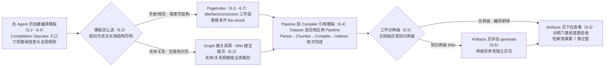
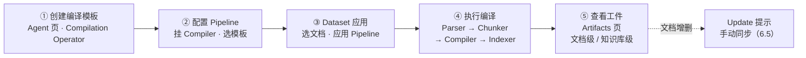

# 第 6 章 知识编译与知识工件

> 本章导读：第 4 章把《售后政策手册》（after-sales-policy.pdf）切成了切片，第 5 章又给切片装上检索增强，客服问「运输破损的赔偿标准是多少」已经能稳定召回。但客服紧接着会问：「手册一共几部分？退货流程在第几章？这次改版动了哪些条款？」——切片答不了这些问题：切片是「点」，结构性问题是「面」。本章讲 RAGFlow 的答案：知识编译（Knowledge Compilation）——在切片之上，用 LLM 把文档再加工为结构化的知识工件（Artifact）：导航索引、图谱、树、思维导图、时间线、Wiki 页。本章覆盖：六类内建模板怎么选、专属配置面怎么调、模板如何经 Ingestion Pipeline 应用、工件在 Artifacts 页怎么查看与更新、常见的坑，以及贯穿案例——给售后手册生成导航工件，让客服 Agent 先看目录再下钻检索。读完本章，你能：为任意文档选对编译模板；走通从模板到工件的完整流程；建立工件随文档改版同步的运营节奏。



*本章操作流程图*

## 你什么时候需要它

三种典型处境，对应本章三种用法。

**文档结构清晰（手册、报告、规范），用户问的是「哪一章讲什么」而不是具体知识点**——看 6.3 选 PageIndex 或 Tree 模板，再看 6.7 贯穿案例：导航工件让问答先给目录、再下钻检索。

**想把文档里的实体关系（人、组织、产品、条款）抽出来做关联查询，或把散落的文档沉淀成互链的 Wiki 页**——看 6.3 的 Graph 与 Wiki 模板配置面；两者都是实体/关系规格驱动的。

**编译跑完了却看不到工件、结果不符预期、改了模板没生效**——直接看 6.6：Wiki 要在 Artifacts 页手动 generate，改模板不会自动重编译，这类行为与直觉相反的条目都归在那里。

前置：第 3 章的数据集（贯穿案例为 after-sales-kb）已就绪；第 4 章的解析与切片、第 5 章的索引与增强已调通——知识编译加工的正是这些产物。

## 6.1 概述：切片之上再加工

官方定义一句话（docs/guides/knowledge_compilation/overview.md，核实日期 2026-10-27）：**知识编译把非结构化文档转化为结构化的知识内容——系统用大语言模型分析文档中的信息，按用户选择的编译模板生成不同类型的知识工件**。生成出的工件可用于知识检索、智能问答与 Agent 应用，帮助用户快速理解和使用文档中的关键信息。

第 4 章说过，切片解决的是「语义匹配要小而聚焦」的检索粒度问题；知识编译解决的是另一个维度——**把切片与解析结果重新组织成「有结构的知识」**。两者的分工可以这样记：

```text
切片（Chunk）管「点」：运输破损的赔偿标准是多少？→ 召回赔偿条款切片
工件（Artifact）管「面」：手册分几部分？退货流程涉及哪些章节？
                          → 层级索引先给目录，再下钻定位
```

当前支持六类知识工件（overview 原文，模板名保持界面半角原样）：

| 工件类型 | 模板名 | 适用文档形态 | 一句话能力 |
|---------|--------|-------------|-----------|
| 知识图谱 | Graph | 人物关系、组织结构、产品关系类内容 | 展示文档中的实体及其关系 |
| 知识树 | Tree | 章节结构、主题分类、知识体系 | 按层次组织文档内容 |
| 页面索引 | PageIndex | 手册、规范、报告 | 保留原始文档结构，增强章节定位 |
| 思维导图 | MindMap | 需要快速把握整体结构的文档 | 围绕核心主题展开内容关系 |
| 时间线 | Timeline | 历史资料、项目记录、事件追踪 | 按时间顺序组织事件信息 |
| 知识页 | Wiki | 企业知识、产品资料、领域知识 | 生成互相关联的知识页 |

**与数据集的关系**：工件不是游离于数据集之外的新对象——它由知识编译基于**数据集中的文档与解析结果**再加工生成，经数据集的 **Artifacts** 页查看浏览；但工件的创建与维护（模板配置、生成、更新、再生成）不在 Artifacts 页完成，而在编译模板与 Pipeline 侧（dataset Artifacts 文档原文）。按生成范围工件还分两级：文档级与知识库级——这条分界线是本章最重要的行为差异，6.5 展开。

背景放一句就够：官方把 RAG 的演进方向定位为 **Agent 上下文引擎（Agent Context Engine）**的基础——LLM 的表现瓶颈不在模型智能，而在所接收上下文的质量；上下文引擎的知识核心（Knowledge Core）靠 TreeRAG、GraphRAG 这类结构化检索弥合语义鸿沟（docs/basics/agent_context_engine.md）。知识工件正是这个定位在产品里的落点：**切片是给检索器的原料，工件是给 Agent 的结构化上下文**——Agent 拿到的不只是若干相关片段，还有「知识长什么样」的骨架。第 1 章术语表提过，知识编译在 v0.27.0 起重构，取代了独立的 GraphRAG 与 RAPTOR 入口——站在第 6 章回看：Graph 模板承接图谱类需求，Tree 模板承接层级摘要类需求。

## 6.2 知识编译总览：五步流水线

### 三个核心概念

| 概念 | 英文 | 一句话定义 |
|------|------|-----------|
| 编译模板 | Compilation Template | 定义知识编译如何生成：抽取哪些信息类型、按什么结构组织、遵循什么生成规则 |
| 知识工件 | Knowledge Artifact | 知识编译产出的结构化结果：Graph、Tree、PageIndex、MindMap、Timeline、Wiki |
| 编译节点 | Compilation Node | 编译流程中执行指定编译任务的处理节点，使用时需关联对应编译模板 |

三者是「规则 → 产物 → 执行位」的关系：模板定义怎么编，工件是编出来的结果，编译节点是 Pipeline 里挂载模板的执行位。

### 标准工作流（五步）



逐步对应官方文档（overview 的 Standard Workflow）：

1. **创建知识编译模板**：在 Agent 页面新建 Agent 时选择 **Compilation Operator**，然后按要生成的工件类型创建模板并完成参数配置——注意入口在 Agent 页而非知识编译功能自身，初次使用容易在这里找错地方；
2. **配置 Ingestion Pipeline**：把 Compiler 加入 Pipeline，并选择创建好的编译模板；
3. **应用 Pipeline**：在 Dataset 中选择要处理的文档，应用配置好的 Pipeline；
4. **执行知识编译**：系统按 Pipeline 配置解析文档，按所选模板生成对应工件；
5. **查看知识工件**：编译完成后，在 Artifacts 页查看 Graph、Tree、PageIndex、MindMap、Timeline 或 Wiki。

典型管线一图流：**Parser 负责解析，Chunker 负责切分，Compiler 负责知识编译，Indexer 负责为后续检索建索引**。也就是说，Compiler 插在第 4 章的切分与第 5 章的索引之间——切片之上、入库之前。

### 触发、生成、更新

把官方散在各文档的行为按生命周期归拢：

| 阶段 | 行为 | 出处 |
|------|------|------|
| 触发 | 模板被 CompilerOperator 引用、且文档实际执行了含 Compiler 的 Pipeline，才生成工件——**模板只定义「怎么编译」，本身不产出任何东西** | apply 文档原文 |
| 生成 | 文档级工件（Graph/Tree/PageIndex/MindMap/Timeline）随文档编译直接产出；知识库级工件（Wiki）编译完成后还需到 Artifacts 页手动 generate | apply 文档原文 |
| 更新 | 系统持续检测数据集内文档变化，但**不会自动重新生成工件**——文档增删后显示更新提示，需人工点击 Update 同步 | apply 文档原文 |

三条里两条「不会自动」——这是知识编译与第 4、5 章「改配置重解析即生效」的心智差异所在，也是 6.6 最多问题的来源。

### 动手前的准备

官方列的四个前提，逐条对照：可用的 LLM 已配置，且模型有较强的文本理解、结构化输出与推理能力（第 2 章的模型通道）；已创建或计划创建含 Parser、Chunker、Compiler、Indexer 的 Ingestion Pipeline；主题清晰、内容可靠的源文档就绪；已按目标知识结构确定模板类型。另有一条官方建议值得当纪律执行：**首次使用先选少量代表性文档试跑，确认输出结构与质量后再放量**——编译是 LLM 重活，全量返工的代价比解析大一个量级。

## 6.3 内建模板与专属配置

### 模板怎么选

选模板的本质是「文档形态 → 知识组织方式」的映射（模板选择建议表，overview 原文）：

| 模板 | 适用场景（官方原文归纳） |
|------|------------------------|
| Graph | 抽取文档中的实体及实体间关系，如人、组织、产品及其关系 |
| Tree | 按主题与层次组织文档内容，把知识整理为树形结构 |
| PageIndex | 保留文档原始章节与页面结构，构建层级索引，用于快速定位与检索 |
| MindMap | 抽取核心主题与分支内容，以思维导图展示知识结构 |
| Timeline | 含明确时间信息与事件的文档，按时间顺序组织展示事件 |
| Wiki | 内容量大、主题间有关联的文档，组织为互相关联的 Wiki 页 |

本书立场：把这张表读成一个判断句——**你要的不是「最先进的工件」，而是「与文档天然结构同构的组织方式」**。手册有天然章节树，强抽图谱是舍近求远；客服纪要里全是「谁因为什么找了谁」，硬排时间线则丢失关系。选错模板是工件质量差的第一原因，且这个错误发生在编译之前，调参数救不回来。

### 专属配置面一览

选定模板后，可在全局规则与模板专属配置两个层面调整（overview 原文）。六个模板的专属配置面：

| 模板 | 专属配置项 |
|------|-----------|
| Graph | 全局规则；EntitySpecification；RelationSpecification；Re-splitting Parser output |
| Tree | 全局规则；Summarization Prompt（含 Claim Extraction Prompt）；Maximum Tokens；Clustering Threshold；Clustering Ratio；Re-chunk by Tree Leaves |
| PageIndex | 全局规则；Re-chunk parser output；EntitySpecification（字段）；RelationSpecification |
| MindMap | 全局规则；EntitySpecification（节点类型）；RelationSpecification（关系）；节点增删改 |
| Timeline | 全局规则；EntitySpecification（timestamp/event）；RelationSpecification（ordered） |
| Wiki | 全局规则；Wiki mode；EntitySpecification；RelationSpecification；ClaimSpecification；ConceptSpecification；Blueprint（含 Instruction） |

其中 Graph、Tree、PageIndex 与贯穿案例关系最近，展开如下；MindMap 与 Timeline 配置面较薄（节点四类 CentralTopic/Branch/Sub-branch/Keyword；实体仅 timestamp/event 两类、关系仅 ordered 一条），按表取用即可。

### 实体与关系规格：Graph 与 Wiki

EntitySpecification 与 RelationSpecification 是图谱类模板的核心：每条规格都有 **Type（类型名）/ Description（定义与范围）/ Rule（抽取约束）** 三件套。系统默认提供的类型——

| Graph 默认实体 | Wiki 默认实体（在其基础上增加） |
|---------------|------------------------------|
| person、org、product、regulation、location、other | 另有 system（技术系统/平台/框架）、equipment（设备/硬件），共 8 类 |

| Graph 默认关系 | Wiki 默认关系（在其基础上增加） |
|---------------|------------------------------|
| owns、part_of、caused_by、regulates、located_in、other | 另有 uses（使用关系），共 7 类 |

官方配置建议（built_in_templates 文档）浓缩为四条：**按业务只留需要的类型**，删除没有实际用途的默认配置以减少无效抽取；类型名与描述保持清晰，不用多个类型表达相似概念；关系语义要明确，避免过宽的定义；复杂场景用 Rule 字段补领域约束。例如全局规则可以写「只抽取文档中的核心人员、组织、产品与关键事件，实体名保持完整，无法确认的不生成实体」。

Wiki 另有三层扩展：**Wiki mode** 决定页面组织方式——Entity mode（实体模式，每个实体/概念一个页面）还是 Topic mode（主题模式，LLM 按关系与上下文把相关实体归入同一页面）；**ClaimSpecification** 抽取完整的事实陈述（要求关联实体来自已抽取信息、避免无法从文档验证的推测内容），适合需要知识核对的场景；**Blueprint** 定义页面结构模板，预置 Brand/Engineering/General/Market/Product/Interview 六种加 Custom 自定义，选中后可在 Example 区预览页面结构再决定生成。官方建议：企业知识库、产品文档这类结构复杂内容建议启用 Plan。

### Tree 的聚类参数

Tree 模板的最终形态由四个参数控制，是六个模板里工程参数最密集的：

| 参数 | 作用 | 调大 | 调小 |
|------|------|------|------|
| Maximum Tokens | 节点摘要的最大长度 | 保留更多摘要信息，适合复杂文档 | 摘要更精炼，适合快速浏览全貌 |
| Clustering Threshold | 内容聚类的匹配度 | 划分更严格，主题节点更细 | 相关内容更多被合并，结构更集中 |
| Clustering Ratio | Tree 结构中的聚类比例 | 层级更丰富 | 节点更少，整体更简洁 |

两处容易踩坑的细节：**Claim Extraction Prompt** 控制聚类前从叶子切片抽取原子论断（claim）的提示词，抽取结果带源切片证据，用于聚类以降低版式噪音的影响——留空用内建规则，仅在有领域特定需求时自定义；**Re-chunk by Tree Leaves** 开启后，RAGFlow 把每个叶子簇的源切片合并为一个新的检索切片（原切片保留但标记为不可检索），让最终检索边界跟随 Tree 的语义边界而非原始切片边界——**同一模板组中只能有一个 Tree 模板启用此选项**（built_in_templates 原文）。

### PageIndex 的字段与关系

PageIndex 按文档章节结构生成层级索引，配置面围绕「抽什么字段、建什么关系」：

- **EntitySpecification（字段）**：默认三字段——title（标题，保留原文，不带页码编号）、fact（关键事实/规则/定义）、conclusion（总结与重要结论）；每个字段同样有 Type/Description/Rule 三件套；
- **RelationSpecification（关系）**：章节间默认用 include 表示包含（文档含章节、章节含子章节），系统默认关系类型表中另提供 conclusion（结论关系）；
- **全局规则建议**（官方原文归纳）：保留原章节结构、优先用原文标题作索引节点名、只抽与章节主题相关的关键信息、无明确标题的内容不强行生成章节节点。

**Re-chunk parser output** 选项开启时，RAGFlow 会在运行 PageIndex 编译前按 Rechunking rules 重组解析切片——尽量保留原始内容顺序、标题层级与章节边界，并保持表格、列表、代码块完整，让编译输入更适合构建层级结构；关闭则直接使用 Parser 原始切片。

## 6.4 应用模板：从基础信息到 Pipeline

### 基础信息配置

创建或编辑编译模板，先完成基础信息——所有模板类型共有六项（basic_information_configuration 文档）：

| 配置项 | 说明 |
|--------|------|
| Template Name | 模板名称；建议按实际用途命名，让名称直接反映使用场景 |
| Template Description | 描述模板的功能、适用场景与主要处理内容 |
| Default Extraction Model | 默认抽取模型：编译时用它理解分析文档、按模板规则完成抽取与结构化生成 |
| Template | 选择要生成的工件类型：Graph / Tree / PageIndex / MindMap / Timeline / Wiki |
| Global Rules | 当前模板执行时统一遵循的要求；不同模板控制的范围不同（Graph 约束实体与关系抽取，Wiki 控制内容组织与生成） |
| Re-Split Parser Output | 控制 Compiler 是否在执行编译前对 Parser 输出重新组织切分；模板保存后，该设置在模板被用于编译时生效 |

**Re-Split 与 Chunker 的边界**（官方 FAQ 第 6 条原文归纳）：前者控制 Compiler 在编译前是否按当前模板的处理要求重组切分 Parser 输出，后者负责 Pipeline 中文档的切片处理——两者作用于**不同处理阶段**，Re-Split **不替代** Chunker。记住一句话：Chunker 切出的切片服务检索，Re-Split 只为编译重组输入。

### 在 Pipeline 中引用模板

模板创建后的落地四步（apply 文档原文）：

1. 创建或打开一个 Ingestion Pipeline；
2. 添加并连接 Parser、Chunker、Compiler、Indexer 四个节点；
3. 打开 CompilerOperator，从模板列表中选择目标 CompilationTemplate；
4. 检查节点连接与必填参数，保存 Pipeline。

再强调一次官方 Note 原文的分量：**CompilationTemplate 只定义「怎么编译」——只有当模板在 CompilerOperator 中被引用、且文档实际执行了这条 Pipeline，才会生成 KnowledgeArtifact**。只建模板不挂 Pipeline，什么都不会发生。

### 在 Dataset 中应用

1. 进入 Dataset 页面，创建数据集或打开已有数据集（贯穿案例即 after-sales-kb）；
2. 上传要处理的文档；
3. 在文件列表中选择 **Configure Ingestion Pipeline**；
4. 选择含 CompilerOperator 的那条 Ingestion Pipeline；
5. 开始解析，并在任务日志中确认 Parser、Chunker、Compiler、Indexer 依次完成。

一个必然遇到的规则：**模板修改后，已完成编译的文档不会自动重新编译**——需要按产品当前提供的操作重新解析或重跑 Pipeline，新配置才会生效（apply 文档原文）。运营上的含义：模板调优期把「改模板 → 重跑 → 对比工件」当作一个固定动作，而不是期待它热更新。

## 6.5 工件管理与消费

### 查看：Artifacts 页与两级工件

编译完成后，进入对应知识库（数据集），左侧栏选择 **Artifacts**；页面右上角下拉选择要查看的工件类型：**Wiki**、**To Skills**、**Tree/Page index**、**Graph**、**Mind map**、**Timeline**（apply 文档原文；dataset Artifacts 文档举例时也将这类层级索引形态称作 **Navigation**——命名以界面下拉项为准，本书在两种称呼间以「导航」指代 Tree/PageIndex 形态）。

两级工件的行为差异是本节重点：

| 生成范围 | 工件 | 生成方式 |
|---------|------|---------|
| 文档级 | Graph、Tree、PageIndex、MindMap、Timeline | 随文档编译直接产出；在文件列表点击文件名查看对应结果 |
| 知识库级 | Wiki（部分工件支持升级为库级） | 相关文档编译完成后，到 Artifacts 页点击 **generate**，系统基于当前库内编译结果生成；库级任务有独立日志 |

### 质检：六类工件各自的检查重点

工件生成后，按所用模板对照检查内容与结构是否符合预期（apply 文档原表，直接背下来当验收单）：

| 类型 | 检查重点 |
|------|---------|
| Graph | 实体是否重复；关系方向是否正确；是否存在无依据的节点或边 |
| Tree | 层级是否清晰；同级节点抽象层次是否相近；摘要是否准确 |
| PageIndex | 章节层级是否保留；事实与结论是否来自对应章节 |
| MindMap | 中心主题是否清晰；分支是否重复或交叉；节点名是否简洁 |
| Timeline | 时间是否准确；事件顺序是否正确；相对时间是否被误读 |
| Wiki | 页面主题是否合理；页面间链接是否有效；事实是否与来源一致 |

### 更新：提示制而非自动制

系统持续检测数据集中的文档变化，但工件**不会**随之自动重新生成——检测到变化时，工件页左上角出现 **Update** 按钮，旁边显示待更新文档数量。悬停提示区可查看具体变更：新增文档（工件生成后上传、尚未纳入）、被移除文档（已删除但相关内容尚未同步移除）与数量指示。确认需要同步后点击 Update，系统基于当前文档变化更新工件。规则一句话：**上传或删除文档本身不会立即更新已有工件，提示出现后需手动点击 Update**（apply 文档 Note 原文）。

### To Skills：工件到技能

Artifacts 页的 **To Skills** 把已生成的工件进一步整理转换为可复用、可被 Agent 使用的 **Skills**：进入 Artifacts 页打开工件 → 右上角下拉选择 To Skills → 系统从工件中抽取整理内容生成 Skills → 生成结果显示在 Skills 列表，点击可在右侧查看详情。生成的 Skill 通常包含 name、description，以及从工件中抽取整理的 rules、methods 或 instructions。两条特性：To Skills **不修改原始工件**，只基于现有工件派生；它架起了知识工件到 Agent 能力的桥——工件的「面」级结构，经 Skills 变成 Agent 可直接引用的方法论。

### 谁在消费

官方对工件用途的定位（overview 原文）：知识检索、智能问答与 Agent 应用。落到本书的章节地图上：

- **聊天助手**（见第 8 章）：数据集配置了编译工件后，问答侧的检索与引用如何受益，在聊天助手的配置语境里展开；
- **画布 Agent**（见第 10 章）：编译模板的创建入口就在 Agent 页（6.2 的 Compilation Operator），工件与 Skills 如何进入客服 Agent 的编排，是第 10 章客服 Agent 实例的输入之一；
- **检索测试**（见第 7 章）：工件建得好不好，最终要回到召回效果验证——「先目录后下钻」的导航路径是否真的改善定位，用检索测试说话。

本书立场：不要把工件当成又一个「生成后看一眼」的花瓶功能——**工件是数据集的二次资产**，切片服务单点召回，工件服务结构导航与方法论沉淀，一条知识链路里两者都在场。

## 6.6 常见问题与坑

官方 FAQ（knowledge_compilation/faq.md）八条，按「症状 → 处方」归四组。

**组一：编译完了，Artifacts 里看不到东西**

- *为什么编译完成后看不到 Wiki？*——Wiki 与其他工件的生成方式不同：Graph、Tree、PageIndex、MindMap、Timeline 是文档级工件，编译完成即可查看；Wiki 是知识库级工件，文档编译完成后还需到数据集的 Artifacts 页点击 generate。
- *为什么编译后根本没有生成工件？*——按序自查五连：Pipeline 里是否加了 Compiler；Compiler 是否选对了模板；编译任务是否执行成功；模板是否正确配置并保存；默认抽取模型是否可用。任务执行失败，用任务执行日志定位具体原因。

**组二：工件生成了，但结果不符预期**

- *工件不完整或与预期不符？*——生成质量受原文档内容、所选模板、默认抽取模型、模板配置共同影响。官方给的处理顺序：**先确认原文档解析结果完整，再调全局规则与对应模板参数，重新编译**。
- *结果不满意先调什么？*——解析正常的前提下，按序检查：默认抽取模型 → 全局规则 → 当前模板的具体配置参数；调整后重新编译并对比。
- *同一文档换模型结果为什么不同？*——模型负责实体抽取、内容理解与结构生成，不同模型在理解能力、上下文长度、生成能力上有差异；按文档类型、内容复杂度与所用模板选模型。

**组三：模板变更与多模板**

- *修改模板后，已生成的工件会自动更新吗？*——不会。需用更新后的模板重新执行编译，新配置才作用于生成结果。
- *同一文档能用不同模板吗？*——能。按使用场景选不同模板，生成不同类型的工件（Graph、Tree、PageIndex、MindMap、Timeline 等）。

**组四：概念辨析**

- *Re-Split Parser Output 和 Chunker 有什么区别？*——见 6.4：不同处理阶段，前者服务编译输入重组，不替代 Chunker。

本书立场补一条 FAQ 之外的坑：**别把「编译成功」当成「工件可用」**——任务日志绿灯只说明流程走完，六类检查表（6.5）才是验收线；尤其 Graph 的无依据节点与 Timeline 的相对时间误读，都是「跑通了但错了」的典型。

## 6.7 贯穿案例：给售后手册装上导航

回到贯穿案例。第 3-5 章之后，after-sales-kb 里的《售后政策手册》（after-sales-policy.pdf，50 页含表格）已经是切片齐全、索引就绪的检索素材——「运输破损的赔偿标准」这类点状问题已能稳定回答。现在补上「面」：客服人员高频的结构性问题——「手册一共几部分？退货流程在第几章？这次改版动了哪些条款？」

**选型**：手册是典型的「章节标题清晰、需要保结构快速定位」的文档——对照 6.3 的选型表，答案是 **PageIndex**（官方适用场景原话：books, reports, and specification documents）。不用 Graph：手册里的实体关系（商品-政策-渠道）稀疏且不值得建网；不用 Tree：Tree 侧重主题聚类摘要，而手册要的是忠实保留原章节结构。

**配置**：沿用默认底子，只动两处——全局规则按官方建议写明「保留文档原始章节结构，索引节点名优先采用原文章节标题，只抽取与章节主题相关的关键信息」；EntitySpecification 保留默认 title/fact/conclusion 三字段（正是客服要的「这章讲什么、关键条款是什么、结论是什么」）；关系保持默认 include。手册含大量表格（赔偿标准表），开启 **Re-chunk parser output**，让编译输入保住表格与章节边界。

**生成与验收**：在 after-sales-kb 的 Pipeline 中挂上 CompilerOperator 并引用模板，对手册执行编译；任务日志确认 Parser → Chunker → Compiler → Indexer 依次完成后，进入 Artifacts 页，在下拉中选择 **Tree/Page index** 查看（即本书记称的**导航工件**，官方 dataset 文档以 Navigation 称呼此类层级索引形态）。按检查表验收：章节层级与手册目录一致；各章 fact 确实来自对应章节（抽查「运输破损」与「清关延误」两章）；没有为无标题内容强行生成的节点。

**消费**：客服 Agent（第 10 章展开）处理结构性问题时的路径从「盲检索」变为「先目录后下钻」——先由导航工件给出「退货流程 → 第 4 章 → 4.2 退货时限与 4.3 退款方式」，再对命中的章节做精细检索。改版差异类问题（「这次改版动了哪些条款」）则靠更新机制：新版手册上传后，工件页出现 Update 提示与待更新数量，运营核对变更清单后手动同步。顺路把「退货流程」章节的 fact 用 **To Skills** 转成 Skill，沉淀为 Agent 可直接引用的退货操作规程——工件到技能的一步，在 Artifacts 页内完成。

**运营节奏**：手册按季度改版，工件随之进入固定循环——


这个循环没有一步是自动的——**改版重编译是运营动作，不是系统行为**。把它写进知识库更新 SOP（谁核对、谁点击、谁抽检、多久一次巡检），是第 13 章团队协作与知识库运营的正题。

## 本章小结

1. **切片管点，工件管面**：知识编译在切片之上，用 LLM 按模板把文档再加工为六类结构化工件（Graph/Tree/PageIndex/MindMap/Timeline/Wiki）；工件是给 Agent 的结构化上下文，切片是给检索器的原料。
2. **模板只定义「怎么编译」**：CompilerOperator 引用模板 + 文档实际执行 Pipeline，才会生成工件；典型管线 Parser → Chunker → Compiler → Indexer。
3. **选型是「文档形态 → 组织方式」的映射**：选错模板发生在编译之前，调参救不回；实体/关系规格按业务裁剪，删除无用的默认类型。
4. **两级行为差异**：文档级工件（Graph/Tree/PageIndex/MindMap/Timeline）编译即得；知识库级工件（Wiki）要到 Artifacts 页手动 generate。
5. **更新是提示制**：文档增删不自动重生成工件，Update 提示出现后人工点击同步；模板修改同理，重编译才生效。
6. **下一步**：第 7 章用检索测试与调优验证「工件 + 切片」组合的真实召回效果——建出来的知识，要在检索端过堂。

## 验收清单

读到这里，你应该能：

- ☐ 说出六类工件各自的适用文档形态，并为「售后政策手册」「项目里程碑记录」「公司组织架构」三份文档各选一个模板并说明理由；
- ☐ 走通完整流程：创建编译模板 → Pipeline 引用 → Dataset 应用 → Artifacts 查看，并说出「模板不挂 Pipeline 就没有工件」的原因；
- ☐ 区分文档级与知识库级工件，解释 Wiki 为什么编译完成后还需要一次手动 generate；
- ☐ 对照检查表为一份 Graph 工件做一次质检，指出实体重复、关系方向、无依据节点三类问题各怎么发现；
- ☐ 解释 Re-Split Parser Output 与 Chunker 的阶段差异，以及「上传新文档后工件为什么没有自动更新」；
- ☐ 为自己的知识库写一条「文档改版 → Update 同步 → 抽检 → Skills 更新」的运营节拍。

## 延伸阅读

- **第 4 章（解析与切片）**——编译的原料侧：解析不完整是工件质量差的第一 suspect（官方 FAQ 的处理顺序第一歩就是回查解析）。
- **第 7 章（检索测试与调优）**——工件的最终裁判：导航路径是否改善定位，用检索测试验证，不凭肉眼。
- **第 10 章（Agent 与工作流）**——编译模板的创建入口就在 Agent 页；工件与 Skills 如何进入客服 Agent 编排，在客服 Agent 实例里会合。
- **第 13 章（团队协作与知识库运营）**——本章末尾的更新循环写成 SOP、定下巡检节拍的地方。
- **官方文档 Knowledge Compilation 全节（docs/guides/knowledge_compilation/）**——本章素材原文；六个模板的默认实体/关系类型清单以官方页面为准，争议时回查。

## 复核清单（发布前）

- [ ] 全章界面操作（Agent 页创建模板的 Compilation Operator 入口、Artifacts 页类型下拉、Update 按钮与悬停提示、To Skills 流程）未实测，待 v1.0.0-rc2 环境就绪后对照 Web UI 核验
- [ ] 「Navigation」与「Tree/Page index」的界面命名对应关系：本章按 dataset Artifacts 文档原文（「such as Wiki, Navigation, and Graph」）处理，待 UI 截图确认下拉项实际命名
- [ ] 六模板默认实体/关系类型清单（Graph 6+6、Wiki 8+7、MindMap 4+4、Timeline 2+1、PageIndex 字段 3+关系 1）已对照 built_in_templates_and_dedicated_configuration.md 复核（2026-10-27），发布前重对一遍
- [ ] Wiki 的 Plan 开关（官方仅一句「建议启用」）语义待环境实测补充
- [ ] 贯穿案例的 PageIndex 配置决策（全局规则文案、Re-chunk parser output 开启）为本书立场演绎，待实测后回填实际参数效果
