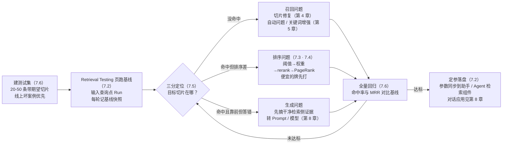
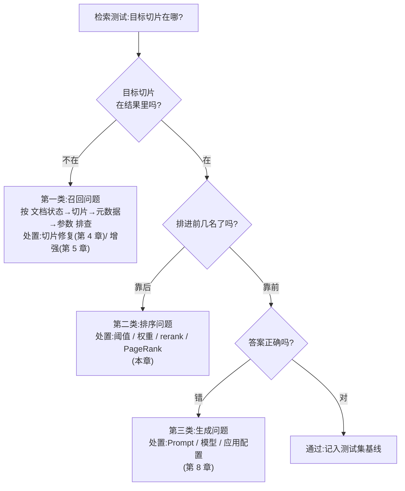

# 第 7 章 检索测试与调优

> 本章导读:after-sales-kb 的三类文档解析完毕、切片入库,客服团队准备上线「售后助手」——第一天的试用就翻了车:有人问「TWS 耳机充电仓保修多久」,系统答非所问。这不是部署问题,是检索质量问题,而它不会在部署当天暴露,只会在真实提问里暴露。本章把「切片已入库」推进到「检索可信赖」:用 Retrieval Testing 页建立裸排基线,读懂混合检索的两个权重,用 PageRank 处理多数据集的优先级,再用一套「三分定位法」把每个坏案例归位到召回、排序、生成三类根因,最后把测试问题沉淀成可回归的评估资产。读完本章,你能:为数据集完成一轮带基线的检索调优;对任意一个坏答案,三步定位出它属于哪类问题、该回哪一章修。



*本章操作流程图*

## 你什么时候需要它

三种典型处境,对应本章三种用法。

**文档解析完了,不知道检索质量行不行**——先看 7.2(Retrieval Testing 页),用典型问题跑一轮,建立裸排基线。官方文档的原话是:运行检索测试永远不会是多余或冗余的——像调校精密仪器一样,RAGFlow 需要仔细调校才能交付最佳问答表现(v1.0.0-rc2 文档,核实日期 2026-10-27)。

**检索结果不对劲,不知道从哪里下手**——直接看 7.5(三分定位法)。先判断是没命中、排序差、还是答错了,三类的修法完全不同,混着修只会浪费时间。

**多个数据集挂在一起,有的总是排不过别人**——看 7.4(PageRank)。这是数据集级的排序杠杆,和切片级修复的分工在这一节。

前置:第 4 章的解析与切片(三类根因之一修在那里);第 5 章的 Extractor 增强(召回补强的另一只手)。

## 7.1 概述:调优循环

先立立场:**检索质量是运营出来的,不是部署出来的。**部署只保证「链路通」——查询发出去、切片能回来;运营才保证「查得准」——正确切片稳定地排在使用者需要的位置。前者是第 2 章交付的,后者是本章开始、并贯穿第 13 章的长期工作。

RAGFlow 官方文档把这个立场写成了操作建议:文档完成解析后,先用典型问题在 Retrieval Testing 里测试,确认召回的切片正确、内容完整、排序合理,再把数据集用于聊天(Chat)、搜索(Search)或智能体(Agent)。它同时是排查工具:如果正确切片已经能召回而答案仍不满意,问题在模型、Prompt 或应用配置;如果目标切片根本没被召回,问题在文档解析、切片、元数据和检索参数。

一轮完整的调优是循环,不是直线:


*检索调优循环*

五步里有两个约定要先立好:

- **「测」永远先于「改」**。任何参数调整前先有基线,否则你说不清改动是变好还是变坏——官方文档同样强调:用多个代表性查询反复测试,基于整体召回结果确定参数,而不是只凭单次测试调配置。
- **「改」有三层,越靠前成本越高**。检索配置(本章)改的是滑杆和开关;切片(第 4 章)与增强(第 5 章)改的是数据本身,要重解析;生成侧(第 8 章)改的是 Prompt 与模型。能在前一层解决的,不要拖到后一层。

本章反复出现的五个术语,在此统一定义:

| 术语 | 英文 | 一句话定义 |
|------|------|-----------|
| 数据集 | Dataset | 知识库的载体,检索的基本单元(v1 对 v0「知识库」的更名) |
| 切片 | Chunk | 解析产出的最小检索单元 |
| 检索测试 | Retrieval Testing | 数据集内验证「查询能否召回预期切片」的页面 |
| 重排 | Rerank | 用重排模型对候选切片重新计算相关性并排序 |
| 混合检索 | Hybrid Search | 加权关键词相似度与加权向量相似度(或重排分)共同决定综合得分 |

## 7.2 Retrieval Testing 页:实验台与它的六个旋钮

### 入口与前提

入口在数据集详情页的 **Retrieval Testing**。前提只有一条(官方 Tip):用于测试的文档必须已完成解析并处于启用状态。页面分两块:左侧 **Setting** 区放参数与测试输入,输入查询后点击 **Run** 执行;右侧 **Results** 区展示结果——每条包含召回的切片内容、相关性信息与来源文档,按当前检索配置排序,顶部有结果总数。数据集文档很多时,Results 右上角的 **File** 过滤器可以只看某个文档的召回情况。

官方对查询本身有一条建议:用接近真实用户表达的问题,并准备多种类型的查询——这条建议是 7.6 测试集的种子。

### 参数逐一列表

Setting 区的可调参数如下(以 v1.0.0-rc2 文档为准,核实日期 2026-10-27):

| 参数 | 作用 | 调整方向与效果 | 默认值 |
|------|------|---------------|--------|
| 相似度阈值(Similarity threshold) | 过滤综合相似度低于阈值的切片 | 调高:召回范围收窄、结果更严格,但可能漏掉有用内容;调低:范围扩大,无关结果增多 | `0.2` |
| 向量相似度权重(Vector similarity weight) | 向量相似度在综合得分中的占比,其余权重归全文/关键词相似度 | 设为 `0.3` 即向量占 `0.3`、全文占 `0.7`;取舍见 7.3 | `0.3` |
| 重排模型(Rerank model) | 对候选切片进一步计算相关性并排序,重排分参与综合得分 | 不选:关键词相似度 + 向量余弦相似度;选了:关键词相似度 + 向量重排分;**会明显增加响应时间** | 未启用 |
| 跨语言检索(Cross-language search) | 选择一个或多个目标语言,系统用默认聊天模型把查询翻译过去再匹配 | 目标语言须真实存在于数据集;不选则只在当前语言检索,可能漏掉其他语言的相关内容 | 未启用 |
| 元数据(Metadata) | 按元数据条件限制检索范围 | 设定后只在满足条件的切片内检索;7.7 样例三的主角 | 无 |
| Top | 返回候选结果的最大数量 | 选 Top 10 即最多返回 10 条符合条件的切片;想多看或少看候选时调整 | 文档未载明 |
| 使用知识图谱(Use Knowledge Graph) | 把图谱的实体描述、关系描述、社区报告切片纳入检索 | 仅对已成功构建图谱的数据集有意义;**图谱切片只用向量余弦相似度,不走混合检索**;显著增加响应时间 | 关闭 |

最后两行说明:Top 的默认值官方文档未载明,本书不杜撰;知识图谱切片的生成在第 6 章,本表只关心它参与检索时的排序行为——它是混合检索规则的一个例外。

### 综合得分怎么算

理解调参之前,先看综合得分公式长什么样。官方文档给了一个实测例子:混合检索在无重排模型时,综合得分 = 加权关键词相似度 + 加权向量余弦相似度:

```text
综合相似度 28.56 = 25.17(词项相似度)× 0.7 + 36.49(向量相似度)× 0.3
```

换成重排模型后,向量余弦那一项换成向量重排分。这张公式决定了每个旋钮的作用位置:阈值卡的是最终综合分,权重分配的是两个相似度的话语权,重排模型替换的是向量侧的打分器。

### 一轮基线的操作与记录

操作本身极简(官方操作步骤即两条):在 Setting 区输入查询,点击 **Run**,在 Results 区查看结果;不满意就调整上述参数再跑。真正的工作量在记录——**本书立场:每轮测试留下基线快照,否则「反复测试」就退化成「反复乱试」。**快照至少包含一张表:

| 记录项 | 内容 | 用途 |
|--------|------|------|
| 问题原文 | 贴近真实用户表达的查询 | 7.6 测试集的种子 |
| 期望切片 | 人工确认应命中的切片(可定位到文档) | 判分依据:命中与否、排名几何 |
| 实际排名 | 本轮配置下期望切片的名次;未进结果记「—」 | 定位的第一信号,直接喂给 7.5 三分法 |
| 配置快照 | 阈值/权重/rerank 开关/Top 的当轮取值 | 回归对比的基准;防止「调到哪了」失忆 |
| 分类 | 三分定位法的类属(7.5) | 汇总后看出问题的分布 |

after-sales-kb 的首轮基线正是这张表:32 条问题、配置快照 `0.2 / 0.3 / 无 rerank`,跑出了 7.7 要走查的三个失败样例。基线记录本身没有仪式感可言,它是纯台账——但 7.6 的回归全靠它说话。

### 关键行为:测试参数不落盘

这是本页最重要的一条官方 Note,单独一节讲:**Retrieval Testing 里的参数变更只作用于当前测试,不会自动同步到聊天助手(Chat Assistant)或 Agent。**确定合适参数后,必须在实际使用该数据集的应用或 **Retrieval** 组件中另行配置(指向第 8、10 章)。

**本书立场:把 Retrieval Testing 当实验台,把应用配置当生产线。**实验台上调出的最优参数,不搬上生产线就等于没调——而「调好了却忘了搬」恰恰是最常见的翻车方式:测试页表现完美,上线后跑的还是默认参数。7.1 调优循环里的最后一步「落盘」,专门就是防这个的。

### 结果看什么

官方列出查看结果的六个关注点,本书按用途归成三组:

| 关注组 | 官方关注点 |
|--------|-----------|
| 召回对不对 | 目标切片是否成功召回;所需内容是否被元数据或其他过滤条件排除 |
| 来源对不对 | 召回切片是否来自正确的文档;切片内容与查询相关且包含答题所需信息 |
| 排序好不好 | 高相关内容是否出现在靠前位置;是否召回了大量与查询无关的切片 |

官方还有一句方法论级的话值得单独记:**检索测试的重点不是孤立比较某一次的分数,而是确认在当前检索配置下,所需切片能否被准确召回并合理排序。**分数只在对比中有意义——这正是 7.6 回归测试的理论根据。

## 7.3 混合检索参数解读:权重与重排

### 两个相似度,两种擅长

混合检索里向量相似度与关键词(全文)相似度是互补的两路,官方文档对分工会给出清晰的场景描述:

| 相似度 | 擅长 | 典型场景 |
|--------|------|---------|
| 向量相似度 | 语义匹配——措辞不同也能命中 | 用户口语化提问,文档是书面语(「东西坏了想退钱」↔「退货退款政策」) |
| 关键词/全文相似度 | 字面匹配——专有名词、产品型号、标识符、固定术语的精确命中 | 型号查询(「TWS- Pro 3」)、错误码、行业术语 |

对应的权重取舍:

| 症状 | 调整 | 理由 |
|------|------|------|
| 口语化问题命中差,字面匹配的噪声反而排前面 | 调高向量权重 | 用户措辞与源文本差异大,该让语义侧多说话 |
| 型号、编码类查询命中不准,语义相近的「近似答案」来捣乱 | 调低向量权重 | 该类查询靠字面精确匹配,语义相似反而是干扰 |

**本书立场:从默认 `0.3` 起步,两头试探后收敛。**权重没有理论最优值,但试错有廉价路径:在测试集上各跑 `0.1` 与 `0.5` 两端,对比命中率变化方向,再向好的方向收敛——比凭感觉一格一格挪快得多。after-sales-kb 的实战认定见 7.7 样例二。

### 重排模型:先裸排基线,再上 rerank

重排模型的官方描述很克制:能进一步提升最终排序质量,但引入额外模型调用、**明显增加响应时间**。启用后,综合得分从「关键词相似度 + 向量余弦」变成「关键词相似度 + 向量重排分」。

**本书立场:rerank 是排序问题的最后一张牌,出牌前先打完便宜的牌。**顺序应当是:

1. 先在无 rerank 的裸排下把权重、阈值调到位,记录基线——这一步免费;
2. 裸排下目标切片能进前几名但进不了第一名,再开 rerank 对比;
3. 只有当排序指标(7.6)的提升值得付出延迟代价时才保留;问答型应用对首字延迟敏感,搜索型应用对排序质量敏感,取舍随应用类型变。

### 应用侧多出来的一个旋钮:Rerank candidates

把测试结论搬进应用时,会遇到一个 Retrieval Testing 页上不存在的参数:检索设置(Search Settings,搜索应用侧的配置,第 9 章展开)中的 **Rerank candidates**——设置进入重排阶段的候选切片数量,例如设为 `100` 表示最多 100 条候选切片进入后续重排。官方对它的调整指引:调大,候选池扩大,高相关内容在初检阶段被漏掉的概率降低,但处理开销增加;调小,速度更快,但小候选池可能漏掉相关内容;大知识库或需要更广检索覆盖时可以适当调大。

**本书立场:开了 rerank 的应用,遇到「目标切片明明能进初检、最终结果里却没有」的迹象时,先查候选池**——候选池太小会把目标切片挡在重排之前,重排模型根本没机会看到它。这是「测试页 rerank 有效、线上 rerank 时灵时不灵」的一个隐蔽来源:测试页与应用侧的参数面并不完全对齐,搬运结论时要把候选池一起核对。

一个例外要记住:**知识图谱切片不参与这套游戏**——无论开不开 rerank,图谱切片都只用向量余弦相似度检索(官方文档)。调优时别拿图谱切片的排名当混合检索的信号。

## 7.4 多数据集检索与 PageRank

### 应用侧的多数据集

Retrieval Testing 是数据集内的测试;到了应用侧(聊天助手、Search、Agent 的检索组件),可以同时挂多个数据集,系统会从所有选中的数据集同时检索。官方随之给出一条约束:按用途选择数据集,避免挂上大量与主题无关的知识库——那只会增加无关结果。after-sales-kb 的拆分方式(政策手册、FAQ、物流公告分库)正是为了给每个应用按需组合。

多库并检立刻带来一个新问题:两个数据集都召回了看起来同样相关的切片,谁排前面?这靠切片级的调参已经管不了——需要数据集级的排序杠杆。

### PageRank:数据集级的加分项

官方 Configuration 文档的定义:PageRank 设置数据集的 PageRank 分数;检索时,该分数**加到该数据集中匹配切片的混合相似度得分上**,提高其排序权重;适用于多数据集检索时,某些数据集的内容需要获得更高优先级的场景。

三个要点决定了它的适用边界:

- **它是数据集级的**:作用于该数据集的所有切片,粒度粗。适合「物流公告库整体应排在 FAQ 库前面」这类诉求;不适合「FAQ 库里某条切片该排前面」——那是 7.3 的权重或第 4/5 章切片修复的事。
- **它是加分项**:叠在混合相似度之上,不改变阈值与权重的语义,是纯粹的比较偏置。
- **它只在你有证据时才该动**:官方文档没有给出数值建议,以下为本书立场。

### 设多少:本书立场

1. **从 0 开始**。默认不干预,先在测试集上看各数据集的命中分布——多数知识库组合不需要 PageRank。
2. **有系统性证据才上调**。证据形态:某数据集的查询命中率整体偏低,且业务上它就该优先(例如时效性强的物流公告对客服问答优先级最高)。
3. **小幅渐进 + 回归**。每次只动一个数据集的 PageRank,动完跑 7.6 的回归——它挤压的是其他数据集的排名,必须确认没有把别人挤下悬崖。
4. **记录每次调整值与回归结果**。这份台账是第 13 章质量巡检的输入。

四个排序杠杆放在一起看分工:

| 杠杆 | 粒度 | 解决什么 | 章节 |
|------|------|---------|------|
| 元数据过滤 | 检索范围 | 把不该参与检索的内容挡在外面 | 本章 7.7 / 第 8 章 |
| 相似度阈值与权重 | 查询级 | 单次查询的召回松紧与两路话语权 | 本章 |
| 重排模型 | 查询级 | 候选池内的精排 | 本章 |
| PageRank | 数据集级 | 多库并检时的库间优先级 | 本章 |

## 7.5 检索质量三分定位法

前面四节给了工具,这一节给方法。官方文档给的排查顺序是**文档状态 → 切片 → 元数据 → 检索参数**——先确认知识内容本身正确进入了数据集,再调检索参数,这样定位最快。本书把这个顺序展开成一个可贴墙的决策模型:任何「检索不对劲」,先问目标切片在哪,答案只有三种,每种对应一类根因、一套处置动作、一章主要参考。



*三分定位决策流程*

### 三类一表:可贴墙的决策表

| | 第一类:没命中 | 第二类:命中但排序差 | 第三类:命中且靠前,但答错 |
|---|---|---|---|
| **证据特征** | 目标内容人工能查到,Results 区却没有它;或整页近乎为空 | 目标切片在结果里,但排在第 5 名开外;前排被无关或弱相关切片占据 | 目标切片第 1 名,内容含答案,最终回答仍然错误或答非所问 |
| **问题层** | 召回问题 | 排序问题 | 生成问题 |
| **常见根因** | 文档未解析成功;切片未生成或切坏;元数据过滤太严;阈值过高;Top 太小(官方列举) | 权重错配;阈值过低放进大量噪声;无 rerank 时裸排能力不足;多库并检时库间无优先级 | Prompt 设计缺陷;模型能力不足;上下文装配问题;应用配置错误 |
| **处置动作** | 按官方顺序排查:文档状态→切片→元数据→参数;切片级修复回第 4 章,自动问题/关键词/上下文增强回第 5 章 | 调阈值挤噪声;调权重换话语权(7.3);上 rerank 精排(7.3);多库场景设 PageRank(7.4) | 转向生成侧:检查 Prompt、换模型、查应用配置——第 8 章的事 |
| **修复成本** | 高(动数据,可能要重解析) | 低(动配置,即时生效) | 中(动 Prompt/模型,需会话级验证) |

这张表的价值在第三类的判据上:**检索侧证据干净,才能把问题判给生成侧。**官方文档记录过一个真实案例(issue #5627):排查很久的问题最终定位是 LLM 能力限制——而能确认「正确切片可以召回」,正是把注意力转向别处的前提。三分定位法的第一、二类不排除,就没有资格下第三类的结论。

### 第一类:没命中——先证明「知识在库里」

证据收集有固定手法:先用 Results 区的 File 过滤器看目标文档是不是零召回,再人工翻源文档确认目标内容真实存在——这两步划定了问题边界(是「库里有但查不到」还是「库里根本没有」)。然后按官方顺序走:文档状态 → 切片 → 元数据 → 检索参数。常见根因官方已列举:文档未解析、没有可用切片、元数据过滤太严、相似度阈值太高、Top 太小。

两条经验(本书立场):**别跳过「文档状态」直接调参**——文档没解析成功时,任何参数组合都是无效动作;**警惕切片切坏的隐蔽形态**——内容明明在库里,却总以「片段级命中」出现,召回的碎片拼不出完整答案,这其实是第 4 章的切片质量问题,参数调不出来,该回切片方法与 Chunker 参数上修。

### 第二类:命中但排序差——便宜的牌先打

这一类的证据在排名数字里,而放大镜是 7.2 的综合得分公式:把一次测试的前排得分拆开(词项分 × 权重 + 向量分 × 权重),看是哪一路把无关切片抬上去、把目标切片压下去的。字面密集但无关的切片占前排 → 关键词路话语权过高,降关键词权重或提阈值;两路得分都不高的目标切片 → 表达问题,回第一类的增强处置(自动问题/关键词)而不是死磕参数。

处置的出牌顺序按成本排:**阈值 → 权重 → rerank → PageRank**,便宜的先打,每打一张跑一次回归(7.6)。rerank 与 PageRank 都是有代价的牌——前者加延迟,后者挤压其他数据集——出牌要有证据支撑。

### 第三类:命中且靠前但答错——先把检索侧摘干净

转生成侧之前,三项证据必须齐:目标切片排名第 1;切片内容确实包含答案;同场进上下文的切片里没有会干扰答案的「近似对手」(旧版本、相邻条款、相似 FAQ)。第三项最容易被跳过,而它恰是误判重灾区——样例三里新旧版本切片同场,表面是「模型胡说」,实际是上下文被污染:模型在两个版本间抽签,抽错不是能力问题。检索侧摘干净后才转第 8 章,且要带走证据包(查询原文、命中切片列表、最终回答),让生成侧的排查不必从零开始。

### 用法的三条纪律

- **一次只改一个变量**。调了权重又换 rerank 又改阈值,回归通过了也不知道该谢谁——下次回退也不知道该防谁。
- **每类问题回到自己的章节修**。第一类去第 4、5 章,第二类留在本章,第三类去第 8 章——跨层乱修是调优陷入泥潭的主因。
- **修完必须回归**(7.6)。修复动作往往按下葫芦浮起瓢:调高阈值救了噪声,可能杀了边缘查询的召回。

## 7.6 测试集沉淀与回归

### 测试问题集是评估资产

7.2 提到官方建议「多类代表性查询、反复测试、整体定参」——隐含的前提是你手里有一组固定的问题。**本书立场:这组问题不是测试的耗材,而是知识库的评估资产**,地位等同于代码库的测试套件:没有它,每次调参都是凭手感;有了它,每次改动才有「没把原来对的改坏」的证明。

测试问题的三个来源,按价值排序:

| 来源 | 例子(after-sales-kb) | 特点 |
|------|----------------------|------|
| 线上真实提问 | 客服实际输入的坏案例(7.7 的三个样例全部来自这里) | 最真实,坏案例密度最高;经线上 trace 沉淀(第 12 章,→ langfuse 书) |
| 业务方高频问题 | 「退货要运费吗」「充电仓保修多久」 | 覆盖核心业务路径,业务方可直接提供 |
| 历史工单/FAQ 原始问题 | FAQ 表里的问题列本身 | 零成本起步,适合冷启动 |

**起步规模:20-50 条即可**(本书立场)。它足以挡住大多数配置回退;与其追求大而全,不如保证每条都有人工确认过的「期望切片」。after-sales-kb 起步用了 32 条,全部带期望切片标注。

测试集的组织形式同样从简——每条记录五个字段(本书立场):

| 字段 | 作用 |
|------|------|
| 问题原文 | 保持用户原始表达,不做书面化改写——改写会破坏对真实查询分布的代表 |
| 期望切片 | 人工确认的应命中切片;回归判分的唯一依据 |
| 来源 | 线上沉淀 / 业务高频 / 冷启动——用于评估测试集自身的覆盖面 |
| 问题类型 | 召回敏感型(口语问句)/ 字面敏感型(型号术语)/ 版本敏感型(涉时效内容)——与 7.3 权重取舍、7.4 版本过滤直接对应 |
| 加入日期与当前结论 | 台账字段;第 13 章巡检的输入 |

「问题类型」字段值得多说一句:它是测试集与调参动作之间的桥——权重怎么调,看两类问题的此消彼长;版本过滤有没有漏,跑一遍版本敏感型子集就知道。没有这个字段,回归只能给一个总分,定位不了是哪类能力退了。

### 每次改动都回归

回归的触发时机:检索参数调整、rerank 开关、PageRank 变更、文档更新或重解析、切片方法调整——后两者常被忽略,而它们恰恰改变切片本体,是最容易悄悄改坏检索的(第 4 章的重解析约定)。

回归怎么跑,四步(本书立场):

1. **全量复跑**——按基线配置快照跑全部测试问题,不抽样:回归的意义就在「把旧账全部翻一遍」,抽样会漏掉边缘回退。
2. **对比基线**——逐条对比期望切片的排名变化,产出命中率与 MRR,和上一轮并排放。
3. **失败项归类**——退步的问题按 7.5 三分法归类:掉出结果的是第一类信号,排名下滑的是第二类信号;归了类才知道改动该回滚还是该补配套动作。
4. **留档**——本次改动内容、参数数值、回归结论记入台账(第 13 章巡检的原始凭证)。

一个特殊情形值得单独立规矩:**文档重解析之后,先修测试集,再谈回归。**重解析可能改变切片边界——期望切片本身被切碎、合并或换了位置,此时「问题 → 期望切片」的映射整体失效,直接跑回归只会得到一堆假警报。正确顺序是人工核对受影响条目的期望切片,更新测试集,然后才跑全量。

### 指标起步:命中率与 MRR

官方文档没有定义评估指标,以下指标选型是**本书立场**:起步阶段只需要两个数,别一上来就上全套 RAG 评估框架。

| 指标 | 定义 | 起步建议 |
|------|------|---------|
| 命中率(Recall@K) | 期望切片出现在前 K 名的测试问题占比 | 先看 Recall@top_n;不达标说明第一、二类问题没清干净 |
| MRR(平均倒数排名) | 每条问题的期望切片排名倒数,取平均 | 衡量「靠前程度」;0.5 以下时优先考虑 rerank 或权重调整 |
| 噪声比 | 前排无关切片占比 | 观察项;过高时先提阈值,再考虑 rerank |

只看两个数的立场不是偷懒:三分定位法已经把「指标差」翻译成了具体动作,指标体系膨胀只会推迟动手。

### 线上 trace 与离线测试的分工

离线测试(本章)与线上 trace(第 12 章,→ langfuse 书)不是替代关系,是闭环的两半:**离线测试是改配置前的守门员**——回答「这版配置比上一版好吗」;**线上 trace 是真实分布的侦察兵**——回答「真实用户的提问落在测试集覆盖之外了吗」。侦察兵发现的新坏案例,沉淀进测试集成为下一轮守门的考题——测试集因此持续生长,这正是「检索质量是运营出来的」在机制上的落点。巡检的频率与责任人约定在第 13 章。

## 7.7 贯穿案例:after-sales-kb 三个失败样例走查

上线前的一轮测试中,after-sales-kb 的 32 条测试集暴露了三个典型失败,分别落在三分定位法的三类上。先给总览,再逐一走查:

| 样例 | 提问 | 现象 | 分类 | 根因 | 处置回指 |
|------|------|------|------|------|---------|
| 一 | 「TWS 耳机充电仓保修多久」 | 目标 FAQ 行完全不在结果里 | 第一类:召回 | FAQ 表格切片的问题列没覆盖「充电仓」 | 第 4、5 章 |
| 二 | 「退货要运费吗」 | 目标切片命中,排第 9 | 第二类:排序 | 向量权重 0.3 压低了口语问句的语义匹配 | 本章 7.3 |
| 三 | 「耳机保修期政策」 | 目标切片第 1,但线上回答引用了过时的 2024 版条款 | 第二类的变体 + 治理缺位 | 新旧版本文档并存,无版本元数据、无过滤 | 第 13 章 |

### 样例一:没命中——FAQ 表格切片问题

**现象**:在第 4 章建好的商品 FAQ 数据集(XLSX,约 200 行,Table 解析,每行一个切片)里测「TWS 耳机充电仓保修多久」,Results 区没有任何 FAQ 行命中,返回的全是政策手册里关于整机保修的条款切片。

**走三分法**:目标切片不在结果里 → 第一类,召回问题。按官方顺序排查:文档状态——FAQ 已解析、已启用,有切片(排除);元数据——未设过滤(排除);检索参数——阈值 `0.2` 是默认值,不算高(排除);切片——人工查表确认,「充电仓 6 个月」写在某行的答案列里,但该行的问题列写的是「耳机保修多久」。查询词「充电仓」与切片的问题列零重叠,答案列里虽出现,整行切片的综合相似度仍被压到阈值之下。

**处置**:这是切片内容问题,不是参数问题——参数怎么调都是治标。两个动作:改写该行问题列,让高频问法(「充电仓」「充电盒」)进入问题列(第 4 章 Table 解析的行内治理);同时为 FAQ 数据集开启自动问题(Automatic Questions)增强,让模型为每条切片补齐用户可能的问法(第 5 章 Extractor)。

**回归**:重解析后复跑测试集——目标查询命中第 1 名,其余 31 条无回退,闭环。

### 样例二:命中但排序第 9——权重问题

**现象**:测「退货要运费吗」,目标切片(FAQ 中「退货运费谁承担」一行)在结果里,但排第 9;前排是政策手册的退货条款长切片——它们不含「运费谁出」的直接答案,只因字面密集出现「退货」「运费」而词项得分高。

**走三分法**:目标切片在结果里但靠后 → 第二类,排序问题,本章的事。证据特征符合「字面噪声压过语义命中」:查询是口语化短句,语义匹配需求高、专有名词为零——正是 7.3 表格中「调高向量权重」的场景。

**处置**:向量相似度权重从 `0.3` 上调到 `0.5`,复跑该查询,目标切片升到第 1;按 7.3 的纪律先在两端试探(`0.1`/`0.5`)确认方向,再收敛。**没有先上 rerank**——排序问题的最后一张牌不该最先打,裸排能解决的问题不值得付出延迟代价。

**回归**:全量复跑,32 条中命中率不变,MRR 从 0.41 升到 0.63;逐一检查 3 条字面型查询(型号、错误码类)无回退后,定参 `0.5`。

### 样例三:命中且靠前,但答错——版本治理问题

**现象**:测「耳机保修期政策」,2026 版条款切片排第 1——检索侧看着完美。但接入「售后助手」(第 8 章)试运行时,回答里引用的是 2024 版旧政策的保修期。测试集回归进一步暴露:所有涉版本的问题(共 5 条)在线上都有概率引用旧版。

**走三分法**:单看一条查询,像是第三类(生成问题)——但第三类的结论要求检索侧证据干净,而测试集回归给出的证据不干净:2024 版政策手册的旧切片仍在库内参与检索,新旧版本切片同时进上下文,生成侧在两个版本之间「抽签」。这是第二类的变体(旧版本抢排名)叠加治理缺位(旧文档未下架),根因不在生成侧。

**处置**:三步——给文档补版本元数据(如版本号、生效日期,元数据机制见第 3 章);应用侧检索设置 Metadata 过滤条件,只允许当前生效版本参与检索(本章 7.2 的 Metadata 参数;助手侧配置见第 8 章);旧版本文档的下架与归档流程,纳入知识库更新 SOP——这是运营机制问题,第 13 章展开。

**回归**:过滤生效后复跑,5 条版本相关问题全部稳定引用 2026 版;「旧版切片被过滤」未影响其余查询。**这个样例的教训:单次测试通过不等于系统没问题——是测试集回归把「偶发抽签」变成了「必现证据」。**

三个样例修完,after-sales-kb 的定参(权重 `0.5`、阈值 `0.2`、无 rerank、版本元数据过滤)同步落盘到「售后助手」的检索配置——7.2 的「不落盘」警告在这里兑现。生成侧的 Prompt 与模型选型,第 8 章接手。

## 本章小结

1. **检索质量是运营出来的,不是部署出来的**——官方建议解析完成后先测试再投入使用;调优是「建测试集→测→定位→改→回归」的循环,不是一次性动作。
2. **Retrieval Testing 是实验台**:六个参数(阈值/权重/重排/跨语言/元数据/Top)反复试;**测试参数不落盘**,确定后必须另行配置到聊天助手或 Agent 的检索组件。
3. **混合检索 = 加权关键词相似度 + 加权向量余弦(或重排分)**:口语化查询提高向量权重,型号术语查询降低;rerank 是排序的最后一张牌,先裸排基线再对比;知识图谱切片只走向量余弦。
4. **PageRank 是数据集级的排序杠杆**:多库并检时给应优先的库加分;从 0 开始、有系统性证据才小幅上调、动完必回归。
5. **三分定位法**:没命中→召回问题(第 4、5 章);命中但排序差→排序问题(本章);命中且靠前但答错→生成问题(第 8 章)。检索侧证据干净,才有资格判第三类。
6. **测试问题集是评估资产**:起步 20-50 条带期望切片;每次改动全量回归;起步只看命中率与 MRR;线上 trace 发现的坏案例回流测试集,形成运营闭环。

→ 参数与切片都调好了,下一步是把它变成用户真正对话的应用:**第 8 章**聊天助手与会话。

## 验收清单

读到这里,你应该能:

- ☐ 为 after-sales-kb 式的数据集跑一轮完整调优:建测试集、记裸排基线、调参、回归、落盘到应用配置;
- ☐ 说出混合检索综合得分的构成,并解释向量权重设为 `0.3` 时另外 `0.7` 归谁;
- ☐ 对一个具体场景(口语咨询 vs 型号查询)判断向量权重该调高还是调低,并说明理由;
- ☐ 用三分定位法对一个坏答案归类,并指出它分别该回哪一章修;
- ☐ 说清 PageRank 的粒度与适用边界,以及「从 0 开始、有证据才上调」的依据;
- ☐ 为知识库搭一个 20-50 条的回归测试集,并用命中率与 MRR 输出两份可对比的基线报告。

## 延伸阅读

- **第 4 章(解析与切片)**——第一类「没命中」的修复现场:切片方法选型与 Chunker 参数。
- **第 5 章(检索增强与索引)**——召回补强的另一只手:自动问题、自动关键词与索引字段选择。
- **第 8 章(聊天助手与会话)**——调优成果的落盘处:助手侧检索参数、Prompt 与模型;第三类「答错」的处置现场。
- **第 13 章(团队协作与知识库运营)**——测试集台账、PageRank 调整记录与巡检 SOP 的归宿。
- **官方文档 Retrieval Testing / Search Settings / Dataset Configuration**——本章全部参数行为与默认值的出处(v1.0.0-rc2,核实日期 2026-10-27)。

## 复核清单(发布前)

- [ ] 全章对照 retrieval_testing.md、search_settings.md、configuration.md(PageRank 与 Basic Information 段)、notes_and_faqs.md(检索段)原文复核(素材核实日期 2026-10-27)
- [ ] Top 参数默认值官方未载明——待实测 v1.0.0-rc2 界面后补记
- [ ] 7.2「综合得分 28.56」算例为官方文档截图数据,待实测复现
- [ ] 7.7 三个样例的界面操作路径(Retrieval Testing 页、Metadata 过滤配置)未实测,待环境就绪后走查
- [ ] MRR/命中率示例数值(0.41→0.63)为案例设定值,非实测数据——已在文中以贯穿案例口径表述,确认无歧义
- [ ] 「测试参数不落盘」在 Agent 检索组件(Retrieval 组件)侧的配置入口截图待补(第 10 章交叉核对)
