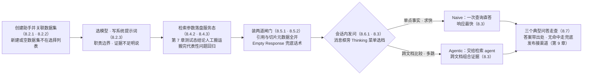
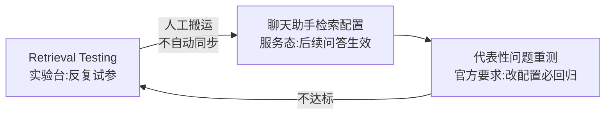

# 第 8 章 聊天助手与会话

> 本章导读:第 7 章结束时,after-sales-kb 的检索参数(权重 0.5、阈值 0.2、无 rerank)已确定待搬——但「搬到哪里」这个问题,要到本章才有答案。聊天助手(Chat Assistant)是 RAGFlow 里挂在知识库上的对话入口:客服团队不必理解什么是切片与混合检索,打开聊天窗口就能提问。本章把这个入口真正建出来:创建助手并关联数据集,写一份边界清晰、强制引用、带兜底话术的系统提示词;理解 Naive 与 Agentic 两种思考模式各自适合的问题;把检索调优结论从测试态正确落盘到服务态;最后用三个典型问答走查,验证「宁可不答、不能编造」在产品里如何兑现。读完本章,你能:独立创建并配置一个可上线的聊天助手;为你的场景选对思考模式与兜底策略;写出客服级的售后助手 prompt。



*本章操作流程图*

## 你什么时候需要它

三种典型处境,对应本章三种用法。

**知识库建好了,要让业务同事直接用**——看 8.2 与 8.3。创建一个聊天助手,关联第 3-5 章建好的数据集,选好模型、写好提示词,团队立刻有一个问答入口。

**第 7 章调好的检索参数,上线后好像没生效**——直接看 8.4。Retrieval Testing 的参数只作用于当次测试,不落盘;生产参数要在聊天助手(或 Agent 的检索组件)里另行配置。

**客服场景,答错比不答更糟**——看 8.5 与 8.7。引用展示让每个结论可溯源到原文;Empty Response 让「查不到」时返回预设话术,而不是模型自由发挥。

前置:第 2 章已配置 chat 模型;第 3-5 章的数据集已解析出可用切片;第 7 章完成过一轮检索调优(没做也不阻塞,8.4 会讲清两态关系,可回头补)。

## 8.1 概述:知识库之上的对话入口

官方对 Chat 的定义一句话:用于创建基于数据集的问答应用——配置好数据集、大模型、系统提示词与检索参数后,用户即可在聊天界面基于数据集内容提问(docs/guides/chat/feature_overview_and_creation.md,v1.0.0-rc2,核实日期 2026-10-27)。它支持数据集检索、引用展示、关键词分析、多轮对话优化、跨语言检索与 Web 搜索等能力。

这句话里有三个角色要分清:数据集(Dataset)是知识来源(第 3 章),切片(Chunk)是检索与引用的基本单元(第 4 章),聊天助手是把两者组装成「能对话的产品」的应用层。本章术语:

| 术语 | 英文 | 一句话定位 |
|------|------|-----------|
| 聊天助手 | Chat Assistant | 挂在数据集上的对话应用,本章主角 |
| 数据集 | Dataset | 知识载体,界定助手的检索与引用范围(第 3 章) |
| 切片 | Chunk | 检索与引用的基本单元(第 4 章) |
| 检索测试 | Retrieval Testing | 数据集内的调参实验台(第 7 章) |
| Agentic 模式 | Agentic mode | v1.0.0-rc2 引入的思考档位,取代原 Low/Medium/High/Ultra(见 8.3) |

### 与画布 Agent 的分工

RAGFlow 有两条做问答应用的路:聊天助手与画布 Agent(第 10 章)。官方没有给出「何时用哪个」的裁决表,下表为本书立场:

| | 聊天助手 | 画布 Agent |
|---|---------|-----------|
| 形态 | 开箱即用的配置型应用 | 画布上以组件编排的流程 |
| 适合 | 单轮/多轮知识问答:FAQ、政策、文档检索 | 有流程编排的复杂任务:调工具、分支、多步推理 |
| 配置成本 | 低:选数据集、写提示词 | 高:组件、连线、调试 |
| 上线速度 | 快 | 慢,但能力天花板高 |

**本书立场:知识问答优先用聊天助手起步,流程编排的需求长出来后再上画布 Agent。**贯穿案例的售后域正是这条路线:本章的「售后助手」回答售后政策,第 10 章的「售后客服 Agent」在同一知识底座上编排查单、退款试算等动作。

对外发布(网页嵌入、iframe、API)不属于本章——接入渠道统一在第 9 章,程序化集成在第 11 章。

## 8.2 创建与知识库关联

### 8.2.1 创建步骤

官方给的最短路径六步(docs/guides/chat/feature_overview_and_creation.md):

1. 左侧导航选 **Chat**;
2. 点击 **Create chat**;
3. 输入助手名称;
4. 确认创建;
5. 打开 **Chat setting**,配置数据集、模型、系统提示词与检索参数;
6. 保存设置,打开聊天窗口测试使用。

两点官方提醒值得先记:**创建时不必配完所有设置**——随时可从列表回到该助手继续配置;**改完配置要用代表性问题重跑测试**,确认新设置符合预期。前者降低上手门槛,后者是第 7 章「改动即回归」纪律在应用层的延续。

基本信息三件套:

| 项 | 用途 |
|----|------|
| **Name** | 列表、发布页、嵌入场景中的显示名 |
| **Avatar** | 助手头像 |
| **Description** | 用途、服务范围、面向对象、数据集覆盖的简述 |

### 8.2.2 关联数据集

数据集决定助手能检索与引用的数据范围(docs/guides/chat/chat_configuration.md,v1.0.0-rc2)。规则三条:

- 一个助手可关联**一个或多个**数据集,回答时在关联数据集的范围内检索;
- **新建或空数据集一般不出现在选择列表**——只有解析成功、有可用切片的数据集才是有效知识源(第 4 章的解析纪律在这里兑现);
- 已删除或无可用切片的数据集会被标记为**不可用**,需换选。

多库并检的取舍第 7 章讲过:按用途选库,避免挂上大量与主题无关的数据集——那只会增加无关结果。after-sales-kb 的三库拆分(政策/FAQ/公告,见第 3 章)正是为按需组合准备的。

还有一个官方 Tip 与 prompt 直接相关:**要让答案立足于检索到的知识,考虑在系统提示词里保留 `{knowledge}` 占位符**——它代表本次检索召回的切片。

### 8.2.3 系统提示词与开场白

配置面里与「话术」有关的两块,职责完全不同:

| | 系统提示词(System Prompt) | 开场白(Opening Greeting) |
|---|---|---|
| 作用范围 | **整个对话过程中的模型行为** | 仅用户进入 Chat 时显示的初始内容 |
| 能定义 | 角色、回答范围、语言与语气、数据集用法、回答格式、缺信息的处理方式 | 助手用途、能力范围、使用方法、示例问题 |
| 官方定位 | 「影响整个对话」 | 「主要提供介绍与引导,不控制后续答案行为」 |

系统提示词是 8.7 的主角,这里先记官方给的四条可选项与两条纪律。可以要求助手:用指定语言回答;保持简洁专业或按指定格式输出;**无法从现有信息确认时明确说明**;拒绝超出当前助手范围的问题。纪律:提示词越清晰,行为越稳定,要基于测试持续打磨;**避免相互冲突的设置与过度复杂的规则**。

模型选择(同篇文档):模型差异在上下文长度、推理能力、响应速度、工具调用能力与成本;常规数据集问答优先响应速度,复杂分析与多文档综合选推理更强的模型。可用模型取决于系统里已添加配置的模型(第 2 章的模型通道)。

## 8.3 Agentic 模式:回答前先调查

先记一条版本事实:**v1.0.0-rc2 为 chat 引入 Agentic 模式,取代原 Low/Medium/High/Ultra 思考档位**(docs/release_notes.md,v1.0.0-rc2 条目,2026-10-16 发布;核实日期 2026-10-27)。按「思考深度」分四档的做法没有了,现在只剩两档——判断标准从「调多深」变成「要不要把回合交给一个检索 agent」。

### 两档的实际差别

官方定义(docs/guides/chat/chat_configuration.md):思考模式(Thinking mode)决定 Chat 在回答前如何调查数据。「检索」指回答前先搜证据:助手关联了数据集就检索切片;开了 Web 搜索,或当前版本提供 PageIndex、Graph 能力,这些来源也可作为补充证据;**最终答案应基于检索到的内容**。

| | Naive | Agentic |
|---|-------|---------|
| 做法 | 直接检索,不做复杂分析 | 把回合交给检索 agent:自己定位段落、深读文档、跨多份组合证据 |
| 适合 | 标识符、术语、位置在文档中明确出现的直接事实问题 | 跨文档问题、比较、多步研究 |
| 速度 | 一般一次查询,响应最快 | 更慢,调用模型的次数更多 |
| 与兜底/引用的配合 | 可与 Empty Response、引用同用 | 空回复的判定更靠后(见 8.5.2) |

### 什么时候开,什么时候不开

官方给了决策句:拿不准时,直接问题或求快用 Naive;答案不完整或需要跨文档比较时用 Agentic。本书立场,展开成客服场景两条:

- **不开(保持 Naive)**:纯 FAQ 直答与单点事实(「保修多久」「退款几天到账」)——一次查询能命中,开 Agentic 只是多花时间;
- **开 Agentic**:多跳检索与跨文档组合(「对比 Shopee 与 Temu 的退货时效」「保修与退货政策冲突时按哪个」)——答案散在多份文档里,需要 agent 自己找、自己读、自己拼。

一个防误读的澄清:上文「检索工具」指 Agentic 的调查动作(官方原文:Agentic 用自己的检索工具调查数据),不是画布 Agent 那种外部工具编排——那是第 10 章的事。

这个选择**不在配置面**,而在会话内:消息框旁的 **Thinking** 菜单,发问前逐条选择。同一助手下,客服可以先 Naive 答完常规问题,遇到难缠的跨文档问题再切 Agentic——**按问题难度分配算力,而不是全局一刀切**(本书立场)。

## 8.4 生成与检索参数面:测试态与服务态

本章导读里埋的问题在这里解决:第 7 章调好的参数,「搬到哪里」?先看助手的两类参数面。

### 8.4.1 生成参数

Web 配置面文档没有单列生成参数一节;HTTP API 的 Create chat assistant 里定义了 `llm_setting`(docs/references/http_api_reference.md,v1.0.0-rc2):

| 参数 | 作用 | 默认值 |
|------|------|--------|
| `temperature` | 随机性:越低越保守,越高越发散 | `0.1` |
| `top_p` | 核采样:只从概率最高的候选词中采样 | `0.3` |
| `presence_penalty` | 对已出现内容施加惩罚,抑制重复 | `0.4` |
| `frequency penalty` | 类似前者,抑制高频重复(键名原文如此,含空格) | `0.7` |

界面是否提供这些参数的编辑入口,以实际界面为准(本书未实测,列入章末复核清单)。**本书立场:客服场景全部保持默认**——`temperature` `0.1` 的保守取向正对口:售后答案要的是稳定与可溯源,不是创作性;调高发散度等于引入「同一问题两种答法」的方差,那是客服质量事故的来源。

### 8.4.2 检索参数:把第 7 章的结论搬进来

配置面的检索配置(Retrieval configuration)五项(docs/guides/chat/chat_configuration.md):

| 参数 | 作用 | 调整方向 |
|------|------|---------|
| 相似度阈值(Similarity threshold) | 召回切片的最低相似分 | 调高更严格、更相关,但可能漏;调低召回广,但引入无关内容 |
| 向量相似度权重(Vector similarity weight) | 向量语义与全文匹配在混合检索中的话语权 | 高向量权重偏语义;高全文权重偏关键词 |
| Top N | 每次检索返回的候选切片数 | 越大上下文越全,但上下文长度、响应时间与成本增加 |
| Rerank model | 重排候选,把更相关的排到前面 | 需先配置可用 rerank 模型(第 7 章:排序的最后一张牌) |
| Metadata | 用文档/切片元数据收窄检索范围 | 按文档类型、日期、来源过滤(第 5 章的元数据字段在此兑现) |

这五项与第 7 章测试页的旋钮几乎一一对应——因为它们本就是同一套参数的两个落点。after-sales-kb 的落盘:权重 `0.5`、阈值 `0.2`、无 rerank、`effective_date` 版本过滤,即第 7 章 7.7 的定参原样写入售后助手的检索配置。

### 8.4.3 测试态与服务态:一处调参,两处生效

第 7 章的官方 Note 在这里重复一遍都不嫌多:**Retrieval Testing 里的参数变更只作用于当前测试,不会自动同步到聊天助手或 Agent;确定合适参数后,必须在实际使用该数据集的应用或 Retrieval 组件中另行配置。**

| | 测试态(Retrieval Testing) | 服务态(聊天助手/Agent 检索组件) |
|---|---|---|
| 位置 | 数据集详情页 | Chat setting / 画布 Retrieval 组件 |
| 作用范围 | 当次测试,不落盘 | 该助手后续的问答 |
| 检索范围 | 单个数据集 | 所有关联数据集 |



*服务态参数的搬运与回归闭环*

**本书立场:测试态是实验室,服务态是生产线;调优结论的最后一公里是「搬」,搬完必须回归。**「测好了却忘了搬」与「搬了却不复测」是这个环节的两大经典翻车,7.6 的回归问题组在这里就是验收工具。另注意:测试态是单库,助手侧可以多库并检——搬运结论时,7.4 讲过的多库优先级(PageRank)要在助手侧重验。

## 8.5 引用与溯源:宁可不答,不能编

### 8.5.1 引用展示

回答与展示设置控制生成内容的呈现,官方说明它们**一般不改变数据集检索范围**(docs/guides/chat/chat_configuration.md):

| 设置 | 开启行为 |
|------|---------|
| **Show citations** | 答案显示所引用的数据集内容及其来源,用户可查验证据、溯源到原文;关闭则不显示引用信息 |
| **Show chunk metadata** | 引用上叠加对应切片的元数据(来源、作者、日期等),帮助用户理解被引内容的出处与属性 |

API 侧对应 `quote` 参数,默认 `true`(docs/references/http_api_reference.md)——引用展示是出厂默认。**本书立场:客服场景必须开启引用,并叠加切片元数据。**引用不是装饰:它是客服主管抽查答案质量的抓手(答错了能追到是哪份文档哪个条款),也是用户信任的基础;第 5 章配置的元数据字段(doc_type、effective_date、site)在这里变成引用上肉眼可见的「证据属性」。

### 8.5.2 无命中兜底:Empty Response

检索是「回答前搜证据」,那搜不到怎么办?这就是**空回复(Empty Response)**:系统无法从数据集获得足够信息时返回的预设内容。官方示例文案:「数据集中未找到相关内容。请补充更多信息后重试。」机制三条(docs/guides/chat/chat_configuration.md):

1. **触发条件**:仅当检索找不到可用内容时;只要有任何可用结果,系统正常继续生成——它不以「最终答案是否完整」为判断标准;
2. **不配置的后果**:数据集无相关内容时,模型可能用自己的知识继续回答——这正是编造的入口;
3. **与思考模式的交互**:Agentic 回答前会用自己的检索工具调查数据,比 Naive 做更多检索与推理才返回空回复;只有系统最终确定无法回答时才兜底。

配置立场三分(官方列举):

| 立场 | 做法 | 适合场景 |
|------|------|---------|
| 严格用数据集 | 配置空回复 | 内部政策、**客服**、合规、产品文档 |
| 允许模型自由回答 | 留空 | 可接受模型自有知识作答的场景 |
| 引导用户下一步 | 空回复里写清指示 | 补充信息、重试、联系管理员 |

**本书立场:售后助手两道闸门都装——Empty Response 写兜底话术,系统提示词里同时写「证据不足明说」。**两者合力才构成「宁可不答、不能编」:检索层查不到,由 Empty Response 接管;检索层有结果但不足以支撑结论,由提示词声明接管。单靠任何一层都有缝。

## 8.6 会话管理

### 8.6.1 会话操作与检索增强选项

进入助手后,左侧是会话列表,中间是当前会话,底部是输入框。一个助手可包含多个会话,**每个会话维护自己的上下文,而所有会话共享助手配置的知识库、模型、系统提示词与检索参数**(docs/guides/chat/using_chat_sessions.md,v1.0.0-rc2)——上下文按会话隔离,配置按助手共享,这条边界是 8.6.2 的主角。

| 操作 | 做法 |
|------|------|
| 新建会话 | 会话列表点 **+**;发出第一条消息后,系统从对话生成会话名 |
| 切换会话 | 点击会话名,打开历史并继续 |
| 搜索会话 | 搜索框按名称过滤 |
| 删除会话 | 会话旁 **More** 菜单;支持多选批量删除 |

发问细节:Enter 发送,Shift+Enter 换行;生成中可点 **Stop** 打断;发问前可选 Thinking 模式(8.3)、开关 Web 搜索、添加附件。

发问前还可按需开启检索增强选项(官方说明:按场景启用,不必全开):

| 选项 | 作用 | 适合 |
|------|------|------|
| Keyword analysis | 分析问题并提取关键词辅助检索 | 含产品名、技术术语、编号等独特关键词的问题 |
| Multi-turn conversation optimization | 用对话历史优化当前检索查询,理解上下文、指代与省略 | 同一主题的多轮对话 |
| Cross-language search | 问题语言与数据集文档语言不同时改善召回 | 跨语言问答 |

官方给了一条使用纪律:**不同话题用不同会话**——聊完一个产品问题,开始完全不同的任务前新建会话,免得前面的上下文影响后续回答。配合多轮优化(历史会参与改写当前查询),这条纪律更重要:上下文是双刃剑,话题漂移时它帮倒忙。

### 8.6.2 附件与语音:补充上下文,不是入库

会话里可以传附件(回形针图标或拖拽):文本文件被解析为文本供模型参考,图像处理需要多模态模型。**边界一句话:会话里上传的文件只提供补充上下文,不会自动加入知识库;要让它永久可检索,必须加入数据集并完成解析**(第 3-4 章的流程)。这个边界经常被误解——客服把一份临时文件拖进会话,当场答案对了,但换个人、换个会话就「失忆」;真正要沉淀的知识走数据集,别走会话附件。语音输入同理:需先配置语音识别模型,录音转文字后作为问题发送。

### 8.6.3 与 API 会话的关系

界面上看到的每个会话,在 HTTP API 里就是对应的 session 对象:`POST /api/v1/chats/{chat_id}/sessions` 创建,`GET .../sessions` 分页列出,`PATCH .../sessions/{session_id}` 更新,另有按条删除消息与消息反馈接口(docs/references/http_api_reference.md,v1.0.0-rc2)。换句话说:**会话不是界面专属,程序一样可以创建会话、发消息、取历史**——平台侧系统接入走 API(第 11 章展开),界面会话用于人工试用与运营;同一个助手,两类入口,共享同一份配置与同一个会话空间。

关于「会话日志」:界面侧素材未描述独立的日志导出入口;会话历史以会话为单位在列表中留存,程序化拉取与审计走第 11 章的 session API,治理视角的日志与合规见第 12 章。

对外嵌入一句话带过:助手名旁的 **Embed into website** 可把助手嵌入外部网页(iframe 需先取得 API key,否则报错)——渠道全貌见第 9 章。

## 8.7 贯穿案例:售后助手上线

现在把 8.2-8.6 全部落在 after-sales-kb 上,产出可直接抄走的售后客服配置。三份文档(第 3 章):after-sales-policy.pdf(售后政策手册)、product-faq.xlsx(商品 FAQ)、shipping-notice.html 与 .eml(物流时效公告)。

### 助手配置单

| 配置项 | 取值 | 依据 |
|--------|------|------|
| 数据集 | after-sales-kb 三库全挂 | 售后与物流时效都在服务范围(8.2.2) |
| 模型 | 团队已配的 chat 模型,常规问答取向 | 8.2.3:响应速度优先 |
| 检索配置 | 阈值 `0.2`、权重 `0.5`、无 rerank、`effective_date` 过滤 | 第 7 章定参落盘(8.4.2) |
| Empty Response | 「抱歉,知识库中暂未查到相关内容。请换个问法,或回复『转人工』联系值班客服。」 | 8.5.2 立场一 |
| 引用 | Show citations 与 Show chunk metadata 均开 | 8.5.1 |
| 多轮优化 | 开 | 客服对话天然多轮(8.6.1) |

### 系统提示词(可直接抄改)

```text
你是「售后助手」,跨境电商团队的售后客服助理,服务对象是内部客服人员。

【职责边界】
- 只回答售后域问题:退货、换货、维修、退款、保修与售后时效。
- 物流时效问题(线路运输时长、清关延误)依据《物流时效公告》回答,引用要求相同。
- 政策条款依据《售后政策手册》,常见问题优先查《商品 FAQ》。
- 商品售前咨询、平台规则、营销活动不在服务范围:礼貌说明,建议用户咨询对应渠道。

【回答规则】
- 优先依据知识库内容回答;知识库证据不足或未查到时,不要凭常识补充,
  明确说「我暂无法确认」,并建议用户回复「转人工」。
- 引用要求:每条结论后附出处文档名;同一条答案内不同结论各附各的出处。
- 用简体中文回答,语气专业克制;涉及金额与时效,先说明条款适用条件,再给结论。
```

这份 prompt 对应 8.2.3 的四条官方可选项:回答范围(职责边界)、指定语言与格式(回答规则)、无法确认时明说(第一道兜底)、拒绝范围外问题(域外引导)。开场白只做引导,不写进规则(8.2.3):

```text
您好,我是售后助手,只回答售后相关问题(退货、换货、维修、退款、保修)与物流时效。
提问时建议带上站点(Shopee/Temu/1688)与商品类型,答复会更准。政策之外的问题我无法回答。
```

### 三个典型问答走查

| # | 用户提问 | 模式 | 走查点 |
|---|---------|------|--------|
| Q1 | TWS 耳机充电仓保修多久? | Naive | 第 7 章翻车同款:FAQ/政策命中,答案带出处——检索修复在服务态的兑现 |
| Q2 | 发泰国多久到?→ 追问:那 Temu 呢? | Naive | 时效按边界声明由《物流时效公告》作答;追问的指代靠多轮优化改写查询 |
| Q3 | 退款能退到朋友的银行卡吗? | Naive | 政策无此条款 → 检索无可用内容 → Empty Response 兜底,不编造,引导转人工 |

走查逐条说:

**Q1(域内直答)**:直接事实问题,7.7 调参后目标切片稳定在前列;Naive 一次查询最快,引用展示开着——客服能点开出处核对条款。若此问仍答错,按第 7 章三分定位法回溯,不要直接在服务态改参数(改动必须回测试态验证,8.4.3)。

**Q2(跨库 + 多轮)**:「发泰国多久到」命中公告库;追问「那 Temu 呢?」只有三个字,不开多轮优化,检索会拿这三个字去撞库。开了 Multi-turn conversation optimization,系统用对话历史把查询优化为「Temu 线路的运输时长」一类完整问法——这正是该选项的官方定义。

**Q3(无命中兜底)**:知识库里没有「退款到他人账户」的条款。检索层查不到可用内容 → Empty Response 预设文案接管,模型不参与编造;若检索带回了模糊相关但不足以定论的切片,则由提示词里的「证据不足明说」接管——8.5.2 的两道闸门在这里各管一段。

补一句 Agentic 的位置:三个走查都选 Naive,因为都是点状问题;换成「对比 Shopee 与 Temu 的退货时效差异」,就该在 Thinking 菜单切 Agentic,让检索 agent 跨文档组合证据——8.3 的选择纪律。

最后留一个运营尾巴:物流时效公告按季度更新(版本治理见第 13 章),公告数据集更新后助手无需改 prompt——内容变动在知识侧消化;但提示词本身也是资产:兜底话术里「转人工」的渠道变了、服务范围扩了,都要走 prompt 改版与回归。prompt 的版本管理、责任人与评审节奏,第 13 章展开。

## 本章小结

1. **聊天助手是知识库之上的对话入口**:配置型应用,数据集、模型、系统提示词、检索参数四件套;知识问答先用它起步,流程编排需求长出来再上画布 Agent(第 10 章)。
2. **Agentic 模式取代四档思考深度**(v1.0.0-rc2):Naive 直答求快,Agentic 把回合交给检索 agent;它是消息框旁的会话内旋钮,按问题难度分配,不全局一刀切。
3. **测试态与服务态是两处配置**:Retrieval Testing 不落盘,生产参数在助手(或 Agent 检索组件)里另设;搬完必用代表性问题回归。
4. **生成参数保持保守**:`temperature` 默认 `0.1` 正对客服场景;发散度是创作参数,不是客服参数。
5. **「宁可不答不能编」要两道闸门**:Empty Response 管检索无命中,提示词「证据不足明说」管有结果但不足定论;引用展示让每个结论可溯源。
6. **会话是上下文的隔离单位**:话题分离、附件不入库;界面会话与 API session 是同一对象的两个入口(第 11 章)。

下一步:第 9 章把助手发布出去,接入更多渠道;第 10 章在画布上组装「售后客服 Agent」;如果团队要平台侧直连,第 11 章的 API 会话接口就是 8.6.3 那几个端点的展开。

## 验收清单

读到这里,你应该能:

- ☐ 从零创建一个聊天助手并关联多个数据集,说出「新建或空数据集不出现在选择列表」的原因;
- ☐ 复述系统提示词与开场白的职责差异(一个影响全程行为,一个只做进入引导);
- ☐ 为一个具体问题选定 Naive 或 Agentic,并说明判断依据(单点事实 vs 跨文档组合);
- ☐ 把第 7 章测试态调出的参数正确落盘到助手检索配置,并跑一轮代表性问题回归;
- ☐ 为客服助手配置 Empty Response 并写出兜底话术,说明它与提示词「证据不足明说」各管哪一段;
- ☐ 说出会话附件与数据集文档的边界(补充上下文 vs 永久可检索),以及界面会话与 API session 的关系。

## 延伸阅读

- **第 7 章(检索测试与调优)**——8.4 所有检索参数的来历;测试态的调法与回归问题组的建法。
- **第 9 章(搜索应用与接入渠道)**——助手的对外发布形态与渠道选型;iframe 嵌入的全貌。
- **第 10 章(Agent 与工作流)**——8.1 分工表的另一侧:流程编排型应用如何复用同一知识底座。
- **第 11 章(对外集成:API 与 MCP)**——8.6.3 session API 的完整展开;平台侧程序化会话。

## 复核清单(发布前)

- [ ] 8.2 创建步骤与 8.6 会话操作的界面路径未实测,待环境就绪后走查(依据:v1.0.0-rc2 官方文档,核实日期 2026-10-27)
- [ ] 8.4.1 生成参数的 Web 配置面编辑入口未实测;当前以 HTTP API `llm_setting` 为准
- [ ] 8.7 系统提示词与三个问答走查未实测,预期行为基于官方文档机制推演
- [ ] 多模型对比(docs/guides/chat/Mutimodel_comparison_and_FAQ.md)与 TTS、语音输入未纳入正文,待补选型实践
- [ ] 全章跨章引用(第 3/4/5/7/9/10/11/12/13 章)发布前全量检查
