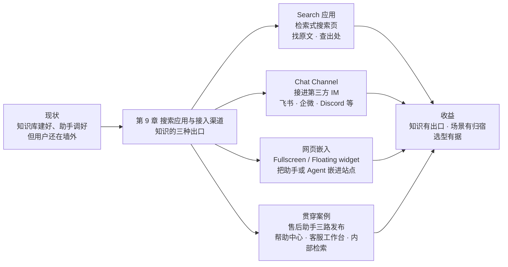
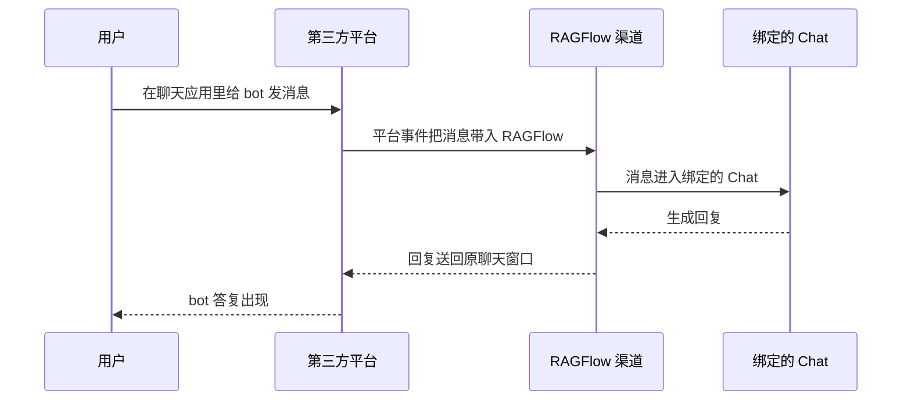

# 第 9 章 搜索应用与接入渠道

> 本章导读：「售后助手」在第 8 章调好了，检索质量在第 7 章验证过了——但它仍然只活在 RAGFlow 的界面里：登录、进 Chat 页、选中会话，才能用。知识做完要「出口」，而出口不止一种：客服想精确翻出政策原文，用户在帮助中心想有个窗口能问，同事在飞书里不想切应用。本章讲 RAGFlow 的三种对外形态——检索式搜索页(Search 应用)、对话渠道(Chat Channel)、网页嵌入——各自的适用场景、配置方法与接入步骤，并用贯穿案例完成「售后助手」的一次三路发布。读完本章，你能：为一个发布需求从三种形态中做出选型；创建 Search 应用并按场景调整检索设置；把 Chat 接进第三方 IM 并完成连通验证；把 Agent 以整页或浮窗形式嵌进自有网页。

*本章导览图*

## 你什么时候需要它

三种典型处境，对应本章三种用法。

**要给团队一个「查文档」的入口，而不是又一个聊天窗口**——看 9.2。客服核对政策原文、按单号查条款这类需求，要的是原文与出处，Search 应用比对话更直接。

**要让用户或同事在他们已有的聊天工具里直接问**——看 9.3。渠道接好后，用户在飞书、企业微信、Discord 里 @bot 就能得到回答，无需登录 RAGFlow。

**要把助手放进自己的网站或产品页**——看 9.4。帮助中心、官网右下角的浮窗，都属这一类；拿不准该选哪种形态，先看 9.1 的对比表与选型决策。

前置：第 3 章建好的数据集(Dataset)是三种出口共同的粮仓；渠道背后挂的是第 8 章配置的聊天助手(Chat Assistant)。

## 9.1 概述：知识做完要「出口」

第 7 章结尾把检索质量调到可信赖，第 8 章把「售后助手」调到能对话——但这些都是「进」的功夫。知识库的价值在被人用到的时刻才兑现，而「被用到」发生在 RAGFlow 之外：帮助中心的网页上、客服的聊天工具里、内部团队的检索入口。本章讲的就是「出」：RAGFlow 提供三种对外形态，对应三类完全不同的使用场景。

三种形态的对比：

| 形态 | 是什么 | 用户在哪 | 典型交互 | 背后的对象 |
|------|--------|---------|---------|-----------|
| Search 应用 | 检索式搜索页 | RAGFlow 的 **Search** 页 | 自然语言提问 + 文档过滤 | 数据集 + 检索设置 |
| Chat Channel(对话渠道) | 接入第三方聊天应用的通道 | 飞书、企业微信、Discord、Telegram 等 IM | 对话式多轮问答 | 绑定的 Chat(WeCom 渠道还可绑 Agent) |
| 网页嵌入 | 把助手或 Agent 嵌进自有站点 | 你的网页(整页或浮窗) | 对话式多轮问答 | Agent(见第 10 章)或聊天助手 |

三种形态分工清晰，选型跟着「用户是谁、在哪、要什么」走：

| 你的场景 | 选什么 | 理由 |
|---------|--------|------|
| 要原文与出处(文档检索、工单辅助) | Search 应用 | 检索形态直接返回切片与来源，不经过生成环节 |
| 用户在 IM 里，不想切应用 | Chat Channel | 渠道把消息搬进来，把答案送回原聊天窗口 |
| 用户在自有网页上(帮助中心、官网) | 网页嵌入 | 整页聊天或浮窗，嵌进你控制的页面 |

**本书立场：先用形态收敛需求，再谈参数调优。** 三种形态共享同一个知识底座，切换成本不高，但「对话还是检索」这个决定影响用户预期——该给原文的场合硬上对话，得到的永远是改写过的答案，反而添乱。对外集成的另一面——让外部程序经 API/MCP 消费这些知识——不属本章，见第 11 章。

## 9.2 Search 应用：检索式搜索页

### 创建与数据集绑定

Search 为知识库提供检索能力，用户输入自然语言问题，可通过文档过滤、结果数量等选项缩小范围。创建五步(官方文档 v1.0.0-rc2)：

1. 顶部导航栏进入 **Search** 页；
2. 点击 **Create Search**；
3. 输入名称并确认；
4. 打开新建的 Search，进入 **Search Settings**；
5. 在 **Datasets** 下选择至少一个知识库，点击 **OK** 保存。

创建完成后必须绑定数据集——没绑数据集的 Search 没有检索对象。除基本检索外，Search 还支持 AI Summary(结果摘要)、Related Search(相关搜索)与 Query Mind Map(查询脑图)三项增强，均为可选开关。

### 搜索设置：九个参数分三组

Search Settings 配置知识源、检索策略与结果呈现，改完点击 **Save**。九个参数按官方文档的三个面向分组：

| 分组 | 参数 | 作用 | 调法(官方文档口径) |
|------|------|------|---------------------|
| 知识源 | **Datasets** | 检索哪些知识库，可多选，多选时同时检索 | 按用途选；塞入大量无关知识库会让不相关结果变多 |
| 检索策略 | **Similarity threshold** | 最低相似度阈值，过滤低相关切片 | 结果太多且不相关→调高；总搜不到预期内容→调低 |
| 检索策略 | **Vector similarity weight** | 向量相似度与全文检索的权重(如 `0.3` = 向量 0.3、全文 0.7) | 用户措辞与原文差异大→调高(偏语义)；专有名词、产品型号、标识符的精确匹配→调低(偏全文) |
| 检索策略 | **Rerank candidates** | 进入重排阶段的候选切片数 | 大库或要覆盖面→调大(开销增)；要速度→调小 |
| 检索策略 | **Rerank model** | 是否启用重排模型对结果重新排序 | 准确率优先→启用(增加延迟与模型调用)；速度优先或未配置模型→关闭 |
| 结果呈现 | **Show chunk metadata** | 结果中是否显示切片元数据 | 需要核对来源→启用；只关心内容本身→可不启用 |
| 结果呈现 | **AI summary** | 是否对检索结果生成 AI 摘要 | 想快速掌握要点→启用；多一次模型调用，增加耗时与成本 |
| 结果呈现 | **Enable related search** | 是否基于当前查询生成相关搜索建议 | 内容探索、研究、开放式搜索→启用；只看当前结果→关闭 |
| 结果呈现 | **Show query mindmap** | 是否以脑图呈现查询的主题结构 | 知识探索与复杂主题→启用；简单事实查询→无必要 |

四个检索策略参数与第 7 章的 Retrieval Testing 页同源——阈值与权重的原理、rerank 的先裸排再重排，第 7 章已讲透(见第 7 章)，本节不重复，只强调两个应用侧差异：一，**Rerank candidates** 是应用侧多出来的旋钮，控制的是候选池大小，不是最终返回条数；二，Search 设置是落盘配置，与 Retrieval Testing「测试参数不落盘」的实验台性质不同——调这里影响的是所有使用该 Search 的人，改前先在测试页验证过。

### 适用场景

Search 应用适合「要找到内容本身」的场合。两个典型：

- **文档检索**：客服核对「运输破损的赔偿标准」原文，要的是条款原文与出处，不是模型转述——开 **Show chunk metadata**，调低向量权重强化条款编号的全文匹配；
- **工单辅助**：处理工单时按产品型号、故障代码检索历史方案，要的是精确命中——同一路数。

反过来，问题开放、需要澄清追问的场合(「我的耳机充不进电怎么办」)是对话的领地，别用 Search 硬接。

贯穿案例的内部检索出口就按这个思路配置(9.5 展开)：绑定 after-sales-kb；开 **Show chunk metadata**——客服要核对出处；**Vector similarity weight** 调低——型号与编码靠全文匹配；**Rerank model** 先关，拿第 7 章的裸排基线对照，准头不够再开。

## 9.3 Chat Channel：把助手接进聊天应用

### 渠道总览

对话渠道(Chat Channel)让用户在 Discord、Telegram、企业微信(WeCom)、飞书 / Lark 等聊天应用里直接与 Chat 对话：用户消息从第三方平台进入 RAGFlow，绑定的 Chat 生成回复送回原聊天窗口。渠道定位一句话——**渠道只负责平台接入与消息转发；回复内容、知识库范围、模型能力与回答质量，由绑定的 Chat 决定。** 支持的渠道：

| 渠道 | 接入方式 | 需开放平台/开发者后台 | 官方文档给出的适用场景 |
|------|---------|----------------------|----------------------|
| Discord | `BotToken` | 是 | 社区支持、产品问答、用户反馈收集 |
| DingTalk | `ClientID` + `ClientSecret` | 是 | 组织内知识问答、流程咨询、协作支持 |
| Feishu / Lark | `AppID` + `AppSecret` | 是 | 企业知识助手、内部业务问答 |
| QQ Bot | `AppID` + `ClientSecret` | 是 | QQ 用户服务、社群问答、频道互动 |
| Telegram | `BotToken` | 是 | 海外用户服务、社群运营、实时对话 |
| WeCom | `Webhook` 或 `WebSocket` | 是 | 员工服务、知识问答、业务机器人 |
| WhatsApp | 扫码配对 | 否 | 用 WhatsApp 联系外部用户的服务场景 |

选平台先看用户在哪：内部团队在飞书 / 企微就选对应渠道，海外用户走 Telegram / WhatsApp，开发者社群走 Discord。

### 接入流程

入口在 **User Settings** → **Chat channels**：页面上半部分显示已添加的渠道，下半部分 **Available channels** 列出可添加的平台。通用流程七步：

1. 进入 **Chat channels** 页；
2. 在 **Available channels** 中选择平台；
3. 创建渠道并填写名称；
4. 按平台填写对应凭证，或完成扫码配对；
5. 保存渠道配置；
6. 将渠道连接到 Chat；
7. 回到第三方平台，向 bot 发送测试消息。

两个行为要点值得提前知道。其一，**保存后页面可能需要几秒**才显示连接状态、二维码或后续提示——按页面提示等待，不要在二维码或状态生成前反复创建渠道。其二，**渠道启用但未连接 Chat 时，RAGFlow 能收到外部消息，但不会生成回复**——「收到了不回」多数是这个原因。另外，修改凭证或渠道类型后 RAGFlow 会自动重启渠道连接；凭证错误时渠道可能启动失败，需回到第三方平台核对 bot 状态、权限与密钥。

### 连接 Chat 与验证

渠道添加成功后要连接到 Chat，用户消息才会进入 Chat 生成回答(以 WeCom 为例，渠道也可绑定 Agent，见下文小节)。五步：

1. 在 **Chat channels** 页找到已添加的渠道；
2. 点击该渠道的连接或编辑入口；
3. 从可用 Chat 列表中选择目标 Chat；
4. 保存配置；
5. 回到第三方平台，向 bot 发送测试消息。

测试消息没有回复时按顺序排查：**先查渠道是否已连接 Chat**，再查 bot 是否在线、第三方平台权限是否齐全、Chat 本身在 RAGFlow 页面能否正常回答——四查从前到后，前三查在渠道侧，最后一查把渠道摘出去验证 Chat 自身。

接通后，一条消息的完整旅程(官方文档描述的数据流)：

*渠道消息流：渠道搬运，Chat 回答*

### 各平台差异与易踩坑

各平台的凭证都从自家开放平台 / 开发者后台获取，参数错误的具体后果官方文档逐平台写明(连不上、认证失败、收发失败)。共性之外，每个渠道都有一两处容易翻车的差异点：

| 渠道 | 易踩坑(官方文档口径) |
|------|----------------------|
| Discord | 未启用 `MessageContentIntent` 时，bot 可能显示在线却读不到用户消息正文；OAuth2 邀请链接选 `bot` scope，并授予收发消息与读取历史权限 |
| DingTalk | 回复依赖消息事件返回的会话 `Webhook`——用户须先向 bot 发消息，RAGFlow 才能在对应会话回复 |
| Feishu / Lark | **Domain** 选错(大陆 Feishu 选 **Feishu(mainland)**，国际版选 **Lark(international)**)会导致认证或 API 调用失败 |
| QQ Bot | **BaseURL** 平时留空用默认地址，仅代理或指定 API 地址时填写 |
| Telegram | 群聊使用需把 bot 加进目标群；群隐私模式影响 bot 能否读取普通群消息 |
| WeCom | `Webhook` 与 `WebSocket` 凭证不能混用：前者要 `CorpID`/`AgentID`/`Secret`/`Token`/`AESKey` 五项，后者只需 `BotID`/`Secret`(先在企微建智能机器人) |
| WhatsApp | 扫码配对：手机 WhatsApp → 设置 → **Linked devices** → **Link a device** 扫码；依赖后端 `WhatsAppGateway`，删渠道或清登录态后需重新扫码 |

### 渠道绑定 Agent：WeCom 的特例

按官方文档，WeCom 渠道除 Chat 外还可绑定自定义 Flow Agent——进来的消息由你在 Agent 画布上设计的工作流回答，而不是普通 Chat(画布与工作流见第 10 章)。连接对话框是单个下拉，条目带类型前缀：`[Chat assistant]` 是当前租户的 Chat，`[Agent]` 是当前租户可访问的 Flow Agent；选中即自动填入对应 id，无需外部凭证。绑定规则有三：一次只能绑定一个目标，选另一个即替换；清空选择即断开；所选 Agent 的组件若未配置模型，运行时会回复错误消息。前提是 Agent 属于渠道所属租户，或以 `team` 权限共享给该租户。

**本书立场：**「渠道可绑 Agent」目前素材只见于 WeCom 渠道，不要想当然泛化到全部渠道；但这个方向值得留意——它意味着 IM 里可以跑的不再只是「问答」，而是「流程」。

## 9.4 网页嵌入：把助手或 Agent 嵌进自有站点

### 嵌入形态

网页嵌入把对话能力放进你控制的页面，两种形态(官方文档口径)：

| 形态 | 样子 | 典型用法 |
|------|------|---------|
| **Fullscreen chat(traditional iframe)** | 整页聊天 | 独立的对话页，页面即对话 |
| **Floating widget(Intercom-style)** | 浮窗 | 帮助中心、官网角落的「随时可问」，不打断浏览 |

本章素材(v1.0.0-rc2)给出的嵌入入口以 **Workflow Agent** 为例、面向自管部署(self-managed deployment)；聊天助手侧的嵌入入口本书未实测，列入章末复核清单。

### 嵌入步骤

前提：在 **User settings > API** 获取 API key(API Key 体系见第 11 章)。随后六步：

1. 在 Agent 页打开目标 Agent 的编辑页；
2. 点击画布右上角 **Management > Embed into webpage**，打开嵌入设置；
3. 在 **Embed Setup** 中选择 **Fullscreen chat(traditional iframe)** 或 **Floating widget(Intercom-style)**；
4. 按需设置 **Language**、**User ID** 与显示选项；启用 **Published** 则使用 Agent 的已发布版本；
5. 浮窗形态用 **Widget Customization** 调整标题、文字与颜色，点击 **Save widget settings** 保存；
6. 复制 **Embed code** 到你的网页；用 **Open in new tab** 预览效果。

**Published** 开关值得单独一句：勾选后嵌入的是已发布版本——本书立场：这意味着画布上的草稿改动不会自动出现在嵌入页里，「发布」是嵌入生效的闸门(发布机制见第 10 章)。改完 Agent 记得重新发布，否则网页上的窗口永远在演上一版剧本。

## 9.5 贯穿案例：售后助手的发布

「售后助手」(第 8 章)现在要发布到三个出口，各走一种形态：

| 出口 | 形态与配置 | 选型理由 |
|------|-----------|---------|
| 帮助中心页 | 网页嵌入：Agent 以 **Floating widget** 浮窗嵌入；先绑「售后助手」，流程化后升级为画布 Agent「售后客服 Agent」(见第 10 章) | 用户在网页上自助，浮窗不打断浏览；问题开放(「耳机充不进电」)，对话形态能澄清追问 |
| 客服工作台 | Chat Channel：飞书渠道，`AppID` + `AppSecret`，**Domain** 选 **Feishu(mainland)**，绑定「售后助手」 | 客服日常在飞书，零培训零切换；渠道只管转发，回答质量由第 7、8 章调好的 Chat 保证 |
| 内部检索入口 | Search 应用：绑定 after-sales-kb，开 **Show chunk metadata**，向量权重调低强化型号/编码的全文匹配 | 客服核对政策原文、按型号查历史方案时，要的是原文与出处，不是模型转述 |

三路发布后有两条纪律。第一，**三个出口共用同一个数据集**，第 4 章调好的切片、第 7 章调好的检索参数在三个出口同时生效——知识底座改一处，三个出口一起受益，这是形态分离、知识统一的架构意义。第二，**每个出口独立验证**：帮助中心发测试消息、飞书里 @bot、Search 页跑第 7 章沉淀的测试问题集——出口不同，故障面不同(网页嵌可能卡在 API key，渠道可能卡在平台权限)，验证不能互相代替。上线后的运维与监控见第 12 章。

## 本章小结

1. **知识做完要出口**：三种对外形态——Search 应用(检索式搜索页)、Chat Channel(接进第三方 IM)、网页嵌入(整页或浮窗)——分别对应「要原文」「在 IM 里」「在自有网页上」三类场景。
2. **Search 应用九参数分三组**：知识源(Datasets)、检索策略(阈值 / 向量权重 / 重排候选 / 重排模型)、结果呈现(元数据 / AI 摘要 / 相关搜索 / 脑图)；四个策略参数与 Retrieval Testing 同源，但这里落盘生效，改前先在测试页验证。
3. **渠道只管搬运，质量在 Chat**：渠道负责平台接入与消息转发；回复内容、知识范围与回答质量由绑定的 Chat 决定；未连接 Chat 的渠道「收到了不回」。
4. **接入验证一条链**：凭证 → 保存 → 连接 Chat → 测试消息；无回复时先查连接，再查 bot 在线、平台权限、Chat 自身。
5. **嵌入以发布为闸门**：**Published** 开关决定网页上跑的是哪一版 Agent；浮窗与整页按场景选。
6. **形态分离、知识统一**：贯穿案例三路发布共用 after-sales-kb，底座改一处，三出口一起受益。

## 验收清单

读到这里，你应该能：

- ☐ 给定一个发布需求(用户、位置、要原文还是要答案)，从三种形态中做出选型并说出理由；
- ☐ 创建一个 Search 应用，绑定数据集，并为「专有名词精确匹配」场景说明该调哪两个参数、往哪个方向调；
- ☐ 完成一次渠道接入：平台拿凭证 → 建渠道 → 连接 Chat → 第三方平台发测试消息验证；
- ☐ 遇到「渠道收得到消息但不回复」时，按四查顺序定位问题；
- ☐ 把一个 Agent 嵌入网页，并说明 **Published** 开关与发布版本的关系。

## 延伸阅读

- **第 7 章(检索测试与调优)**——Search 应用四个检索策略参数的原理与调法；Search 页可直接用第 7 章沉淀的测试问题集做出口级回归。
- **第 8 章(聊天助手与会话)**——渠道背后回答问题的对象；渠道接入前先把 Chat 本身调好。
- **第 10 章(Agent 与工作流)**——网页嵌入支持的 Workflow Agent、WeCom 渠道可绑定的 Flow Agent，其画布与发布机制在本章展开。
- **第 11 章(对外集成：API 与 MCP)**——对外集成的程序侧：让外部系统经 API/MCP 消费同一座知识库。
- **第 12 章(生产运维)**——出口上线后的配置、监控与运维面。

## 复核清单(发布前)

- [ ] 全章对照官方文档 v1.0.0-rc2(search/create_search、search/search_settings、chatchannel 三篇、agent/embed_into_web_pages)，核实日期 2026-10-27
- [ ] 未实测：Search 应用创建与九参数配置(含多数据集同时检索行为)
- [ ] 未实测：任一渠道(计划以飞书或 WeCom 为准)从建渠道到测试消息的全流程
- [ ] 未实测：WeCom 渠道绑定 Flow Agent 的连接对话框与 `[Chat assistant]`/`[Agent]` 前缀
- [ ] 未实测：Agent 嵌入(Embed Setup、Widget Customization、Embed code)；聊天助手侧嵌入入口与参数待补
- [ ] 「渠道只负责接入与转发，质量由绑定 Chat 决定」为素材原意的转述，发布前对照英文原文复核措辞
