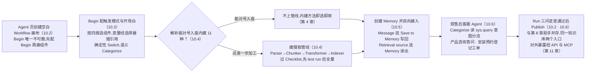
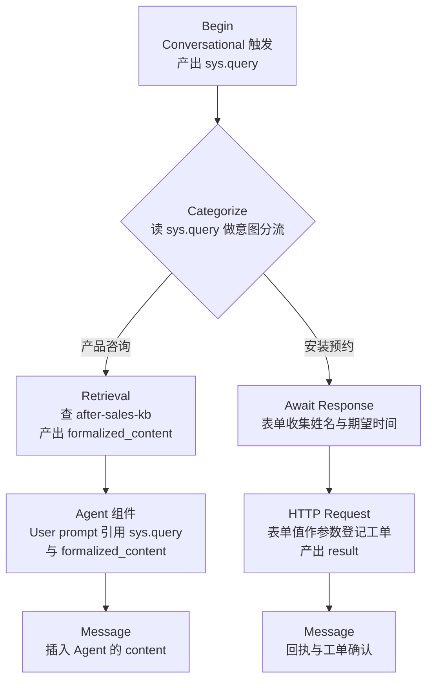

# 第 10 章 Agent 与工作流

> 本章导读:第 8 章上线的「售后助手」能答知识库里的题,但用户说「帮我预约上门安装」时,它只能尴尬地检索一圈再道歉——配置型应用只会检索与生成,不会办事。本章引入 RAGFlow 的第三层能力:画布 Agent。在可视化画布上连接组件、传递变量,就能编排出「意图分流 → 知识检索 → 模型生成 → 调用外部系统」的完整业务流程;数据侧还有 Ingestion Pipeline 自定义解析管线,记忆侧有 Memory 跨会话存取交互历史。本章沿用售后贯穿案例,把第 8 章的「售后助手」升级为「售后客服 Agent」,逐节点讲清变量怎么传。读完本章,你能:读懂画布的节点-边-变量模型;按组件族为业务流程选型;创建自定义摄取管线并完成 test run;为 Agent 配置记忆的写入与检索;从零搭出一个可发布的客服 Agent。



*本章操作流程图*

## 你什么时候需要它

三种典型处境,对应本章三种用法。

**知识库能检索,但用户要的是办事**:先判断意图,再查库或调接口,最后给结果——一条龙,不是一问一答。看 10.1 与 10.3,再用 10.6 照着搭。

**内建解析满足不了**:特殊格式要换解析器组合、切片要加摘要与标签、甚至要编译成知识工件。看 10.4——它是第 4 章内建解析的可编排版本。

**Agent 得记住用户上次说过什么**:跨会话的偏好、历史工单、上下文延续。看 10.5,配置记忆的写回与检索两个方向。

前置:第 2 章已配置 chat 模型;第 3-5 章的 after-sales-kb 已解析出可用切片;第 8 章的聊天助手作为对照物(不是硬前置,但 10.1 的分工与 10.6 的对比会不断回指它)。

## 10.1 概述:画布模型与聊天助手的分工

官方对 Agent 的定义一句话:**在可视化画布上连接组件,构建自动化工作流**——连接定义执行顺序;条件、分类与循环控制哪些步骤运行(docs/guides/agent/agent_overview.md,v1.0.0-rc2,核实日期 2026-10-27)。

这句话拆出画布模型的三个要素:

| 要素 | 是什么 | 类比 |
|------|--------|------|
| 节点(组件) | 一个处理步骤:检索、生成、调接口、判断 | 流程图里的方框 |
| 边(连接) | 定义执行顺序:从上游组件的连接点拉到下游 | 流程图里的箭头 |
| 变量 | 节点间传数据的机制:上游的输出被下游引用 | 函数间的参数 |

三要素里最容易被忽视的是变量。画布上的连线只回答「先做什么后做什么」,不回答「数据怎么从上一步流到下一步」——后者靠变量引用完成。10.3 会专门讲,10.6 会逐节点走查。

### 与聊天助手的分工

第 8 章已给出两者对比表(见 8.1),官方的分法一句话:**Chat 适合以知识库问答为主、多轮对话的应用;Agent 适合需要条件分支、工具调用、数据处理或多步编排的业务工作流**。

落到判断上,三判据命中其一,就该从聊天助手升级到画布 Agent:

1. **多步流程**——一个请求要经过「先查 A、再算 B、最后汇总」的多步,而不是一次检索一次生成;
2. **工具调用**——要碰知识库以外的东西:HTTP 接口、数据库、MCP 工具、自定义代码;
3. **条件分支**——不同输入走不同的路:售后问题查政策库,预约请求进表单, complaints 转人工。

官方列的典型场景与此对应:基于知识库答问;识别意图并分流到不同处理流;调用 HTTP 接口、数据库、MCP 工具或自定义代码;拆分与批处理长文本;保存会话记忆或导出处理结果。

还有一个容易忽略的细节:Retrieval 组件在 Agent 里有两个用法——作为**普通工作流节点**(固定位置,固定检索),或挂到 Agent 组件下当**工具**(由 LLM 自主决定何时检索)。前者是第 8 章式问答的画布版,后者才带一点「自主性」。本章 10.6 用前者,好懂也好调试。

### 本章术语

| 术语 | 英文 | 一句话定位 |
|------|------|-----------|
| 数据集 | Dataset | 知识载体,Retrieval 的检索对象(第 3 章) |
| 切片 | Chunk | 检索与引用的基本单元(第 4 章) |
| 摄取管线 | Ingestion Pipeline | 可编排的解析-切片-增强-索引流程(本章 10.4) |
| 知识工件 | Artifact | 知识编译产出的知识树/Wiki 等形态(第 6 章) |
| 聊天助手 | Chat Assistant | 挂在数据集上的配置型问答应用(第 8 章) |
| 记忆 | Memory | 保存会话内容与执行结果,供跨会话复用(本章 10.5) |

## 10.2 画布速览:创建与管理

### 入口与三种创建路径

登录后点顶部导航 **Agent**,已创建的 Agent 以卡片展示,点卡片继续编辑。三种创建路径(docs/guides/agent/creation_and_management.md,v1.0.0-rc2):

| 路径 | 起点 | 适合 |
|------|------|------|
| **Create from template** | 模板已预设组件与连接(Deep Research、Knowledge Base Q&A、Data Analysis、E-commerce Customer Service 等) | 业务场景与模板接近,只需改模型、知识库、提示词、接口地址或输出内容 |
| **Create from blank:Workflow** | 画布只有 `Begin` | 会话式 Agent,本章主角 |
| **Create from blank:Ingestion pipeline / Compilation operator** | 管线以 `Begin → Parser` 开始 | 自定义解析(10.4);知识编译(见第 6 章) |

空白创建时先选类型(Workflow / Ingestion pipeline / Compilation operator)、命名、确认,再进画布。还有一条非交互路径:在旧 Agent 上 **Management > Export** 导出 JSON,再以新名字导入——这是「复制」的官方做法,也是配置备份的唯一途径(删除会连带删除所有保存的版本,删前先导出)。

### Begin 规则与画布操作

两条硬规则先记住:

- `Begin` 是工作流起点,**每个 Agent 只能有一个,且不可删除**;先配置 Begin,再配置后续组件;
- **未连接到执行路径的组件不会运行**;删除组件前,先检查上下游连接与变量引用,避免下游节点缺输入。

日常画布操作三件事:点组件旁的 **+** 号选下一个组件;点组件本身打开右侧配置面板(字段、输入变量、输出变量、执行设置都在这里);从上游组件的连接点拉线到下游。连接的语义:顺序组件沿单一路径执行;`Switch`、`Categorize` 这类分支组件按条件把流路由到不同出口;`Iteration` 循环执行子流程。

配置面板的推荐用法是一句口诀:**先确认组件读什么变量 → 配处理逻辑 → 验证下游引用的输出正确**——每个组件配完,顺着这三步过一遍,大部分连线错误当场就能发现。

### 保存、运行与发布

编辑器显示最新自动保存时间。四个动作各有分工:

| 动作 | 作用 | 何时用 |
|------|------|--------|
| **Save** | 保存编辑配置 | 每改完一个组件 |
| **Run** | 编辑器内测试:输入测试问题,观察每个组件的执行结果 | 调试,发布前必做 |
| **Launch** | 打开会话页(Conversational 模式) | 自测对话体验 |
| **Publish** | 创建发布版本 | 测试通过后 |

Run 时组件没有输出,按顺序查五处:输入变量、模型配置、知识库权限、外部接口地址、工具配置——官方文档给的就是这个排查面。特别注意第一项:九成的「组件沉默」是变量引用错了名字或指错了上游。

### 管理面板

Workflow 画布的 **Management** 提供六项:

| 条目 | 用途 |
|------|------|
| Conversation variable | 配置会话级变量 |
| Version history | 浏览保存的版本并查看画布配置;注意历史条目**不等于**已发布版本 |
| Log | 按 ID/标题与日期搜执行记录,查看 state、version 等详情,支持导出当前页 |
| Export | 导出 Agent 配置(备份/复制) |
| Settings | Agent 设置 |
| Embed into webpage | 网页嵌入选项 |

## 10.3 组件族地图:四族组件与变量传递

### 变量传递:画布的血液

组件的输入字段里,输入 `/` 或点输入框旁的变量图标,打开变量选择器,从三类来源里选(docs/guides/agent/understand_the_canvas.md,v1.0.0-rc2):**系统变量**、**Begin 组件定义的全局变量**、**上游组件的输出**。选完自动插入引用——注意引用的是画布上真实存在的组件,示例里的名字只是示意,不要手打。

四个最常用的变量,全书反复出现,建议背下来:

| 变量 | 内容 | 谁产出、谁消费 |
|------|------|----------------|
| `sys.query` | 当前用户输入的问题 | 系统给出;Categorize、Retrieval、Agent 的 prompt 都读它 |
| `formalized_content` | Retrieval、SQL 或工具组件输出的整理后文本 | 检索/工具产出;Agent 的 User prompt 消费 |
| `chunks` | 文档解析或切片组件输出的片段集 | 管线内流转(10.4) |
| `content` | Agent、Code 等组件的主文本输出 | 生成类组件产出;Message 消费 |

### 四族组件表

Workflow 画布的组件按职责可归为四族(官方文档按组件逐个设页,未做官方分族;下表的归族为本书立场,组件清单以文档为准):

| 族 | 组件 | 职责 | 典型用法 |
|----|------|------|---------|
| 对话与生成 | `Begin` | 起点:触发模式、开场白、输入变量 | 每个 Agent 必有,见下文 |
| | `Agent` | 调 LLM 推理、生成、规划与工具调用 | 画布上的「大脑」,见下文 |
| | `Message` | 向用户输出回复 | 兜底流程的最后一棒,常插 `content` 或回执文案 |
| | `Await response` | 中途向用户收集输入并等待 | 表单收集:姓名、时间、选项(10.6 预约分支) |
| 数据操作 | `Retrieval` | 从知识库或 Memory 检索 | `sys.query` 进,`formalized_content` 出,见下文 |
| | `Execute SQL` | 查外部数据库,结果转为文本/表格 | 库存查询、报表取数(六种库,见表后说明) |
| | `Code` | 运行自定义代码加工数据 | 解析 HTTP 的 JSON 响应、字段整理 |
| | `Text processing` | 文本加工 | 对上游文本做轻量变换 |
| 流程控制 | `Categorize` | 按语义把输入分类,路由到对应出口 | 意图分流(10.6 主角) |
| | `Switch` | 按条件表达式分支 | 确定性条件:数值比较、布尔判断 |
| | `Iteration` | 循环执行子流程 | 长文本分段批处理 |
| 外部工具 | `HTTP Request` | 调 REST API | 工单登记、通知推送,见下文 |
| | MCP 工具 | 经 Agent 组件工具选择器接入的 MCP Server 工具 | 外部工具标准化接入(→ mcp 书) |
| | 搜索类(Tavily、Google、DuckDuckGo、SearXNG、Keenable、Sofya、Search1API 等) | 网页/新闻/学术检索 | 知识库没有的公开信息 |
| | `Email` / `Document Generator` / `Browser` | 发邮件/生成文档文件/自然语言抽取网页 | 结果送达与素材抓取 |

选型心智:**确定性的判断用 `Switch`,语义性的判断用 `Categorize`**;固定的外部调用连 `HTTP Request` 节点,需要 LLM 自主决定调不调的,才挂到 Agent 组件的工具列表里。

官方文档对 `Code` 与 `Text processing` 未设专页,表中职责按素材归纳;其余组件以下文展开为准。

### Begin:起点与触发模式

`Begin` 配置三件事:触发模式、开场白、输入变量(docs/guides/agent/agent_workflow/basic_component.md,v1.0.0-rc2)。

| 触发模式 | 机制 | 适合 |
|---------|------|------|
| **Conversational** | 对话触发,可配开场白 | 常规聊天型 Agent(默认) |
| **Task** | 作为任务启动 | 非对话的自动化流程 |
| **Webhook** | 外部 HTTP 请求触发 | 系统集成、自动化、第三方回调 |

Webhook 是三模式里配置最重的,四个要点:复制生成的 URL 并选择允许的请求方法;**Security** 里配认证——Token 认证要求调用方携带 `X-Webhook-Token` 头且值一致,外部请求还需 `Authorization: Bearer <RAGFlow API key>`(账号须有权访问该 Agent);**Schema** 选 `application/json` 并定义请求字段(不支持 multipart 文件上传,返回 HTTP `501`);**Response** 二选一——**Accepted response** 先确认再后台继续,**Final response** 等流程跑完返回结果消息。

输入变量(Input)定义用户开始会话前要提供的参数,后续组件经变量选择器引用。类型七种:单行文本、段落文本、下拉选项、文件上传、数字、布尔、JSON 对象。注意文件上传的边界:文件只在当前工作流内可用,**不会自动入库**;文档类上传需选解析器并经 `sys.files` 引用,图像类需在 Agent 组件选视觉模型,视频不支持,且内容须在模型上下文限制内。

### Agent 组件:画布上的大脑

Agent 组件调用大模型做推理、生成、任务规划与工具调用,可以独立处理用户问题,也可以与检索、HTTP、代码、数据库、子 Agent 协作完成多步任务。配置项:`Model`、`System prompt`、`User prompt`、`Tools`、`Agent`、`Message window size`、`Max retries`、`Delay after error`、`Max reflection rounds`、`Output`。

**Prompt 写法**承第 8 章的纪律:System prompt 定义角色与行为边界,User prompt 定义当前任务与输入数据。跟在检索组件后面时,User prompt 的标准结构是「问题 + 参考资料 + 约束」——输入 `Question: ` 后插入 `sys.query`,换行输入 `Reference: ` 后插入上游 Retrieval 的 `formalized_content`,再加一句指令:

```text
Answer using the reference. If it does not contain the answer, say so.
```

(示例来自官方文档原文;中文场景可写作「仅依据参考资料回答,资料没有就说没有,并追问用户」。)

**Tools 与子 Agent**:在 Agent 组件下挂了工具或子 Agent 后,当前 Agent 的角色变为 **planner**——由模型决定何时调用哪些能力。内置工具选择器含知识检索(Retrieval)、Execute SQL、Code、search 等;MCP 工具在 **MCP 标签页**选择(配置入口 **User settings > MCP > Add MCP**,运行用户须有所选 Server 的权限,外部工具经 MCP 接入的协议细节 → mcp 书)。两个易踩的边界:`HTTP Request` 是工作流节点,**不在** Agent 组件的内置工具选择器里;挂了工具或子 Agent 后面板才出现 **Max reflection rounds**,选了 MCP 工具后才出现 **Tool timeout**。工具何时该用,要写进 System prompt,官方示例的句式值得抄:「Use Retrieval for product questions; if no relevant content is found, ask the user for more details.」

**Output 结构化**:默认输出是 `content`(自然语言文本);开启 **Structured output** 后,按自定义 JSON Schema 返回 `structured`,便于 `Code`、`HTTP Request`、`Execute SQL`、`Switch` 等下游节点程序化读取——这是「Agent 产出 → 结构化消费」的关键机关,比从自由文本里抠字段可靠得多。

**高级设置**两项常用:

| 参数 | 作用 | 建议 |
|------|------|------|
| Message window size | 推理时保留的历史消息条数;越大上下文越全,token 消耗越高 | 一般保持默认;多轮对话调大,单轮任务调小 |
| Citation | 回答是否携带引用信息 | 知识库问答场景建议开启(同第 8 章纪律) |

官方有一条性能提醒值得贴在工位上:工具调用、反思轮次与会话历史都会拉长响应时间——**常规问答从简单工作流起步,任务确实需要时再加工具或子 Agent**。

### Retrieval 组件:知识检索

Retrieval 在画布上从指定的知识库或 Memory 检索相关内容,既可作普通工作流节点,也可作 Agent 组件的工具(10.1 已提)。配置五步:选 **Query variable**(常用 `sys.query`);**Retrieval source** 选一个或多个知识库,或选 Memory;高级设置里调 **Similarity threshold**、**Keyword similarity weight**、**Rerank candidate count**、**Top N**(需要时选 **Rerank model**);跨语言场景选 **Cross-language search**;Run 试检。

参数语义与第 7 章一脉相承,此处只记画布侧的差异点:

| 参数 | 初始值/默认 | 要点 |
|------|------------|------|
| Similarity threshold | 0.2(百分比控件显示 20) | 越高越严,可能漏;0.2 宽松召回,0.5 一般问答,0.8 严格匹配 |
| Keyword similarity weight | 0.7(向量 0.3) | 面板同时显示两权重;调大偏关键词,调小偏向量 |
| Rerank candidate count | 64 | 参与重排的候选数,与 Top N 是两回事 |
| Top N | 8 | 传给下游的切片数;FAQ 类 3-5,产品文档 5-10,长文档 10-20 |

多知识库联合检索时,确保它们使用**同一 embedding 模型**;检索结果缺失时,检查 **Meta data** 过滤条件;Rerank 通常改善排序但增加模型调用延迟,速度敏感的 Agent 可先不开——这套取舍的第 7 章已完整论证(见第 7 章)。

### 工具组件:连接外部世界

工具组件把外部搜索、数据库、HTTP API、邮件、文档生成、网页抽取接进 Agent(docs/guides/agent/agent_workflow/tool_components.md,v1.0.0-rc2)。展开三个最常用的,其余按选型表对号入座:

**Execute SQL**——连外部数据库执行 SQL,结果格式化为文本或表格。要点:库类型支持 `mysql` / `postgres` / `mariadb` / `mssql` / `trino` / `oceanbase`;`max_records` 默认 1024,限单条语句返回记录数;地址须 RAGFlow 服务器可达;`sql` 字段支持画布变量,可与上游输出拼查询。给 Agent 的权限只读——画布执行的是你写的语句,但变量拼接意味着内容不完全可控。

**HTTP Request**——调外部 REST API,业务系统由此接入画布。配置表:

| 配置 | 说明 |
|------|------|
| Url | API 地址,可插画布变量 |
| Method | GET / POST / PUT |
| Timeout | 秒,默认 60 |
| Headers | JSON 对象 |
| Parameter | 点 `+` 添加,值可用常量或变量 |
| Clean HTML | 去除响应中的 HTML 标记 |

输出是 `result`(响应体文本);URL 被拒时输出 `_ERROR` 且 `result` 为 null——**消费 `result` 前先判 `_ERROR`**;JSON 响应体要用其中的字段,先过一道 `Code` 组件解析。

**搜索类工具**——官方选型表精简如下:通用网页检索选 Tavily(为 LLM 设计,`formalized_content` 直接进 prompt)、DuckDuckGo(免 key)或自托管 SearXNG;指定站点内容用 Tavily 的 Include Domains 或 Keenable 的 site 参数;学术论文走 Google Scholar / ArXiv / PubMed;网页正文抽取用 Tavily Extract 或 Browser(配 chat 模型,自然语言指令驱动)。产物约定与检索一致:`formalized_content` 给 Agent 做 prompt,`json` 给下游节点读字段。

## 10.4 摄取管线:自定义解析流程

第 4 章讲解析时提过一句:数据集的解析入口分 Built-in(内建)与 Pipeline(自定义摄取管线)两条。内建是「选一种切片方法,其余交给平台」;**Ingestion Pipeline 则把解析-切片-增强-索引打开成一张可编排的画布**——它就在 Agent 页创建,是本章画布模型的第二种画布。

### 创建与典型流

入口:**Agent > Create agent > Create from blank**,类型选 **Ingestion pipeline**(docs/guides/agent/ingestion_pipeline/create_ingestion_pipeline.md,v1.0.0-rc2)。画布以 `Begin → Parser` 开始,典型流:

**Begin → Parser → Token Chunker → Transformer → Indexer**

Transformer 可选;Transformer 之后也可选 Compiler 走知识编译(每画布限一个 Compiler,模板组经 **Compilation operator** 准备,见第 6 章)。

### 五个核心组件

| 组件 | 职责 | 对应第 4-6 章内建侧概念 |
|------|------|------------------------|
| `Parser` | 读并理解文件(PDF、图像、邮件等),抽取文本与结构 | 内建解析器(DeepDOC 等,第 4 章) |
| `Token Chunker` | 按目标 token 数把长文切成 chunk | General 切片的 chunk size(第 4 章) |
| `Title Chunker` | 按标题结构切片 | Title Chunker / Hierarchy 与 Group(第 4 章) |
| `Transformer` | 给 chunk 增强摘要、关键词、问题、标签、元数据;一个节点可多开 | Extractor 的增强环节(第 5 章) |
| `Indexer` | 末环:把处理后的数据送入文档引擎,支持全文+向量混合检索 | Indexer(第 5 章) |
| `Compiler` | 用编译模板组与模型把 chunk 组织成知识树/思维导图/Wiki | 知识编译(第 6 章) |

### test run:先样本后全量

管线的验证手段不是 Run,而是 **test run**:配置各组件、过 **Checklist**、Save 之后,用**测试知识库**对样本文档跑一遍,确认解析、切片、增强、索引各环节的产物符合预期,再处理整批文档(docs/guides/agent/ingestion_pipeline/test_run.md)。这与第 4 章的纪律同源:解析选错的代价不是报错,而是安静地切出糟糕切片——管线把每段打开,恰恰是为了让「安静的错误」在样本上现形。

### 内建还是管线:取舍

**本书立场:标准化选内建,特殊处理选管线。**

| | 内建解析 | 摄取管线 |
|---|---------|---------|
| 成本 | 选方法即用,零编排 | 画布搭建 + 逐组件配置 |
| 覆盖 | 11 种切片方法,绝大多数形态(第 4 章) | 组件自由组合,可插增强与编译 |
| 适合 | 主流文档、团队自服务、快速起量 | 特殊格式、要插 Transformer 增强、要接 Compiler 出工件、要按文档族精细控制每一步 |

判断口诀:第 4 章的 11 种内建方法能对号入座的,不要上管线;对号入座之后还差「一步加工」的,才把那一步在管线里补上。

## 10.5 记忆:让 Agent 记住交互

第 1 章埋过一个区分:RAG 与 Memory 技术底座一致,差别在数据来源——**RAG 面向事先准备好的既有知识,Memory 面向交互中实时产生的动态数据**(见第 1 章)。RAGFlow 把这两个东西做成了 Retrieval 组件的两个可选来源,本章把这个区分落成配置。

### Memory 与知识库的互补

| | 知识库(RAG) | Memory |
|---|-------------|--------|
| 存什么 | 既有知识:手册、政策、FAQ | 交互记忆:会话内容与 Agent 执行期间产生的抽取结果 |
| 数据何时产生 | 上线前准备与更新 | 每次对话与执行中实时写入 |
| 典型问题 | 「退货政策是什么」 | 「我上次报修的工单号是多少」 |
| 作用 | 让回答有据可查 | 让 Agent 跨会话复用历史上下文 |

### 创建 Memory

入口:**Memory 页 > Create memory**,四步:命名;选记忆类型;选 embedding 模型;选大语言模型;Confirm(docs/guides/memory/create_memory.md,v1.0.0-rc2)。创建后进入列表或详情页,Memory 还有自己的 **Messages** 页,后面验证写入要用它。

### 双向接入:写回与检索

记忆必须连接到 Agent 才会生效,且通常**两个方向都要配**(docs/guides/memory/connect_to_an_agent.md,v1.0.0-rc2):

**写回(Write to memory)**:在 Agent 画布上选或加 `Message` 组件 → 配置里找 **Save to Memory** → 选目标记忆;历史需要按用户区分时,配置用户 ID → 保存并跑一次测试 → 回记忆的 **Messages** 页确认有新消息产生。注意挂载点:`Save to Memory` 长在 Message 组件上,Agent 只输出不入库,没有 Message 节点就没有写回。

**检索(Retrieve from memory)**:在画布上选或加 `Retrieval` 组件 → **Query variable** 用 `sys.query`(常用)→ **Retrieval source** 选 **Memory** 并勾选目标记忆 → 调 Similarity threshold、Vector similarity weight、Top N → 把检索结果接给下游的 LLM 或回答组件 → 保存测试,确认回答正确引用了历史记忆。

设计上的优雅之处:读知识库和读 Memory 是**同一个 Retrieval 组件**,换的只是 Retrieval source。所以一个售后 Agent 可以同时挂两个 Retrieval——一个查 after-sales-kb(政策与商品资料),一个查 Memory(这个用户的历史报修)——下游 Agent 的 prompt 里两份 `formalized_content` 各占一段。

还要分清一对概念:Agent 组件的 **Message window size** 是会话内上下文(多轮对话的历史窗口,本章 10.3);Memory 是**跨会话**的持久化。窗口管「这轮对话我记得多少」,Memory 管「上次会话我记得什么」——两者互补而非互替。

## 10.6 贯穿案例:售后客服 Agent

现在把第 8 章的「售后助手」升级为画布 Agent「售后客服 Agent」。骨架取自官方 quickstart「Build a Customer Support Agent」(docs/guides/agent/quickstarts/build_customer_support_agent.md,v1.0.0-rc2),域改为售后:知识库用第 3-5 章建好的 after-sales-kb,流程上比 quickstart 多一步工单登记。

### 画布总览



*售后客服 Agent 画布:两条分支,五种变量引用*

### 逐节点走读:变量怎么传

**① Begin——产出 sys.query**。类型选 Workflow,触发模式 Conversational;开场白一句话说清能力边界:「您好,我是售后客服,可以解答产品使用与售后政策问题,也可以登记安装预约。」开场白不产生变量;用户在对话里输入的每句话,由系统变量 `sys.query` 携带,供所有下游节点引用。

**② Categorize——读 sys.query,输出路由**。加在 Begin 之后,查询变量用 `sys.query`,模型选第 2 章配置的 chat 模型。定义两个分类,每个分类给名称、描述、例句——描述与例句就是这一节点的「检索提示词」,写得越像真实用户的话术,分流越准:

| 名称 | 描述 | 例句 |
|------|------|------|
| 产品咨询 | 产品功能、使用方法与故障排查 | Model A 怎么重置? |
| 安装预约 | 预约上门安装、维修排期 | 我想约师傅上门安装 |

变量进出:读 `sys.query`;输出是路由——命中哪个分类,流程就走哪个出口。这里没有文本变量可引用,分类结果体现在走哪条边。

**③ Retrieval——产品咨询分支**。加在「产品咨询」出口后:Query variables 用 `sys.query`,Retrieval source 选 after-sales-kb。参数沿用第 8 章 8.4.2 落定的结论:Similarity threshold 0.2、Keyword similarity weight 0.5、不开 Rerank——第 7 章调优的结论在聊天助手与画布 Agent 两处要**保持一致**,这是同一套知识服务两个入口的基本盘。变量进出:读 `sys.query`;产出 `formalized_content`(命中切片的整理后文本)。

**④ Agent 组件——LLM 生成**。System prompt 定边界(可直接抄改):

```text
你是售后客服,依据产品资料回答产品使用与售后政策问题。
资料中没有的,明确说没有,并追问一个澄清问题;不猜测、不编造。
```

User prompt 按标准结构组装:输入 `Question: ` 后经变量选择器(输入 `/`)插入 `sys.query`;换行输入 `Reference: ` 后插入 ③ Retrieval 的 `formalized_content`。开启 Citation。变量进出:读 `sys.query` 与 `formalized_content`;产出 `content`(自然语言回答)。

**⑤ Message——回复用户(产品咨询分支终点)**。插入 ④ 的 `content`。变量链至此闭环:`sys.query`(用户问题)→ `formalized_content`(检索结果)→ `content`(回答)——三次引用,就是画布数据流的全部主干。

**⑥ Await Response——安装预约分支:收集表单**。加在「安装预约」出口后,向用户展示表单,收集客户姓名与期望安装时间,等待用户提交(quickstart 的官方示例即用此组件收这两项)。变量进出:触发条件来自分类路由;产出表单提交结果,供下游节点引用。

**⑦ HTTP Request——登记工单**。加在 ⑥ 之后:Method POST,Url 指向售后工单系统的创建接口,Parameter 里把 ⑥ 收集的姓名与时间作为请求字段(值选变量而非常量)。变量进出:读 ⑥ 的表单结果;产出 `result`(响应体文本)。两处纪律:消费 `result` 前先判 `_ERROR`;POST 失败时 Message 要有兜底话术,而不是把 `_ERROR` 原样甩给用户。

**⑧ Message——回执(安装预约分支终点)**。插入 ⑦ 的 `result` 或组装一段确认文案:「已为您登记安装预约,姓名 X,时间 Y,工单号 Z。」

这里有一处对 quickstart 的刻意偏离,本书立场:**quickstart 原版的预约分支止步于「收集并展示」,不真正落单**——教学上干净,生产上欠账。官方在 agent_overview 里的售后示例恰好补了这一环:「若用户要求安装预约,用 HTTP 请求调用外部工单系统」。⑦ 就是这一环,把「收集偏好」升级为「登记工单」。

### 三问走查与排障

Save 后 Run,三条测试问句各走一条路:

| 输入 | 预期 |
|------|------|
| Model A 怎么重置? | 产品咨询分支;after-sales-kb 中「重置需长按 reset 键 5 秒」被检索并引用作答 |
| Model A 支持 Bluetooth 吗? | 产品咨询分支;Agent 明确说资料未提及,并追问 |
| 我想约师傅上门安装 | 安装预约分支;出现表单,提交后回执含登记信息 |

排障三条(quickstart 原文归纳):路由错了,细化分类的描述与例句;检索为空,查解析状态、知识库选择与查询词;回答无视检索文本,查 Agent 的变量引用——又是变量,10.2 的五查里它排第一不是偶然。

两条分支都按预期工作,才点 **Publish**。发布后,这个 Agent 与第 8 章的「售后助手」并存于同一套 after-sales-kb 之上:同一份知识,两个入口,各答各的题——这正是 8.1 分工表的落地形态。

## 本章小结

1. **画布模型三要素**:节点(组件)、边(执行顺序)、变量(数据传递)——连线管顺序,变量管数据,后者才是九成错误的来源。
2. **与聊天助手分工**:多步流程、工具调用、条件分支三判据命中其一,从助手升级到画布 Agent;纯知识问答留在第 8 章。
3. **组件族选型**:确定性判断用 `Switch`,语义判断用 `Categorize`;固定调用连 `HTTP Request` 节点,LLM 自主决策才挂 Agent 工具列表;四个常用变量 `sys.query`、`formalized_content`、`chunks`、`content` 是数据流主干。
4. **管线是打开的内建**:Begin → Parser → Chunker → Transformer → Indexer;标准化选内建,特殊处理选管线;先 test run 后全量,与第 4 章纪律同源。
5. **Memory 双向接入**:Message 组件挂 Save to Memory 写回,Retrieval 组件选 Memory 来源读出;窗口管会话内,Memory 管跨会话。
6. **售后客服 Agent**:两条分支五种变量引用;quickstart 的「收集展示」在生产里要补上 HTTP 工单登记,才配叫「办事」。

→ 画布 Agent 只在 RAGFlow 界面里可达;**第 11 章**把 HTTP API 与 MCP Server 打开,让外部应用与平台侧 Agent 也能消费这套知识能力。

## 验收清单

读到这里,你应该能:

- ☐ 说出画布模型三要素(节点/边/变量)与聊天助手的分工,并用三判据为一个新需求做一次选型;
- ☐ 在画布上完成一次变量引用:在 Agent 组件的 User prompt 里插入 `sys.query` 与上游 Retrieval 的 `formalized_content`;
- ☐ 为 Begin 配置一种非默认触发模式(Webhook),说清 Token 头、Bearer 凭证与两种 Response 模式的取舍;
- ☐ 用四族组件表为一个三步业务流程选型连线,并说明 `Switch` 与 `Categorize` 各自的适用场景;
- ☐ 创建一条 Ingestion Pipeline(Begin → Parser → Token Chunker → Transformer → Indexer),并说明 test run 为什么先于全量导入;
- ☐ 为一个 Agent 配置记忆双向接入:Message 组件写回、Retrieval 组件读出,并验证 Messages 页出现新消息;
- ☐ 按 10.6 搭出售后客服 Agent,跑通三问走查,并指出哪一步是对 quickstart 的生产化补全。

## 延伸阅读

- **第 8 章(聊天助手与会话)**——纯知识问答的配置型路线,与本章画布路线互为替代;10.6 的对比结论建立在 8.1 的分工表上。
- **第 4-5 章(解析切片/增强索引)**——10.4 管线每个组件的内建对照面;读管线前先读它们,才知道每个节点在替代什么。
- **第 6 章(知识编译与知识工件)**——管线里 `Compiler` 组件与 Compilation operator 的完整展开。
- **第 11 章(对外集成:API 与 MCP)**——本章 Agent 只在界面内可达;对外暴露的两种方式与外部工具经 MCP 接入的协议细节(→ mcp 书)。
- **官方 quickstart 原文(Build a Customer Support Agent)**——10.6 的骨架出处,英文原版可作搭建时的对照清单。

## 复核清单(发布前)

- [ ] 全章事实对照官方素材(docs/guides/agent 七份 + docs/guides/memory 两份,v1.0.0-rc2,核实日期 2026-10-27)逐节复核
- [ ] 10.6 画布 Agent 未实机走查:三问走查结果、HTTP Request 工单登记均为按文档推演,待实机补实测记录
- [ ] 10.4 test run 未实测:测试知识库验证流程待实机走通
- [ ] 10.5 Memory 创建与双向接入未实测;Save to Memory 挂载点、Vector similarity weight 字段名以实机面板为准
- [ ] Await Response 表单配置细节(dialogue_component.md 收集预约示例)未深读,10.6 ⑥ 仅按 quickstart 概述展开
- [ ] 10.6 ③ 检索参数沿用第 8 章 8.4.2 结论(0.2/0.5/无 rerank),实机核对 Agent 检索组件面板参数项与聊天助手是否同款
