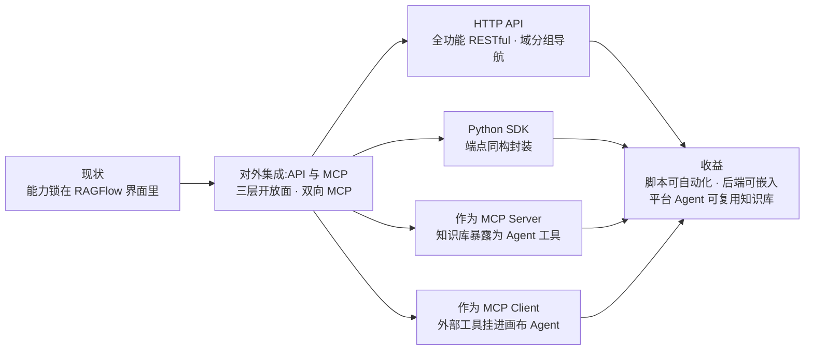
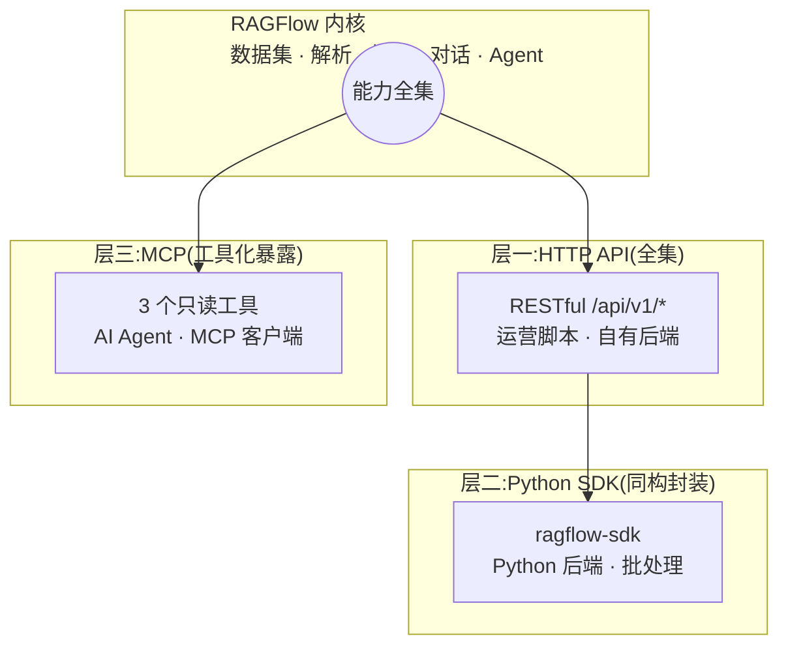
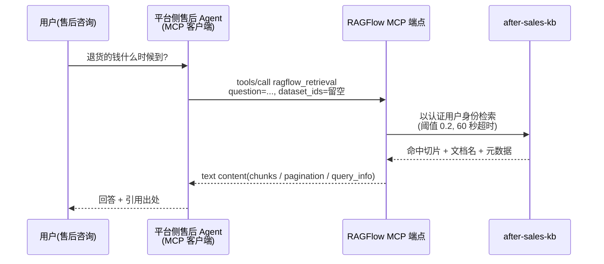

# 第 11 章 对外集成：API 与 MCP

> 本章导读:第 10 章结束时，after-sales-kb 已经长出了画布 Agent，但它的能力仍被锁在 RAGFlow 自己的界面里——售后团队的运维脚本想批量导入工单文档、自有后端想把检索嵌进业务接口、mcp 书里那个中台售后域的 Agent 更是想直接「查知识库」。这些诉求指向同一件事:RAGFlow 必须把自己开放出去。本章梳理三层开放面——HTTP API（程序化全功能）、Python SDK（同构封装）、MCP（Model Context Protocol，面向 Agent 的工具化暴露）——给出 API Key 的获取与认证方式，按域导航上百个端点，然后走进 MCP 的双向角色:RAGFlow 既是把知识库暴露成工具的 MCP Server，也是把外部工具挂进画布 Agent 的 MCP Client。读完本章，你能:为「运营脚本、自有后端、外部 Agent」三类消费方各选对一条开放路径；走通「创建数据集→上传→解析→检索测试（Retrieval Testing）」的 API 链路；说出 RAGFlow 双向 MCP 角色的配置要点与取舍。



*本章导览图*

## 你什么时候需要它

**要写脚本批量维护知识库**（导入历史工单、定期同步文档、巡检解析状态）——走 11.3 的 HTTP API 或 11.4 的 Python SDK，选哪个看你的技术栈；这类脚本与第 12 章（生产运维）的 CLI 巡检还会会师。

**要在自有后端里嵌入 RAGFlow 的检索或对话能力**——同样走 HTTP API / SDK，重点看 11.3 的检索端点与 11.7 的取舍分析；Java 后端的接入细节（→ agentscope-java 书）。

**要让 RAGFlow 之外的平台 Agent（或 IDE、ChatBot 等任何 MCP 客户端）直接查你的知识库**——11.5，RAGFlow 作为 MCP Server；**反过来，要让画布 Agent 调用外部世界的工具**（联网搜索、第三方系统）——11.6，RAGFlow 作为 MCP Client。

前置:第 3 章的数据集（Dataset）概念、第 7 章的检索参数、第 10 章的 Agent 与工具组件。

## 11.1 概述:三层开放面

RAGFlow 的对外开放面有三层，能力自下而上收窄、使用门槛自上而下降低:

| 层 | 形态 | 典型消费方 | 覆盖面 |
|----|------|-----------|--------|
| HTTP API | RESTful 端点，`/api/v1/*` | 运维脚本、自有后端、任何能发 HTTP 请求的语言 | 全功能:数据集、文档、切片、聊天助手（Chat Assistant）、会话、Agent、记忆、搜索应用、文件、系统 |
| Python SDK | `ragflow-sdk` 包，对象化封装 | Python 后端、数据分析与批处理脚本 | 与 HTTP API 同构，按同一套域组织 |
| MCP | MCP Server 暴露的工具 | AI Agent 及一切 MCP 客户端 | 三个检索与列举类工具——只读、面向「查知识库」 |

三层的分工逻辑:**HTTP API 是能力的全集**，SDK 是它对 Python 用户的「省事版」，MCP 则是面向 Agent 的一次重新建模——不是把上百个端点都变成工具，而是只暴露「Agent 真正需要的」三个:检索、列数据集、列聊天助手。



*三层开放面:HTTP API 承载全集，SDK 同构封装，MCP 面向 Agent 重新建模*

**本书立场**:三层的本质差异不是「功能多少」，而是**调用者的自主性**。脚本与后端代码明确知道自己要调什么，所以给它们全集与参数；Agent 在对话中自主决定查不查知识库、查哪个，所以只给它少量语义清晰、描述充分的工具——这正是 mcp 书第 6 章「模型靠 description 选工具」原理在 RAGFlow 侧的落地。

## 11.2 API Key 与认证

三层开放面共用同一种凭据:RAGFlow API Key。官方文档（acquire_ragflow_api_key，核实日期 2026-10-27）给出的获取步骤:

1. 在 RAGFlow UI 右上角点击头像，进入配置页；
2. 点击 **API** 切换到 API 页；
3. 在该页生成并复制 API Key。

认证方式是标准 Bearer 头，所有 HTTP API 请求都带上:

```text
Authorization: Bearer <YOUR_API_KEY>
```

Base URL 即 RAGFlow 服务地址，Go API 端口默认 `9380`（SDK 示例写作 `http://<YOUR_BASE_URL>:9380`）。MCP 的可选监听器（11.5）另用 `9382` 端口，且在 `host` 认证模式下除 `Authorization: Bearer` 外还接受 `api_key`、`X-API-Key`、`Api-Key` 三种头。

排错前先分清**双层错误码**——HTTP 状态码与响应体业务码要分开检查:

| 层 | 值 | 含义要点 |
|----|-----|---------|
| HTTP 状态码 | `200` | 请求已处理，但业务结果要看 body 的 `code` |
| | `400` / `401` / `403` / `404` / `409` / `500` | 坏请求 / 未授权 / 禁止 / 不存在 / 冲突 / 服务器错误 |
| 响应体 `code` | `0` | 成功；`message` 默认为 `"success"` |
| | `101` / `102` | 无效请求参数 / 无效或缺失数据 |
| | `106` / `108` / `109` | 操作仍在进行 / 权限错误 / 认证错误 |
| | 其余 | `10` 未生效、`100` 异常、`103` 操作错误、`105` 连接错误等 |

版本护栏:RAGFlow 1.0 把公开 REST API 从 Python 后端迁到 Go，文档列出了一批**移除的别名端点**——老脚本升级时先对照这份清单（节选，完整版见官方参考「Removed API aliases」）:

| 移除的别名（仅 Python 后端可用） | 1.0 替代端点 |
|------|---------|
| `POST /api/v1/chats/{chat_id}/completions` | `POST /api/v1/chat/completions` |
| `PUT /api/v1/chats/{chat_id}/sessions/{session_id}` | `PATCH`（同路径） |
| `PUT .../chunks/{chunk_id}` | `PATCH`（同路径） |
| `GET /v1/system/healthz` | `GET /api/v1/system/healthz` |
| `POST /api/v1/file/*` 系列 | `POST` / `GET` / `DELETE /api/v1/files` 系列归并 |

数据集创建也以 `parse_type` + `parser_id` 取代了旧的 `chunk_method`。Go 后端的响应带 `X-API-Source: go` 头，迁移期可用它确认实际服务的后端。官方还提醒:Go 后端部分校验业务码、错误消息与认证 HTTP 状态与 Python 有差异——**按文档化的业务码做分支判断，不要按消息文本匹配**。

## 11.3 HTTP API 全景导航

HTTP API 参考按域组织，本节给一张「域 → 职责 → 代表端点」的地图（依据 v1.0.0-rc2 参考目录，核实日期 2026-10-27），具体参数以官方参考为准:

| 域 | 职责 | 代表端点 |
|----|------|---------|
| OpenAI-Compatible API | 用 OpenAI 客户端直接对接聊天助手与 Agent | `POST /api/v1/openai/{chat_id}/chat/completions` |
| 数据集管理 | 数据集（Dataset）的增删改查 | `POST /api/v1/datasets` |
| 数据集内文档 | 上传、更新、下载、列举、删除、触发解析 | `POST /api/v1/datasets/{dataset_id}/documents`、`POST /api/v1/datasets/{dataset_id}/chunks` |
| 切片管理 | 切片（Chunk）增删改查、元数据、检索 | `POST /api/v1/retrieval` |
| 聊天助手管理 | 聊天助手（Chat Assistant）配置 | `POST /api/v1/chats` |
| 会话管理 | 助手与 Agent 的会话、对话、TTS/STT、联想问题 | `POST /api/v1/chats/{chat_id}/sessions` |
| Agent 管理 | Agent 的列表、创建、更新、删除与版本 | `GET` / `POST /api/v1/agents` |
| 记忆管理 | Memory 及其消息的增删改查、检索 | 记忆系列端点 |
| 系统与文件 | 健康检查、用户文件管理（含 Git 式提交/版本） | `GET /api/v1/system/healthz`、`POST /api/v1/files` |
| 搜索应用 | 搜索应用（Search App）管理 | 搜索应用增删改查端点组 |

### 11.3.1 走读:从建库到检索的四步链路

以贯穿案例的售后知识库为例，四步走一遍最核心的链路（**以下 curl 均未实测**，路径与字段取自官方参考原文，实测清单见章末复核清单）:

第一步，创建数据集——注意 1.0 必填的 `parse_type`（`1` 为内置解析器，需配 `parser_id`；`2` 为摄取流水线，需配 `pipeline_id`，见第 4 章）:

```bash
curl --request POST \
     --url http://{address}/api/v1/datasets \
     --header 'Content-Type: application/json' \
     --header 'Authorization: Bearer <YOUR_API_KEY>' \
     --data '{"name": "after-sales-kb", "language": "Chinese",
              "parse_type": 1, "parser_id": "general"}'
```

第二步，上传文档——`multipart/form-data` 携带文件，可一次多个:

```bash
curl --request POST \
     --url http://{address}/api/v1/datasets/{dataset_id}/documents \
     --header 'Content-Type: multipart/form-data' \
     --header 'Authorization: Bearer <YOUR_API_KEY>' \
     --form 'file=@./faq.docx'
```

第三步，触发解析——把上一步返回的文档 ID 传给解析端点（仅内置流水线数据集；摄取流水线数据集改用 `POST /api/v1/documents/ingest`）:

```bash
curl --request POST \
     --url http://{address}/api/v1/datasets/{dataset_id}/chunks \
     --header 'Content-Type: application/json' \
     --header 'Authorization: Bearer <YOUR_API_KEY>' \
     --data '{"document_ids": ["<document_id>"]}'
```

第四步，检索测试（Retrieval Testing）——把第 7 章调好的参数落成 API 调用（阈值 `0.2`、关键词权重 `0.7`、无 rerank）:

```bash
curl --request POST \
     --url http://{address}/api/v1/retrieval \
     --header 'Content-Type: application/json' \
     --header 'Authorization: Bearer <YOUR_API_KEY>' \
     --data '{"question": "退货的钱什么时候到",
              "dataset_ids": ["<dataset_id>"],
              "similarity_threshold": 0.2}'
```

成功响应的 `data.chunks` 数组里，每个切片带 `content`、`similarity`、`term_similarity`、`vector_similarity`、`document_id` 等字段，`data.doc_aggs` 给出按文档聚合的命中计数——与第 7 章检索测试页看到的是同一套数据。

**本书立场**:这四步链路就是「知识库数据面」的程序化投影——UI 里点按钮能做到的，这里都能做。运维脚本（定时导入、批量解析、解析状态巡检）与第 12 章（生产运维）的 CLI 共享同一层底座；写脚本时优先复用第 7 章的调参结论，而不是在脚本里重新调参。

### 11.3.2 检索端点的参数面

`POST /api/v1/retrieval` 是全功能检索入口，参数面远宽于 MCP 工具（11.5 只开放其中一部分）。走读之外值得单独记住的参数:

| 参数 | 默认 | 说明 |
|------|------|------|
| `page_size` | `30` | 每页切片数 |
| `similarity_threshold` | `0.2` | 最低相似度阈值 |
| `keywords_similarity_weight` | `0.7` | 关键词相似度权重，向量权重为 `1 - 该值` |
| `knn_top_k` | `1024` | 参与向量余弦计算的切片数；旧参数 `top_k` 已废弃，仅为别名 |
| `knn_num_candidates` | `max(2048, knn_top_k)` | 近邻候选数，须 ≥ `knn_top_k`（目前仅 Elasticsearch 生效） |
| `rerank_candidates_count` | `64` | 进入重排的候选数，须 ≥ `page × page_size` |
| `metadata_condition` | — | 元数据过滤:`logic`（`and`/`or`）+ 条件数组（字段名、比较操作符、值） |
| `use_kg` | `false` | 检索知识图谱相关切片，面向多跳问题（须先构建图谱，见第 6 章） |
| `include_knowledge_compilation` | `true` | 是否纳入知识工件切片；`knowledge_compilation_scope` 选 `dataset`/`document`/`all` |
| `highlight` / `cross_languages` / `keyword` | `false` | 高亮、跨语言检索、关键词匹配 |

元数据过滤的比较操作符全集:`contains`、`not contains`、`start with`、`empty`、`not empty`、`=`、`≠`、`>`、`<`、`≥`、`≤`。**本书立场**:这张表是「第 7 章调参结论落盘到代码」时的参数字典——脚本化检索出问题时，先回到第 7 章的测试态复现，再对照此表迁移参数，不要在脚本里盲调。

## 11.4 Python SDK:同构的省事版

`pip install ragflow-sdk` 安装后，SDK 把 HTTP API 封装成对象模型:`RAGFlow` 是入口，`DataSet`、`Document`、`Chunk`、`Chat`、`Session`、`Agent` 等对象挂在其下。**同构性**体现在两点:一是官方 Python 参考与 HTTP 参考按同一套域标题组织（数据集管理、文档、切片……），每个端点对应一个方法；二是对象方法与 REST 端点一一对应，如 `DataSet.upload_documents()` 对应文档上传、`DataSet.async_parse_documents()` 对应触发解析。

```python
from ragflow_sdk import RAGFlow

# 未实测:依官方参考示例改写,实测清单见章末
rag = RAGFlow(api_key="<YOUR_API_KEY>",
              base_url="http://<YOUR_BASE_URL>:9380")

dataset = rag.create_dataset(name="after-sales-kb")

with open("./faq.docx", "rb") as f:
    dataset.upload_documents(
        [{"display_name": "faq.docx", "blob": f.read()}])

docs = dataset.list_documents()
dataset.async_parse_documents([d.id for d in docs])  # 异步触发解析

chunks = rag.retrieve(
    question="退货的钱什么时候到",
    dataset_ids=[dataset.id],
    similarity_threshold=0.2,
)
```

SDK 示例的三处细节值得注意:上传文档的参数是 `{"display_name": ..., "blob": ...}` 字典列表，文件内容以字节读入；解析是**异步**的——`async_parse_documents()` 只投递任务，正式轮询解析状态要用文档的 `run` 状态（进度与排错见第 4 章、第 12 章）；`RAGFlow.retrieve()` 的签名与 11.3 的检索端点同构（`page_size` 默认 30、`vector_similarity_weight` 默认 0.3），但注意它走的是 SDK 封装而非 OpenAI 兼容层。

何时选 SDK 而非裸 HTTP？**本书立场**:Python 项目一律优先 SDK——省掉认证头、envelope 解析与重试这些样板；非 Python 的后端（如 Java 服务）则直接走 HTTP API，不必为了调 API 引入一层 Python（Java 侧的知识库集成专题 → agentscope-java 书）。

## 11.5 RAGFlow 作为 MCP Server

前三层开放面给的是「程序」，这一节给「Agent」。RAGFlow 把知识库能力暴露为 MCP（Model Context Protocol）工具，任何 MCP 客户端——外部平台 Agent、IDE、ChatBot——都能发现并调用它们。协议本身（工具发现、传输、认证语义）不在本章展开，系统讲解见 mcp 书第 2 章；这里聚焦 RAGFlow 侧的暴露方式（依据官方 MCP 文档，核实日期 2026-10-27）。

### 11.5.1 两种端点与两种认证模式

RAGFlow 的 Go API 进程提供两条 MCP 路径:

| 端点 | 开启方式 | 传输 | 认证 |
|------|---------|------|------|
| `POST /api/v1/mcp`（Go API 端口 9380） | 随 API 服务可用 | Streamable HTTP，JSON 响应 | 每个客户端自带 RAGFlow 凭据（`Authorization` 头） |
| 可选 MCP 监听器（默认 `127.0.0.1:9382`） | `mcp.enabled: true` 或 `RAGFLOW_MCP_ENABLED` | Streamable HTTP（`/mcp`）；legacy SSE（`/sse` + `/messages/`） | `host` 或 `self-host` 模式 |

可选监听器在 `conf/service_conf.yaml` 的 `mcp` 段配置，本地启用的最小示例（依官方原文）:

```yaml
mcp:
  enabled: true
  host: 127.0.0.1
  port: 9382
  launch_mode: host
  transport_sse_enabled: true
  transport_streamable_enabled: true
  json_response: true
```

每个字段都有同名环境变量 `RAGFLOW_MCP_*` 可覆盖 YAML（如 `RAGFLOW_MCP_ENABLED`、`RAGFLOW_MCP_PORT`、`RAGFLOW_MCP_HOST_API_KEY`）；两个传输开关全关时 Streamable HTTP 会以流式响应重新启用，非法端口或 launch_mode 会阻止启动。Docker 部署把 `RAGFLOW_MCP_HOST=0.0.0.0` 与 `SVR_MCP_PORT`（默认 `9382`）暴露到宿主机，改动后需重建容器。认证分两档:

| 模式 | 凭据处理 |
|------|---------|
| `host` | 每个请求按其自带凭据认证，推荐 `Authorization: Bearer <key>`；各客户端以**自己的身份**操作 |
| `self-host`（默认） | 启动前必须配置 `host_api_key`；**所有连入的客户端共享配置用户的身份**，与本机自带什么头无关 |

**本书立场**:多人或多 Agent 接入时用 `host` 模式——`self-host` 下所有客户端共用一个身份，权限边界和审计都会糊掉；官方文档也提醒该模式仅限受信客户端并用防火墙约束。这与 mcp 书第 10 章「部署与安全」的授权层结论一致:凭据的粒度决定了你能审计到谁。

### 11.5.2 工具集:三个只读工具

Go MCP 运行时注册三个工具，以认证用户身份执行，服务端超时 60 秒:

| 工具 | 职责 | 关键参数 |
|------|------|---------|
| `ragflow_retrieval` | 从数据集检索相关切片 | `question`（必填）；`dataset_ids`（缺省=该用户全部可访问数据集）；`document_ids`；`page_size`（1-100，建议 ≤50）；`similarity_threshold`（默认 0.2）；`vector_similarity_weight`（默认 0.3）；`keyword`、`top_k`、`rerank_id` 等 |
| `ragflow_list_datasets` | 列出可访问的数据集 | `page`；`page_size`（默认 100） |
| `ragflow_list_chats` | 列出可访问的聊天助手 | `page`；`page_size`（默认 30） |

三个实现细节，是「把知识库做成好用的 Agent 工具」的范本:

1. **检索返回结构化 JSON**:单个 text content 内含 `chunks`（切片，附带数据集名、文档名与元数据）、`pagination`（`page` / `page_size` / `total_chunks` / `total_pages`）与 `query_info`（回显问题与参数）——Agent 能据此判断要不要翻页、要不要收紧条件。
2. **动态描述注入**:`tools/list` 返回的 schema 里，RAGFlow 会把当前认证用户**可访问的数据集信息追加进检索与列数据集工具的描述**、可访问的聊天助手信息追加进列聊天工具的描述——模型选工具时就「看得见」有哪些库可查，不必先盲调一次列表。
3. **参数护栏内建**:`page × page_size` 不得超过 512 的重排候选窗口，越界直接报错；`top_k` 上限 1024。护栏写进 schema 与校验，而不是靠提示词劝说——又是 mcp 书第 6 章「约束写进结构」的呼应。

### 11.5.3 会合点:知识库成为平台 Agent 的工具

对外部 Agent 而言，接入动作只有三步:在 MCP 客户端配置里指向 RAGFlow 的 MCP 端点（内置路由或监听器 URL），带上凭据；客户端完成 initialize 与 `tools/list` 发现三个工具；之后 Agent 在对话中即可自主调用 `ragflow_retrieval` 查库。这一步的深远之处在于:**知识库不再要求消费方理解 RAGFlow 的领域模型**（数据集、切片、权重），它被压缩成一个语义清晰的任务级工具——「按问题检索知识库切片」。这正是 mcp 书第 8 章「跨框架客户端接入」的承诺:同一个 Server，不同框架通用；平台侧 Agent 如何在循环里消费这些工具，见 mcp 书第 8 章。11.7 用贯穿案例完整走一遍这条会合路径。

## 11.6 RAGFlow 消费外部 MCP:双向都是 MCP

上一节 RAGFlow 是被消费的 Server；这一节角色反转——画布 Agent（第 10 章）可以挂载外部 MCP Server 的工具，RAGFlow 成了 MCP Client。

接入入口在 UI:**User settings → MCP → Add MCP**，填四项——Name（≤64 字符，字母数字下划线连字符）、URL（完整 MCP 端点）、Server type（`streamable-http` 或 `sse`）、Authorization Token（可选，以 `Authorization: Bearer <token>` 发送）。点刷新测试连接并发现工具；官方设计是 **Save 按钮在测试成功且至少发现一个工具之前保持禁用**——连不通的配置进不了系统。工具发现后，在 Agent 组件里按需启用即可（如官方 Parallel Search 示例的 `web_search` / `web_fetch`）；官方特别提醒:导入 Server 并不会让它自动成为 Agent 的默认搜索工具。

四个工程要点（均出自官方文档）:

- **只支持 Streamable HTTP 与 SSE 两种传输**，不直连 `stdio` 型 MCP Server——要用 stdio 服务，先经网关或代理转成 HTTP 端点（mcp 书第 10 章正是这类网关的展开）。
- **默认拒绝非公网地址**:URL 必须是 `http(s)://`，且 DNS 解析出的所有地址必须公网可路由——回环、私有、链路本地、Docker 网段一律拒绝，防 SSRF。连自托管私网 MCP 需在后端环境设 `ALLOW_ANY_HOST=true`（注意这是共享开关，也会放行私有数据库主机）。
- **不走系统代理**:Go MCP 客户端直连校验后的地址，不读 HTTP 代理环境变量——企业内网排障时别在代理变量上白费功夫。
- **凭据最小面**:表单只暴露 Bearer Token 一种认证；要自定义请求头，用 JSON 文件导入，且 `headers` 必须是字符串到字符串的对象。真凭据不要进提交到仓库的配置文件。

连接失败时，官方排错表可直接对照（节选）:

| 症状 | 排查方向 |
|------|---------|
| `Invalid MCP url` 或 scheme 错误 | 端点必须是完整 `http(s)://` 地址，`/mcp` 或 `/sse` 路径要对 |
| `URL resolves to a non-public address` | 从 RAGFlow 后端环境检查 DNS；公网域名若解析出私有地址也会被拒（Fake-IP 模式的代理工具会触发） |
| 连接或发现超时 | 出站网络、传输类型、端点路径；发现超时默认 10 秒 |
| 认证失败 | 核对 Token，或改用 JSON 导入自定义头 |
| Save 一直灰着 | 重新测试当前配置，并确认服务端至少宣告了一个工具 |

**本书立场**:双向 MCP 让 RAGFlow 在 MCP 拓扑里同时占两个位置——对外是「知识库工具」的提供者，对内是画布 Agent 的工具聚合器。这不是角色混乱，而是同一协议两侧的自然结果:协议只规定了 Server 暴露工具、Client 消费工具，RAGFlow 恰好两边都有需求。给画布 Agent 接外部工具时，仍按第 10 章的纪律来:工具要挂进 Agent 组件并显式启用，而不是「导入即生效」。

## 11.7 贯穿案例:平台侧售后 Agent 检索 after-sales-kb

mcp 书的中台售后域有一条主线:20 个中台接口聚合为 6 个售后工具，经 Gateway 供多框架 Agent 消费。现在这个平台侧售后 Agent 遇到新需求——用户问「退货的钱什么时候到」，Agent 需要查售后知识库（第 1-8 章建成的 after-sales-kb），而不是只查工单接口。两条路线:

**路线 A:MCP 工具接入（给通用 Agent 复用）。**平台侧 Agent 作为 MCP 客户端接入 RAGFlow 的 MCP 端点，发现 `ragflow_retrieval` 等三个工具。Agent 循环里的调用是:`question="退货的钱什么时候到"`，`dataset_ids` 留空（用户可访问的全部数据集都查，或先调 `ragflow_list_datasets` 确认）——返回的 `chunks` 附带文档名与元数据，Agent 把引用拼进回答。全程零代码:RAGFlow 侧只完成了第 1-7 章的建库与调参，加一条 MCP 配置；消费方只需要一个 MCP 客户端。



*路线 A:平台侧 Agent 经 MCP 工具检索知识库——RAGFlow 只暴露「查」这一个动作*

**路线 B:HTTP API 直连（给自有后端）。**若售后域想在**自己的后端服务**里控制检索——比如把 `POST /api/v1/retrieval` 嵌进已有的工单查询接口，对返回切片做二次加工、加缓存、加鉴权——就直接走 11.3 的 API（Java 后端的实现细节 → agentscope-java 书）。这条路线拿到的是完整参数面（`metadata_condition`、`use_kg`、`include_knowledge_compilation`），MCP 工具只开放了其中一部分。

取舍写成一张表:

| | 路线 A:MCP 工具 | 路线 B:HTTP API 直连 |
|----|----------------|---------------------|
| 消费方 | 任何 MCP 客户端（平台 Agent、IDE……） | 自有后端代码 |
| 调用方式 | 模型在 Agent 循环中**自主选择** | 代码显式调用，时机与参数由工程决定 |
| 参数面 | 检索常用参数（阈值、权重、分页） | 全量（元数据过滤、知识图谱、知识工件） |
| 复用成本 | 一次配置，多框架通用（mcp 书第 8 章） | 每个后端各自实现一遍客户端 |
| 审计与治理 | 工具调用日志在 Agent 侧 | 后端日志，可自建埋点 |

**本书立场**:二者不是二选一，而是**按消费方的性质分流**——给「很多个会自主决策的 Agent」共享的知识库，走 MCP，让 RAGFlow 替你把工具建模好；给「确定性业务流程」里嵌的检索，走 HTTP API，把参数与时机握在自己手里。平台侧售后 Agent 的最终形态是两者并存:Agent 交互问答走 MCP 工具，工单系统的自动摘要走后端直连——知识库只有一份，开放面按需各取。

## 本章小结

1. **三层开放面，按调用者自主性分工**:HTTP API 全功能（脚本与自有后端）、Python SDK 同构封装（Python 侧省事版）、MCP 三工具（面向自主决策的 Agent）。
2. **一套凭据，双层错误码**:`Authorization: Bearer <KEY>` 通吃三层；HTTP 状态码与响应体 `code` 分开检查；1.0 迁移用 `X-API-Source: go` 验后端。
3. **API 链路四步走**:建库（`parse_type` 必填）→ 上传 → 触发解析（内置流水线与摄取流水线端点不同）→ `POST /api/v1/retrieval` 检索测试。
4. **作为 MCP Server**:内置路由 `/api/v1/mcp` 与可选监听器（9382）两条路径；`host` 模式保身份隔离，`self-host` 模式共享身份要慎用；三个只读工具以动态描述与参数护栏建模。
5. **作为 MCP Client**:画布 Agent 可挂外部 MCP 工具，仅支持 Streamable HTTP 与 SSE，默认拒绝非公网地址；「测试通过且发现工具」是保存的前置条件。
6. **双向皆 MCP，按消费方分流**:通用 Agent 复用走 MCP，确定性业务流程走 HTTP API——after-sales-kb 一份，开放面两层。

下一步建议:把本章的运维脚本与第 12 章（生产运维）的 CLI 巡检合并成一个任务清单；若要把 MCP 暴露面接入企业级网关与鉴权，mcp 书第 10 章是下一站。

## 验收清单

读到这里，你应该能:

- ☐ 说出三层开放面各自的典型消费方，并为「批量导入历史工单」「Java 后端嵌检索」「平台 Agent 查知识库」三个需求各指定一条路径；
- ☐ 拿到 API Key 后，用 curl 带认证头完成「创建数据集→上传文档→触发解析→检索测试」四步调用；
- ☐ 区分 HTTP 状态码与响应体业务码，并说出 1.0 迁移中 `chunk_method` 被 `parse_type` + `parser_id` 取代这一变化；
- ☐ 用 SDK 写出上传（`display_name` + `blob`）与异步解析（`async_parse_documents` + `list_documents`）的最小脚本；
- ☐ 配置一条 RAGFlow 作为 MCP Server 的接入:说出两种端点、两种认证模式的差别，并解释 `tools/list` 动态描述对模型选工具的意义；
- ☐ 在画布 Agent 里接入一个外部 MCP Server，说出传输限制（stdio 不支持）与「测试通过才可保存」的前置条件；
- ☐ 为贯穿案例做分流决策:哪些消费走 MCP 工具，哪些走 HTTP API 直连，并给出理由。

## 延伸阅读

- **第 12 章（生产运维）**——本章 HTTP API 脚本的运维化归宿:巡检、批处理与故障排查。
- **mcp 书第 2 章（协议核心概念）**——本章 MCP 端点背后的协议机制:工具发现、传输与认证语义。
- **mcp 书第 8 章（跨框架客户端接入）**——平台侧售后 Agent 消费 `ragflow_retrieval` 的完整链路:Agent 循环与多框架支持矩阵。
- **agentscope-java 书第 22 章（RAG 知识库集成）**——路线 B 的 Java 实现:自有后端如何消费 RAGFlow 的 API。
- **官方 MCP 文档（overview / use_ragflow_as_mcp_server / mcp_tools / connect_external_mcp_server）**——本章四个小节的原始依据，参数表以它为准。

## 复核清单（发布前）

- [ ] 本章全部示例**未实测**:11.3 四段 curl、11.4 SDK 脚本、11.5/11.6 的 MCP 配置——发布前在 v1.0.0-rc2 实例逐条跑通并记录版本；
- [ ] 端点域表（11.3）按目录归纳，发布前对照最新 HTTP API 参考核对域划分与代表端点拼写；
- [ ] MCP 环境变量与 `mcp` 配置段的字段清单未逐项展开，引用前对照官方 use_ragflow_as_mcp_server 原文；
- [ ] 双层错误码表收录了常用码，`10`/`100`/`103`/`105` 等低频码使用时再查原文；
- [ ] 跨书引用（mcp 书第 2/8/10 章、agentscope-java 书第 22 章）发布前全量检查不断链。
