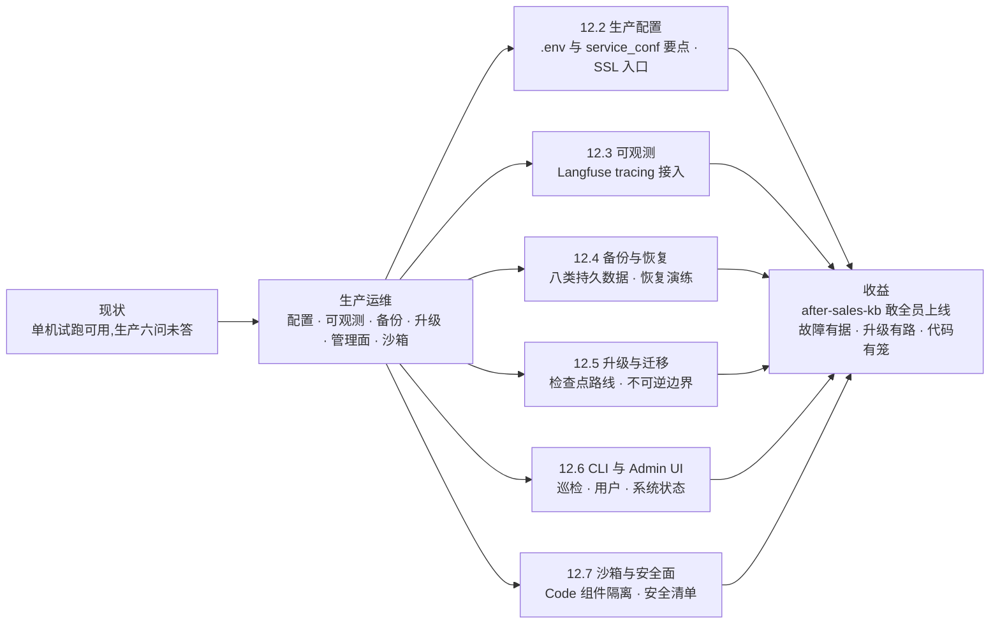
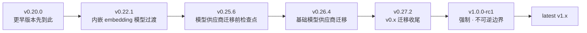

# 第 12 章 生产运维

> 本章导读:after-sales-kb 在第 7 章调优完毕,「售后助手」在第 8 章接进客服台,试跑期间检索质量过关——现在客服主管问了三个问题:「下周全员上线,数据丢了怎么办?服务挂了谁先发现?下个版本怎么升?」这三个问题就是单机试跑与生产之间的距离。本章把这段距离拆成六件事:配置从「能跑」调到「扛得住」(12.2);tracing 把每次问答送进可观测平台(12.3);备份与恢复演练让磁盘故障不再是事故(12.4);升级按检查点走而不是换镜像(12.5);CLI 与 Admin UI 给管理员一个驾驶舱(12.6);代码执行沙箱(Code Execution Sandbox)把不可信代码关进笼子(12.7)。读完本章,你能:为 after-sales-kb 列出一份可执行的生产化清单;独立完成备份、恢复演练与 v0→v1 升级准备;用 CLI 与 Admin UI 完成日常巡检。



*本章导览图*

## 你什么时候需要它

三种典型处境,对应本章三种用法。

**after-sales-kb 下周全员上线**——直接看 12.8 的生产化检查表,表中每一项都标注了对应小节;配置收紧与入口加密的细节在 12.2。

**线上「答非所问」或服务异常,不知道从哪查**——两条线并行:12.6 的服务状态看依赖与进程是否健康,12.3 的 tracing 看这次问答在模型侧实际发生了什么。

**手里有个 v0 老部署要升 v1,或刚经历一次磁盘告警**——12.5(检查点升级路线与不可逆边界)与 12.4(备份范围与恢复演练)。

前置:第 2 章的 Docker 部署与配置体系;贯穿案例中 after-sales-kb 的建设过程(第 3-10 章)。

## 12.1 概述:从单机试跑到生产

第 2 章的部署目标是「跑起来」,这一章的目标是「睡得着」。两者之间的差距可以列成一张表,它同时也是本章的地图:

| 维度 | 单机试跑态 | 生产态 | 本章 |
|------|-----------|--------|------|
| 容量 | 默认配置一路跑 | 逐容器资源上限核算,embedding 资源预留 | 12.2 |
| 可观测 | 出了问题翻容器日志 | 每次问答进 tracing 平台,按租户与会话可查 | 12.3 |
| 备份 | 无,或偶尔手动拷卷 | 八类持久数据成套备份,定期恢复演练 | 12.4 |
| 升级 | 换个镜像 tag 重启 | 检查点逐级验证,不可逆边界单独对待 | 12.5 |
| 管理面 | 直接进容器、改数据库 | CLI 与 Admin UI:用户、服务状态、系统设置 | 12.6 |
| 安全 | 默认端口、开放注册 | SSL 入口、注册关闭、账号治理、沙箱隔离 | 12.2/12.6/12.7 |

版本基线:本章全部事实以 RAGFlow v1.0.0-rc2(2026-10-16 发布,Go 后端)官方文档为准,核实日期 2026-10-27。要特别注意:v1 的 Go 后端与 v0 的 Python 后端是两代运行时,从 v0 到 v1 属于「迁移」而非「更新」(见第 1 章),这也是 12.5 单独成节、着墨最重的原因。

## 12.2 生产配置

### 12.2.1 配置体系回顾

第 2 章 2.3 节已经介绍过 Docker 部署的配置文件分工,这里换生产视角回顾一遍——排查「改了配置为什么不生效」之前,先确认改对了文件:

| 文件 | 管什么 | 生产中的典型改动 |
|------|--------|-----------------|
| `docker/.env` | 镜像、服务 profile、对外端口、各项凭据 | 关闭注册、调整端口、配镜像源 |
| `docker/service_conf.yaml.template` | Go 服务消费的系统级配置(API/MySQL/MinIO/S3/Kvrocks) | 换 S3 后端、调连接池 |
| `docker/docker-compose.yml` | RAGFlow 服务与依赖 profile 的选择 | 给服务加证书持久挂载 |
| `docker/docker-compose-base.yml` | 共享依赖:文档引擎、元数据库、MinIO、Kvrocks、NATS、ClickHouse | 外置存储或更换文档引擎 |

其中 `service_conf.yaml` 由模板在容器启动时生成并替换其中的环境变量——手改生成物没有意义,要改模板。对上述文件的任何改动,都要重启全部容器才生效:

```bash
docker compose --env-file docker/.env -f docker/docker-compose.yml up -d
```

### 12.2.2 生产要点清单

`.env` 与 `service_conf` 里值得在生产部署时逐项过目的条目:

| 配置项 | 默认值 | 生产关注点 |
|--------|--------|-----------|
| `SVR_WEB_HTTP_PORT` / `SVR_WEB_HTTPS_PORT` | 80 / 443 | 浏览器与 API 的公网入口;9380 是内部 API 口,业务流量应走 Nginx 公网口 |
| `MEM_LIMIT` | 约 7.52 GiB | **每容器**上限:不是主机内存需求、不是总量保证、也不代表每容器真用这么多;逐容器核算 |
| `ENABLE_REGISTER` | 1(开放注册) | 生产置 0,账号改由管理员创建(12.6) |
| `MYSQL_MAX_PACKET` | 1 GiB | 外置 MySQL 时,服务端 `max_allowed_packet` 要保持兼容 |
| `mysql.max_connections` / `stale_timeout` | 900 / 300 秒 | Go 部署的连接池默认值,按并发调 |
| `DB_TYPE` / `METADATA_DB_PROFILE` | mysql | OceanBase 可经 MySQL 兼容协议接入 |
| `STORAGE_IMPL` + `s3:` 段 | MinIO | 换 S3 兼容后端(Tigris/AWS S3/OSS 等);**改存储布局前先建恢复点**(12.4) |
| `api.trusted_proxies` | 仅 loopback | 显式列表是**替换**不是追加:保留 loopback 项再加代理网段;置空则不信任任何代理头 |
| `TEI_MODEL` | - | 本地 embedding 服务,内存/显存按模型、精度、并发实测预留 |
| `RAGFLOW_IMAGE` | 官方镜像 | 拉取受限时可用华为云/阿里云镜像源 |

`trusted_proxies` 单独说一句:它决定 Go API 信任哪些代理发来的 `X-Forwarded-For` / `X-Real-IP` 头来还原客户端地址——登录审计记录和 Agent webhook 的 `ip_whitelist` 都依赖它。前面放了 Nginx 之外的反向代理却忘了改它,审计里记到的就全是代理的地址。

### 12.2.3 SSL 证书:入口级 HTTPS

公网入口上 HTTPS,官方路径是替换 RAGFlow 容器内 Nginx 的站点配置(以容器 `docker-ragflow-cpu-1` 为例):

```bash
# ① 宿主机准备 Nginx 格式证书,拷入容器
docker cp ./fullchain.pem docker-ragflow-cpu-1:/tmp/fullchain.pem
docker cp ./privkey.pem   docker-ragflow-cpu-1:/tmp/privkey.pem

# ② 容器内部署
docker exec -it docker-ragflow-cpu-1 /bin/bash
mkdir -p /etc/nginx/ssl
mv /tmp/fullchain.pem /etc/nginx/ssl/ && chmod 644 /etc/nginx/ssl/fullchain.pem
mv /tmp/privkey.pem   /etc/nginx/ssl/ && chmod 600 /etc/nginx/ssl/privkey.pem

# ③ 切换到 HTTPS 配置模板
cd /etc/nginx/conf.d/
mv ragflow.conf ragflow.conf.bak
cp /etc/nginx/ragflow.https.conf ./ragflow.conf
vi ragflow.conf        # 确认 ssl_certificate 与 ssl_certificate_key 指向 /etc/nginx/ssl/
nginx -t && nginx -s reload   # 语法校验通过后重载;无效则退出容器重启 ragflow-cpu
```

⚠️ **持久化警告**:用 `docker cp` 与 `docker exec` 做的改动,在容器重建后全部丢失。测试通过后,把证书与 `ragflow.conf` 存到宿主机,并在 `docker-compose.yml` 的 `ragflow-cpu` 服务上为它们添加持久 volume 挂载——否则下一次升级或重建容器,HTTPS 就悄悄退回了 HTTP。

## 12.3 可观测:tracing 进 Langfuse

RAGFlow 内置 Langfuse 集成,记录聊天 trace 与聊天模型的 generation 观测。前置条件只有一个:一个 Langfuse workspace(云托管或自托管皆可)及其项目级 Public Key / Secret Key——key 是项目作用域的,所有要写进同一项目的环境共用一对即可。

凭据按租户(tenant)存储,两条配置路径:

- Web UI:右上角头像 → **API** → 拉到底部 **Langfuse Configuration**,填 Host、Public Key、Secret Key,保存;
- HTTP API(见第 11 章)。

保存后,Go chat pipeline 在**使用知识库或 web 搜索**的聊天请求上使用这些凭据上报。一次被追踪的聊天,在 Langfuse 里长这样:

| 观测对象 | 记录内容 |
|---------|---------|
| trace:`openai_chat` | `userId` = 租户 ID;`sessionId` = 聊天 ID;metadata 含是否流式、配置的知识库数量 |
| generation:`chat` | 模型名;输入含 prompt、引用(citation)prompt 与模型消息列表 |
| completion 更新 | 输出摘要,以及 prompt / completion / total 三项 token 计数 |

投递是异步的:tracing 投递失败不会阻塞聊天响应——可观测平台的可用性与业务解耦(本书立场:这也意味着「上报失败」本身没有告警,可观测平台自身的健康要在平台侧盯住)。

trace 的内部结构、评估与多租户数据分析属于 Langfuse 一侧的功夫(→ langfuse 书)。对运维的最低要求是:上线当天就让 trace 进平台——按 12.8 的检查表第 8 项执行。

## 12.4 备份与恢复

### 12.4.1 备份什么

v1 官方备份文档的定位很克制:创建同版本恢复点、搬家到另一台主机。升级是它的下游动作——任何升级之前,先做本节备份。确定备份范围的第一步永远是看真实挂载,而不是背清单:

```bash
docker compose -p docker -f docker/docker-compose.yml ps --all
for container_id in $(docker compose -p docker -f docker/docker-compose.yml ps --all -q); do
  docker inspect "$container_id" --format '{{.Name}}{{range .Mounts}}{{println "" .Type .Source .Name .Destination}}{{end}}'
done
```

默认部署下,官方给出的核对清单是八类持久数据。业务数据是前三行——元数据库、对象存储、检索索引,其余是支撑数据与日志:

| 服务 / 数据 | 持久位置 |
|------------|---------|
| 元数据库(内建 MySQL) | `docker_mysql_data` |
| 对象存储(内建 MinIO,上传文件) | `docker_minio_data` |
| Elasticsearch 索引 | `docker_esdata01` |
| Infinity 索引(如启用) | `docker_infinity_data` |
| Kvrocks 缓存与检查点 | `docker_kvrocks_data` |
| NATS JetStream 数据 | `docker_nats_data` |
| Kibana 数据(如启用) | `docker_kibana_data` |
| RAGFlow 日志 | `docker/ragflow-logs` bind mount |

这张表是核对清单,**最终备份范围以 `docker inspect` 的输出为准**;存在 Docker 卷之外的数据(如外置存储)要一并纳入。日志仅用于排障,缺了不影响业务数据恢复。除数据卷外,还要保存 `docker/.env`、配置模板、证书与自定义挂载文件——它们含凭据,备份本身要保护。停机前用 `df -h` 与 `docker system df` 确认宿主机空间;离线主机提前预备 `alpine:3.20` 镜像。

### 12.4.2 备份流程

先全停,防止归档期间数据库、对象存储与索引还在变化;再对每个记录的卷打包并校验:

```bash
docker compose -p docker -f docker/docker-compose.yml down

backup_dir="backup-ragflow-v1-$(date +%Y%m%d-%H%M%S)"
mkdir "$backup_dir"

volume_name=docker_mysql_data    # 对每个记录的卷重复执行
docker volume inspect "$volume_name" >/dev/null &&
  docker run --rm -v "$volume_name":/source:ro -v "$PWD/$backup_dir":/backup alpine:3.20 \
    tar czf "/backup/$volume_name.tar.gz" -C /source . &&
  tar tzf "$backup_dir/$volume_name.tar.gz" >/dev/null
```

最后 `ls -lh "$backup_dir"` 确认每个卷都有对应的 `.tar.gz`。注意 `tar tzf` 那一步不是仪式——归档不可读,等于没备份。

### 12.4.3 恢复与演练立场

恢复到目标主机:安装**同一版本**的 RAGFlow、恢复保存的配置、备份目录放仓库根、服务保持停止;对每个归档,若目标卷已存在先检查再用,`docker volume create` 后解包;解压失败的卷不要继续用,确认其中无必须保留的数据后换新空卷重试;bind mount 恢复到源主机同一路径。之后 `up -d` 启动,`ps --all` 与 `logs --tail=200 ragflow-cpu` 查看状态,最后登录确认:知识库与文件都在、文件能打开、检索返回已解析文档的内容。

本书立场:**没有经过恢复演练的备份,只是占磁盘的希望**。官方升级准备清单同样要求「在独立测试环境恢复并验证,测试部署不得连接生产卷」——恢复演练就是最便宜的灾难保险,把它排成定期动作(节奏建议见 12.8)。

## 12.5 升级与迁移

### 12.5.1 升级路线:检查点,不是换镜像

v0.x 升到 v1.x 有官方指定的标准路线;更早的部署(低于 v0.20.0)先用该版本自带的文件升到 v0.20.0——注意 v0.20.0 之前创建的 Agent 与其后不兼容,定义只留作参考,升到 v0.20.0 后重建并重测:



*标准升级路线:每个箭头都是一次独立的升级与验证*

两条纪律,官方原文的分量:

- **必须启动并验证路线上的每一个目标版本**——只改镜像 tag 或拷贝卷,不会执行该版本的数据库与数据迁移;
- **从第一个比当前版本新的检查点开始**,绝不降级,绝不对已被新版本使用过的数据启动旧版本。

每个检查点的验证清单:老用户能登录并看到数据集;已有文件可列出、可打开;旧文档检索有结果;新文档可上传、解析、检索;模型供应商、凭据与租户默认模型正确;有代表性的 Agent 能跑通。当前检查点不通过,不进下一个。`v0.26.4` 与 `v0.27.2` 两个检查点首次启动时保留 `--init-model-provider-tables`,并核对迁移日志。

升级前的通用准备(对任何版本变更成立):记录当前版本、启用的服务、用 Elasticsearch 还是 Infinity、存储后端、自定义挂载文件 → 停掉文档导入、解析、Agent、同步等一切写任务 → 停机状态下备份配置与全部持久卷 → 在独立测试环境恢复并验证 → 原备份保留到该版本通过验收。

### 12.5.2 v0.27.2 → v1.0.0-rc1:不可逆边界

这是全路线中唯一**不可逆**的一步,它引入 v1 运行时并执行数据迁移。开始前必须:停所有写任务,创建并验证完整的 v0.27.2 恢复点。这一步带来的引擎与行为变化:

| 变化 | 对运维的影响 |
|------|-------------|
| NATS 取代 Redis 成为消息队列 | Redis/Valkey 数据文件与 Kvrocks/NATS 存储不兼容;Redis 备份仅用于回滚,**不恢复进 v1** |
| Kvrocks 存缓存与检查点;新增 ClickHouse | 三者都用全新空卷,不要把 v0 的 Redis 卷挂给它们 |
| 废弃的 HTTP API 别名移除 | 调用方按第 11 章核对接口 |
| Tag 文件不再绑定到数据集 | Python 后端的 Tag 数据集迁移后失效:需在 Go 后端重配 tag 文件并验证 |
| 本地沙箱与早期 Team/Me 权限行为不支持 | 沙箱改走 12.7 的 provider 配置;权限体系见第 13 章 |
| GraphRAG / RAPTOR 配置页下线 | 已生成内容仍可检索 |

术语对齐:升级文档里的「知识库(Knowledge Base)」就是本书通篇说的「数据集(Dataset)」——v1 改了称呼,升级材料没有全改。

操作骨架(默认 MySQL + MinIO + Redis + Elasticsearch 四卷部署):

```bash
# ① v0.27.2 停机并创建恢复点(四归档逐一校验可读)
docker compose -p docker -f docker/docker-compose.yml down
backup_dir="backup-v0.27.2-$(date +%Y%m%d-%H%M%S)"
bash docker/migration.sh backup "$backup_dir"
for archive in mysql_backup.tar.gz minio_backup.tar.gz redis_backup.tar.gz es_backup.tar.gz; do
  tar tzf "$backup_dir/$archive" >/dev/null || exit 1
done

# ② 新目录部署 v1.0.0-rc1:用新模板 .env 拷入旧值,RAGFLOW_IMAGE=infiniflow/ragflow:v1.0.0-rc1
# ③ 启动并跟踪迁移日志,直到迁移完成、服务起来
docker compose -p docker -f docker/docker-compose.yml up -d
docker compose -p docker -f docker/docker-compose.yml logs -f ragflow-cpu

# ④ 健康检查(默认 web 端口 80,改过 SVR_WEB_HTTP_PORT 则用实际值)
curl -f http://127.0.0.1/api/v1/system/healthz
```

失败纪律,一次说清:迁移报错就停掉 v1 部署、保留日志,**不要对部分迁移的数据重试**——恢复完整的 v0.27.2 恢复点,在独立测试环境查明原因,再从恢复点重来。RAGFlow 不提供自动反向迁移;旧应用配新数据库不是回滚。大库要给 schema 变更与会话历史回填留足启动时间;并行应用副本保持停止,直到一次迁移尝试完成。

升级完成后的收尾验证:登录确认数据与配置在,测一次检索、一次新文档上传、一次聊天、一次 Agent 运行;用通义千问的部署要在模型供应商里重选 Base URL 并重新保存;Tag 数据集按上表重配;v0.27.2 备份保留到新部署通过验收并在正常负载下稳定运行。

v1.x 内部的后续升级简单得多:先做 12.4 的备份,再按官方 upgrade from v1.x 文档执行。Go 后端启动时按版本门控执行数据库迁移,每步 schema/数据变更与版本标记的完整记录在官方 Database Change Log 文档里——排查迁移问题时按图索骥即可,理解升级主线不依赖它。

## 12.6 CLI 与 Admin UI

v1 的 Go 后端自带两个管理面:命令行的 RAGFlow CLI(Admin 模式)与浏览器的管理界面(Admin UI)。两者都面向系统管理员、都连 Go Admin Service(容器内默认 9381 端口,对应 `.env` 的 `ADMIN_SVR_HTTP_PORT`),且都应只暴露给受信管理员;普通用户使用知识库、聊天、Agent 等业务功能,完全不需要接触它们。

### 12.6.1 RAGFlow CLI

安装(生产环境建议固定版本):

```bash
curl -fsSL https://raw.githubusercontent.com/infiniflow/ragflow/main/tools/scripts/install.sh \
  | VERSION=v1.0.0-rc2 sh
ragflow-cli --version
```

以 Admin 模式连接(默认 `127.0.0.1:9381`;Docker 发布的主机端口不同时,用 `docker ps` 里 `ADMIN_SVR_HTTP_PORT` 的实际映射端口):

```bash
ragflow-cli --admin --host 127.0.0.1:9381 --user admin@ragflow.io
```

密码走交互提示输入,**不要**用 `--password` 传真实密码——命令行参数对本地其他进程可见,还会进 shell history。`--output` 可切 `table`(默认)/ `plain` / `json`(本书立场:巡检脚本用 `json`,人看用 `table`)。命令是 SQL 风格:分号结尾、大小写不敏感、提示符 `RAGFlow(admin)>`,按命令族记忆:

| 命令族 | 代表命令 | 干什么 |
|--------|---------|--------|
| 会话 | `LOGIN ADMIN` / `LOGOUT` / `PING` / `SHOW VERSION` | 连接与身份;`PING` 等无需先登录 |
| 服务 | `LIST SERVICES` / `SHOW SERVICE '<name>'` | 依赖健康 + 心跳注册的运行时进程(`api_server` / `ingestor` / `file_syncer`) |
| 用户 | `LIST USERS` / `CREATE USER` / `ALTER USER ACTIVE` / `ALTER USER PASSWORD` / `DROP USER` | 账号生命周期;`DROP` 前必须先 `ACTIVE off`(活跃用户拒绝删除);管理员账号不可删 |
| 配置 | `LIST VARS` / `SHOW VAR '<name>'` / `LIST CONFIGS` / `LIST ENVS` | 运行时设置与环境摘要 |
| 摄取 | `LIST INGESTORS` / `LIST INGESTION TASKS` | 摄取进程与任务面(摄取管线(Ingestion Pipeline)的编排见第 10 章) |
| 消息队列 | `MQ SHOW` / `MQ LIST [PENDING]` / `MQ PUBLISH` / `MQ PULL` | NATS JetStream 任务流诊断;`PUBLISH` 发测试消息,`PULL` 默认确认、`NOACK` 负确认可重投 |
| 元命令 | `\h` / `\q` | 帮助与退出 |

一段典型巡检会话:

```text
RAGFlow(admin)> LOGIN ADMIN 'admin@ragflow.io' PASSWORD '********';
RAGFlow(admin)> LIST SERVICES;
RAGFlow(admin)> SHOW SERVICE 'mysql';
RAGFlow(admin)> MQ SHOW;
```

### 12.6.2 Admin UI

入口是 `/admin`(如 `http://192.168.1.5/admin`)。三张页面覆盖三类系统级操作:

| 页面 | 能做什么 | 关键约束 |
|------|---------|---------|
| Service status | 查看依赖健康与进程心跳:MySQL、文档引擎(ES/Infinity)、对象存储、Kvrocks、NATS,以及 `api_server` / `ingestor` / `file_syncer` 各进程;Actions 里看 `elapsed` 与状态消息 | 依赖行 `alive` = 健康检查通过;进程行 `alive` = 45 秒内有心跳。此处不提供容器/日志排障入口,继续排查用部署环境自己的工具 |
| User management | 查询用户、创建用户、`Active`/`Inactive` 启停、重置密码、删除、看详情(最近登录时间等) | 不能对当前登录的自己执行禁用/改类型/重置/删除;删除是高风险动作,先交接资源、先 `Inactive`;`Superuser` 只授予真正需要进 Admin UI 的人 |
| Sandbox settings | 选择并测试代码执行沙箱 provider | 系统级设置,保存即全部署生效(12.7) |

初始管理员:Admin Service 以 `--init-superuser` 启动且尚无超级用户时,创建 `admin@ragflow.io`(初始密码 `admin`)——首登立即改密;该账号用于系统初始化与创建后续管理员,**不作长期共享的日常运维账号**。账号状态语义:`Active` 可正常登录使用;`Inactive` 禁止登录但账号与数据保留。官方对密码的口径:创建表单前端校验至少 6 字符、重置密码至少 8 字符——生产环境应施加更强的统一密码策略。

## 12.7 代码执行沙箱与安全面

### 12.7.1 沙箱:决定代码在哪跑

Agent 画布的 Code 组件(见第 10 章)能执行 Python 或 JavaScript——这些代码可能来自画布作者,也可能由模型生成。本书立场:**不可信代码不进生产进程**;把代码交给隔离环境执行,是带 Code 组件的画布上生产的先决条件。这就是代码执行沙箱(Code Execution Sandbox)存在的理由:v1 中,管理员必须先选定并配置沙箱 provider,Code 组件才可用。

provider 决定代码实际跑在哪:

| Provider | 代码跑在哪 | 何时选它 |
|----------|-----------|---------|
| **Self-Managed** | 自有环境里由 Sandbox Executor Manager 管理的 Python/Node.js Runner 容器 | 默认选项;私有部署保持执行控制权的首选 |
| **SSH** | 已有的远程 Linux 主机 | 已有合适执行服务器,且能管理 SSH 访问与 host keys |
| **Aliyun Code Interpreter** | 阿里云托管执行环境 | 组织已用阿里云,要托管环境 |
| **E2B** | E2B 云沙箱 | 要外部托管,不想运维本地 Runner 容器 |
| **Tenki** | 每次执行创建的一次性 microVM | 要每次运行强隔离、短生命周期 |
| **UCloud Agent Sandbox** | UCloud 支持区域的托管沙箱 | 需要 UCloud 区域内的托管沙箱 |

私有部署推荐 Self-Managed,标准形态三段:RAGFlow 把执行请求发给 Sandbox Executor Manager → Manager 挑选一个 Python 或 Node.js Runner 容器 → Runner 执行代码,把输出与生成的文件返回 RAGFlow。Admin UI 的 Sandbox settings 页只负责配置 RAGFlow 到 Manager 的连接,共三件事:

| 字段 | 用途 |
|------|------|
| Executor Manager Endpoint | Manager 地址,须从 RAGFlow 进程/容器可达 |
| Executor Manager API Token | 共享令牌,须与 Manager 侧 `SANDBOX_EXECUTOR_MANAGER_API_TOKEN` 一致 |
| Request Timeout (seconds) | 单次 Manager 请求的最大等待时间 |

Runner 镜像、容量、内存、服务超时与网络访问属于部署侧设置,在 Manager 一侧管理。保存前必走 **Test connection**——它真的执行一个小 Python 程序(Self-Managed 下等价于验证 Manager 能拉起 Runner,只看 `/healthz` 不够),结果 `PASSED` 再 **Save**。

⚠️ 沙箱 provider 是**系统级设置**:保存即对后续所有 Code 组件运行生效;替换使用中的 provider 前,先在新配置上测通。选云 provider 前确认三件事:部署可达其 API、凭据有效、配额与区域满足。

### 12.7.2 安全面清单

本章各节的防线合到一张表,作为安全评审的底稿:

| 面 | 生产基线 | 出处 |
|----|---------|------|
| 入口 | HTTPS 上线,且证书持久化挂载防容器重建回退;业务流量走 Nginx 公网口 | 12.2.3 |
| 账号 | `ENABLE_REGISTER=0`;`admin` 默认密码首登即改;`Superuser` 最小授予;删用户先交接、先 `Inactive` | 12.2.2 / 12.6 |
| 审计前提 | `api.trusted_proxies` 正确配置,登录审计与 webhook `ip_whitelist` 才能拿到真实客户端地址 | 12.2.2 |
| 沙箱 | Code 组件上生产前配好 provider 并测通;隔离形态按数据敏感度选(容器 / microVM / 云) | 12.7.1 |
| 备份 | `.env`、证书与备份包都含凭据,访问权限收紧 | 12.4 |

## 12.8 贯穿案例:after-sales-kb 生产化清单

回到贯穿案例的现状:三类售后文档(50 页政策手册 PDF、约 200 行 FAQ XLSX、物流时效公告)已成为调优完毕的数据集(第 3-7 章),「售后助手」服务客服问答(第 8 章),画布客服 Agent 处理退换流转(第 10 章)。全员上线前的检查表:

| # | 检查项 | 动作 | 出处 |
|---|--------|------|------|
| 1 | 容量核算 | 按客服并发量核对 `MEM_LIMIT` 各容器上限;TEI 本地 embedding 预留实测峰值加余量 | 12.2.2 |
| 2 | 配置收紧 | `ENABLE_REGISTER=0`;客服账号由管理员在 Admin UI 逐个创建 | 12.2.2 / 12.6.2 |
| 3 | 入口加密 | 域名证书按官方流程配置,并完成持久化挂载 | 12.2.3 |
| 4 | 备份节奏 | 升级前必备份;日常建议每周全量一次(停机窗口内)——「每周」是本书立场,官方未规定节奏 | 12.4 |
| 5 | 恢复演练 | 上线前完成一次「备份 → 恢复 → 登录验证」独立环境演练,此后按季度重复 | 12.4.3 |
| 6 | 升级窗口 | 排期按检查点升级,不做原地换镜像;当前已在 v1.x 内,每次升级前先做备份 | 12.5 |
| 7 | 沙箱开关 | 客服 Agent 画布未用 Code 组件 → 暂不配 provider,Code 组件不可用恰好是期望状态;日后要用,先配 Self-Managed 并测通 | 12.7 |
| 8 | 监控接点 | 租户级配好 Langfuse 三元组,上线当天产出首批 trace;`/api/v1/system/healthz` 进拨测;Admin UI 服务状态进每日巡检 | 12.3 / 12.6 |

第 7 条值得多说一句:after-sales-kb 的画布只用检索与 LLM 组件,没有 Code 组件,所以沙箱可以「不配置」——在 v1 中这意味着 Code 组件不可用,对不用它的部署来说,这正是想要的关闭方式。上线不是终点:平台稳住之后,知识库的长期质量靠运营接力,**第 13 章**的权限体系与巡检 SOP 就是下一棒。

## 本章小结

1. 生产与试跑的差距是六件事:容量、可观测、备份、升级、管理面、安全——本章每节收口一件,12.8 的检查表把它们串回 after-sales-kb。
2. 配置改 `.env` 与模板、重启全容器生效;`MEM_LIMIT` 是每容器上限;`trusted_proxies` 是替换语义;生产必查 `ENABLE_REGISTER=0` 与 SSL 持久挂载。
3. tracing 按租户接 Langfuse:一次聊天 = 一条 `openai_chat` trace(`userId` = 租户、`sessionId` = 会话)+ 一条 `chat` generation + token 计数;异步投递,不阻塞业务。
4. 备份 = 八类持久数据 + 配置与证书;范围以 `docker inspect` 为准;`tar tzf` 校验不是仪式;恢复演练是备份有效性的唯一证明。
5. v0→v1 是逐检查点迁移:v0.22.1 → v0.25.6 → v0.26.4 → v0.27.2 → v1.0.0-rc1;只换镜像不跑迁移;v0.27.2 → v1.0.0-rc1 不可逆,失败恢复完整恢复点,不对部分迁移数据重试。
6. 管理面两条:CLI 按命令族管服务、用户、配置、MQ;Admin UI 三页管状态、账号、沙箱;`admin@ragflow.io` 初始账号只用于初始化。
7. Code 组件的代码不可信:进生产前配沙箱 provider 并测通;provider 是系统级设置,保存即全部署生效。

→ 平台稳了,内容运营接棒:**第 13 章**讲权限体系、Team 共享与知识库运营 SOP——after-sales-kb 的长期质量靠运营,不靠上线。

## 验收清单

读到这里,你应该能:

- ☐ 说出试跑态与生产态的六项差距,并为 after-sales-kb 指出当前缺哪几项;
- ☐ 完成一次 SSL 配置,并说出容器重建后证书为什么不丢(持久化挂载);
- ☐ 在租户级配好 Langfuse tracing,并说出一条 trace 里租户 ID 与会话 ID 各落在哪个字段;
- ☐ 在独立环境完成一次「备份 → 恢复 → 登录验证」演练,列出八类持久数据的备份清单;
- ☐ 画出 v0→v1 升级路线,并复述「只换镜像不跑迁移」与「部分迁移数据不可重试」两条纪律;
- ☐ 用 CLI 登录 Admin Service,完成一次服务健康查看与一个用户的创建、停用;
- ☐ 为 Code 组件选定沙箱 provider,说出「Test connection 通过再 Save」与系统级生效的含义。

## 延伸阅读

- **第 2 章(部署与模型通道)**——本章配置体系(`.env` / `service_conf`)的首次出场;生产化从这里回头补课。
- **第 13 章(团队协作与知识库运营)**——本章管平台稳定,第 13 章管内容质量:权限体系、Team 共享与运营巡检 SOP。
- **第 11 章(API 与 MCP)**——`healthz`、HTTP API 与 tracing 之外的程序化运维面。
- **langfuse 书**——trace 结构、评估与告警在可观测平台一侧展开。
- **官方 `docs/administrator/` 目录**——本章全部素材源;Database Change Log 详录 Go 后端数据库迁移步骤与版本标记。

## 复核清单(发布前)

- [ ] 本章全部命令未实测(`docker compose`、`migration.sh backup`、SSL 七步、CLI 安装与各命令族、`healthz` 探测)——待环境就绪后按节补测
- [ ] v0.27.2 → v1.0.0-rc1 迁移全流程未演练(不可逆操作,需专用可丢弃环境)
- [ ] Admin UI 三页的界面元素与 v1.0.0-rc2 实际版本逐一对照
- [ ] 自托管 Langfuse 对接实测(trace 字段与异步投递行为)
- [ ] 「备份八项表」与实际部署的 `docker inspect` 输出核对(启用 Infinity / Kibana 的部署形态)
