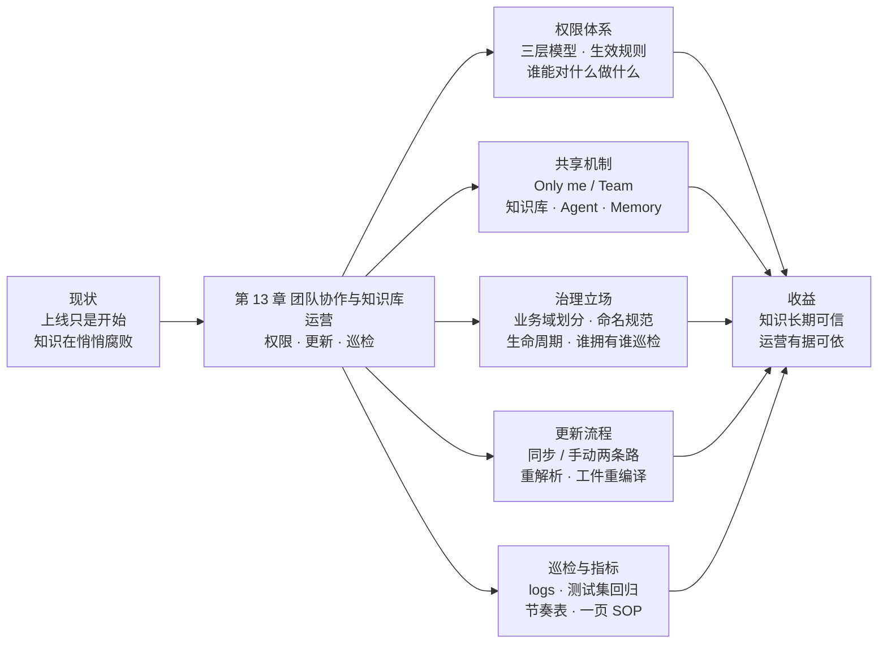
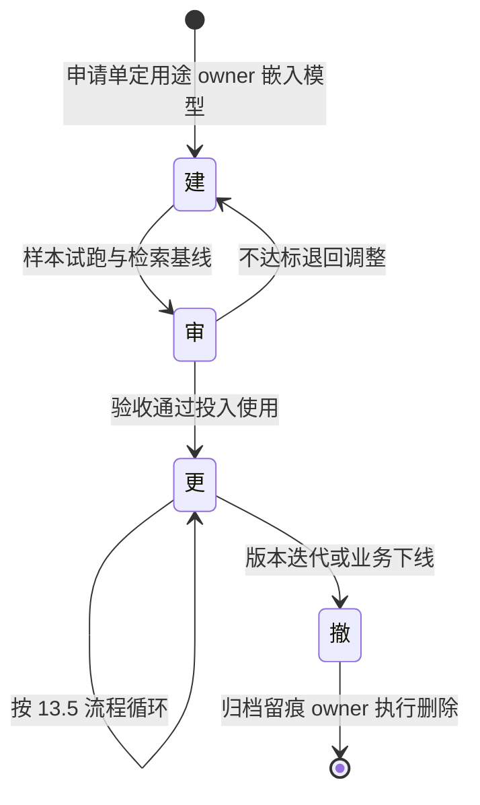
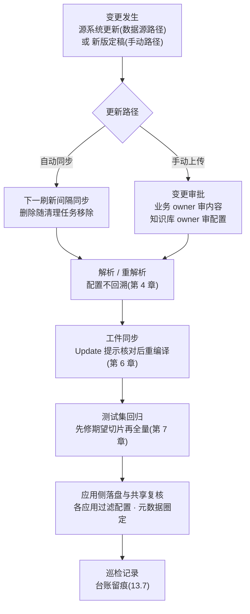

# 第 13 章 团队协作与知识库运营

> 本章导读：after-sales-kb 上线了——平台已经稳住(第 12 章)，客服用上了「售后助手」(第 8 章)与画布客服 Agent(第 10 章)。然后，10 月改版来了：政策手册换新、新条款只对部分站点生效，而几天后客服还在引用旧条款。这就是知识腐败(knowledge rot)：上线只是开始，无人治理的知识库会悄悄变坏——旧条款不撤、切片过期、没人敢动、没人负责。本章是全书收束，讲运营三件事：权限与共享治理——谁能对什么做什么(13.2-13.4)；文档更新流程——让新版「确定」生效(13.5)；质量巡检——让衰退被及时发现(13.6-13.7)。最后用一次 10 月改版全流程演练回收贯穿案例，并把全书 12 章路线一句话回顾。读完本章，你能：为团队配置权限与共享、走通一次改版的端到端更新闭环、按日/周/月节奏巡检，并带走一页可落地的运营 SOP。

*本章导览图*

## 你什么时候需要它

三种典型处境，对应本章三种用法。

**多人用一套 RAGFlow，谁能动什么说不清**——看 13.2 与 13.3。权限三层模型与生效规则五步是官方的判定顺序，13.4 再补一层「系统管权限、SOP 管秩序」的治理分工——口头约定变成系统行为加书面流程。

**文档改版了，怎么让新版「确定」生效**——直接看 13.5。数据源同步与手动上传两条路径、重解析与工件重编译的下游动作，末尾的 10 月改版演练是完整示范。

**知识库用了几个月，答案开始时好时坏**——看 13.6 与 13.7。logs 分层定位、测试集定期回归、日/周/月巡检节奏，配上三个运营指标记账。

前置：第 3 章的数据集创建与 Permissions 字段(它的第一次出场在那里)；第 12 章的生产化基线——平台不稳，运营无从谈起。

## 13.1 概述：上线只是开始，然后呢

第 1 章说过，LLM 的第一大局限是静态知识——训练快照之外的它不知道。RAG 的对策是「检索段实时从外部知识库取最新内容」，但这句对策有个隐含前提：**得有人持续把最新内容喂进知识库**。没人喂，RAG 就退化成一台「快速检索旧文档的机器」，而且因为它带着引用、答得笃定，**旧知识错得比没有知识更可信**——第 7 章样例三(2024 版旧条款被当作现行政策引用)就是预演。

这种衰退有个业界通称：知识腐败(knowledge rot)——本书立场采用这个说法，它不是官方术语。落到 RAG 知识库上，典型症状四条：

| 症状 | 表现 | 对应运营动作 |
|------|------|-------------|
| 版本混杂 | 新旧文档并存，检索在两版之间「抽签」 | 版本元数据 + 旧版下架(13.5) |
| 内容过期 | 源文档改了，切片、工件还是旧的 | 更新流程(13.5) |
| 责任悬空 | 没人说得清这个库谁建、谁审、谁管 | 权限与治理(13.2-13.4) |
| 质量漂移 | 配置被多人改动，效果无人复验 | 巡检与回归(13.6-13.7) |

对抗它的是三件事——本章的主体结构：

| 运营三件事 | 回答的问题 | 所在节 |
|-----------|-----------|--------|
| 权限与共享治理 | 谁能对什么做什么？资源怎么交出去？ | 13.2、13.3、13.4 |
| 更新流程 | 文档改了之后，新版怎么「确定」生效？ | 13.5 |
| 质量巡检 | 衰退怎么被及时发现、及时归因？ | 13.6、13.7 |

本章反复出现的术语，沿用全书词汇表并补两条(中英对照首次在此集中给出)：

| 术语 | 英文 | 一句话定义 |
|------|------|-----------|
| 数据集 | Dataset | 知识库的载体(v1 对 v0「知识库」的更名，见第 1 章) |
| 切片 | Chunk | 文档解析产出的最小检索单元 |
| 检索测试 | Retrieval Testing | 数据集内验证「查询能否召回预期切片」的页面(见第 7 章) |
| 知识工件 | Artifact | 知识编译产出的结构化产物：Wiki、Graph、Tree、PageIndex 等(见第 6 章) |
| 团队/个人共享空间 | Team / Me | 资源共享范围的两个取值：团队可见 vs 仅所有者可见 |

事实边界先声明：13.2 与 13.3 的权限模型、共享范围、成员管理，13.6 的日志能力，全部以官方文档为准(docs/guides/team/、docs/guides/dataset/logs.md，素材核实日期 2026-10-27)；13.4 的治理设计与 13.7 的指标、节奏，是**本书立场**——官方给了权限的「骨骼」，秩序的「肌肉」要每支团队自己长。

## 13.2 权限体系：谁能对什么做什么

### 三层模型

官方对权限体系的定义一句话(docs/guides/team/permission_system_overview/index.md，核实日期 2026-10-27)：**RAGFlow 通过三层管理团队协作与资源权限——团队成员关系、资源共享范围、资源操作权限**。三层各回答一个问题，层层收紧：

| 层 | 英文 | 回答的问题 | 由谁设置 |
|----|------|-----------|---------|
| 团队成员关系 | Team membership | 这个人在不在团队里？ | 团队所有者(邀请) |
| 资源共享范围 | Resource sharing scope | 这份资源对团队可见吗？ | 资源所有者(配置 Permissions) |
| 资源操作权限 | Resource operation permissions | 可见之后，能做什么操作？ | 系统按资源类型与权限级别判定 |

读这张表的正确顺序是自上而下：**不在团队，一切免谈；在团队而资源未共享，依然看不到；看得到而操作越权，照样被拦**。三层是「与」的关系，不是「或」。

### Team 与 Me：两个共享空间

每个 RAGFlow 用户注册即拥有一个**个人工作空间**(即 Me 空间)，团队页以「昵称 + workspace」为标题；默认情况下，每个用户有一个以自己用户名命名的团队。团队页分两区：**Team members**(当前工作空间的成员)与 **Joined teams**(我加入的或被邀请加入的其他工作空间)——机制上，RAGFlow 用 `user_tenant` 关系记录成员资格：**所谓加入团队，就是被加进团队所有者的工作空间**。团队角色共四种：

| 角色 | 含义 |
|------|------|
| owner | 工作空间所有者；**只有 owner 能邀请成员、移除成员** |
| normal | 已接受邀请、正式加入的成员 |
| invite | 已被邀请但尚未接受 |
| admin | 后端使用的角色值 |

两条官方边界要记：其一，**团队成员不能再邀请别人**——邀请与移除是 owner 专属动作；其二，**团队角色不等于企业版的角色管理(Enterprise roles)**——团队角色只定义「是否属于这个工作空间、能做哪些团队级动作」，企业版角色才管理 administrative 资源的操作权限。开源版读者记住前者即可，后者留个印象，免得把两套概念混着用。

### 生效规则：五步判定的顺序

当用户对资源执行一个操作时，RAGFlow 按以下顺序评估权限(permission_effective_rules.md 原文顺序)：

1. 用户是否已**正式加入**资源所属的团队；
2. 资源的**共享范围**是否允许团队访问；
3. 用户是否拥有知识库级、资源级或协作者级的 **Read、Write 或 Manage** 权限；
4. 目标文档是否还有**文档级**的 Read、Write 或 Manage 权限要求；
5. 当前操作是否被该资源类型的**权限表**允许。

配套三条规则：**资源所有者永远拥有一切权限**；资源设为 Only me 时只有所有者能访问，设为 Team 时只有满足权限条件的团队成员能访问；若存在更细粒度的权限(如知识库内的文档级权限)，它**叠加**在资源访问权限之上继续生效。

用一次走查把五步跑一遍——新邀请的店铺运营成员想访问 after-sales-kb(贯穿案例演示，第 3 章建库时 Permissions 已设为 Team)：①她接受了邀请，角色是 normal，在团队里；②数据集共享范围为 Team；③知识库级权限允许其读取；④目标文档无额外的文档级限制；⑤她的操作是查看与提问，在权限表允许范围内——五关全过，访问成立。若第③步她只有 Read 级权限而操作是上传文件，判定就会停在那里。官方同时明确：共享知识库的团队成员**可以上传并解析文件**(share_knowledge_bases.md)——第③步对「用库」的成员通常放行到写操作，但对「删库」不放行：**删除知识库更严格，一般要求操作者是创建者**(resource_sharing_from_the_team_perspective.md)。

### 资源类型与权限级别

操作权限覆盖的资源类型共七类，常见权限级别为 **Read(读)、Write(写)、Manage(管理)**，不同资源使用不同的级别组合；所有者永远拥有该资源的最高权限：

| 资源类型 | 说明 |
|---------|------|
| 知识库(数据集)及其文档 | 权限体系的主战场，本章治理的对象 |
| 聊天助手(Chat 应用) | 绑定数据集的问答应用(见第 8 章) |
| Agent | 画布编排的任务流(见第 10 章) |
| MCP Server | 对外暴露知识能力的通道(见第 11 章) |
| Memory 及 Memory 消息 | Agent 的记忆资产(见第 10 章) |
| 搜索应用(Search) | 偏检索展示的知识应用(见第 9 章) |
| 模型提供商、模型实例与默认模型配置 | 模型通道(见第 2 章) |

诚实注记：官方文档列出了七类资源与三个常见级别，但**没有逐一给出每类资源「哪个级别对应哪些具体操作」的完整映射表**——这一层以界面实际展示为准，本书不杜撰。运营上够用的粒度是：Read 大致对应查看与使用，Write 对应上传、解析与配置修改，Manage 对应共享与权限管理类的重操作；拿不准的操作，以界面按钮是否可见、是否报权限错误为准。

## 13.3 共享机制：默认不共享，显式才生效

### 共享范围配置(开源版)

开源版的共享范围通过资源配置页的 **Permissions** 字段配置，两个选项(open_source_edition_sharing_scope_configuration.md 原文)：

- **Only me**：仅资源所有者可以访问；
- **Team**：资源在团队内共享。

最重要的一条官方原文单独放这里：**资源不会自动共享——要让其他用户能用，必须显式配置共享范围或权限**。这不是限制，是安全默认：知识库默认待在 Me 空间里，直到 owner 决定把它交给团队。同时别忘了 13.2 的三层结构：设为 Team 也不必然人人可见——系统仍会检查用户是否属于 owner 的团队、资源是否支持团队共享、操作是否被权限规则允许。

### 三类资源的共享入口

支持团队共享的资源——知识库、Agent、聊天助手、搜索应用、Memory——各有各的配置入口，落点不同：

| 资源 | 共享入口 | 默认值 | 共享后团队成员能做什么 |
|------|---------|--------|----------------------|
| 知识库(数据集) | 数据集配置页的 **Permissions** 字段 | Only me | 查看与使用；**上传文件、解析文档**(share_knowledge_bases.md) |
| Agent | Agent 设置对话框中的 **permission** 字段 | Only me | 使用共享的 Agent(team_management/index.md) |
| Memory | Memory 高级设置中配置，`me`/`team` 两个值 | Only me(me) | 共享后按权限规则访问；后端另定义了 `all` 值，但界面仅暴露 Only me 与 Team |

共享知识库有一条值得单独记的行为差异：用与改的门槛不同——**成员可以上传与解析**(官方明确)，而删除知识库一般要求创建者本人。运营含义：把共享库想成「团队的公共工作台，但门锁与拆迁权在 owner 手里」。

团队内共享之外还有更大的出口：知识经 MCP Server 暴露给平台侧 Agent 消费(见第 11 章)(→ mcp 书)——MCP Server 同样在七类资源之列，共享给平台 Agent 时知识版本与内容的治理约定，在 mcp 书展开；本章先把「人」这一层管好。

### 邀请与成员管理(轻)

邀请流程四步(invite_members.md)：打开 **Team** 页 → 在 **Team members** 区点击 **Invite** → 输入对方 email → 点击 **OK**。三条边界：email 必须属于**已存在的 RAGFlow 用户**，否则返回 user-not-found 错误；已加入或已在邀请中的用户，重复邀请会被拒绝；邀请创建后成员记录以 `invite` 角色存在，**对方接受后才转为 normal**——团队页的 Joined teams 区里能看到待接受的邀请。

成员管理一句话总结：默认每人一个同名团队；**只有 owner 能邀请与移除**；成员加入后能帮上三件官方点名的忙——向共享数据集上传文档、解析共享数据集中的文档、使用共享的 Agent。最后一步是运营动作(本书立场)：配置完共享，**换一个成员账号登录验证可见性**——共享范围配错方向(该 Team 的留在 Only me)或配过头(不该共享的共享了)，都只有换账号才看得出来。

## 13.4 多租户知识库治理：系统管权限，SOP 管秩序(本书立场)

> 本节与 13.7 的治理设计为**本书立场**：官方提供的是权限能力，本节给的是把这些能力组织成秩序的方法。

### 先校准「多租户」

开源版语境里的「租户」要和 SaaS 的多租户区分开：RAGFlow 中每个用户即一个工作空间(tenant)，团队协作的本质是**把成员加进 owner 的 tenant**(13.2 的 `user_tenant` 关系)；第 12 章配置 Langfuse tracing 时「`userId` = 租户」指的正是这层。所以一套部署服务多个业务团队时的隔离形态是**逻辑多租户**(本书立场表述)：每个业务团队以一个账号为 owner 建 Team，知识资产归属 owner 的工作空间，隔离边界由团队边界 + 共享范围构成——不是物理隔离，是权限隔离。

### 业务域与店铺划分

贯穿案例的设定(第 3 章)：after-sales-kb 的 Permissions 设为 Team，「客服与各店铺运营共用」。把它推广成治理约定(本书立场)：**一个业务域一个 Team，一批数据集归属这个 Team 的 owner**。划分的判据不是组织架构图，而是知识的使用边界：谁日常要检索这批知识、谁对它的正确性负责，谁就该在同一域内。跨域消费不靠把所有人拉进一个超大团队，而靠应用层组合——第 7 章的多数据集检索已经演示过：应用按需挂载数据集，数据集按域归属。

### 数据集命名规范

数据集多了之后，列表页的第一道秩序是命名。本书立场给一条最小规范：`{业务域}-{内容类型}[-{限定项}]`，小写连字符：

| 命名 | 判定 | 理由 |
|------|------|------|
| `after-sales-kb` | 合规 | 业务域(after-sales)+ 内容类型(kb)，第 3 章的示范 |
| `after-sales-faq-sea` | 合规 | 带限定项(站点)的扩展形态 |
| `客服专用库2` | 违规 | 无业务域、无内容类型、序号无语义 |
| `zhangsan-test` | 违规 | 人名前缀——个人实验库不该进团队共享空间 |

配套两条：命名写进建库申请单(见下)；个人试验数据集留在自己的 Me 空间，**成熟一个、规范命名一个、再共享一个**——共享空间的列表页保持干净。

### 生命周期：建 → 审 → 更 → 撤

每个数据集都有生命周期，四态(本书立场)：

*数据集生命周期(本书立场)*

| 阶段 | 要点 | 系统能力 / 章节依据 |
|------|------|-------------------|
| 建 | 建库申请单：用途、owner、嵌入模型、命名——嵌入模型**创建时即定**(第 3 章)，这是申请单必须先填的原因 | 第 3 章创建五项 |
| 审 | 先传样本跑检索测试再全量(第 4 章的低成本试错法)；以第 7 章基线报告为验收物 | Retrieval Testing |
| 更 | 文档更新走 13.5 流程，是生命周期的常态而非例外 | 13.5 |
| 撤 | 旧版本下架与归档；**删除知识库一般要求创建者**，所以「撤」由 owner 执行并留台账 | 13.2 生效规则；第 7 章样例三 |

「审 → 撤」两端是治理最薄弱的地方，也是第 7 章样例三的直接教训：**2024 版旧文档当年没有人执行「撤」，才有了新旧切片同场的抽签**。下架不是删文件了事——归档留痕(何时下架、谁批准、替代版本是哪份)，让「为什么库里没有 2024 版」随时可答。

### 谁拥有谁巡检 + 系统/SOP 分工表

本节的立场可以压成一句话：**谁拥有，谁巡检**——owner 权限系统已经给了(永远拥有最高权限)，巡检责任要靠 SOP 落实(13.6、13.7)。官方能力与团队秩序的分工总表：

| 治理诉求 | 系统能力(官方) | SOP 补齐(本书立场) |
|---------|---------------|-------------------|
| 访问控制 | 三层权限模型 + 五步生效规则 | 定期权限复核(13.6 周巡检) |
| 资源归属 | owner 永远全权限；删除要求创建者 | 命名规范 + 建库台账 |
| 版本控制 | 元数据 + 检索过滤(第 7 章) | 旧版下架与归档流程 |
| 业务域隔离 | Team 边界 + 共享范围 | 一域一 Team 的划分约定 |
| 质量责任 | —(系统无此概念) | 谁拥有谁巡检；节奏表与指标 |

表格的读法：左列是目标，中列是系统已经白给的，右列是必须写进团队规范、指定责任人的部分——**治理设计的大部分工作量在右列，这正是本节存在的理由**。

## 13.5 文档更新流程：让新版「确定」生效

### 两条更新路径

文档更新的第一条分叉：内容从哪来。两条路径的节奏完全不同：

| 路径 | 适用内容 | 生效节奏 | 关键机制 |
|------|---------|---------|---------|
| 数据源自动同步 | 外部系统原生内容：邮件、网盘、协作工具等 | **首次同步导入存量；外部新增或修改的内容，通常在下一个刷新间隔到达时同步**；开启 sync deleted files 后，源端删除的内容在后续同步或清理任务中从索引移除 | 刷新间隔、同步状态、数据源日志；接好连接先 **Test connection**(第 3 章) |
| 手动上传 | 发布制文档：政策手册、标准、对外承诺类内容 | 人为节奏：审批 → 上传 → 解析 | 变更审批 + 重解析(下文) |

自动同步路径最常见的问题官方也给了排查入口：「明明改了，知识库里怎么还是旧的」——**先查刷新间隔到没到、同步状态、数据源日志**(add_to_knowledge_base_and_sync.md；第 3 章 3.4 已给过同一处方)。物流时效公告(shipping-notice)这类持续更新的内容走数据源路径；《售后政策手册》这类「一版一定稿、改版要审批」的内容走手动路径——贯穿案例两类都有，不是巧合：**按内容的变更性质选路径，而不是按文档格式选**(本书立场)。

### 变更审批、重解析与工件重编译

手动路径的第一个闸门是**变更审批**(本书立场)：业务 owner 审内容(条款对不对、生效范围是哪些站点)，知识库 owner 审配置(新文档的元数据、解析配置是否沿用)。审批通过后，进入技术侧的连锁动作——每一步都有第 4、6 章立过的约定：

- **重解析**：配置变更不回溯(4.6.3)——改了切片配置、列角色、元数据规则，都只对**之后的解析**生效，存量文档必须重新解析才吃得到新配置。第 4 章的约定在这里升格为纪律：**「改配置 → 重解析 → 检索测试」是一个动作，不是三步**。
- **工件重编译**：工件不随文档更新自动重生成(第 6 章)——文档增删后 Artifacts 页出现 **Update** 提示与待更新数量，核对后手动同步；同一文档内容更新的提示行为以界面实测为准，但无论提示是否出现，**新版解析完成后导航工件必须人工确认重编译**，并按 6.5 检查表抽检。
- **换模型的特例**(官方 FAQ，核实日期 2026-10-27)：换 embedding 模型触发兼容性检查——抽样对比新旧向量，平均相似度不低于 `0.9` 才允许切换且**无需重解析**；不达标则必须清空切片重解析，或用新模型另建数据集。换 reranker 只影响排序、换 LLM 只影响生成，**都不需要重解析**。

把常见变更的下游动作合成一张表，更新时照单执行：

| 变更类型 | 切片层 | 工件层 | 应用层 | 依据 |
|---------|--------|--------|--------|------|
| 文档内容更新(同文档换版) | 重解析该文档 | 确认 Update 提示 / 人工重编译 | 回归 + 各应用核对过滤 | 第 4、6、7 章 |
| 切片配置 / 列角色 / 元数据规则 | 不回溯，须重解析 | 重解析后同步工件 | 回归 | 4.6.3 |
| 编译模板调整 | — | 已编译文档**不会自动重编译**，须重跑 | 工件变化后回归 | 第 6 章 |
| 检索参数调整 | — | — | **测试页参数不落盘**，须另行配置到助手 / Agent / Search | 第 7 章 |
| 换 embedding 模型 | 兼容性检查 ≥ `0.9` 免重解析，否则清库重解析 | 随重解析同步 | 全量回归 | 官方 FAQ |
| 换 reranker / LLM | **不需要重解析** | — | 应用侧各自生效 | 官方 FAQ |

### 更新流程全景

*文档更新流程：两条路径汇入同一条技术链*

### 贯穿案例：《售后政策手册》10 月改版全流程演练

把本章前半部的所有机制串成一次真实改版(日期与站点设定为贯穿案例演绎)：

| 步 | 动作 | 路径与依据 |
|----|------|-----------|
| 1 | **公告发布(D0)**：业务侧发布改版公告——新版手册 2026 年 10 月版定稿，新退货条款仅对东南亚站点生效，其余条款全站点适用 | 流程起点，非系统动作 |
| 2 | **政策文档更新(D+1)**：新版 after-sales-policy.pdf 走**手动上传**(发布制)；同期物流时效公告由源系统更新，走**数据源自动同步** | 13.5 两条路径 |
| 3 | **审批与重解析(D+1)**：业务 owner 审条款、知识库 owner 审配置；补元数据 `version=2026-10`、`region=SEA`(取值为案例演绎)；重解析新版 | 13.5 审批；4.6.3 |
| 4 | **导航工件重编译(D+2)**：Artifacts 页核对变更后同步 **Navigation** 工件；按 6.5 检查表抽检章节层级与事实归属；退货流程相关 Skill 经 To Skills 重生成 | 第 6 章 Update 提示制 |
| 5 | **测试集回归(D+2)**：重解析可能改变切片边界——先修 32 条测试集的期望切片，再全量回归；版本敏感型 5 条子集全部引用 2026-10 版 | 第 7 章 7.6 约定 |
| 6 | **共享范围复核(D+3)**：售后助手(第 8 章)与搜索应用(第 9 章)**各自**配置 Metadata 过滤——测试页参数不落盘，应用各配各的；从非东南亚站点店铺运营账号验证：能进库(Team 共享)，但检索不到 SEA 专属条款 | 第 7 章元数据过滤 |
| 7 | **巡检记录(D+3)**：改版时延 D0→D+2、回归命中率与 MRR、旧版下架归档，全部入台账 | 13.6 / 13.7 |

第 6 步值得单独说透，它是本章权限机制与第 7 章检索机制的会合点：**共享范围管「谁能进库」，元数据过滤管「能看到哪条」**——团队共享(Team)让东南亚与欧洲的店铺运营都能访问 after-sales-kb，站点级的差异隔离不靠再建一个数据集，而靠元数据 + 检索过滤在内容层完成。两层各管一段，混着用(比如为每个站点建一个独立数据集)会让数据集数量膨胀、维护翻倍；只用一层(只建元数据不配过滤)则等于没隔离。

## 13.6 质量巡检：让衰退被及时发现

### 先看哪本账：logs

巡检的第一入口是数据集的 **Logs** 页(docs/guides/dataset/logs.md，核实日期 2026-10-27)。页面顶部是统计行：**Total files**、**Processing**、**Downloading** 等；下方按日志类型分两层——注意官方特别强调：**两者不是父子日志或汇总关系，记录的是不同类型的任务**：

| | 文档日志 | 数据集级日志 |
|---|---------|-------------|
| 记录对象 | 单个文档的任务执行 | 以整个数据集为处理对象的任务 |
| 典型任务 | 解析、任务取消、成功失败(如 **Parse**) | **Knowledge Compilation**(Processing type 如 **Wiki**) |
| 主要字段 | ID、Filename、Source、Ingestion pipeline、Start date、Task、Status、Operations | ID、Start date、Processing type、Status、Operations |
| 适用症状 | 单文档长时间未完成解析、解析失败、切片数量异常 | 数据集级任务失败、长时间未完成、需确认执行结果 |

排查口诀一句话(官方原文归纳)：**先判断问题发生在单个文档还是整个数据集，再去对应的日志看**。Status 为 Failed 就打开 Operations 里的日志详情看具体错误；长时间停在 Pending、Running 或 Schedule，先核对状态与开始时间再判断是否仍在正常运行。日志把「解析坏了」从感觉变成记录——13.6 的日巡检扫的就是这本账。

日志之外的定位框架沿用官方 FAQ 的四步：「答案不对」先分层——文档解析是否正确 → 切片是否包含预期内容 → **Retrieval Testing** 能否召回相关切片 → 检索正常而回答仍错，才查应用设置、Prompt 与模型。配套两条 FAQ 结论值得贴在巡检手册里：解析成功**不等于**可检索成功(还要过切片、嵌入、阈值、rerank 几关)；答案在库里**不等于**会被检索到、更不等于模型会遵循(幻觉三查：索引、召回、生成)。这两条是巡检时「别急着归罪解析」与「别急着归罪模型」的依据。

### 定期回归：测试集是巡检的仪表盘

13.6 的技术底座全部在第 7 章：32 条测试集、期望切片、命中率与 MRR。巡检语境下只补三条运营约定(本书立场)：

- **周检抽测，月检全量**：周巡检只跑版本敏感型子集(改版后最容易回退的一类)；月巡检按基线配置快照全量复跑，产出命中率与 MRR 与上月并排。
- **重解析之后先修测试集再回归**：切片边界变了，期望切片映射整体失效——直接跑只会得到假警报(7.6 的特殊情形条款)。
- **回退逐条归因**：退步条目按三分定位法(7.5)归类，归了类才知道改动该回滚还是补配套——巡检记录里存「结论」而不只是「分数」。

### 巡检节奏表

把 logs、回归、权限、工件合成一张节奏表(本书立场，频率与责任人为建议值，团队按规模裁剪)：

| 频率 | 检查项 | 责任人 | 工具与出处 |
|------|--------|--------|-----------|
| 日 | logs 失败任务扫描；数据源同步状态 | 数据集 owner | Logs 页(本节)；数据源日志(第 3 章) |
| 日 | 服务状态与 `healthz` 拨测 | 平台值班 | Admin UI(第 12 章) |
| 日 | 线上坏案例标记与归集 | 客服组长 | 会话记录；trace(第 12 章)(→ langfuse 书) |
| 周 | 版本敏感型子集抽测 | 知识库 owner | Retrieval Testing(第 7 章) |
| 周 | 工件 Update 提示核对与同步 | 知识库 owner | Artifacts 页(第 6 章) |
| 周 | 共享与成员变更盘点(新共享资源、新成员、离队成员) | Team owner | Team 页 / Permissions(13.2、13.3) |
| 月 | 测试集全量回归；命中率与 MRR 入台账 | 知识库 owner | 第 7 章 7.6 |
| 月 | 权限复核与生命周期盘点(待撤数据集、归档) | Team owner + 业务 owner | 13.4 |
| 月 | 指标汇总与 SOP 修订 | 运营负责人 | 13.7 |

演练的巡检记录(13.5 第 7 步)落到这张表上就是三行台账：更新时延 D0→D+2(手动路径，含审批)、回归命中率与上轮持平且版本敏感子集全过、2024 版手册已下架归档(批准人、替代版本留痕)。**台账不必精美，必须存在**——它是 13.7 指标的原始凭证。

## 13.7 运营指标与 SOP(本书立场)

### 三个起步指标

运营要记账，指标先于仪表盘(→ langfuse 书 的线上指标体系管「回答质量」，本节的三个数管「知识供给」——两者互补，不重复)。起步只记三个：

| 指标 | 定义 | 怎么测 | 健康信号 |
|------|------|--------|---------|
| 更新时延 | 源文档定稿 → 新内容可被稳定检索的时长 | 13.5 流程各步耗时台账；每次改版实测(演练:D0→D+2) | 手动路径稳定在目标天数内；数据源路径不超过刷新间隔的量级 |
| 巡检命中率 | 月度全量回归的命中率与 MRR | 第 7 章指标(7.6)，与基线并排 | 不低于上轮；回退条目全部归因闭环 |
| 工单反哺数 | 当月由线上坏案例、客诉工单沉淀进测试集的条数 | 测试集台账的「来源」字段(7.6 的问题来源) | 持续大于零——测试集随业务生长，而不是建完即静止 |

第三个指标最容易被忽视也最要紧：**工单反哺测试集是「检索质量是运营出来的」(第 7 章)在机制上的闭环**——客服答不好的问题，先查是知识没进库(13.5)、进库没召回(第 7 章)、还是召回没答对(第 8 章)，定位后把问题沉淀进测试集，下一轮回归就有了新考题。线上 trace(第 12 章，→ langfuse 书)与工单是它的两个输入口。

### 一页 SOP

把本章全部动作压成一页可落地的清单，贴墙即用(频率与角色沿用 13.6 节奏表，触发式条目除外)：

| # | 频率 | 动作 | 负责人 | 工具与出处 |
|---|------|------|--------|-----------|
| 1 | 日 | 扫 logs 失败任务与同步状态 | 数据集 owner | Logs 页(13.6) |
| 2 | 日 | 服务状态与 `healthz` 拨测 | 平台值班 | 第 12 章 |
| 3 | 日 | 线上坏案例标记归集 | 客服组长 | trace(→ langfuse 书) |
| 4 | 周 | 版本敏感子集抽测 | 知识库 owner | 第 7 章 |
| 5 | 周 | 工件 Update 提示核对同步 | 知识库 owner | Artifacts 页(第 6 章) |
| 6 | 周 | 共享与成员变更盘点 | Team owner | 13.2、13.3 |
| 7 | 月 | 测试集全量回归 + 指标入台账 | 知识库 owner | 第 7 章；13.7 |
| 8 | 月 | 权限复核与生命周期盘点 | Team owner + 业务 owner | 13.4 |
| 9 | 触发式 | 文档改版走 13.5 全流程(审批→重解析→工件→回归→复核→记录) | 业务 owner + 知识库 owner | 13.5 |
| 10 | 触发式 | 坏案例归因后沉淀测试集并回归 | 知识库 owner | 第 7 章 |

### 全书收束：13 章路线回顾

最后把贯穿案例走过的路完整收一遍——部署 → 构建 → 调优 → 消费 → 运营，每一章一句话，每句话落一次案例足迹：

| 章 | 一句话回顾 | 贯穿案例足迹 |
|----|-----------|-------------|
| 1 初识 RAGFlow | RAG 的核心是 Retrieval，主战场在解析与切片 | 50 页 PDF 进向量库，立了反面靶子 |
| 2 部署与模型通道 | Docker 起服务，模型通道打通，首条链路验证 | 引擎第一次跑起来 |
| 3 数据集 | 建库五项决定，数据源接入与同步 | after-sales-kb 建成，权限设 Team |
| 4 解析与切片 | 切片方法选型、列角色、重解析语义 | 三类文档各配一套解析方案 |
| 5 检索增强与索引 | Extractor 增强、索引策略、子切片 | 「充电仓」类问法补齐 |
| 6 知识编译与知识工件 | 切片管点，工件管面；更新提示制 | 手册 PageIndex 导航工件，先目录后下钻 |
| 7 检索测试与调优 | 三分定位法，测试集是评估资产 | 32 条测试集，定参落盘 |
| 8 聊天助手与会话 | 检索配置的落盘处，Agentic 模式 | 「售后助手」上线 |
| 9 搜索应用与接入渠道 | Search 应用与网页嵌入、Chat Channel | 客服台的检索入口 |
| 10 Agent 与工作流 | 画布编排组件族，Memory 接入 | 「售后客服 Agent」处理退换流转 |
| 11 对外集成：API 与 MCP | HTTP/Python API 与 MCP Server 暴露知识 | 经 MCP 交平台侧 Agent(→ mcp 书) |
| 12 生产运维 | 监控 tracing、备份恢复、版本升级 | Langfuse 接入、备份与升级清单 |
| 13 本章 | 运营接力：权限、更新、巡检 | 10 月改版全流程演练 |

这条线的起点是第 1 章那个翻车的客服问答——「运输破损的赔偿标准是多少」答出三段不相干的物流文字；终点是本章：同一家公司的政策手册完成了 10 月改版，两天内新版条款对指定站点「确定」生效，旧版归档有据，回归全绿有台账。**起点到终点之间没有一行魔法代码，是 13 章的工程方法在接力**：部署把引擎跑起来(第 2 章)，建库与解析把知识放进去(第 3、4 章)，增强与编译把知识加工好(第 5、6 章)，调优把检索做可信(第 7 章)，应用把知识交到用户手上(第 8-11 章)，运维把平台稳住(第 12 章)，运营让这一切**持续**成立(本章)。

## 本章小结

1. **上线只是开始**：知识腐败(knowledge rot)是无人治理时的默认趋势；对抗它的是运营三件事——权限与共享治理、更新流程、质量巡检，本章各节一一对应。
2. **权限三层 + 生效五步**：团队成员关系 → 共享范围 → 操作权限，层层收紧；判定按官方五步顺序走；owner 永远全权限，删除知识库一般要求创建者。
3. **默认不共享，显式才生效**：开源版 Permissions 字段 Only me/Team 两档；知识库共享后成员可上传与解析；邀请只有 owner 能做，invite 角色接受后才转 normal。
4. **治理 = 系统能力 + SOP**：系统管权限边界，SOP 管命名、生命周期(建→审→更→撤)与巡检责任——谁拥有谁巡检(13.4，本书立场)。
5. **更新是流程不是事件**：两条路径(自动同步/手动上传)汇入同一条技术链——审批、重解析(配置不回溯)、工件提示制重编译、测试集回归、应用落盘与共享复核；「共享范围管谁能进库，元数据过滤管能看到哪条」。
6. **质量是巡检出来的**：logs 分文档级与数据集级两层；周抽测、月全量回归；更新时延、命中率、工单反哺三个指标记账，SOP 一页贴墙。

全书完。下一步不在书里，在你的知识库上：把第 13 章的 SOP 表改成你们团队的版本，填上真实的人名与频率——从今天的第一条台账开始。

## 验收清单

读到这里，你应该能：

- ☐ 按顺序说出权限三层模型与生效规则五步，并用一个新成员访问共享数据集的例子走一遍判定；
- ☐ 为一位新成员走通「邀请 → 接受 → 配置共享 → 换账号验证可见」的完整流程，并说出邀请为什么只有 owner 能做；
- ☐ 说出「Team 共享 ≠ 自动可见」与「删除知识库一般要求创建者」两条规则的出处与运营含义；
- ☐ 为一次文档改版列出完整下游动作清单：审批、重解析、工件重编译、测试集回归、应用落盘与共享复核，并说出漏掉每一步各会发生什么；
- ☐ 区分文档日志与数据集级日志的适用症状，并按日/周/月节奏表为自己的知识库排出巡检班表；
- ☐ 用更新时延、巡检命中率、工单反哺数三个指标为自己团队的运营记一个月的账；
- ☐ 把 13 章路线表讲给一位新同事：每章一句话，指出贯穿案例在第几章完成第几步。

## 延伸阅读

- **第 12 章(生产运维)**——与本章互为两半：第 12 章管平台稳定，本章管内容质量，两章合起来才是「生产就绪」的完整含义。
- **第 7 章(检索测试与调优)**——巡检回归的技术底座；测试集台账、三分定位法与本章节奏表对接。
- **第 6 章(知识编译与知识工件)**——Update 提示制与工件检查表的出处；13.5 演练第 4 步的依据。
- **(→ mcp 书)**——知识经 MCP 共享给平台侧 Agent 时的版本协同与内容治理(见第 11 章)；本章管「人」的共享，那边管「Agent」的共享。
- **官方文档 Team 全节(docs/guides/team/)与 dataset/logs.md**——本章权限、共享、成员与日志素材的原文；权限模型随版本演进较快，争议时以官方最新文档为准。

## 复核清单(发布前)

- [ ] 全章对照官方素材原文复核(docs/guides/team/ 下 permission_system_overview、sharing_scope_configuration、team_management 三组，docs/guides/dataset/logs.md，docs/guides/data_source/add_to_knowledge_base_and_sync.md，docs/faq.mdx 相关条目；素材核实日期 2026-10-27)——权限与共享模型随版本演进快，发布前重对一遍
- [ ] 界面操作未实测：Team 页邀请流程、Permissions 字段配置、Agent 设置对话框与 Memory 高级设置的共享入口、Logs 页字段、Artifacts 页 Update 提示——待 v1.0.0-rc2 环境逐项走查
- [ ] Read/Write/Manage 到具体操作的映射官方未逐一载明，13.2 仅给「常见级别」的运营粒度表述——待界面截图确认后决定是否补充
- [ ] 「同一文档重新解析是否触发工件 Update 提示」：官方明确文档**增删**触发提示，同文档内容更新的提示行为待实测(影响 13.5 演练第 4 步表述)
- [ ] 演练设定(改版日期、东南亚站点划分、`version`/`region` 元数据取值)与巡检节奏、指标定义、SOP 角色分工均为本书立场或案例演绎，非官方素材——已在文中标注，定稿时确认标注完整
- [ ] 13.7 收束表中第 8、9、10 章的一句话回顾依据第 1 章路线图与第 12 章衔接段撰写，未逐章复核原文——发布前对照各章小结核对
