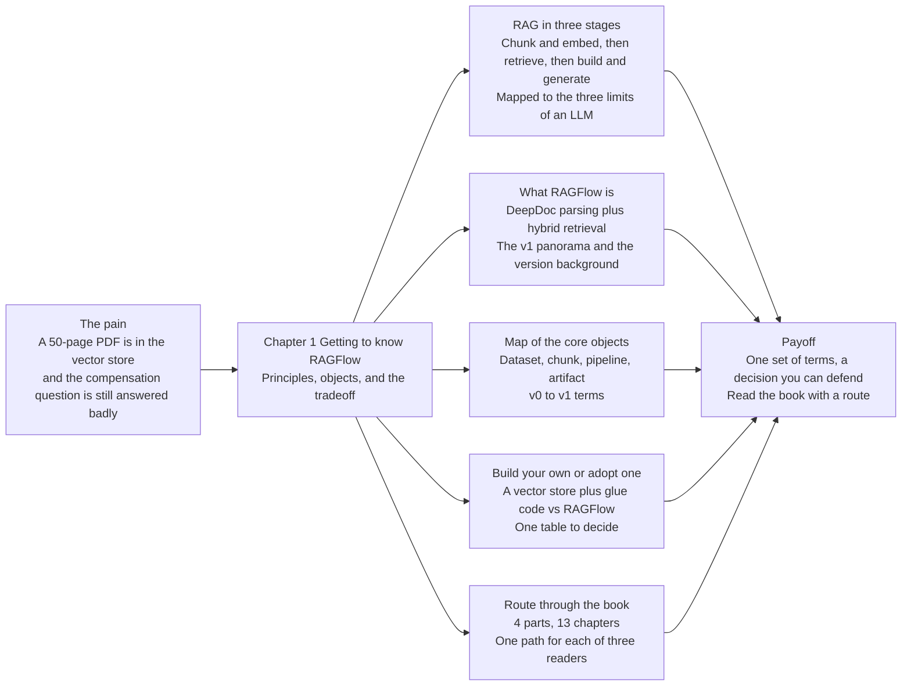
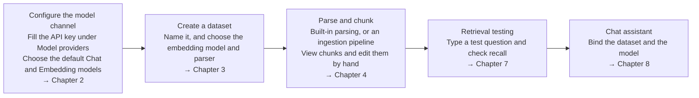

# Chapter 1 Getting to know RAGFlow

> Chapter guide: A cross-border e-commerce support team poured the whole 50-page After-sales Policy Manual (after-sales-policy.pdf) into a vector database. Support asked "运输破损的赔偿标准是多少" ("What is the compensation standard for damage in transit?"), and what came back was three passages of logistics text that had nothing to do with the question. Switching to a product code and asking "哪个仓发哪些型号" ("Which warehouse ships which models?"), exact match was sometimes right and sometimes not. The problem is not the vector store. The pipeline skipped the two hardest steps in RAG: parsing and chunking. This chapter builds the conceptual foundation of the book: how the three stages of retrieval-augmented generation (RAG) work, and which stage eases each of the three limits of an LLM; what RAGFlow, as an open-source RAG engine, fills in that "a vector store plus glue code" cannot do; a map of the book's terms and core objects; and how to choose between building your own and adopting an existing product. By the end of this chapter, you can: explain RAG to a colleague with the three stages; read the next twelve chapters with one set of terms; make the tradeoff for your own scenario; and mark the reading path that is yours.



*Overview figure for this chapter*

## When you need it

Three typical situations, and three ways to use this chapter.

**You have a pile of mixed-format documents that must become a knowledge base people can question, and you do not know where to start.** Read Section 1.1 and 1.2. First see which stage of RAG is hard, then see which stages RAGFlow has turned into a product. The technical chapters later then have a target.

**The team is wavering between "build RAG ourselves or use an existing engine".** Go straight to the comparison table and the two judgment lists in Section 1.4. This is a decision chapter, not a sermon: in some scenes, building your own is still the right call.

**You have already decided to use RAGFlow, but the terminology gap between the v0 and v1 docs is confusing you** (the previous tutorial said knowledge base, this one says dataset). Read the terminology table in Section 1.3, then use 1.5 to mark your own reading path.

## 1.1 Overview: from speaking from memory to an answer you can check

Large language models (LLMs) are astonishing at general knowledge. Once the question lands on internal company documents, a private knowledge base, or live data, three limits show themselves:

| Limit | How it shows up | RAG's answer |
|------|------|-----------|
| Static knowledge | Knowledge stays at the data snapshot from training time and cannot update on its own | The retrieval stage pulls the latest content from an external knowledge base in real time |
| Blind spot on private data | It cannot reach private company documents, live information streams, or domain content | Private data enters the knowledge base and becomes a retrievable asset |
| Hallucination | When it lacks a basis, it still invents a plausible wrong answer in order to stay fluent | Retrieved results enter the context as a factual basis, and the answer can be traced |

Retrieval-augmented generation (RAG) exists for exactly this: **before the LLM generates an answer, first retrieve the most relevant context from an external knowledge base as "reference material", then steer the model to answer from that**. That upgrades the LLM from "speaking from memory" to "an answer you can check". Another one-sentence summary of RAG's nature in the official docs is worth keeping: the core of RAG is Retrieval, not Generation. Everyone has a generation side. Retrieval quality is the watershed.

RAG's workflow has three stages:

1. **Data processing and vectorization**: knowledge comes from unstructured data in many formats (documents, database records, API responses). First chunk it (Chunk), then an embedding model turns it into vectors and stores them in a vector database.
2. **Retrieval**: the user query is turned into a vector too. Semantic similarity search in the vector store recalls the most relevant text fragments.
3. **Context construction and generation**: the recalled content is assembled into the LLM context as a factual basis, and the model organizes the final answer.

### Why a 50-page PDF going straight into a vector store does not work

Look back at our running example. Vectorizing the whole 50-page After-sales Policy Manual works poorly, and that is not mysticism. The official docs give three mechanical explanations:

- **Semantic "averaging"**: a long document pressed into one vector has its details flattened. "运输破损赔 30%" ("damage in transit is compensated at 30%") and "清关延误不赔" ("a customs delay is not compensated") melt into one vague "售后政策" ("after-sales policy").
- **A limited context window**: an LLM's input has a length cap. You already have to feed only the most relevant fragments.
- **Cost and efficiency**: both the embedding computation and the retrieval cost of long text are higher.

So you must chunk. Chunking immediately hits an internal contradiction: **semantic matching wants chunks that are small and focused, while understanding the context wants chunks that are large and complete**. The system is forced to trade off between "precise but broken" and "complete but vague". Add another layer: company knowledge is often multimodal documents that contain tables, charts, and formulas. Simple OCR drops a lot of semantic information (a compensation-standard table is flattened into garbled text). And exact matches such as product codes and regulation numbers are something pure vector retrieval is naturally bad at. The conclusion in the official docs is the argument on the other side of this chapter's title:

```text
❌ Shortcut: the whole PDF → vector store → retrieval
   Long-document semantics get averaged. Table structure is lost. Exact-id recall is unstable.

✅ The real path: DeepDoc parsing (tables keep their rows and columns) → chunk by heading level
   → hybrid vector + full-text retrieval → rerank → build the context → generate
```

**Parsing and chunking are the main battlefield of RAG.** That sentence is the starting point of the whole book. Chapter 4 and Chapter 5 both answer it.

### RAG and Agent: same origin, different streams

Add a set of concepts that are easy to mix up. Under an Agent framework, RAG and memory rest on a highly similar technical base. Both are "retrieve relevant information from storage according to the current need". The difference is the data source: **RAG faces existing knowledge prepared in advance** (documents, databases), and **Memory faces dynamic data produced in real time during interaction** (session history, tool execution results). A complete Agent system often has both. This distinction shows up again in Chapter 10: RAGFlow's canvas Agent connects to both.

The official docs also point out where RAG is heading. Three signals connect directly to the second half of this book:

| Direction | Meaning | Where in this book |
|----------|------|---------|
| RAG is the data foundation of an Agent | For an Agent to decide on its own and reliably, it must depend on a standardized ability to reach private-domain knowledge | Chapter 10, Chapter 11 |
| Use the LLM to improve retrieval itself | Query rewriting, result fusion, intelligent routing: let reasoning strengthen every step of retrieval | Chapter 8 (Agentic mode), Chapter 7 |
| Toward context engineering 2.0 | Today's RAG can be seen as context engineering 1.0. The next step is a combined context that dynamically assembles documents, memory, tools, and environment information for an Agent | Chapter 6 (knowledge artifacts), Chapter 10 |

That is, RAG is evolving from "a technique that raises the quality of question answering" into "infrastructure for trustworthy intelligent applications". That is also why this book gives Agent and integration a part of their own.

## 1.2 What RAGFlow is

The official definition, in one sentence: RAGFlow is an **open-source RAG engine based on deep document understanding**. Working with an LLM, it provides grounded, citation-backed question answering over data in all kinds of complex formats (quickstart original wording, v1.0.0-rc2). Two terms in that definition are worth circling:

- **Deep document understanding** means DeepDoc. It combines OCR, table structure recognition (TSR), and layout analysis (DLR), and "translates" complex documents such as PDFs and scans into text that keeps structure and semantics, for later chunking and retrieval. The problem in Section 1.1, a compensation-standard table getting flattened, is handed to DeepDoc.
- **An engine, not a toy.** The retrieval layer is a composite system: vector retrieval covers semantic breadth, full-text retrieval (BM25) covers keyword precision, the two are fused by RRF, then rerank and metadata filtering are added. What a bare vector store can't do is built in here.

The v1 product picture, in one sentence: **a dataset holds the knowledge, an ingestion pipeline orchestrates the parsing flow, knowledge compilation produces knowledge artifacts (Artifact) such as a Wiki and a graph, chat assistants and search applications face question answering directly, a canvas Agent orchestrates complex task flows, and the HTTP API and MCP Server expose knowledge capability to external systems**. Knowledge is consumed by platform-side Agents through MCP (see Chapter 11) (the MCP book). Each object has a one-line note in Section 1.3.

**Version background, v0 to v1** (the version facts come from the official release_notes, checked on 2026-10-27): v1.0.0-rc1 (released 2026-09-29) was a full rewrite in Go, moving from a heavy deployment to a light architecture. The message queue moved from Redis to NATS, and cache and checkpoints were unified on Kvrocks. v1.0.0-rc2 (released 2026-10-16, the version baseline of this book) introduced Agentic mode for chat, replacing the old Low/Medium/High/Ultra thinking levels, unified the built-in document parser with the Pipeline parser, and also supports Team/Me sharing and an arm64 image. The data upgrade between the two generations starts from v0.27.2 and is irreversible. The full checklist for upgrade and migration is in Chapter 12. Every account in this book follows the v1.0.0-rc2 docs.

If the panorama is too abstract, look at the minimal main line the quickstart gives. Walk five actions, and you have a knowledge application that can answer:



*RAGFlow's minimal main line: from model configuration to a question-answering application (from the quickstart, v1.0.0-rc2)*

The first easy pitfall of the whole book is buried on this line: **the embedding model has to be chosen before parsing**. After a dataset already has chunks, changing the model is allowed to save only after a compatibility check on a sample of existing vectors (the dimensions match, and the average cosine similarity is not below 0.9), and old chunks are not re-embedded automatically. The details are in Chapter 3.

## 1.3 A map of the core objects

The place v1 renamed the most: **the knowledge base in the v0 docs is called a dataset in v1**. This book uses the latter throughout. Narrative scenes occasionally use "knowledge base" as a general word. The two tables below are the glossary and the map of the book. The first solves "one thing, two names". The second solves "which chapter unfolds each object".

**Table 1: terms and the v0 to v1 mapping**

| Term in this book | English | Old name / change | One-sentence definition |
|----------|------|------------|-----------|
| Dataset | Dataset | v0 called it a knowledge base | The basic unit for organizing and managing knowledge. It can hold multiple documents |
| Chunk | Chunk | — | The basic knowledge unit after a document is parsed and split. The main object of indexing, retrieval, and citation |
| Ingestion pipeline | Ingestion Pipeline | — | Defines the processing flow after a document enters a dataset (parsing, processing, chunking) |
| Knowledge compilation | Knowledge Compilation | Rebuilt starting with v0.27.0, replacing the standalone GraphRAG and RAPTOR entries | Further processing of a single document or a whole dataset, producing knowledge artifacts |
| Knowledge artifact | Knowledge Artifact | — | The product of knowledge compilation: Wiki, Graph, Tree, PageIndex, Mind Map, Timeline, Skills |
| Retrieval testing | Retrieval Testing | — | Enter a test query, inspect the recalled chunks, and adjust the retrieval configuration from that |
| Chat assistant | Chat Assistant (on-screen text: Chat) | — | A question-answering application based on one or more datasets |
| Agentic mode | Agentic | v1.0.0-rc2 replaced the Low/Medium/High/Ultra thinking levels | A retrieval Agent checks in depth and then answers. Naive mode does one-shot retrieval |

**Table 2: object, duty, and chapter**

| Object | One-sentence duty | Chapter |
|------|-----------|---------|
| Dataset | Holds documents and chunks. The knowledge carrier for all retrieval and question answering | Chapter 3 |
| Chunk | The smallest retrieval unit. Parsing quality lands, in the end, on chunk quality | Chapter 4 |
| Ingestion pipeline | Orchestrates parsing, processing, chunking, and indexing on a canvas | Chapter 4, Chapter 10 |
| Knowledge artifact | Reorganizes existing knowledge into processed products such as a Wiki, a graph, and navigation | Chapter 6 |
| Retrieval testing | The everyday tool for tuning and inspection: ask, and check the recall at once | Chapter 7 |
| Chat assistant | The question-answering entry for end users. Configure the prompt and the retrieval parameters | Chapter 8 |
| Search application (Search) | A knowledge application tilted toward retrieval and result display. It complements Chat | Chapter 9 |
| Canvas Agent | Visually orchestrates a task-processing flow of retrieval, models, logic, and tools | Chapter 10 |
| HTTP API and MCP Server | Exposes knowledge capability to external applications and platform-side Agents | Chapter 11 |

When a term is doubtful in a later chapter, come back to these two tables. The definitions in the tables all come from the official Glossary (checked on 2026-10-27).

The two tables are a paper map. Where the objects land in a real console is the figure below. This screenshot is from a hands-on run on 2026-11-04 of RAGFlow v1.0.0-rc2 deployed with Docker on this machine. The screen is the console home after a newly registered account logs in:


Each object in table 2 has an entry on the screen. A row of top navigation, Dataset, Chat, Search, Agent, File, lines up with the main objects in table 2 from the dataset through to everything short of the API. The two empty-state cards on the page show this is a brand-new account that has not created any object yet. What Chapter 3 and Chapter 8 build starts from the plus sign here. One honest note: the rc2 top navigation has one more entry than table 2, Memory (an object of Chapter 10). This chapter's table does not list it on its own. When you reach Chapter 10, you can match it on the screen.

## 1.4 The tradeoff with building RAG yourself

First, a position from the official docs: **a vector database is not a RAG system**. A vector store is good at semantic similarity retrieval, but what RAG wants is "an answer that is exact and reliable". The retrieval layer needs composite capability. Hybrid retrieval keeps both semantic breadth and keyword precision. Metadata filtering (filter by date, department, and type) is a business necessity. Rerank puts the most relevant content in front. On a self-built path, all of these have to be assembled one by one with glue code.

| Dimension | Self-built: vector store + glue code | RAGFlow |
|------|----------------------|---------|
| Document parsing | Assemble OCR, table recognition, and format conversion yourself. One branch per format | DeepDoc built in (OCR/TSR/DLR). PDF, DOCX, XLSX, images, and slides work out of the box |
| Retrieval layer | Start from vector retrieval. Build BM25, RRF, rerank, and metadata filtering yourself, one by one | Vector plus full-text hybrid retrieval, RRF fusion, rerank, and metadata filtering are built in |
| Chunk governance | No UI. Scripts and logs. Chunk quality is a black box | Chunks are visible, editable, and can take added keywords. Parsing logs can be inspected |
| Retrieval verification | Build your own evaluation scripts | The retrieval testing screen: ask, and check at once |
| Application layer | The question-answering UI, sessions, and channel access are all built in-house | Chat assistant, search, canvas Agent, and API/MCP are ready to use |
| Freedom to customize | Fully controllable. Every link of the retrieval chain can be replaced | You can orchestrate inside the pipeline. That is freedom inside the framework's boundary |
| Starting surface | One vector store is enough to start | A whole set of services. The official suggestion is to start from 4 CPU cores, 16 GB of memory, and 50 GB of disk |

What is easy to miss in the table above is the **hidden cost** of the self-built path: long-term maintenance of format branches, a way to observe chunk quality, and evaluation scripts for retrieval quality. Each of these is ongoing investment, not a one-time build. "The vector store is open source and free" does not equal "RAG is cheap".

### When building your own is still reasonable

Our recommendation: if any one of the three holds, you should seriously consider building your own. **Deep customization of the retrieval chain** (a ranking model of your own, a special index structure, retrieval deeply coupled with business logic). **Platform infrastructure you already have** (pgvector/Milvus is already in production, and the team has people for RAG development and operations). **Compliance requires** that every step be fully self-held. The engineering detail of the self-built path, choosing a vector store, assembling the retrieval chain, and consumption on the Agent side, is not developed in this book (the AgentScope Java book).

### When RAGFlow is faster

Our recommendation, likewise three items: the main contradiction is "a pile of mixed-format documents → a knowledge base people can question", and **parsing is the hard part** (tables, scans, and Excel arrive mixed together); you need an **operations interface**, chunks must be visible and editable, retrieval quality must be verifiable, and document updates must have a process, rather than changing code every time; you want an **application layer and an integration surface that work out of the box**, a chat assistant, a canvas Agent, and HTTP API/MCP are directly usable (see Chapter 11). Our running example belongs to the latter category: the core demand of a support knowledge base is the efficiency of turning documents into question answering, not the retrieval algorithm itself.

The two paths do not exclude each other. Even if you choose to build your own, the ideas in this chapter (the chunking tradeoff, hybrid retrieval, parsing quality) are still general. RAGFlow has only productized these steps.

## 1.5 A roadmap for the whole book

The book has 13 chapters. By this book's division they fall into 4 parts:

| Part | Chapters | The content in one sentence |
|----|-----|-----------|
| Getting started | 1 Getting to know RAGFlow | This chapter: why RAG, what RAGFlow is, the tradeoff |
| | 2 Deployment and model channels | Docker deployment, the configuration system, connecting models, verifying the first chain |
| Building the knowledge base | 3 Datasets: the carrier of a knowledge base | Creation and permissions, file management, data source access and sync, metadata |
| | 4 Parsing and chunking: from documents to Chunk | Choosing a built-in parsing method, Chunker parameters, table column roles |
| | 5 Retrieval enrichment and indexing | The Extractor set of four, indexing strategy (sub-chunks are in Section 4.4.1) |
| | 6 Knowledge compilation and knowledge artifacts | Generating a Wiki, navigation, and a graph; templates and dedicated configuration |
| Applications | 7 Retrieval testing and tuning | Retrieval Testing, hybrid retrieval weights, a way to locate retrieval quality |
| | 8 Chat assistants and sessions | Configuration, Agentic mode, the prompt and parameters, session management |
| | 9 Search apps and access channels | Search apps, Chat Channel, web embedding |
| Advanced and operations | 10 Agents and workflows | The canvas and component families, connecting Memory, a support Agent case |
| | 11 External integration: API and MCP | The HTTP/Python API panorama, API keys, RAGFlow as an MCP Server |
| | 12 Production operations | Monitoring and tracing (the Langfuse book), backup and restore, the v0 to v1 upgrade |
| | 13 Team collaboration and knowledge-base operations | The permission system, Team/Me sharing, the update process, and a quality-inspection SOP |

Suggested paths for three kinds of readers (take what you need; you do not have to read straight through in order):

| Reader | Suggested path | Why |
|------|---------|------|
| Platform engineer | 1→2→12→13 | Deployment, production operations, and team collaboration are the main line. Consult the knowledge-base and application chapters as needed |
| Knowledge base operator | 3→4→5→7→13 | From datasets to chunk governance and then to retrieval tuning. Chapters 4 and 7 are everyday tools |
| Agent developer | 3→8→10→11 | Dataset → chat assistant → canvas Agent → API/MCP access |

Our running example "售后知识底座" ("After-sales Knowledge Base") grows chapter by chapter along this path: Chapter 2 deploys the environment, Chapter 3 turns the After-sales Policy Manual (after-sales-policy.pdf), the Product FAQ (product-faq.xlsx), and the Shipping Time Notice (shipping-notice.html and the mail archive shipping-notice.eml) into the dataset after-sales-kb, Chapter 4 tunes parsing and chunking, Chapter 8 configures the chat assistant "售后助手" ("After-sales Assistant") (After-sales Assistant), Chapter 10 assembles the canvas Agent "售后客服 Agent" ("After-sales Support Agent") (After-sales support Agent), and Chapter 11 exposes it through MCP for platform-side Agents to consume (the MCP book).

## Chapter summary

1. **The core of RAG is Retrieval, not Generation**: the three stages (chunk and vectorize → retrieve → construct context and generate) upgrade the LLM from "from memory" to "an answer you can check". Each of the three limits has a stage that eases it.
2. **The main battlefield is parsing and chunking**: semantic averaging of long documents, information loss in multimodal documents, the granularity contradiction of chunking, and weakness at exact match. All of it happens in the ground layer on the retrieval side. Chapters 4 and 5 develop it.
3. **RAGFlow = DeepDoc parsing + hybrid retrieval + an operations interface + an application layer**. The key rename in v1 is knowledge base → dataset. Agentic mode replaced the four thinking levels.
4. **A vector database is not a RAG system**: when you need deep customization, already have the infrastructure, or face strong compliance requirements, building your own is still reasonable. When the hard part is parsing, you need an operations interface, or you want an application layer out of the box, RAGFlow is faster.
5. **Next**: Chapter 2 deploys RAGFlow and opens the model channel, so Chapter 3 is ready to build after-sales-kb.

## Acceptance checklist

By the time you have read this far, you should be able to:

- ☐ Explain RAG's workflow to a colleague with the three stages, and say which stage eases each of the three limits of an LLM.
- ☐ Use "parsing and chunking are the main battlefield" to explain the three mechanisms behind a 50-page PDF going straight into a vector store and working poorly.
- ☐ State the duties of the five objects dataset, chunk, ingestion pipeline, knowledge artifact, and chat assistant, and point to the chapter where each is developed.
- ☐ Give two queries in the after-sales domain that pure vector retrieval would miss and that need full-text retrieval to fill the gap (such as a product code or a regulation number).
- ☐ Make the "self-build or RAGFlow" choice for your own scenario, and give at least two reasons that belong on our recommendation lists.
- ☐ For your own role, mark the chapters to read on the path table, and write the reading order of the first three chapters.

## Further reading

- **Chapter 2 (Deployment and model channels)**: getting the engine running is the premise of everything that follows, including verification of the first chain.
- **Chapter 4 (Parsing and chunking)**: the technical development of this chapter's "main battlefield" claim. How a compensation-standard table keeps its rows and columns. The answer is there.
- **Chapter 7 (Retrieval testing and tuning)**: how "it works poorly" becomes an engineering problem you can locate and repair.
- **(the MCP book)**: the same after-sales domain meets across the two books. This book builds the knowledge. The MCP book delivers that knowledge through MCP to platform-side Agents (see Chapter 11).
- **The official docs, What is RAG and the Glossary**: the original material of this chapter (docs/basics/rag.md, docs/references/glossary.mdx). When a term is disputed, the official original wins.

## Review checklist (before publication)

- [ ] This chapter is a concepts chapter. There is no code or UI operation to measure hands-on. The v1 shape panorama in Section 1.2 (dataset / ingestion pipeline / knowledge artifact / chat assistant / canvas Agent / MCP Server) is to be checked item by item against the Web UI once a v1.0.0-rc2 environment is ready
- [ ] The v0 to v1 version facts (the rc1 Go rewrite and NATS/Kvrocks, rc2 Agentic mode and parser unification, the irreversible upgrade) have been checked against release_notes.md (2026-10-27). Check them once more before publication
- [ ] The division into 4 parts (getting started / building the knowledge base / applications / advanced and operations) is an organizing choice of our recommendation. At final draft, check it for consistency with the README chapter plan
