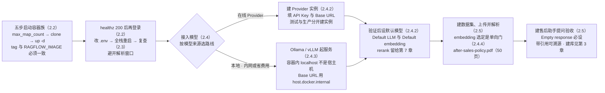
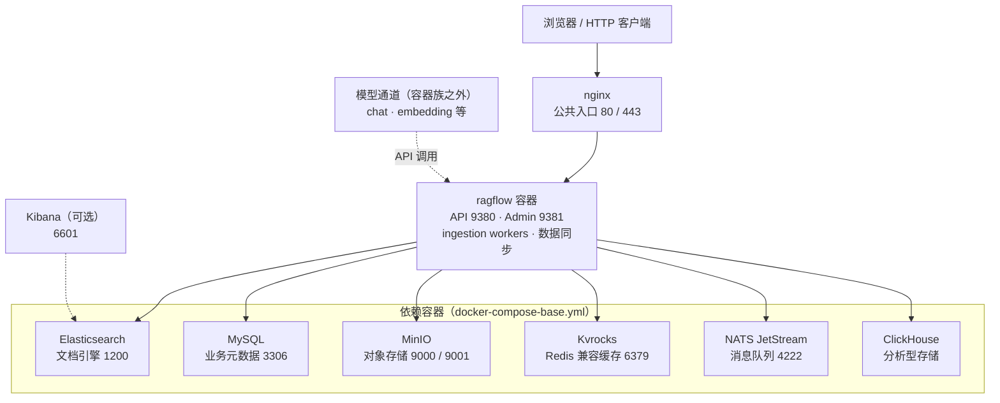

# Chapter 2 Deployment and model channels

> Chapter guide: Chapter 1 made clear why it is RAGFlow. This chapter answers how to get it running. You have a machine with Docker installed, and three seed documents for 「售后知识底座」 (After-sales Knowledge Base): the After-sales Policy Manual, the Product FAQ, and the Shipping Time Notice. The goal is to deploy RAGFlow, connect the models, and pave the road for the dataset (Dataset) work in chapter 3. This chapter runs along three lines. Deployment: the container-family topology and the five Docker Compose steps. Configuration: how `docker/.env` and `service_conf.yaml.template` divide the work. Model channels: among seven model roles, a support scene that is just starting on "retrieval + generation" needs only chat and embedding. Leave rerank for chapter 7, when you tune. By the end of this chapter, you can: finish a deployment whose health check passes; say how a configuration change takes effect; connect an online or local model and set the defaults; and walk the After-sales Policy Manual through the first question-answering chain that carries citations.



*Flowchart for this chapter*

## When you need it

Three typical situations, and three ways to use this chapter.

**Installing RAGFlow on this machine for the first time.** Follow the five steps in 2.2. If you get stuck on startup or the health check, go back to 2.1 and use the container-family map to see which component did not come up. Finish by verifying with 2.5.

**It is installed, but the model is not connected, or you want to change the Provider.** Go straight to 2.4. Nine times out of ten, an error from the verification button is the Base URL and whether the network can reach it: RAGFlow runs inside a container, and `localhost` is not your host.

**You need to change a port, switch the document engine, or start preparing to go live.** Read 2.3 to understand how the two configuration files divide the work and how a change takes effect. Password governance, backup, and upgrade management for production are developed in (see chapter 12).

Prerequisite: a machine that meets the resource prerequisites in 2.2, and Docker. The basic RAG concepts from chapter 1. This chapter requires no programming background. Every operation is done on the command line and in the web UI.

## 2.1 Overview: the unit of deployment is a family of containers

Set one conceptual position first: **understand RAGFlow as "a family of containers that work together", not as a single application**. Later troubleshooting, port changes, and capacity planning all rely on this map. After `docker compose up`, what you get is not "one RAGFlow". It is one entry, one business container, and six kinds of dependencies:



*RAGFlow container-family topology (the ports are the host's external ports; the defaults are in the table below)*

A list of components and duties:

| Component | Duty | Default port (host) | Key variables in `.env` |
|------|------|------------------|----------------|
| nginx | The public entry. Browser traffic and API traffic both come in here | 80 / 443 | `SVR_WEB_HTTP_PORT` / `SVR_WEB_HTTPS_PORT` |
| ragflow | API, Admin, ingestion workers, and data sync. The startup script runs the database migration first | 9380 / 9381 | `SVR_HTTP_PORT` / `ADMIN_SVR_HTTP_PORT` / `RAGFLOW_IMAGE` |
| Elasticsearch | The document engine (the default choice). It holds the chunk index | 1200 | `STACK_VERSION` / `ES_PORT` / `ELASTIC_PASSWORD` |
| MySQL | The business metadata database (the default database name is `rag_flow`) | 3306 | `DB_TYPE` / `MYSQL_PASSWORD` / `EXPOSE_MYSQL_PORT` |
| MinIO | Object storage. It stores every uploaded file | 9000 (API) / 9001 (console) | `MINIO_USER` / `MINIO_PASSWORD` |
| Kvrocks | A Redis-compatible cache (independent of the NATS queue) | 6379 | `KVROCKS_PORT` / `REDIS_PASSWORD` |
| NATS JetStream | The message queue | 4222 | `EXPOSE_NATS_PORT` |
| ClickHouse | Analytical storage | — (9900 for a source deployment) | — |
| Kibana (optional) | Elasticsearch visualization | 6601 | `KIBANA_PORT` |

Three data flows bring the table to life. Uploaded **original files** land in MinIO. The **chunk index** produced by parsing goes into Elasticsearch. **Business metadata** (datasets, document records, accounts) goes into MySQL. The ragflow container is the only one that does the business work. The quickstart's original wording is that it runs the API server, ingestion workers, and data sync, which from the source's point of view are four Go services: API, Admin, Ingestor, and Syncer (2.6 will meet them again).

There is another kind of dependency that is not on a solid line in the figure: **models**. The quickstart states, in the prerequisites, that at runtime you need access to one LLM and one embedding model. They are either an online Provider's API or a local service you deploy yourself. That is the "model channel" of 2.4: the second supply line, outside the container family.

## 2.2 Docker Compose deployment

The official standard path is Docker Compose bringing up a prebuilt image. From v1.0.0-rc2 on, images are provided for Linux x86-64 and ARM64. When you start with a release tag, Docker automatically chooses the architecture that matches the host.

### Prerequisites

| Item | Requirement (v1.0.0-rc2 docs) |
|----|------------------------|
| CPU | 4 cores to start (x86-64 or ARM64) |
| Memory | 16 GB to start |
| Disk | 50 GB of free space |
| Docker | ≥ 24.0.0, Docker Compose ≥ v2.26.1, and BuildKit enabled |
| Build-time network | Able to pull the dependency image `infiniflow/ragflow_deps:latest` |
| Runtime dependencies | Able to reach one LLM and one embedding model (2.4) |

The docs also remind you: the resources you actually need depend on the document engine, the volume of data, the parsing load, and concurrency. **Local models and OceanBase need extra resources.** If the after-sales base runs Ollama on the same machine, raise the memory budget (this book's position: 16 GB means "it can run"; once a local model is added, 32 GB means "comfortable").

### Five steps to start

**Step 1: adjust `vm.max_map_count` (the default Elasticsearch engine needs it).** Check it, and raise it when it is below 262144:

```bash
sysctl vm.max_map_count
sudo sysctl -w vm.max_map_count=262144
```

A change made with `sysctl -w` is temporary and is lost after a reboot. To persist it, write `vm.max_map_count=262144` into `/etc/sysctl.conf`. Docker Desktop users need to apply this setting inside its Linux virtual machine. This is the step beginners miss most often. The symptom is the ES container restarting again and again.

**Step 2: clone the repository.**

```bash
git clone https://github.com/infiniflow/ragflow.git
```

**Step 3: check out the release tag, and start with Docker Compose.**

```bash
cd ragflow/docker
git checkout v1.0.0-rc2
docker compose -f docker-compose.yml up -d
```

Watch the version correspondence. When you switch to another version, the tag in `git checkout` and the image tag of `RAGFLOW_IMAGE` in `docker/.env` must match. If pulling the image is difficult, the docs provide two mirror sources, Huawei Cloud and Alibaba Cloud (just change `RAGFLOW_IMAGE`; see 2.3). Two more points, said in advance. First, layout analysis, OCR, and table recognition in DeepDoc for open-source 1.0 use CPU inference and do not need a GPU. Second, before you deploy to any host the network can reach, change the default passwords in `docker/.env`.

**Step 4: verify the service status.**

```bash
docker ps
docker logs -f ragflow-cpu
```

After initialization finishes, check the health of the API and the dependencies through the web port, from another terminal:

```bash
curl -f http://localhost/api/v1/system/healthz
```

A successful response is HTTP 200. If you changed `SVR_WEB_HTTP_PORT`, the URL has to include that port. **Wait until this check passes before you open the web UI.** The ragflow container's startup script runs the database migration before it starts the service. If you jump the gun, you only see a half-initialized state.

**Step 5: log in.** Open `http://IP_OF_YOUR_MACHINE` in a browser (if you changed the web port, include the port the same way). Register or log in, and enter the console.

### A pitfall in a development scene

If what you checked out is a development branch rather than a release tag, the service may refuse to start and report `Refusing to start: database was migrated by a newer version`. The code version is older than the database migration version. The fix the docs give is to set `RAGFLOW_DEV_MODE=true` in `.env` and run the Compose command again (it skips the database downgrade check). **Production must keep `RAGFLOW_DEV_MODE=false`.** Every chapter of this book uses a release tag and will not trigger this problem.

## 2.3 The configuration system

Changing a port, switching the document engine, and connecting an external database all happen in the configuration layer. A Docker deployment of RAGFlow has four configuration files, divided like this:

| File | What it governs |
|------|--------|
| `docker/.env` | The deployment surface: the Docker image, service profiles, external ports, dependency credentials, and other environment variables |
| `docker/service_conf.yaml.template` | The service surface: system-level configuration consumed by the Go services. When the container starts, the template generates `service_conf.yaml` and substitutes the environment variables in it |
| `docker/docker-compose.yml` | Starts the RAGFlow service, and selects dependencies by profiles |
| `docker/docker-compose-base.yml` | Defines the shared dependencies: the document engine, the metadata database, MinIO, Kvrocks, NATS, and ClickHouse |

**Nine tenths of everyday changes land in `.env`.** A quick lookup of the key items:

| Variable | Default | Notes |
|------|--------|------|
| `SVR_WEB_HTTP_PORT` / `SVR_WEB_HTTPS_PORT` | 80 / 443 | The public nginx ports. After a change, every access URL has to include the port |
| `SVR_HTTP_PORT` / `ADMIN_SVR_HTTP_PORT` | 9380 / 9381 | The Go API / Admin ports. They usually do not need to be exposed directly to the browser |
| `DOC_ENGINE` | — (Elasticsearch by default) | The document engine choice. The quickstart's original wording: `.env` controls `DOC_ENGINE`, the service ports, and the dependency credentials |
| `DB_TYPE` | `mysql` | The metadata database type. Connecting to OceanBase goes through its MySQL-compatible protocol |
| `STACK_VERSION` / `ES_PORT` | 8.11.3 / 1200 | The Elasticsearch version and the external port |
| `MYSQL_PORT` / `EXPOSE_MYSQL_PORT` | 3306 / 3306 | The port for connections inside the container / the port exposed to the host |
| `MEM_LIMIT` | 8073741824 (about 7.52 GiB) | The memory cap of a **single container**. Not the minimum memory, not the total reservation, and not a guarantee of actual usage |
| `TZ` | `Asia/Shanghai` | The time zone |
| `HF_ENDPOINT` | Disabled by default | A mirror site for huggingface.co. When the network is restricted, uncomment it to enable it |
| `ENABLE_REGISTER` | 1 | Whether user registration is open. For an internal deployment, set it to 0 |
| `RAGFLOW_IMAGE` | — | The image and tag. It must match the release tag you checked out |

At the `service_conf.yaml.template` layer, this chapter only needs you to remember two points. It is a template, not the final file (it is generated at startup; do not edit the generated file directly). When a proxy and the real IP are involved, watch `api.trusted_proxies` (by default it trusts only the loopback address of the nginx inside the image; an explicit list **replaces** rather than appends). The value of `MEM_LIMIT` is also defined among this layer's MySQL connection-pool parameters and the like (such as `max_connections`, which defaults to 900). Tuning the service surface is developed in chapter 12.

**How a change takes effect**: a change to any of the configuration above needs a restart of every container before it takes effect:

```bash
docker compose --env-file docker/.env -f docker/docker-compose.yml up -d
```

This book's position: turn "edit `.env` → restart the full stack → recheck healthz" into muscle memory, and **change only one related group of settings at a time**. A full-stack restart interrupts parsing tasks that are in progress. Time a configuration change so that it avoids the parsing window (change management and upgrade migration in production are in chapter 12).

## 2.4 Model channels

RAGFlow is a RAG engine. It does not bring any generation or vectorization ability of its own. Every demand it places on models is met through a "model channel": on the screen, configure the Provider, the model, and the credentials, and the container family calls them by role at runtime. The channel sits outside the container family. That is the last piece of the deployment topology.

### 2.4.1 Model roles

RAGFlow uses models by role. The official docs list seven:

| Model role | Full name | What it does | Typical scene |
|----------|------|--------|----------|
| LLM (chat) | Large Language Model | Understand, reason, and generate text | Question answering, content generation, summarization, information extraction |
| Embedding | Embedding model | Turn text into vectors | Semantic retrieval, similarity calculation, knowledge-base indexing |
| Rerank | Rerank model | Rescore the first-pass candidates by relevance and reorder them | Improve retrieval results, raise question-answering accuracy |
| VLM | Vision-language model | Understand an image and the text, objects, and scenes in it | Visual question answering, chart understanding |
| ASR | Automatic speech recognition | Speech to text | Transcription, meeting notes, live captions |
| TTS | Speech synthesis | Text to speech | Spoken announcements, voice interaction |
| OCR | Optical character recognition | Recognize text in a picture or a scan | Scans, receipt recognition |

The main chain of retrieval question answering is strung together from the first three: **the embedding model vectorizes the query and the chunks and recalls candidates by similarity, the rerank model reorders the candidates, and the LLM generates an answer from the knowledge that was selected**. Carried into the after-sales scene: support asks "退货时限是几天". The question is vectorized by the embedding model, policy entries are recalled from the chunks of `after-sales-kb`, and the chat model answers from that. The starter list follows from this: **to get "retrieval + generation" running, you need at least the two model types chat and embedding**. Rerank is an enhancement for when you tune in chapter 7. VLM/ASR/TTS/OCR are not used by the after-sales scene in this book (the tables and layout of the After-sales Policy Manual are carried by DeepDoc's CPU inference, and do not depend on you adding a vision model of your own). RAGFlow also supports exposing these abilities to external applications through the HTTP API. How to connect is in (see chapter 11).

### 2.4.2 Connecting an online Provider

Taking an online large model as the case, the quickstart gives four steps:

1. From the avatar, enter **User settings** and select **Model providers**.
2. In **Available models**, select a Provider and create a Provider instance.
3. Fill in the instance name and the connection information (such as **API Key** and **Base URL**), select the models you need from the list or add them, verify them one by one, and save the instance.
4. In **Set default models**, choose the Chat model and the Embedding model. Configure the other types as needed.

When that set of four steps lands on a real screen, the first thing you see is often the page of the last step. This screenshot is from a hands-on run on 2026-11-04 of RAGFlow v1.0.0-rc2 deployed with Docker on this machine (User settings → Model providers). The first time a new account enters Set default models, the dropdowns for all six default-model types are empty:


The prompt at the top of the page says "Please complete these settings before beginning", and the LLM item also carries a red required asterisk. If the default models are not set, the business pages have no model they can use. Available models on the left lines up a long row of providers, OpenAI, Anthropic, Gemini, but the models you can pick in a dropdown come only from instances that have already been created (the green dot beside OpenAI-API-Compatible is the mark that the demo-gateway instance is ready; this screenshot was taken after the instance was created and before the defaults were set). Create the Provider instance first, then come back and set the defaults. On the screen, that order is a hard constraint.

A few details the docs emphasize are worth copying into the way you operate:

- **An instance is a set of connection settings.** You can create separate instances for test, production, a local model, or a proxy gateway, so the purposes do not get mixed together.
- **Base URL.** An official Provider generally keeps the default. When you go through a compatible API, a proxy, or a gateway, fill in the real address, and confirm whether the path needs to include `/v1`.
- **Verification.** Verify one by one, or use **Verify all models**. On failure, check in this order: credentials, Base URL, network, quota, model name, and availability.
- **Set at least two default models:** Default LLM and Default embedding (after rerank is configured, add a default rerank as well). When a business page does not name a model, it takes the default automatically. Setting the defaults first avoids picking a model that is not available.
- **Custom models.** When the list does not have it but the Provider actually supports it, add it by hand. The model name must be exactly the same as the model ID the Provider API exposes, and the model type must be chosen correctly. A model that supports tool calls can turn on **Tool calling** (this bears on the Agent capability in chapter 10).
- **API Key discipline.** Do not leak it. A few Providers have role limits (such as Bedrock's API key authentication, which does not support rerank models). Production prefers short-lived credentials.

Steps 2 and 3 of the four, choosing a Provider and creating an instance, then filling in the connection information, land on the screen as the form below. In the same hands-on run (2026-11-04, RAGFlow v1.0.0-rc2), OpenAI-API-Compatible was selected from Available models and a new instance was created:


Instance name is demo-gateway, which matches the habit of "create separate instances for test, production, and a proxy gateway". The API Key is echoed as dots. The whole Base URL is covered by a black bar (the gateway address is hidden as sensitive information). The Models area is empty at this moment: All models 0, No models available. List models, Verify all models, and Add all models beside it are the three buttons the next step uses to load models and run verification.

After the instance is saved and you open it again, the form has become an archive view:


The title line has changed to the instance name demo-gateway, and a green dot has appeared beside the provider name. The Models area now has three cards. The category counts are All models 3 / LLM 1 / Embedding 2. The two embedding cards (text-embedding-v4 and doubao-embedding-vision) were pulled from the gateway by List models. The deepseek-flash LLM card was added by hand with "+": fill in the model name, choose Chat as the type, then fill in Max context length. That is exactly the "custom model" path in the body text.

With the instance and the models ready, go back and fill in the empty form from the opening of this section:


Of the six types, the hands-on run touched only two, LLM and Embedding, which is exactly "set at least two default models". Leaving VLM, ASR, Rerank, and TTS empty does not affect the "retrieval + generation" main chain. On this book's pace, rerank is left for chapter 7. A dropdown item is displayed as the pair "model name + instance name" (deepseek-flash demo-gateway). A model belongs to an instance, and you can see at a glance which instance a default landed on.

### 2.4.3 Local models

When the data must not leave the intranet, or you want to save the API cost, you can deploy a model locally and then connect it. The docs give two main lines, plus one option built into Docker:

**Ollama: a light way to start.** One command brings the service up, then pull one chat model and one embedding model (documentation Example):

```bash
sudo docker run -d --name ollama --restart unless-stopped \
  -p 11434:11434 -v ollama:/root/.ollama ollama/ollama
sudo docker exec ollama ollama pull openbmb/minicpm5-2b
sudo docker exec ollama ollama pull qwen3-embedding:0.6b
```

Connect it to RAGFlow. In **Model providers**, select **Ollama** and create an instance. Fill the Base URL with the address in the table below, **leave the API Key empty**, add `openbmb/minicpm5-2b` as Chat and `qwen3-embedding:0.6b` as Embedding (the model name must be exactly the same as the name Ollama returns), verify, and save.

In the hands-on run, the Ollama connection form looks like this. In the same run a new Ollama instance was created. The host was running Ollama 0.20.5:


The address the Base URL field offers is `http://host.docker.internal:11434`. RAGFlow is in a container and Ollama is on the host, and the iron rule "localhost inside the container is not the host" is already headed off for you inside the input box. Leave the API Key empty. Ollama on this machine does not authenticate.

Click List models once, and the local models go straight into the instance:


List models pulled two models from the local Ollama (0.20.5). The names are exactly the same as the output of `ollama list`: gemma4:26b is classed as LLM, and qwen3-embedding:0.6b is classed as Embedding. The `qwen3-embedding:0.6b` from the Example in the body appears unchanged. The chat model in the hands-on run is the gemma4:26b already on this machine, standing in for the Example in this book, `openbmb/minicpm5-2b`.

**vLLM: high throughput on a GPU.** It provides an OpenAI-compatible service:

```bash
vllm serve openbmb/MiniCPM5-2B --served-model-name MiniCPM5-2B \
  --host 0.0.0.0 --port 8000 --dtype auto --max-model-len 8192
```

When you connect it, select **VLLM** as the Provider. The Base URL ends with `/v1`. If `--api-key` is not configured, leave the API Key empty. If it is configured, fill in the same value.

**TEI, the local embedding service built into `.env`**: enable the `tei-cpu` or `tei-gpu` profile, name the model with `TEI_MODEL`, and expose it with `TEI_PORT` (the default is 6380). It fits a scene where you do not want to install a separate tool stack just for embedding.

The two sources can be mixed. A vLLM chat model paired with an Ollama embedding model is a combination the docs accept. Which machine the model is on decides how you fill the Base URL. This table is the spot in the chapter you will look up most often:

| Deployment shape | Base URL (Ollama on 11434 / vLLM on 8000 as the case) |
|----------|----------------------------------------------|
| RAGFlow in Docker, the model on the same host | `http://host.docker.internal:11434` / `http://host.docker.internal:8000/v1` |
| RAGFlow and the model both running directly on the host | `http://localhost:11434` / `http://localhost:8000/v1` |
| The model on another machine | `http://<模型机 IP>:11434` / `http://<模型机 IP>:8000/v1` |

**The connectivity iron rule: RAGFlow runs inside a container, and `localhost` inside the container is not the host.** For the same-host scene, always use `host.docker.internal`. If you are not sure, go into the container and measure it. First find the ragflow container name, then curl once from inside the container:

```bash
sudo docker ps --filter "label=com.docker.compose.service=ragflow-cpu" --format '{{.Names}}'
sudo docker exec -it <RAGFLOW_CONTAINER> curl http://host.docker.internal:11434/api/tags
```

Verification on the screen means something only when the container can list the models. On the security side, do not expose model ports such as 11434 and 8000 directly to the public internet. Constrain where access comes from with a firewall or the intranet.

### 2.4.4 A selection position: the embedding model is approximately irreversible

Among the seven roles, a chat model can be swapped at any time. It is stateless, each call stands alone, and using A today and B tomorrow leaves no trace. An embedding model is completely different. The quickstart spends a whole caution paragraph on the warning, and it is worth relaying at the level of the original wording:

> Choose the embedding model when you create the dataset. Before the dataset has any chunks (Chunk), you can change it directly. Once there are chunks, changing the model triggers a compatibility check: the vector dimensions must match, and the average cosine similarity of a sample of the existing vectors must not be below 0.9. If the check does not pass, the original choice is restored. Saving a model change does **not** automatically re-embed the existing chunks.

Turn that paragraph into the language of a decision: **choosing an embedding model is a one-way door. Changing the model ≈ the hidden cost of rebuilding the dataset.** Vectors come from the model. Change the model, and the old vectors and the new queries are not in the same semantic space. The retrieval results cannot be trusted. So this book's position is: before chapter 3 builds the `after-sales-kb` dataset, treat the embedding choice as a formal decision. For Chinese after-sales corpus, prefer a model that does well in Chinese and has a moderate dimension. If the requirement is to run locally, starting with Ollama's `qwen3-embedding:0.6b` is enough, and accept the pace of "verify on a small scale first, then parse in full". The selection detail on the dataset creation page is in (see chapter 3).

## 2.5 Verifying the first chain

Once the deployment is healthy (healthz returns 200) and model verification has passed, string the chain together with one real question and answer. Read the quickstart's five steps as follows. Each step is marked with "what it verifies". **The habit of verifying matters more than the operation itself.** Each step is the ground under the next stop:

| Step | Operation (following the quickstart) | What it verifies |
|------|----------------------|----------|
| ① Create a dataset | **Datasets** → **Create dataset**: fill in **Name**, choose **Embedding model** and **Parse type** (the first time, choose **Built-in** and pick a parsing method that fits) | The dataset was created, and the embedding model is already locked. This is the last window before the one-way door in 2.4.4 closes |
| ② Upload documents | On the dataset **Files** page, **Add file > Upload file**. You can check **Parse on creation** to parse automatically. Otherwise select the document and click **Run** | The parsing status advances to complete. When it sticks, look at the document **Logs** and the `ragflow-cpu` service logs |
| ③ Intervene in parsing | Open a file whose parsing has finished and enter the **Chunk** page: hover for a snapshot preview, and double-click the text to edit it by hand or add keywords. Then try a question in **Test text** under **Retrieval Testing** | A chunk is not a black box: you can see it, you can change it, and you can test it. Whether the tables in the After-sales Policy Manual were cut into usable chunks is something you see with your own eyes at this step |
| ④ Create a chat assistant | **Chat** → **Create chat**. In **Chat setting**, select the dataset you just parsed, choose the chat model, check the **System prompt**, and set **Empty response** | The binding of the chat assistant (Chat Assistant) to the dataset and the model takes effect. Empty response is the fallback wording for "there is no answer in the knowledge base" |
| ⑤ Ask a question | Open the chat window and ask about the document's content. For a question you can answer directly, choose **Naive**. For one that needs a deeper investigation, choose **Agentic** | **The answer carries a real citation, and the source can be traced.** That is what RAGFlow stands on, and it is the only authoritative test that the chain is through |

Land it on the running case. ① Create a dataset (name it `after-sales-kb`). ② Upload only `after-sales-policy.pdf` (50 pages, with tables; the first parse is a good moment to feel the time scale of CPU inference). ③ In **Retrieval Testing**, ask "退货时限是几天" and look at the policy chunks that are recalled. ④ Create the assistant 「售后助手」 (After-sales Assistant). ⑤ Ask "跨境订单的退货时限和运费承担". When you get one answer that carries citations, this chapter's acceptance is done. Two additions. First, choosing a parsing method (which one for a 50-page PDF, which one for XLSX) is the subject of chapter 4. This chapter starts with the default recommendation under Built-in. Second, **after-sales policy question answering must set Empty response**. A wrong answer to a policy question is worse than no answer. Leaving it empty means allowing the model to improvise when it has nothing to go on (this book's position: this item is not allowed to stay empty before knowledge-base question answering goes live). Deeper intervention in parsing and chunking is in (see chapter 4). The full configuration of a chat assistant is in (see chapter 8).

> The UI operations in this chapter were measured on 2026-11-04 on a v1.0.0-rc2 instance deployed with Docker on this machine (the screenshots are the figures in each section). The deployment and operations commands are written from the official docs. The measured scope is in the review checklist at the end of the chapter.

## 2.6 Starting from source: which scenes actually need it

The conclusion in one sentence: **simply using RAGFlow (deploying, building a knowledge base, tuning, integrating) does not require starting from source.** Docker Compose is the path the official docs recommend. Only three scenes need a source start: you are going to change the Go backend or the frontend source, you need to debug DeepDoc's internal behavior in depth, or the target platform has no prebuilt image. When that time comes, read the official `launch_ragflow_from_source` guide. Here, only a piece of expectation-setting: it is much heavier than a Docker deployment. It supports only Linux x86_64 (macOS does not support the Go backend for now). It depends on Go ≥ 1.27, Clang 20 / LLD 20, CMake ≥ 4.0, Node.js ≥ 18.20.4, and Python ≥ 3.10. The build order is "the dependency download script → `build.sh --all` → Docker brings up the supporting services → `--migrate` → start the four processes Admin, API, Ingestor, and Syncer separately → the frontend `npm run dev` (port 9222)". The good news is that the container-family map in 2.1 still holds in the source form. The supporting services are still that family of containers. Only the ragflow container is replaced by four processes on the host. The development-mode switch and version management in the source form are in (see chapter 12).

## Chapter summary

1. **The unit of deployment is a family of containers**: nginx is one entry (80/443), the ragflow container does the business work (API 9380 / Admin 9381), and six kinds of dependencies each do their own job: retrieval (ES), metadata (MySQL), object storage (MinIO), cache (Kvrocks), the queue (NATS), and analytics (ClickHouse). The model channel is the second supply line, outside the container family.
2. **In the five deployment steps there are only two real pitfalls**: `vm.max_map_count ≥ 262144` (Docker Desktop has to apply it inside the Linux VM) and "wait for healthz 200 before opening the UI". The tag and `RAGFLOW_IMAGE` must correspond.
3. **Configuration is split across two layers**: `.env` governs the deployment surface (ports, credentials, `DOC_ENGINE`), and `service_conf.yaml.template` governs the service surface. Any change takes effect only after a full-stack restart. Avoid the parsing window.
4. **Models are managed as seven roles**: the main chain of retrieval question answering is embedding → rerank → LLM. A support scene needs only chat + embedding to start. Leave rerank for chapter 7.
5. **Choosing the embedding is a one-way door**: a chat model can be swapped at any time. After there are chunks, an embedding is constrained twice, by dimension and by similarity. It is the first decision before chapter 3 builds a dataset.
6. **Each of the five steps of the first chain has a verification point**: from creating the dataset to an answer that carries citations. Question answering over `after-sales-policy.pdf` can be traced to a source. That is the acceptance state this chapter delivers.

Next: with the embedding model already locked, enter chapter 3 and formally build the three seed documents into the dataset `after-sales-kb`.

## Acceptance checklist

By the time you have read this far, you should be able to:

- ☐ Finish one Docker Compose deployment: healthz returns 200, and say how a change to `.env` takes effect and how you choose the moment to make it.
- ☐ State the duty and the default port of each component in the container family, and which component each of the three data flows lands on (original files / chunk index / business metadata).
- ☐ Connect one online Provider: create an instance, verify the models, and set Default LLM and Default embedding.
- ☐ Explain why the embedding model has to be chosen before parsing, and state the two compatibility conditions for changing the model after there are chunks (the vector dimensions match, and the average cosine similarity is ≥ 0.9).
- ☐ Connect a local model with Ollama or vLLM, and state how to write the Base URL when a RAGFlow container reaches a model on the same host.
- ☐ Walk `after-sales-policy.pdf` through the five-step first chain, and get one answer that carries citations.

## Further reading

- **Chapter 3 (Datasets: the carrier of a knowledge base)**: where the embedding one-way door lands on the dataset creation page. The formal creation of `after-sales-kb`, and connecting the three seed documents.
- **Chapter 7 (Retrieval testing and tuning)**: the full form of Retrieval Testing from step ③ of 2.5. Hybrid retrieval weights, and when rerank is added.
- **Chapter 8 (Chat assistants and sessions)**: the expansion of step ④ of 2.5. System Prompt, the parameters, and Agentic mode.
- **Chapter 12 (Production operations)**: taking the configuration system of 2.3 into production. Password governance, monitoring and tracing (the Langfuse book), backup, and upgrade migration. Version management of the source form in 2.6.
- **The official Ollama and vLLM docs**: this chapter only covers the minimum set required to connect them to RAGFlow. A full local-model deployment (GPU acceleration, quantization, concurrency) follows the official docs of the two projects.

## Review checklist (before publication)

- [x] **Model-channel UI operations were measured on 2026-11-04** (screenshots in this chapter): creating an instance against an OpenAI-compatible gateway, List models, adding a chat model by hand, connecting Ollama (host.docker.internal:11434), and Set default models. Consistent with the flow in the body. The five deployment steps (sysctl / clone / checkout / compose up) are written to the official standard compose. This machine was an in-place upgrade of a custom compose and was not re-run item by item. The commands themselves still follow the official docs
- [x] The UI operation paths (User settings > Model providers, Create dataset, the Chunk page, Create chat) were measured on 2026-11-04 and match the v1.0.0-rc2 UI
- [ ] The component-duty table in 2.1 and the topology figure in 2.1 checked against what `docker-compose-base.yml` actually renders (currently summarized from the prose of configuration.md)
- [ ] The `MEM_LIMIT` default of 8073741824 bytes (about 7.52 GiB) checked against a measured `docker stats` value
- [ ] Availability and naming of the Ollama / vLLM Example models (`openbmb/minicpm5-2b`, `qwen3-embedding:0.6b`) follow the two repositories at the time of measurement
- [ ] Whether `shipping-notice.eml` (the original mail) is inside the supported-format list was not verified. The quickstart format list does not include eml. Verify it empirically when chapter 3 connects a data source
