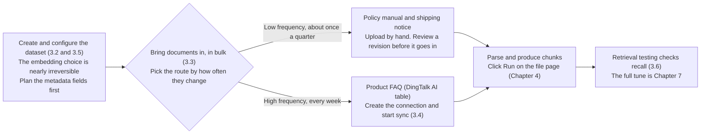

# Chapter 3 Datasets: the carrier of a knowledge base

> Chapter guide: The RAGFlow from Chapter 2 is already running, and the model channel is already open. The question now is where the knowledge comes in. This chapter creates the dataset `after-sales-kb` for our running example "售后知识底座" ("After-sales Knowledge Base"): the 50-page After-sales Policy Manual, which contains tables, the Product FAQ table of about 200 rows, and the Shipping Time Notice, which moves whenever the logistics provider adjusts it. The three kinds of documents update on completely different rhythms, so the access routes should differ too. This chapter helps you make four decisions. How to create a dataset, and why the embedding choice is "quasi-irreversible". Where documents come in, and how to pick among four access routes by update frequency. How an external system syncs on its own, the seven-way choice of data source and the refresh rhythm. And how to lay the foundation for retrieval filtering, by planning the metadata fields in advance. By the end of this chapter, you can: create a dataset whose choices have a basis; pick the right access route for each kind of document; connect one data source and state the sync rhythm; and plan a set of metadata fields that support retrieval filtering.

*Flowchart for this chapter*

## When you need it

Three typical situations, and three ways to use this chapter.

**I have a batch of documents to pour into RAGFlow. Where do I start?** Follow Section 3.2 (creating a dataset) and 3.3 (document access), in that order. Pay special attention to the embedding choice in Section 3.2: once a dataset has chunks, changing the model has to pass a compatibility check, and the switch does not automatically re-embed the chunks that are already there. Five extra minutes of thought at creation saves a full reparse later.

**The documents live in an external system (an online spreadsheet, Confluence, a network drive), and you do not want to carry them by hand every week.** Go straight to Section 3.4 (data sources and sync). Creating a connection is only the first step. You still go back into the dataset, link it, and start the sync. The place to look when "I changed the content, so why did it not update" is in that section too.

**Retrieval results keep mixing in an expired policy, or content from some other site.** Read Section 3.5 (metadata management). Metadata is the foundation of retrieval filtering. Plan it when you build the knowledge base, rather than patching it after retrieval has already gone wrong (the full use of filtering on the retrieval side is in Chapter 7).

Prerequisite: the deployment in Chapter 2 is done, and at least one embedding model is available (where a model comes from is in Chapter 2).

## 3.1 Overview: a dataset is not just a folder

**A dataset is the workspace in RAGFlow that carries knowledge sources and retrievable content.** It usually corresponds to a set of business materials, a collection of documents, or an external data source. Inside a dataset, a user imports files, parses files, cuts files into chunks (Chunk), maintains metadata, and verifies recall. After that, chat assistants (Chapter 8), search applications (Chapter 9), and Agents (Chapter 10) all take this content and use it for retrieval augmentation.

One sentence on how the version moved: in the v0 era this object was called a knowledge base, and v1 renamed it dataset. This book uses "dataset" for the core object throughout. A narrative scene occasionally uses "knowledge base" as a general word. When you meet the two words in the official docs and in community discussion, they refer to the same thing.

The official docs add an important reading in the other direction: a dataset is **not only a "folder"**. A folder only stores files. Besides storing them, a dataset takes on four jobs:

| Duty | Meaning | Chapter where it is developed |
|------|------|---------|
| **Chunking** | Turn the original documents into chunks that can be retrieved. A document has to be parsed before it can be retrieved | Chapter 4 |
| **Enabled state** | Store the enabled or disabled state of documents and chunks. A disabled document is still in the library, but it is no longer a retrieval source | 3.3 of this chapter |
| **Metadata** | Maintain structured information at document level and at chunk level. The foundation of filtering and of retrieval that is limited to a scope | 3.5 of this chapter |
| **Supplying data** | Provide the base data for knowledge artifacts (Artifact) and for log tracing | Chapter 6, Chapter 12 |

This table also previews the structure of the book. The dataset is the foundation of every later capability (retrieval testing, knowledge artifacts, chat assistants, Agents). Whether that foundation is solid depends on a few decisions in this chapter.

Our running example's `after-sales-kb` is designed against this list of duties. It carries three kinds of documents from the cross-border e-commerce after-sales domain:

| Document | Form | What the content is like | Update rhythm |
|------|------|---------|---------|
| After-sales Policy Manual | `after-sales-policy.pdf`, 50 pages | Contains a large number of tables. Mostly policy clauses | Low frequency (a quarterly revision) |
| Product FAQ | `product-faq.xlsx`, about 200 rows | The columns are Title/Content/Category/Year | High frequency (the product catalog updates every week) |
| Shipping Time Notice | `shipping-notice.html` + `shipping-notice.eml` | Short notices, sensitive to timing | Medium frequency (when the logistics provider adjusts) |

The readers of all three kinds of documents are support staff and store operations, but the update rhythms are completely different. That difference decides the access-route choice in Section 3.3, and it is also the starting point of knowledge-base operations in Chapter 13.

## 3.2 Creating a dataset: a set of five, and one quasi-irreversible decision

### The creation entry and the minimum set of three

On the dataset list page, click **Create dataset** to open the creation dialog. The list page shows, as cards, the datasets the current user can reach (ones they created, and ones other people shared). A card has a portrait or an initial, a name, a document count, and a creation time. Three items have to be set at creation:

| Required item | Notes |
|--------|------|
| **Name** | The name. It cannot be empty. Prefer a name that reflects the business or the scope of the material |
| **Embedding model** | The embedding model. The dropdown lists models that have already been added in the system and are available now (see below; the most important decision in this chapter) |
| **Parse type** | The parsing type, one of two: **Built-in** or **Pipeline** |

- **Built-in**: use the parsing methods built into RAGFlow. The system presets General, Q&A, Manual, Table, Paper, Book, Laws, Presentation, One, Audio, and Email. Choose by the document's content and structure. Choosing among the 11 methods is the subject of Chapter 4.
- **Pipeline**: parse documents with a custom ingestion pipeline. The pipeline has to be created and configured in **Agent** ahead of time. Inside the dataset you only select it (see Chapter 10).

Creation is only the first step. The official docs suggest: after you create it, go to the dataset configuration page and, for the real scene, further check and configure language, the parsing method, automatic metadata, the data source link, and similar options, then upload documents in a batch. What `after-sales-kb` follows is exactly "create first, configure after". The dialog sets the name, the embedding, and the parsing type. Then the configuration page fills in the set of five below.

The dialog confirmed in testing for "create first" is below. This screenshot is from a hands-on run on 2026-11-04 of RAGFlow v1.0.0-rc2 deployed with Docker on this machine. The prefilled embedding carries over the tenant default model set in Chapter 2:

The three required items arrive together in the dialog: Name is required (after-sales-kb), Embedding model is required, and the parsing-method dropdown. The Built in badge beside General is what the Built-in type looks like on the screen. The Embedding model field is already prefilled with text-embedding-v4 (demo-gateway). The prefilled value comes from the tenant's default embedding, set in Chapter 2. BAAI/bge-m3 in the decision of the table below (the Section 3.2 decision table) is this book's case setting. The hands-on screen uses text-embedding-v4 on the gateway side. Whichever you choose, the nature of "locked at creation" does not change.

### The basic-information set of five

The basic information on the configuration page contains a set of five, plus two settings related to retrieval. The set of five:

| Field | Official role | The value for `after-sales-kb`, and why |
|------|---------|------------------------------|
| **Name** | The name. It can still be changed after creation. It is shown on the card and in the title of the detail page | `after-sales-kb`, the After-sales Knowledge Base used uniformly throughout the book |
| **Language** | The dataset's main language. It affects the language assumption while parsing and while the model processes the text | Chinese. The policy manual and the FAQ are both Chinese corpus |
| **Avatar** | The avatar. Image upload is supported, with a maximum of 4 MB | An after-sales icon, recognizable at a glance in the list |
| **Description** | States the scope of the material, the business use, or maintenance information | "售后域三类知识：政策手册 / 商品 FAQ / 物流公告；客服与店铺运营使用" ("Three kinds of after-sales knowledge: the policy manual, the product FAQ, and shipping notices, used by support and shop operations") |
| **Permissions** | Controls who can reach the dataset, and the range of operations that are allowed | Team. Shared by support and the operations staff of each store (the full permission system is in Chapter 13) |

On the configuration page the set of five is a vertical form. The hands-on page for after-sales-kb follows:

The set of five and the two retrieval settings are visible item by item: Language=Chinese, Permissions=Team, and Page rank stays at 0. The Description that was actually filled in is "跨境电商售后知识底座：售后政策手册、商品 FAQ 与物流时效公告。" ("Cross-border after-sales knowledge base: the policy manual, the product FAQ, and the shipping-time notice."). The wording differs from the suggestion in the table above, and the meaning is the same. What is more worth noticing is Select or switch the parsing mode, below the Basic area. rc2 turns Parser, General Chunker, Extractor, and Indexer into tabs on the page. The parsing and chunking configuration surface that Chapters 4 and 5 of this book will cover is spread out right here.

### The embedding model and PageRank

**Embedding model** is the model that vectorizes chunks. At retrieval time, the user query and the chunks have to compute similarity in the same vector space. A different model means a different space. **PageRank** has nothing to do with the model. You set a PageRank score on the dataset, and at retrieval time that score is added onto the hybrid similarity score of matching chunks that come from this dataset, which raises their ranking weight. The scene it fits is multi-dataset retrieval, when you want one dataset's content to come first (the complete way of using multi-dataset retrieval is in Chapter 7).

#### What happens when you switch the embedding model

This is the most important group of behaviors in the chapter. The official docs write it very clearly (based on the v1.0.0-rc2 docs, checked on 2026-10-27):

1. When the dataset **does not yet have chunks**, you can change the model directly.
2. Once it **already has chunks**, choosing a different model on the configuration page triggers a **compatibility check**: the existing vectors are sampled, the **vector dimensions must be the same**, and the **average cosine similarity must not be below 0.9**. If the check fails, the original choice is restored.
3. Saving a model change **does not automatically re-embed** the existing chunks. Chunks that have already been parsed keep the old model's vectors. Only documents parsed after that use the new model.

The third one is the easiest to miss, and its consequence is the most concrete. If you change the model and do not reparse, the library is a mix of the two kinds of vectors, old and new, and retrieval quality cannot be predicted. The only way for an old document to receive the new model's vectors is to reparse (the list of reparse scenes is in Section 3.3 and in Chapter 4).

So this book calls it a **quasi-irreversible** decision (**Our recommendation**). Technically there is a switching path that comes with a check. In engineering, the embedding choice at creation should be treated as a choice made once, for the life of the dataset. First parse a small batch of samples and verify them in retrieval testing (Chapter 7). Confirm the recall. Then put the documents on in full.

In the hands-on run this gate really did block a switch once. On after-sales-kb, which already had chunks, the embedding was changed to another model and saved, and a red error popped up in the upper right on the spot (confirmed in testing on 2026-11-04 on RAGFlow v1.0.0-rc2):

The red toast in the upper right gives the full reason: "hint : 10 Embedding model switch failed: the average similarity between old and new vectors is below 0.9, indicating incompatible vector spaces." The average cosine similarity is below 0.9, the switch is rejected, and the Embedding model dropdown stays on the original model, text-embedding-v4. "If the check fails, restore the original choice" shows up on the screen exactly as described. This is one of the few figures in the book of a failure branch confirmed in testing. The caution cited in Chapter 2, and the three behaviors in this section, are not constraints that exist only on paper. The quasi-irreversibility of a dataset's embedding has a clear gate on the screen.

> **Our recommendation**: three considerations in choosing an embedding. The language of the corpus (for Chinese corpus, choose a Chinese or a multilingual model), how it performs on special content such as tables, and the deployment cost (a local model or an online API; how to connect is in Chapter 2). Of the three considerations, the first two can both be verified as fact with the retrieval testing in Chapter 7. Do not settle it from a model leaderboard.

### Creation decisions for `after-sales-kb`

| Decision | Value | Basis |
|--------|------|------|
| Name | `after-sales-kb` | Uniform throughout the book. See the running-case convention |
| Language | Chinese | The corpus is mainly Chinese |
| Permissions | Team | Shared by support and the operations staff of each store. The sharing mechanism is in Chapter 13 |
| Embedding model | BAAI/bge-m3 (the case choice) | A multilingual model, and it does well on Chinese corpus. How to connect is in Chapter 2. The final word is retrieval testing |
| Parse type | Built-in | All three kinds of documents can be covered by a built-in method. A custom pipeline is brought in as needed in Chapter 10 |
| PageRank | Not set for now | The current single-dataset retrieval has no use for it. Turn it on later, when retrieval runs in parallel with a product knowledge base (see Chapter 7) |

Watch the order of the decisions. The embedding is fixed at creation. Language, permissions, and the rest are filled in on the configuration page. The FAQ's data source link is left to Section 3.4. Make one decision at a time. Each decision has its own moment.

## 3.3 Document access: four routes

One fact, stated first: **a document becomes retrievable content only after it is parsed and chunks are generated.** This section only solves "getting it in". What happens after you press the parse button is the whole of Chapter 4.

| Route | Entry | What it fits | Where it lands for `after-sales-kb` |
|------|------|---------|------------------------|
| Manual upload | The dataset **Files** page → **Add file** → **Upload file** | Local documents, low-frequency updates | The policy manual, the shipping notice |
| Link from file management | The **File** page → the inline **Add to Knowledge Base** | Files are gathered in one place first, then linked as needed to one or more datasets | A spare route (see the pitfall below) |
| Data source | After a data source is linked on the configuration page, add or sync automatically from the **Files** page | Content from an external system, continuous updates | The Product FAQ (developed in Section 3.4) |
| API | HTTP / Python API | Programmatic writes in bulk, system integration | Developed in Chapter 11 (the MCP book) |

### Manual upload

Enter the **Files** page of the target dataset, click **Add file**, choose **Upload file**, select the local document, and confirm the upload. You can optionally turn on **Parse on creation** (parse as soon as it is created). After the upload finishes, look at the status in the document list. A revision of the policy manual is a quarterly event. Each time the version changes, a person should review it before it enters the library. Manual upload keeps a person inside the process. That is the effect wanted here.

### Linking from file management

The **File** page is RAGFlow's personal file system. Nested folders organize files by project, by business topic, or by data source. It supports uploading a single file or a whole folder. The actions on a file row include **Add to Knowledge Base** (link a knowledge base), **Move**, **Rename**, **Download**, preview, and **Delete**. After a file is linked to a dataset, parsing, chunking, and retrieval continue from the dataset side. The processing status follows the dataset's document page.

Two pitfalls that are easy to fall into. The official docs state them clearly:

1. **Linking a single file has "replace" semantics.** The operation replaces that file's knowledge-base links with the current selection. **Only a batch operation is "append".** When the same file serves more than one dataset, confirm the target list before you save. Do not overwrite a link that is already there.
2. **Deleting a file or a folder may affect datasets that are already linked.** Before you delete, confirm the file is no longer used by a business process, by knowledge-base parsing, or by Agent retrieval.

### Adding from a linked data source

After a dataset has linked an external data source on the configuration page, you can also, from the document management page, manually add documents that sit in the data source. After they are added, parsing still has to finish before there are chunks. This route and the automatic sync in Section 3.4 are the manual gear of the same mechanism. In practice the automatic gear is enough.

### What the file page can do

The file page (the document list) is the dataset's everyday workbench. The nine fields each have a meaning:

| Field | Meaning | Everyday use |
|------|------|---------|
| **Name** | The document name | Click to enter the document details and see the parsing result, the chunks, and the metadata |
| **Size** | The file size | — |
| **Source** | The source: a local upload / a linked data source / file management | Lines up one to one with the four access routes. Tracing a document back to its source depends on it |
| **Enabled** | Whether it takes part in retrieval | Disable it, and do not delete it. The document and the parsing result stay. It is simply no longer a retrieval source. For a temporary takedown, use disable. Do not use delete |
| **Chunks** | The number of chunks already generated | A value of `0` usually means it was not parsed, parsing failed, or there was no usable content after parsing. Start the investigation here |
| **Metadata** | The number of document-level metadata fields | Click to view or edit the metadata (Section 3.5) |
| **Parse** | The current parsing method, and the entry for parsing | A single document can change its parsing method. That affects only that document. It does not touch the dataset's default configuration (Chapter 4) |
| **Status** | The parsing-task status: waiting / running / completed / failed / canceled | On failure, go to **Logs** for the reason, and reparse after you have cleared the fault |
| **Action** | Rename, view information, download, delete | Delete removes the chunks, the metadata, and the parsing result along with the document. Confirm before you act |

On a real list, the nine fields are the closing frame of the chain in the acceptance checklist, "visible in the list → the status changes → a Chunks count appears". The Files page after the four seed documents finished parsing (confirmed in testing on 2026-11-04 on RAGFlow v1.0.0-rc2):

"Visible in the list after upload → the status changes → a Chunks count appears" shows up in full across the four document rows. The eml is cut into 1 chunk, and the Parse column shows Email. When the original mail was uploaded, rc2 switched on its own to the built-in Email configuration. The open item in the Chapter 2 review checklist, whether eml is supported, has empirical evidence here. html, xlsx, and pdf go through General, and they get 3, 11, and 5 chunks respectively. One version difference, stated as it is: rc2's column headers are Name, Upload date, Enable, Chunks, Metadata, Parse, and Action. Of the nine fields, Size, Source, and Status are not laid out as columns of their own.

The list also supports search by name, and filtering by parsing status, enabled state, or source. After you check the checkboxes, a batch action bar appears: **Enabled** / **Disabled** / **Run** (parse in a batch) / **Cancel** (cancel parsing) / **Metadata** (maintain metadata in a batch) / **Delete**. The typical scenarios for reparsing, a change of parsing method or parameters, a change of chunk configuration, a change of automatic metadata configuration, a change of table-column roles, a source document updated and replaced, and a parsing result that is incorrect, will each be met in Chapter 4.

## 3.4 Data sources and sync: the mechanical part of an update

### What a data source is

A data source is used to connect an external system and sync the documents, records, mail, or messages in it into the RAGFlow knowledge base. Once it is configured, the amount of manual uploading drops sharply, and content from the external system can be retrieved and questioned directly inside the knowledge base.

### Seven categories

The official docs suggest: first choose the broad category by where the content comes from, then go into the matching data source configuration. There are seven:

| Category | Representative connections | The scene it fits |
|------|---------|---------|
| Documents and collaboration platforms | Confluence, Notion, 飞书 Wiki (Feishu Wiki), Google Drive, OneDrive, SharePoint, Box, Dropbox, WebDAV, SeaFile | Team documents, a wiki, a cloud drive: a company knowledge base, a project library |
| Object storage | S3, Google Cloud Storage, Oracle Storage, R2, Azure Blob Storage | A large batch of files: a historical archive, a bulk import, centralized management of cloud files |
| Databases and warehouses | MySQL, PostgreSQL, BigQuery | Structured records or query results: question answering over business data, metric knowledge |
| Code repositories and project management | GitHub, GitLab, Bitbucket, Azure DevOps, Jira, Asana | Code collaboration, issues, tasks: accumulated technical knowledge, project history |
| Mail, messaging, and collaborative communication | Gmail, Outlook, IMAP, Microsoft Teams, Slack, Discord | Mail, channel messages: support communication, business correspondence |
| Business systems and spreadsheets | Salesforce, Airtable, Dingtalk AI Table, Zendesk, Moodle | CRM, tickets, online spreadsheets: a business ledger, a service knowledge base |
| General APIs and subscriptions | REST API, Xquik, RSS, Sitemap | A business system with no standard connector, collecting public content |

One detail that is easy to misread: Personal Edition / Enterprise Edition in the docs means the account edition of the **external system**, not a RAGFlow license. Whether a sync is possible depends, in the end, on whether the external system allows the current account to reach the target content and the API.

### Two steps: create the connection, then link and sync

**Step one, create the connection.** From **User Settings**, enter the **Data Source** page. The upper half manages data sources that are already connected. The lower half adds a new one. Creating a connection usually fills in four things: the connection name; the connection information (account, token, address, path, or storage scope, which varies with the data source type); the sync parameters (sync deletion, the refresh interval, the cleanup interval, the timeout); and, before saving, **Test connection**, to verify the account's permissions and the connection parameters.

**Step two, link the dataset and start the sync.** Creating a connection only saved the access configuration of the external system. **The data does not come in by itself.** Go back to the configuration page of the target dataset, click **Link data source** in the data source area to link the connection, choose the sync scope, the parsing method, or the chunking parameters as the page prompts, save and start the sync, and wait until the sync task finishes.

### Sync rhythm

After the sync starts, RAGFlow reads content from the external system and writes the content that can be parsed into the knowledge base index. Three rhythm rules:

1. **The first sync** imports the existing content inside the current sync scope.
2. Content that the external system **adds or modifies** usually syncs in when the next **refresh interval** arrives.
3. After **sync deletion** is turned on, content deleted on the outside is removed from the knowledge base index in a later sync, or in a **cleanup task** (the cleanup interval takes effect only when sync deletion is on).

"I clearly changed it. Why is the knowledge base still showing the old content?" Check three things first: whether the refresh interval has arrived, the sync status, and the data source logs. The bottom of the data source settings page is the log area. The fields include the start time, the status (success / failure / in progress), the knowledge base that was written, the task type (initial sync, incremental sync, cleanup task), and a summary (the error description, used to locate problems of permission, fields, network, and rate limits). An empty log usually means that connection has not been used by any knowledge base yet, or that a sync has not been triggered.

### `after-sales-kb`: why the FAQ goes through a data source

The Product FAQ is maintained by the product department in a DingTalk AI table, and it **updates every week** along with the product catalog. Manual upload means that every week someone has to remember to carry it, and someone has to check whether it was carried. That is typical process debt. Connect a data source of the business-system and spreadsheet kind (in this case, Dingtalk AI Table). The first sync imports the whole set. After that, increments arrive on their own with the refresh interval. Once sync deletion is on, an expired FAQ deleted in the table is removed along with it.

The policy manual is the other way around. Revisions are low frequency, and each revision should already pass a human review before it enters the library (if the content is wrong, support will reply to the user by following the wrong answer). Manual upload is not a step backward. It keeps a person in the right place.

> **Our recommendation**: what data source sync solves is the mechanical part of the update process, the carrying. When an update should happen, who reviews it, and whether a review is required before the update, are questions of process governance. Mechanizing the carrying does not replace them. The full update-process SOP and the quality inspection are in Chapter 13.

## 3.5 Metadata: the foundation of retrieval filtering

### What metadata is, and where it comes from

Metadata is structured information associated with a document or a chunk. It describes the content's source, category, time, ownership, or business attributes, and it is used for document management, for filtering, for limiting the retrieval scope, and for analyzing results. It has four sources:

| Source | Notes | Where you manage it |
|------|------|---------|
| Fields built into the system | Structured information the system presets | Automatic |
| Generated automatically while parsing | After the dataset turns on **Auto Metadata**, generated by the rules at parse time | The configuration page |
| Table column role configuration | Under Table parsing, a column's role of Indexing / Metadata / Both | Developed in Chapter 4 |
| Maintained by hand | Add a field name, a data type, and a value, document by document | The document list, or the detail page |

### Adding by hand and generating automatically

When you **add a field by hand**, you specify the field name, the data type, and the value. A suggestion in the official docs is worth treating as a team norm: **keep the field name, the data type, and the value format consistent.** If the same meaning is written "政策" ("policy") one moment and "policy" the next, a filter will not match.

**Automatic generation** (Auto Metadata) is set on the dataset configuration page, in two kinds:

- **Generation**: customize the fields to generate. Each field is given four items. Field (the field name), Description (a description of what to extract or generate from the document), Type (the data type), and Values (the allowed range of values).
- **Built-in**: fields built into the system. What is supported now is `update_time` (the document's update time) and `file_name` (the file name). A switch is enough to use them.

Watch one gap in time: **a change to the automatic metadata configuration affects only documents that are parsed afterward.** For an existing document to pick up the new rules, the only way is to reparse.

### How metadata is used

Two layers of use:

1. **Filtering the document list.** **Metadata field** on the file page filters documents by field value. Which fields and which values are available depends on the metadata the current dataset already has. So the field plan has to come first. A field that is not in the library cannot be chosen when you filter, either.
2. **Limiting the retrieval scope.** After you configure metadata conditions, retrieval searches only the content that meets the conditions. "Retrieve only policies whose effective date is still inside the valid period" and "retrieve only this site's FAQ" are both places it earns its keep (the full use of filtering inside retrieval testing and tuning is in Chapter 7).

The risk is written in the docs as well. Metadata conditions that are too strict, or field values that are not accurate, can shut relevant content out of the retrieval scope. Filtering cuts both ways. The quality of the field values decides whether it is a guardrail or a wall.

### Metadata planning for `after-sales-kb`

When you build the knowledge base, plan three fields, and put them into Generation under Auto Metadata (or, for documents uploaded by hand, maintain them document by document):

| Field | Type | Values | The scene it supports |
|------|------|------|-----------|
| `doc_type` | Enumeration | 政策 (policy) / FAQ / 公告 (notice) | A scope limit such as "look only inside the policies" |
| `effective_date` | Date | The document's effective date | Keep an expired policy out of the retrieval scope |
| `site` | Enumeration | The identifier of each site | Differences across sites: "see only this site's answer" |

The three fields correspond to the three filtering needs that come up most often in the after-sales domain. When Chapter 4 covers column roles in Table parsing, the Category and Year columns of `product-faq.xlsx` are configured as metadata roles, following the official Example. For content that is a table, the metadata does not have to be generated. The columns themselves already are metadata.

## 3.6 Five entries on the dataset page

Enter the dataset detail page. Five entries, and each one governs its own area:

| Entry | What it governs | Which section of this chapter | Chapter that develops it |
|------|--------|---------|---------|
| **File list** | Documents, parsing status, enabled state, the chunk count, the metadata field count, and document-level operations. The dataset's default entry | 3.3 | Chapter 4 |
| **Retrieval Testing** | Enter a test question, adjust the retrieval parameters, and verify the recall of the current dataset | — | Chapter 7 |
| **Artifacts** | View the knowledge-artifact entries related to the current dataset: **Wiki**, **Navigation**, **Graph** | — | Chapter 6 |
| **Logs** | Records of document parsing and of dataset-level tasks (document logs and dataset-level logs) | 3.3 | Chapter 4 |
| **Configuration** | Basic information, the embedding model, the parsing method, the data source link, and other configuration | 3.2, 3.4 | Chapter 4, Chapter 10 |

One tip you will use immediately, and which the official docs emphasize on purpose: **parameters you adjust in Retrieval Testing are not saved automatically.** Apply them separately in the **Chat Assistant** or **Retrieval Agent** component. The testing page is a test plot. It is not where configuration lands. When a good set of parameters comes out of the test plot, copy it back to the component that actually serves users (Chapter 7, Chapter 8).

This chapter only takes you as far as recognizing the doors. The rooms behind the five entries open one by one, starting with Chapter 4.

## Chapter summary

1. **A dataset is not just a folder**: chunking, enabled state, metadata, and supplying data for knowledge artifacts and for logs. The four duties are what make it the carrier of every retrieval capability (v0 knowledge base → v1 dataset, the same object).
2. **The most important decision at creation is the embedding model**: after there are chunks, a switch has to pass a compatibility check (the vector dimensions are the same, and the average cosine similarity is ≥ 0.9; on failure it rolls back), and the switch does not automatically re-embed the existing chunks. Our recommendation: treat it as a choice made once, for the life of the dataset. Verify with retrieval testing before you scale up.
3. **There are four routes for document access, and you choose by update frequency**: low frequency goes to manual upload, continuous updates go to a data source, gather-then-distribute goes to file management, and programmatic access goes to the API (Chapter 11). The four fields Source, Enabled, Chunks, and Status on the file page are the main dashboard of an everyday inspection.
4. **Data source sync is two steps**: creating a connection (connection information + sync parameters + Test connection) only saves the configuration. Data really comes in only after you go back to the dataset, link it, and start the sync. Increments follow the refresh interval, deletions follow the cleanup task, and troubleshooting looks at the connection logs.
5. **Metadata is the foundation of filtering**: four sources (built in / generated automatically / column roles / by hand). It both filters the document list and limits the retrieval scope. Plan the fields when you build the knowledge base. A change to automatic metadata affects only documents that are newly parsed.
6. **The five entries correspond to later chapters**: File list with parsing and chunking (Chapter 4), Artifacts with knowledge compilation (Chapter 6), Retrieval Testing with tuning (Chapter 7), and Pipeline inside Configuration (Chapter 10).

Next: the documents are in the library, and there are still no chunks. Chapter 4 opens what happens after you click **Run** in the File list. How to choose among the 11 built-in parsing methods, how to configure Parser and the vision model, and how to tune the Chunker parameters. The 50-page PDF of the After-sales Policy Manual is waiting there.

## Acceptance checklist

By the time you have read this far, you should be able to:

- ☐ State the four differences in duty between a dataset and a "folder", and point out which kind of later capability each duty serves.
- ☐ Finish creating the `after-sales-kb` dataset (or your own): name, language, permissions, embedding model, and parsing type, all five chosen with a basis.
- ☐ Explain to a colleague the compatibility-check conditions for an embedding switch (the dimensions are the same, and the average cosine similarity is ≥ 0.9) and the consequence of "not re-embedding automatically".
- ☐ Upload one document, walk through the chain "visible in the list → the status changes → a Chunks count appears", and state the three possible reasons a Chunks count is 0.
- ☐ State the update frequency each of the four access routes matches, and explain why the FAQ goes through a data source and the policy manual goes through manual upload.
- ☐ Plan three metadata fields for one dataset (name / type / values), and use one of them to finish a filter in the document list.
- ☐ Point out what problem each of the five entries on the dataset page solves, and state the pitfall that Retrieval Testing parameters "are not saved automatically".

## Further reading

- **Chapter 4 (Parsing and chunking)**: what happens after you click **Run** in the File list. Choosing among the 11 built-in parsing methods, and table column roles (turning the FAQ's Category and Year into metadata is waiting for you).
- **Chapter 2 (Deployment and model channels)**: where the embedding model comes from. Connecting an online API and a local model.
- **Chapter 7 (Retrieval testing and tuning)**: the full tuning method behind the Retrieval Testing entry. How PageRank is used in multi-dataset retrieval. The retrieval-side expansion of metadata filtering.
- **Chapter 13 (Team collaboration and knowledge-base operations)**: the full picture of the permission (Team) system. On top of data source sync, the update-process SOP for "when to update, and who reviews", and quality inspection.
- **Chapter 11 (External integration: API and MCP)**: the expansion of the fourth access route, and how RAGFlow's knowledge capability is consumed by an external program (the MCP book).

## Review checklist (before publication)

- [ ] UI items and behavior throughout the chapter checked against the official v1.0.0-rc2 docs (docs/guides/dataset, docs/guides/file, docs/guides/data_source). Checked on 2026-10-27
- [ ] The creation dialog confirmed in testing: the three required items (Name / Embedding model / Parse type) and the Built-in / Pipeline options
- [ ] The embedding-switch compatibility check confirmed in testing: both failure branches, mismatched vector dimensions and insufficient similarity, roll back to the original choice
- [ ] Connecting an online-spreadsheet data source confirmed in testing: create the connection → Test connection → Link data source → the first sync → incremental refresh and sync deletion
- [ ] The actual generation effect of Generation fields in Auto Metadata, and the Built-in fields (`update_time` / `file_name`), still to be verified hands-on
- [ ] Confirmed in testing: single-file linking in file management has "replace" semantics, and a batch has "append" semantics
- [ ] The operation flowchart at the start of the chapter checked for rendering on the GitHub web UI
