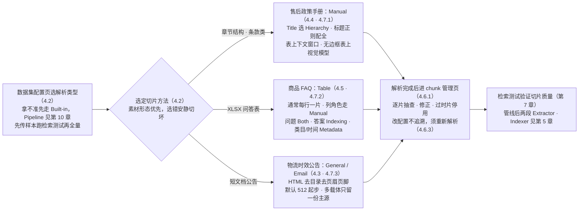
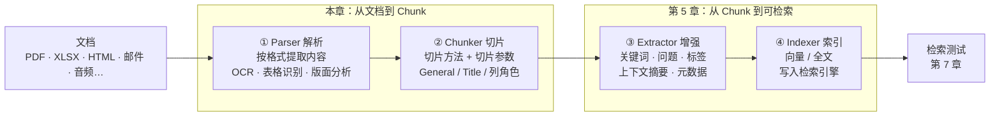
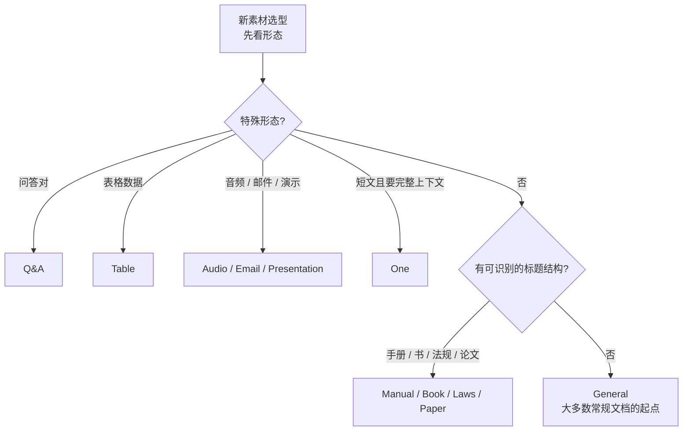

# Chapter 4 Parsing and chunking: from documents to Chunk

> Chapter guide: Chapter 3 put the three kinds of documents from 「售后知识底座」 (After-sales Knowledge Base) into the dataset `after-sales-kb`, but an upload is not yet usable. A document has to go through parsing and chunking before it becomes a chunk (Chunk) the retrieval engine can hit. This step sets the ceiling of the knowledge base: cut the chunks too fine, and the answer loses its context; cut them too coarse, and what comes back is a stretch of noise. This chapter covers the first two of the four stages of the parsing pipeline: how the Parser extracts content by format (a built-in parser, or calling in a vision model), and how the Chunker cuts that content into pieces of a suitable size (choosing among the 11 built-in chunk methods, the two chunkers General and Title, and column-role configuration). It then uses the running case to give the after-sales policy manual, the product FAQ, and the shipping timeliness notice each a plan. By the end of this chapter, you can: choose a chunk method for new material and configure the Parser and Chunker; use column roles so a table is both searchable and filterable; view, correct, and disable at chunk level on the chunk management page; and complete the loop "change the config → reparse → retrieval test".

*Flowchart for this chapter*

## When you need it

Three typical situations, and three ways to use this chapter.

**The document has finished parsing, but retrieval testing hits fragments or one solid block**: go back to 4.2 and check whether the chunk method matches the form of the material, then go to 4.4 and adjust the Chunker parameters. If the method is wrong, every parameter tweak after that is a patch.

**Scans, multi-column PDFs, and PPTs that mix images and text come out a mess**: go straight to 4.3 (Parser configuration). This section answers two things: which parser to choose, and when it is worth turning a vision model on for it.

**A table knowledge base cannot be searched into, and filters do not move**: see 4.5 (column roles). Whether each column of a table should take part in retrieval, serve only as metadata, or do both is a per-column decision, not a dataset-level switch.

Two other situations are also common. Parsing fails, or you changed the configuration and it "does not take effect". See 4.6. Most of these are not faults. The reparse semantics have not been taken in.

Prerequisites: creating the dataset and uploading files in Chapter 3; the model channel in Chapter 2. The vision models and ASR models used in this chapter all come from the model service configured there.

## 4.1 Overview: the four stages of the parsing pipeline

Set down this book's position first: **the chunk method is this book's main battlefield**. More than half of the final question-answering quality of a RAG system is decided at the moment the chunks take their shape. However strong the model is, it can only look for the answer inside the chunks that retrieval feeds it. That is why this chapter is the heaviest in the book, and why that weight is worth it.

From a document to a searchable chunk, RAGFlow's parsing pipeline has four stages:

*The four stages of the parsing pipeline: this chapter covers the first two, and the last two are in Chapter 5*

| Stage | Responsibility | Key configuration | Where it is developed |
|----|------|---------|---------|
| ① Parser | Turn documents of every kind into text and structure: OCR, table-structure recognition, layout analysis | Parser choice, vision model, removing the table of contents / headers and footers, page range | 4.3 in this chapter |
| ② Chunker | Cut the parse output into chunks of a suitable size that are semantically whole | Chunk method, chunk size, overlap, context window, heading rules | 4.4 in this chapter |
| ③ Extractor | Add keywords, questions, tags, a context summary, and metadata to a chunk | Enrichment switches and model choice | (see Chapter 5) |
| ④ Indexer | Write the chunk into the retrieval engine: vectors and full text | Retrieval method, index fields | (see Chapter 5) |

Two reading notes. First, the official docs state clearly that "different built-in methods show different configuration items; follow what the interface actually displays". The tables in this chapter are a panorama, and not every item necessarily appears on your interface. Second, the right side of the built-in parsing configuration page has a **View built-in parser details** (view built-in parser details) entry, where you can see the file formats each method supports, the detailed chunking rules, and examples. It is the first-hand reference material the official docs give you.

## 4.2 Choosing a built-in chunk method

The chunk method (Chunk method) is the overall strategy by which a dataset processes uploaded documents and turns them into chunks. **Parse type** (parsing type) on the configuration page offers two entries: **Built-in** (built-in parsing) and **Pipeline** (a custom ingestion pipeline (Ingestion Pipeline)). Before you open the configuration page, one small thing is worth checking: the **Language** setting in the basic information of the dataset (Dataset) affects the language assumptions of parsing and of model processing (the other basic-information fields are in Chapter 3). If the language of the material does not match the setting, chunk quality is already one layer worse.

| | Built-in (built-in parsing) | Pipeline (custom ingestion pipeline) |
|---|---|---|
| Form | Choose a built-in chunk method, then tune parameters on the configuration page | A canvas pipeline created and arranged in advance under **Agent > Ingestion Pipeline** |
| Where it is configured | The whole configuration is done on the dataset configuration page | Processing nodes are arranged on the Agent side; inside the dataset you only select the pipeline, and you no longer configure the nodes inside it |
| Fits | The great majority of document forms | You need custom document-processing logic, or a complicated processing flow |
| Prerequisite | None | The pipeline must already be created and configured; if there is no pipeline yet, the entry on the configuration page can jump you to Agent to create one |
| Where it is developed | 4.3-4.5 in this chapter | (see Chapter 10) |

**This book's position: when you are not sure, start with Built-in.** Built-in methods cover the great majority of document forms. Pipeline is the upgrade you take after "built-in cannot meet the need". It is not the default.

### The 11 built-in chunk methods

| Method | Material it fits | Chunking behavior (official wording) |
|------|---------|---------------------|
| General | The general method for most ordinary documents | Recognizes the document content and generates chunks by the configured chunking rules |
| Q&A | Data organized as question-answer pairs | Each question-answer pair becomes its own chunk |
| Manual | PDFs with a clear hierarchical chapter structure, such as product manuals and operation guides | Chunks by section structure |
| Table | Structured table data such as XLSX and CSV/TXT | Usually one row per chunk |
| Paper | Academic documents such as PDF papers and research reports | Chunks by structural elements such as abstract, chapter, and subsection |
| Book | Long documents with a chapter structure, such as DOCX/PDF/TXT books | Designed for long documents organized by chapters |
| Laws | Legal documents in DOCX/PDF/TXT | Recognizes chunk boundaries from the structural features of legal text |
| Presentation | PDF/PPTX slide decks | Usually one page / one slide per chunk |
| One | Relatively short documents that need to keep their full context | The whole document is a single chunk |
| Audio | Audio such as WAV/MP3/AAC/FLAC/OGG | Transcribes to text with an ASR model first, then chunks the transcript |
| Email | Mail files such as EML/MSG | Extracts sender, recipients, subject, body, and attachments, then chunks |

On the rc2 interface, that table looks like this. Screenshot measured on 2026-11-04, on a local Docker deployment of RAGFlow v1.0.0-rc2: the Built-in pipelines area of the Agent page, where chunk methods appear as ingestion-pipeline templates.

The 12 cards can be matched one by one against the 11 methods in the table above. The only extra is a separate **Picture** (image) template. rc2 gives image ingestion a card of its own, and the table in the body does not list it on its own; the Manual template mentioned in the body is indeed in the list. The template cards are the physical inventory of chunk methods. When you choose, walk this figure against the table above, then go into the parser configuration in 4.3. The reason for the choice then has a place to land on the interface.

### The selection decision: the form of the material comes first

The official selection advice, in one sentence: choose the method by the form of the material itself. Start ordinary documents with General, start table material with Table, and give question sets, manuals, papers, pictures, audio, and mail each their matching method, so you spend less later adjusting chunks.

**This book's position: look at the form of the material first, then at what you expect from retrieval.** Form decides "whether it can be cut right". Cut question-answer pairs with General, and whether a pair stays whole is luck. What you expect from retrieval decides "whether the cut is fit to use". The same manual, if you want every hit to carry a "chapter > clause" path, has to be chunked by heading structure. From that, one decision path:

*Decision path for the chunk method: questions of form come before questions of structure*

Know the cost of choosing wrong: **a mismatched method usually does not report an error. It quietly cuts out bad chunks.** A question set is cut into semantic fragments, and a manual is cut into structureless blocks of text. When you notice, the only remedy is to reparse (see 4.6.3). So upload one or two samples into the dataset first, run one retrieval test (Retrieval Testing), and only then upload the full batch. That is the low-cost way of trying and correcting that this book recommends (retrieval testing is covered in Chapter 7).

## 4.3 Parser configuration: set the parsing strategy by format

After you choose a chunk method, you can go on to configure document parsing, chunking, and content enrichment. This section is the Parser. It decides how content of different formats is extracted. Keep the two layers apart. The chunk method in 4.2 is "how the dataset cuts". The parser in this section is "how the content of a given format is read out". For example, the table cells under the Table chunk method still need a parser chosen to recognize the table structure.

### 4.3.1 PDF: the format with the most problems and the heaviest configuration

PDF is the format with the most problems in practice, and it also has the most configuration items. Look at them in two groups.

**Parser choice** (**Parsing method**). Six built-in, plus external models:

| Parser | Character (official wording) | Fits |
|--------|----------------|------|
| DeepDOC | RAGFlow's default document parser; runs OCR, table-structure recognition, and layout analysis | PDFs with a complex layout, images, scanned content, or tables |
| Naive | Aimed at PDFs that are mostly plain text; does less OCR, table recognition, and complex layout analysis, and is faster | Plain-text PDFs |
| Docling | An open-source document parsing tool that can parse documents such as PDF and extract structured content | As an alternative parser |
| OpenDataLoader | Extracts text, layout, and structured information | As an alternative to the other built-in methods |
| TCADP Parser | Tencent's open-source parser, which can parse PDF content | As an alternative parser |
| MonkeyOCRv2 | Parses visually, combining OCR and visual understanding | Scans, complex layouts, mixed images and text |
| External model | Document-understanding models already configured in the system, such as a vision-language model (Vision-Language Model,VLM) | Complex layouts, scans, images, borderless tables, mixed images and text; incurs extra model calls and token consumption |

**Behavior switches**:

| Configuration item | What it does | When to turn it on |
|--------|------|---------|
| Multi-column layout recognition (multi-column layout recognition) | Recognizes two-column / multi-column pages and extracts text regions in a suitable reading order | Multi-column documents such as papers, journals, and reports |
| Remove original table of contents (remove the original table of contents) | Removes the table of contents that comes with the PDF during parsing, so it does not enter chunks and retrieval results as if it were body text | When contents pages would be treated as body text |
| Remove headers and footers (remove headers and footers) | Recognizes and removes the headers and footers repeated on every page, cutting irrelevant content in the knowledge base | When every page has a header / footer / page number |
| Page range (page range) | Set a start and end page, and add more than one range, to skip pages that do not need processing | When a long document should only contribute some chapters |
| Disable vision model (disable the vision model) | When on, parsing does not call a vision model; when off, a vision model can help understand a complex layout or mixed image-and-text content | Decide by document complexity (see 4.3.7) |
| Model (vision model) | Choose the vision model parsing needs; the stronger the model, the more complete its understanding of a complex layout may be, and quality and token consumption change with it | When a vision model is needed |

External models are shown in the parser dropdown grouped by model provider. Whether one is available depends on the providers already configured and on their capabilities. The same is true of external models for table parsing and image parsing, and later sections will not repeat it.

### 4.3.2 Table: recognizing the structure of table content

This is recognition of tables inside a document. It is a different layer from the Table chunk method in 4.2. You can configure three items: **Parsing method** (DeepDOC / TCADP Parser / external model), **Disable vision model**, and **Model**. Official wording: DeepDOC recognizes table structure and extracts cell content, and it fits most standard tables. A regular table with clear borders can use a built-in parser. For a complex table, a borderless table, merged rows or columns, or a table that needs to be read visually, then consider a model with vision. The price is the same: extra model calls and tokens.

### 4.3.3 Image: OCR or an external model

Image parsing solves "turn visual content into text". **Parsing method** is one of two:

| Way | What it can do | Fits |
|------|---------|------|
| OCR | Optical character recognition (Optical Character Recognition,OCR), extracting the text in the image | Screenshots, scans, and photos whose text is clear |
| External model | An already configured model with visual understanding; besides text, it can also read layout, charts, objects, and the relation between image and text | Charts, complex layouts, interface screenshots, content that needs visual understanding |

The official reminder: parsing quality also depends on image clarity, text size, layout, and overall quality. If the picture itself is too blurred, no change of model can save it.

### 4.3.4 Markdown, HTML, DOC, and DOCX: four combinations for removing repeats

Configuration for these four formats turns on two things: **removing repeats** (table of contents, headers and footers) and **whether to use a vision model**:

| Format | What you can configure | The point |
|------|--------|------|
| Markdown | Remove the original table of contents; Disable vision model; Model | The vision model handles images and other content inside the document that need visual understanding |
| HTML | Remove the original table of contents (including navigation lists); remove headers and footers | Aimed at files saved or exported from a web page; if the header, footer, or table of contents itself contains information you need, keep it |
| DOC | Remove the original table of contents; remove headers and footers; Disable vision model; Model | The vision model helps parse images, complex layouts, and the like |
| DOCX | The same four items as DOC | **Model lists only external models already configured**. DOCX does not offer built-in parser options such as DeepDOC, Naive, or Docling |

### 4.3.5 PPTX, video, and audio

**Parsing method** for PPTX is one of three: DeepDOC (extracts slide text, tables, and layout; fits most standard files), TCADP Parser (Tencent open source; extracts text and structured content), and External model (already configured models, grouped by provider). If the file is mostly text and standard tables, start from DeepDOC or TCADP. For a complex layout, mixed images and text, a large number of pictures, or content that needs to be read visually, choose an external model whose capability matches.

**Video and Audio support external models only**. There is no built-in parser to choose. Video needs a model with video or multimodal understanding (it analyzes video frames, visible text, speech, and context, then generates text). Audio needs a model with automatic speech recognition (Automatic Speech Recognition,ASR). Models differ sharply in language support, accent, multiple speakers, background noise, and long-audio transcription. When you choose, check the model's capability against the features of the material.

### 4.3.6 Vision models: benefit and token cost

Pull out one sentence that keeps reappearing in 4.3.1-4.3.5 and make it a rule on its own. The official wording is always the same shape: "Start plain-text content from a built-in parser; for scans, multiple columns, complex tables, and mixed images and text, a vision model may improve parsing quality; because a vision model incurs extra calls and tokens, enable it by document type."

**This book's position: a vision model is "prescribed for the document's actual condition", not "a supplement for everyone".** In the same dataset, turning a vision model on for a plain-text PDF only burns tokens and does not raise quality, while a borderless table such as a compensation-standard table is recognized as garbage if you leave the vision model off. Gather the official advice that keeps reappearing for each format in 4.3 into one comparison table, and match each kind of material to its row:

| Feature of the material | Suggested path |
|---------|---------|
| Plain-text PDF | Start with Naive (for speed), vision model off |
| Multi-column paper / journal / report | Turn on multi-column recognition; add a vision model if the layout is complex |
| Scan / complex layout / mixed images and text | MonkeyOCRv2 or an external vision model |
| Standard table (clear borders) | DeepDOC, and the vision model can stay off |
| Borderless / merged-row-or-column complex table | An external model with vision |
| Screenshot / scanned photo with clear text | OCR |
| Chart / interface screenshot / image that needs to be read visually | An external vision model |

The official FAQ also gives a performance angle: parsing is slower than LangChain precisely because layout analysis, table-structure recognition, and OCR put a vision model to work. From v0.17.0+ on, a plain-text PDF can choose Naive and speed up sharply, and in open-source 1.0 DeepDoc runs these operations with CPU inference. Turning a vision model on for the whole base without thinking makes the most expensive path the default path.

## 4.4 Chunker configuration: how large to cut, and how

The Chunker decides how the parse output is split. Built-in configuration has two chunkers: **General Chunker** (by size and delimiters) and **Title Chunker** (by heading structure).

### 4.4.1 General: the general-purpose chunker

| Parameter | Default | What it does |
|------|--------|------|
| Recommended chunk size (recommended chunk size) | **512** (tokens) | The target size of each chunk. The system combines neighboring content up to that size, but it is a target, not a hard cap. A paragraph that exceeds the target and cannot be split further may stay as one chunk |
| Overlap ratio(%) (overlap ratio) | -- | The share of content that neighboring chunks share. When overlap is on, content at the end of the previous chunk is copied to the start of the next, which reduces context lost at the boundary and improves semantic continuity. Set **0** for no overlap |
| Table context window (table context window) | -- | How much context before and after (tokens) is attached to a table chunk, keeping the relation between the table and the surrounding text. Set **0** to attach none |
| Image context window (image context window) | -- | How much context before and after (tokens) is attached to an image chunk. It fits images that need the surrounding text before they can be understood. Set **0** to attach none |
| Delimiters (delimiters) | Newline `\n`, period, question mark, exclamation mark, semicolon, and so on | The set of delimiters that take part in splitting |
| Split by delimiter (split by delimiter) | -- | Split the text by delimiters first, then combine neighboring fragments up to the recommended chunk size, assembling a suitable size while keeping the semantics as far as possible |
| Split positions (split positions) | -- | Shows every delimiter currently in use, so you can confirm which boundaries are used |
| Add (add) | -- | Add a custom delimiter. Use a boundary marker that means something in the document, such as a heading mark or a paragraph mark |
| Use sub-chunks for retrieval (retrieve with sub-chunks) | -- | Turn on parent-child chunks (parent-child): generate smaller child chunks from a larger parent chunk, and retrieve with the child chunks. After a child chunk hits, the parent chunk supplies more complete context |

The official four sentences of advice are worth copying into the team standard verbatim, and then turning into an action table of "symptom → which parameter to move":

| Symptom / need | Which parameter to move |
|------------|-----------|
| An ordinary document, starting from zero | The default 512, plus delimiters that match the document structure |
| Context is often cut off at a chunk boundary | Raise Overlap ratio |
| Many tables and images, and the surrounding text has come loose from the figure | Configure Table / Image context window |
| You want precise retrieval and you also want to keep the full context | Turn on Use sub-chunks for retrieval |

**This book's position: the three window-style parameters (chunk size, table context, and image context) are three faces of the same tradeoff.** They all spend tokens, and they all buy completeness of context. Body text before and after a table getting cut away is the most common retrieval failure for table knowledge (the table is hit, the applicable conditions are lost). So for a "table + preconditions" document such as a compensation clause, the table context window should rank above overlap.

### 4.4.2 Title Chunker: chunk by heading structure

Title Chunker recognizes document structure from the heading hierarchy and organizes chunks from it. It offers two modes, **Hierarchy** and **Group**:

| | Hierarchy (hierarchy mode) | Group (group mode) |
|---|---------------------|------------------|
| Shape of the chunk | Builds a document tree from the heading hierarchy and generates independent chunks | Generates flatter chunks at the chosen heading level, and merges neighboring subsections |
| Heading path | **Each chunk keeps the full parent-heading path**, such as `Part 1 > Chapter 3 > Section 2` | Does not add the full parent-heading path |
| What it emphasizes | Locatability of the chunk: when it is retrieved away from the original document, you still know where it sits | Semantic continuity of neighboring content |
| Documents it fits | Documents whose chapters are relatively independent and whose heading structure means something: articles of law, regulations, contracts, technical specifications | Documents whose neighboring paragraphs / subsections depend on each other, such as books, user manuals, reports, and articles |
| Parameters of its own | Separate parent heading content; Set first chunk as global context | Heading level supports Automatic |

Shared parameters: **Chunk token limit** (the maximum token count of a chunk; past the limit it keeps splitting, so a chunk does not get too large), **Heading level** (which heading level generates chunks, such as H3; the system recognizes levels such as H1, H2, and H3 by the heading rules, then organizes the split at the chosen level), and **Rules** (heading-recognition rules, developed in the next section). Hierarchy's **Separate parent heading content** controls whether body text that belongs directly to a parent heading is handled on its own. When it is on, the parent section's own body text is not mixed into one chunk with the child sections. **Set first chunk as global context** uses the document's first chunk as document-level background for the chunks that follow. Group's Heading level also supports **Automatic**, and the system chooses the level itself from the document structure it detects.

Choose the mode in one sentence: **if a sense of position comes first, choose Hierarchy; if a sense of continuity comes first, choose Group.** Clause-style content ("Article 7, Liability for breach") must bring its clause path along when it hits, or the user cannot check it against the original. That is Hierarchy. Narrative content (operation steps that continue across subsections) loses its thread if it is cut into independent chunks. That is Group.

### 4.4.3 Heading-recognition rules: regex and rule sets

**Rules**, shared by both modes, decides "what counts as a heading". Each rule can contain five levels of regular expression, H1 through H5. They can match Markdown marks (`#`, `##`, `###`), Chinese numbered headings (such as 「第一章」 and 「三、」), and English heading words (`PART`, `Chapter`, `Section`, `Article`). **Add regular expression** adds one level and its regex to the current rule. **Add rule** adds a whole new rule set, for a different language, numbering system, or document format.

**This book's position: heading regex is the "foundation work" of heading-based chunking, and it is worth writing all five levels for a manual before you put it online.** Once level recognition is under-configured, for example a manual mixes the two numbering systems 「第一章」 and 「1.1」 and the rules only cover one of them, the headings that slip through are demoted to body text, and the chunk boundaries collapse with them. After you write the regex, upload a sample and verify the level tree before you talk about token limit.

## 4.5 Column roles: make a table both searchable and filterable

When a dataset uses **Table** as its built-in chunk method, **Column mode** (column mode) can set what each column of the table is for during parsing and retrieval: enter the chunk text and take part in retrieval, serve only as metadata, or do both.

**Auto (automatic)**: the default. Every column both enters the chunk text and is stored as metadata. It fits the case where you do not need to distinguish what columns are for, and you want all of the table content to take part in retrieval and to be usable as metadata at the same time.

**Manual (manual)**: RAGFlow recognizes the table's columns and shows them one by one under the original column names. Names such as `CRIM`, `ZN`, `INDUS`, and `CHAS` appear on the interface. They come from the column names of the current table. They are **not predefined RAGFlow fields**. Each column is one of three, chosen from a dropdown:

| | Auto | Manual |
|---|------|--------|
| Grain of configuration | Dataset-level default, zero configuration | Specify a role column by column |
| Columns that enter the chunk text | All | Only Indexing and Both columns |
| Columns stored as metadata | All | Only Metadata and Both columns |
| Fits | You do not need to distinguish what columns are for | You have a clear split between columns of retrieval content and columns of filter dimensions |

| Role | Behavior | Columns it fits |
|------|------|--------|
| Indexing (index) | Column content enters the chunk text and takes part in vector retrieval and full-text retrieval | The column that carries the main retrieval content |
| Metadata (metadata) | The column is stored only as metadata and does not enter the chunk text; it can be a filter field that narrows the retrieval range | Filter-condition columns such as category and year |
| Both (both) | Enters the chunk text and takes part in retrieval, and can also filter as metadata | Columns such as a title, which "must be retrieved and must also be filterable" |

The four-column example the official docs give can be applied directly to a product-FAQ table:

| Column | Role | Reason |
|----|------|------|
| Title | Both | The title takes part in retrieval, and can also be metadata |
| Content | Indexing | The body is mainly for content retrieval |
| Category | Metadata | Filter retrieval results by category |
| Year | Metadata | Filter retrieval results by year |

The effect: fields that do not need to take part in content retrieval do not enter the chunk text, and they are still kept as retrieval filter conditions. The chunk text is cleaner, and not one filter dimension is missing.

**Remember when it takes effect**: column-role configuration acts on the column structure of the table, not on a single cell. After a change, it takes effect only for documents **parsed later**. Documents already parsed must be reparsed before the new roles take effect. While you are here, cover **Auto Metadata** (automatic metadata) on the same page. It configures metadata generated automatically during parsing, in two kinds. **Generation** is custom generated fields (Field for the field name, Description for the description, Type for the type, Values for the allowed range). **Built-in** is built-in fields (currently `update_time`, the document update time, and `file_name`, the file name; the switch is all it takes). Its changes likewise take effect only for documents newly parsed afterward. They do not automatically update documents whose parsing is already finished.

## 4.6 Governing chunk quality: from parse results to usable chunks

However good the configuration is, it is only the "factory setting". The last mile of chunk quality is on the chunk management page. This section covers three things: manual correction at chunk level, parse logs and fault location, and reparse semantics. This set of governing actions is triggered again and again by retrieval testing in Chapter 7, and in Chapter 13 it is promoted to a routine item of operations inspection.

**This book's position: the chunk management page is the buffer between "parsing quality" and "retrieval quality".** An imperfect parse is the normal case, and correcting chunk by chunk is much cheaper than tuning parameters and reparsing over and over. But a manual correction is a patch applied to a specific chunk. Reparsing generates the chunks again, and the patch does not migrate with them. So its place is "small repairs". A systematic problem still has to go back to the configuration layer.

### 4.6.1 The chunk management page: view and correct at chunk level

After parsing finishes, click the document name on the **Files** page to enter the parse-results page. A chunk is a retrievable piece of knowledge produced by parsing the document, and it is also the basic unit of RAGFlow retrieval and question answering. The full set of capabilities:

| Operation | How | Use |
|------|------|------|
| View the chunk list | Each chunk has body text, keywords, questions, and an enabled state | Check whether the content was parsed, split, and stored correctly |
| Linked preview of the source | Click the chunk text, and the document preview jumps to the corresponding source position | Check the split against the original; for types whose source cannot be located, view the chunk body as the main text |
| Search and filter | Keyword search; filter by enabled state; toggle between showing the full long text and collapsing it | Locate the target content quickly inside a large document |
| View details | Body text, keywords, questions, enabled state | Confirm that the content is complete, semantically continuous, and fit for retrieval |
| Edit a chunk | Double-click to open the edit window; you can change Content, Keywords, Questions, and Tags | Correct an inaccurate parse or add content; after you save, it is used in later retrieval |
| Add a chunk | Add one manually; it is stored under the current document | Add a piece of knowledge, which likewise takes part in retrieval and question answering |
| Enable / disable | The enabled state decides whether this chunk takes part in dataset retrieval | For outdated, wrong, or temporarily unneeded content, **disable rather than delete**. A disabled chunk stays in the parse results; retrieval simply no longer recalls it |
| Delete | Remove it from the current document's parse results | Use it only when you are sure it is no longer needed; to keep it out of retrieval for a while, use disable |

On the interface, that capability table is the layout below. Screenshot measured on 2026-11-04 in the same environment: the parse-results page after `after-sales-policy.pdf` finished parsing. The left column is a preview of the PDF source, and the right column is the Chunk result chunk list.

The "linked preview of the source" in the table above has a physical instance in this figure: the PDF source in the left column, the chunk list in the right column, each chunk with a source thumbnail and an enable switch. The Full text/Ellipse switch at the top is the "show the full long text / collapse" toggle, and Total 5 at the bottom is the chunk count of this small sample manual. Record one measured flaw honestly along the way: the end of the first chunk's text line in the right column is slightly truncated (「2.1 退货时」 is missing the character 「限」). Compare it with the source in the left column and it shows. The last mile of chunk quality has to be corrected chunk by chunk on the chunk management page, which is exactly the position stated at the start of this section.

### 4.6.2 Parse logs and fault location

The order for investigating a failed parse, as the official docs give it, is a three-stage path: **document state → configuration → Logs**. First confirm whether the document is still parsing or has already failed. Then check the parsing method, the model, and the data-source configuration. Last, open the document log details and look at the error reason.

One high-frequency error is worth knowing on its own: **"File not found in object storage."** During parsing, the source file cannot be found in object storage (the original storage error is still in the document log). Possible causes: the disk that holds the MinIO data directory ran out of space, so an earlier upload never wrote successfully; or the file was deleted after it was uploaded. Note the official reminder: this message alone cannot prove that the disk is full. Check the free space of the machine / volume where MinIO lives, and look back at the MinIO logs from the upload window for a failed write. In the default Docker Compose deployment, MinIO data lives in the `minio_data` volume mounted at `/data`. After you repair the storage problem, you have to **upload the file again and then parse**. Retrying the parse alone cannot bring back a file that is already lost.

### 4.6.3 Reparse semantics: changing the configuration does not reach back on its own

This section is the cognitive pit the whole book is easiest to step in. Nail it down here in advance. The update-process SOP in Chapter 13 will take it in again.

**If you change the parsing configuration, do old documents update on their own?** Official wording: usually you have to reparse. The parsing configuration decides how a document is turned into chunks. For a document already parsed, changing the configuration **does not automatically rewrite the old chunks**. To make the new configuration act on documents you already have, you must reparse the related documents.

Metadata is half an exception. After you edit it by hand, interface filters can usually use the new value directly. But if the metadata takes part in retrieval filtering or affects index results, you may need to combine a reparse, an index refresh, or a fresh retrieval test to confirm the final effect.

**This book's position: treat "change the config → reparse → retrieval test" as one action, not three steps.** If you only change the configuration and do not reparse, you think you are tuning parameters, and you are actually comforting yourself. If you reparse and do not run a retrieval test, you think you fixed it, and you have not verified it.

### 4.6.4 A quick lookup of common pitfalls

| Symptom | Root cause (official wording) | What to do |
|------|-----------------|------|
| Parsing is slower than LangChain | Layout analysis, table-structure recognition, and OCR put a vision model to work | Choose Naive for a plain-text PDF (v0.17.0+); the cost is expected |
| Parsing takes a long time overall | RAPTOR, knowledge graph (GraphRAG), automatic keywords, and automatic questions are all heavy-cost items | Turn them off as needed; keyword / question generation is in Chapter 5 |
| Retrieval testing cannot retrieve the content | The document was not parsed, there is no usable chunk, metadata filtering is too strict, Similarity threshold is too high, or Top K is too small | Investigate in the order "document state → chunk → metadata → retrieval parameters" (see Chapter 7) |
| An error that the source file is lost | The MinIO disk filled up and the upload failed, or the file was deleted | Repair storage → upload again → parse again |
| Behavior did not change after the configuration changed | Reparse semantics: configuration does not reach back | Reparse the related documents (4.6.3) |
| A column-role change did not take effect | It takes effect only for documents parsed later | Reparse tables that were already parsed (4.5) |

## 4.7 Running case: chunking plans for three documents

Back to the dataset `after-sales-kb`. The three kinds of material differ sharply in form, and each one stands for a selection path. Look at the overview first, then take each document apart for "why this choice" and "the expected failure mode". The latter is part of the plan, not a disclaimer.

| Document | Form of the material | Chunk method | Key configuration |
|------|---------|---------|---------|
| `after-sales-policy.pdf` | A 50-page PDF, chapter structure + compensation tables | Manual | Title Chunker (Hierarchy); heading regex; table context window |
| `product-faq.xlsx` | XLSX, about 200 rows of questions and answers | Table | Column roles Manual: question Both, answer Indexing, category / update time Metadata |
| `shipping-notice.html` | A site announcement page saved as a file | General | Remove the table of contents (navigation) and the headers and footers; start from the default 512 |
| `shipping-notice.eml` | The mail edition of the same announcement | Email | The method itself extracts sender / subject / body / attachments |

### 4.7.1 The after-sales policy manual: Manual + Title Chunker (Hierarchy)

**Why this choice.** The character of a policy manual is "the clause is the unit of knowledge". Support asks "who pays the shipping on a return of a cross-border order", and the hit you want is the clause under "After-sales policy > Returns and refunds > Who pays shipping", not a mixture of neighboring clauses. That is exactly where Hierarchy mode is at home. Each chunk keeps the full parent-heading path, and it can still be located when it is retrieved away from the original document. The accompanying action: give the heading rules a full set of H1-H5 regex for the manual's numbering system. Suppose this manual uses the three-level numbering 「第一章 / 1.1 / 1.1.1」. The rule set can look like this (Example in this book; adjust the regex to the actual numbering system):

| Level | Example regex | Match target |
|------|---------|---------|
| H1 | `^第[一二三四五六七八九十百]+章` | Chapter-level headings |
| H2 | `^\d+\.\d+(?!\.)` | Section-level headings (negative lookahead, so the prefix of 1.1.1 is not matched by mistake) |
| H3 | `^\d+\.\d+\.\d+(?!\.)` | Clause-level headings |

Turn on two more switches. Turn **Set first chunk as global context** on, so the general provisions become document-level background for the chunks that follow. Turn **Separate parent heading content** on, so the lead-in under a chapter heading is not mixed into a chunk with the clauses. The compensation-standard table (such as "product category x compensation ratio") is a retrieval hot spot of this manual. Give the table context window the body text before and after, so the "applicable conditions" do not lose contact with the table.

**Expected failure modes.** First, the heading regex misses a numbering system. If the manual mixes the two level systems 「三、」 and 「3.1」 and the rules only cover one of them, the headings that slip through are demoted to body text, the chapter path collapses, and the hit chunk loses its sense of position. Second, Chunk token limit is set too large, one chunk is stuffed with several unrelated clauses, and a hit is noise. Third, if the compensation table has no borders or contains merged cells, the built-in table parser struggles, and you need a vision model (4.3.2). Fourth, the contents page and the headers and footers were not removed, and "Chapter X ... page number" becomes a junk chunk that hits at high frequency.

### 4.7.2 The product FAQ: Table + column roles

**Why this choice.** An XLSX of about 200 rows of questions and answers, with the Table method at one row per chunk, lines up naturally with "one question and one answer is one unit of knowledge". Column roles go Manual, mapped on the official four-column pattern: the question column → Both (the user's question has to be matched against the prepared question, and a title-style column is also worth having as a filter dimension), the answer column → Indexing (pure retrieval content), the category column → Metadata (filter by product category, for example search only questions in the "shipping" category), the update-time column → Metadata (operations filters by new and old). The reason not to use the default Auto: **this book's position: mixing category and timestamps into the chunk text dilutes the vector representation**. On a small table of 200 rows the effect is still tolerable, but the discipline should be formed early.

**Expected failure modes.** First, you change the column roles and forget to reparse, the old behavior remains, and you misjudge it as "the configuration is ineffective". That is the when-it-takes-effect clause in 4.5. Second, the answer column occasionally has an over-long row, and the behavior of "one row per chunk" when it meets over-long content has to be settled by measuring the interface (already on the review checklist). Third, the values in the category column are not disciplined (several spellings of the same category), and Metadata filtering might as well not be there. That is a data-governance problem. Chunking cannot save it.

### 4.7.3 The shipping timeliness notice: General and Email, each in its place

**Why this choice.** An announcement is a short document. It does not need heading-structure chunking. General, starting from the default 512, is enough. The configuration weight for the saved HTML file is on the Parser: turn on removing the original table of contents (including navigation lists) and removing headers and footers. An announcement page often carries the site navigation bar and the copyright bar. If you do not clean them, that repeated text pollutes every chunk. The mail edition of the same announcement takes the Email method, and the method itself extracts sender, recipients, subject, body, and attachments.

**Expected failure modes.** First, the HTML edition and the mail edition of the same content are both stored, the same announcement appears twice in the retrieval results, and it takes up Top N slots. **This book's position: when the same content enters the same dataset in more than one carrier, keep only one copy as the main retrieval source, and disable the other or build a separate dataset for it.** If you keep the mail edition, note that its attachments (which may be another complete PDF) are also extracted and turned into chunks. Judge whether that attachment should be stored on its own according to the form of the document. Second, the announcement is updated often and the old and new versions coexist, so the old version must be disabled or deleted. For "timeliness" knowledge, a freshness error is more dangerous than a gap. Leave this to the update process in Chapter 13.

After the three documents finish parsing, spot-check chunk quality on the chunk management page first (4.6.1), then run a retrieval test together to verify (see Chapter 7). That is the next battlefield.

## Chapter summary

1. **Four stages of the parsing pipeline**: Parser → Chunker → Extractor → Indexer. This chapter covers the first two. Extractor and Indexer are in Chapter 5, and the means of verification is the retrieval test in Chapter 7.
2. **Choose by the form of the material first**: the 11 built-in methods are matched to form. The cost of choosing wrong is not an error report. It is quietly cutting out bad chunks, so upload samples before the full batch.
3. **The Parser sets strategy by format**: PDF has the heaviest configuration (six built-in parsers + a vision model). Prescribe the vision model for the document's actual condition. Only scans, complex layouts, and borderless tables are worth its tokens.
4. **The Chunker has two blades**: General governs "how large to cut" (the default 512, overlap, table / image context windows, delimiters, sub-chunks). Title Chunker governs "what structure to cut by". Choose Hierarchy for a sense of position and Group for a sense of continuity, and the foundation is the heading regex.
5. **A table column role is one of three**: Indexing / Metadata / Both. Column roles take effect only for documents parsed later, and after a change you must reparse.
6. **Governance has a page, and taking effect has semantics**: the chunk management page supports view / edit / add / disable. "Change the config → reparse → retrieval test" is one action, not three steps.

→ Chunks have already been produced. Chapter 5 walks further down the pipeline: how the Extractor adds keywords, questions, tags, and context to a chunk, and how the Indexer chooses vector and full-text indexes, so a chunk that has been cut well becomes "easier to look up".

## Acceptance checklist

By the time you have read this far, you should be able to:

- ☐ Choose a method for a piece of new material from the 11 built-in chunk methods, and state the reason for the choice (the form of the material first, structure second);
- ☐ Configure parsing for a multi-column scanned PDF: choose a parser, turn on multi-column recognition, remove the table of contents and the headers and footers, set a page range, and state the reason for the vision-model switch;
- ☐ Configure a set of General chunking parameters: adjust chunk size, set overlap, give a table a context window, and add delimiters according to the document structure;
- ☐ Configure Title Chunker for a document with a chapter structure: write heading regex that covers its numbering system, and make a reasoned choice between Hierarchy and Group;
- ☐ Set column roles (Indexing/Metadata/Both) for a four-column table, and explain when the change takes effect;
- ☐ Finish one "view → edit/disable" correction on the chunk management page, and walk the loop "change the config → reparse → retrieval test".

## Quick reference

| Item | Value |
|----|----|
| Parsing-type entry | Built-in (built-in) / Pipeline (custom ingestion pipeline, see Chapter 10) |
| Built-in chunk methods | General / Q&A / Manual / Table / Paper / Book / Laws / Presentation / One / Audio / Email |
| PDF parsers | DeepDOC (default) / Naive / Docling / OpenDataLoader / TCADP Parser / MonkeyOCRv2 / external model |
| Table / PPTX parsers | DeepDOC / TCADP Parser / external model |
| Image parsing | OCR or External model (one of the two) |
| External models only | Video (video / multimodal understanding), Audio (ASR) |
| Recommended chunk size | Default 512 tokens (a target value, not a hard cap) |
| Overlap ratio | Neighboring chunks share content; 0 means no overlap |
| Table / Image context window | Context attached before and after the chunk (tokens); 0 means none attached |
| The two Title Chunker modes | Hierarchy (full heading path, for articles of law / contracts), Group (neighboring content merged, for books / reports); both support H1-H5 regex rules and multiple rule sets |
| Column roles | Auto (default, every column enters the chunk + metadata); under Manual, Indexing / Metadata / Both |
| When it takes effect | Configuration and column-role changes take effect only for documents parsed later; existing documents must be reparsed |
| Investigation order | Parse failure: document state → configuration → Logs; nothing retrieved: document state → chunk → metadata → retrieval parameters |

## Further reading

- **Chapter 3 (datasets: the carrier of the knowledge base)**. The prerequisite of this chapter's configuration page: creating a dataset, uploading files, and choosing the Embedding model. The compatibility check for the Embedding model is explained there.
- **Chapter 5 (retrieval enrichment and indexing)**. The last two stages of the pipeline: the Extractor's four-piece set and the Indexer indexing strategy. The linked effect of sub-chunks and retrieval is also developed there.
- **Chapter 7 (retrieval testing and tuning)**. Whether a chunk is good is for the retrieval test to say. The full investigation method for "nothing retrieved", and the similarity parameters, are only named in this chapter.
- **Chapter 10 (agents and workflows)**. The custom ingestion pipeline for when Built-in cannot meet the need: arranging processing nodes on the canvas.
- **Chapter 13 (team collaboration and knowledge-base operations)**. The chunk-governance actions in this chapter are promoted to an operations-inspection SOP. The flow for replacing old documents with new ones is in the "update process" section.

## Review checklist (before publication)

- [ ] Check the whole chapter against the original official configuration.md (v1.0.0-rc2, verified 2026-10-27)
- [x] Some interface operations were measured on 2026-11-04 (screenshots in this chapter): the chunk-method template inventory (Built-in pipelines on the Agent page, 12 cards) and the chunk management page (preview on the left, chunks linked on the right). Both line up with the body
- [ ] Still to be measured: switching PDF parsers, a comparison of parse results from tuning General/Title parameters one by one, and the three Manual column roles (the demo data passed with General chunking and did not take the Manual path)
- [ ] The defaults for General Chunker's Overlap ratio, Table context window, and Image context window are not given in the documentation; fill them in from an interface measurement
- [ ] "The correspondence between chunk method and Chunker configuration group" (for example, whether Manual/Book/Laws correspond to Title Chunker) is not stated in the official documentation; confirm it from an interface measurement
- [ ] The split behavior of the Table method's "one row per chunk" when it meets an over-long row (>512 tokens); confirm it from an interface measurement
- [ ] Actually produce the three documents of the running case, upload and parse them, and verify the heading-regex and column-role plans
- [ ] Check that the operation flowchart at the head of the chapter and the 4.1 pipeline diagram render natively on the GitHub web view
