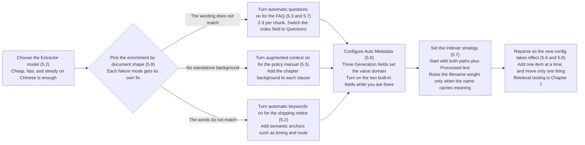
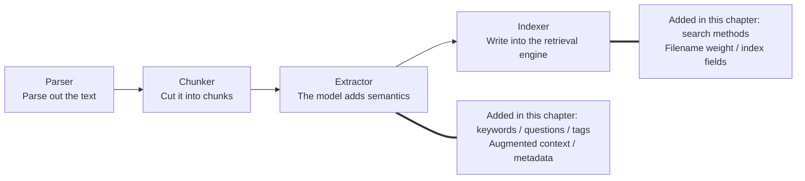
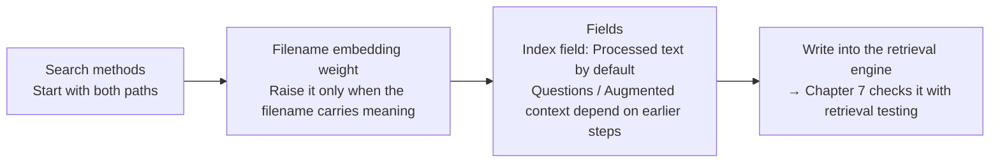

# Chapter 5 Retrieval enrichment and indexing

> Chapter guide: At the end of Chapter 4, the three documents in `after-sales-kb` had already been cut into decent chunks (Chunk). A chunk that passes for quality is not the same thing as a hit in retrieval. The user asks "how long until the money from a return arrives", and the original text in the policy manual says "refund time limit". The words do not line up. FAQ chunks are standard questions, but the ways users ask are all over the place. After a policy clause is cut into an independent chunk, it has left the chapter it belongs to, and on its own it is hard to tell what it is about. This chapter covers the second battlefield after parsing and chunking: the Extractor uses a model to add semantics to a chunk (automatic keywords, automatic questions, tags, augmented context, metadata), and the Indexer decides which retrieval method to use and which fields to write into the index. By the end of this chapter, you can: choose which enrichment items to turn on for each kind of document and explain the cost; configure the Generation and Built-in fields of Auto Metadata; choose the retrieval method and the index fields, and state the prerequisites and when the change takes effect.



*Flowchart for this chapter*

## When you need it

Three typical situations, and three ways to use this chapter.

**The chunk content is fine, but retrieval testing keeps failing to recall it**: first tell "the words do not match" apart from "the way of asking does not match". If a synonymous rephrasing is not recalled, see the retrieval methods in Section 5.7 (turn on the Embedding path so you have both). If the user's question and the declarative original text do not share a shape, see automatic questions in Section 5.3 and the Questions index field in Section 5.7.

**It was recalled, but the chunk cannot be understood on its own**: clauses and short paragraphs lose their background once they leave the original. See augmented context in Section 5.5.

**The knowledge base has grown, and you need to narrow retrieval by category, date, or site**: see tags in Section 5.4 and Auto Metadata in Section 5.6. This chapter gets the fields ready. The filtering action is verified in the retrieval test in Chapter 7.

Prerequisites: the parsing method and Chunker parameters from Chapter 4; creating the dataset and the Embedding model from Chapter 3.

## 5.1 Overview: the second battlefield after parsing and chunking

First locate this chapter in the pipeline. Chapter 4 finished the first two stages. This chapter is the last two:



*The four-stage pipeline: Chapter 4 delivers the first two stages, and this chapter delivers the last two*

By the division of labor in the official documentation: **the Extractor adds information to a chunk after chunking**. It uses a model to generate keywords, questions, tags, a context summary, and metadata, and "these additions can improve later retrieval and question answering". **The Indexer decides how a chunk is indexed and written into the retrieval engine**: which retrieval method, and which content fields take part in the index.

Why are these two stages needed? This book gathers "the chunks were cut well, and retrieval still cannot recall them" into four failure modes (our recommendation; the official documentation describes the functions one by one and does not give this framework):

| Failure mode | Symptom | Cause | Remedy | See |
|---------|------|------|------|----|
| Words do not match | Rephrase it and it is not recalled | The index only recognizes keywords, and a synonymous rewrite does not match | Embedding vector retrieval | 5.7 |
| The way of asking does not match | The user's question does not line up with the declarative original | The index has only the content, not "a question that can answer it" | Automatic questions + the Questions field | 5.3 / 5.7 |
| No classification dimension | Recall is too wide, and it cannot be narrowed by category | The chunk has only content, and no classification attribute | Tags + metadata | 5.4 / 5.6 |
| No independent background | It was recalled, and the chunk cannot be understood on its own | The chunk has left the original and lost its context | Augmented context | 5.5 |

How the four modes divide the work: the Extractor is responsible for "adding content" (the way of asking, the classification, and the background all have to exist on the chunk first), and the Indexer is responsible for "setting strategy" (words that do not match are handled by changing the retrieval method; whether the added content enters the index is also its decision). Only after both stages are done is there something for the retrieval test in Chapter 7 to tune. Enrichment first, tuning after.

There is a principle that runs through the investigation thinking of the whole book. The official retrieval-testing documentation writes it as an investigation order: **document parsing → chunks → metadata → retrieval parameters**. First confirm that the knowledge content itself has entered the dataset correctly, then tune the retrieval parameters. The reason is plain: retrieval parameters can only choose among **content that has already entered the index**. Something that is not in the index cannot be recalled no matter how low you set the threshold or how you arrange the weights. So when you meet "it is not recalled", come back to this chapter first and ask "is the content that should be on the chunk actually there", and only then go to Chapter 7 and move parameters. This chapter is all of the engineering before retrieval parameters (the fourth link).

## 5.2 Extractor: the model and automatic keywords

The Extractor enrichment items share one model entry: the **Model** dropdown chooses the model the Extractor uses. The official documentation is explicit: automatic keywords, automatic questions, augmented context, and metadata that needs to be generated by a model **all call this chosen model**. The range you can choose depends on the model providers already configured in the system (→ Chapter 2, the model channel).

**Our recommendation**: the Extractor's job is "read a chunk, output a short structured text". It does not ask much of reasoning ability, and it is sensitive to call volume. Choose a model that is cheap, fast, and steady on Chinese. There is no need to spend the best reasoning model here. The real grading of models is left to the vision model for PDF parsing (Chapter 4).

The Model dropdown just mentioned sits in the configuration page as follows. Screenshot taken on 2026-11-04, on a local Docker deployment of RAGFlow v1.0.0-rc2: the Extractor tab area of the dataset configuration page, with the model set to deepseek-flash, connected through an OpenAI-compatible gateway. That is exactly the kind of choice in our recommendation: "cheap, fast, and steady on Chinese".


rc2 makes the Extractor an in-page tab of the configuration page, alongside Parser, General Chunker, and Indexer. The model entry in Section 5.2, the automatic questions in Section 5.3, and the augmented context in Section 5.5 are all gathered in this one tab area. What is visible in the figure is exactly the shared model entry. The count of automatic keywords, `System prompt`, and the other parameters sit below the Model dropdown. This screenshot does not expand them, and the field names follow what the interface actually displays. The page also shows the Page rank slider in the Basic area (the value is 0) and the Embedding model (qwen3-embedding:0.6b). The former is the dataset-level ranking lever that 7.4 will develop, and the latter comes from the model channel in Chapter 3.

### Automatic Keywords: add semantic cues to a chunk

Once it is on, the system automatically extracts, for each chunk, keywords or phrases that can stand for its main content:

| Parameter | What it does |
|------|------|
| `Number of automatic keywords` | How many keywords each chunk generates; set it to **0** to disable |
| `System prompt` | The instruction sent to the model; it can be customized |

The logic of the default prompt (official documentation): have the model analyze the text and extract the most important `{{ topn }}` keywords or phrases. You can rewrite it to specify the type of keyword, the output language, or the format. For example, require product words only, restrict the output to Chinese, or force a `key: value` format.

The official docs say the value of keywords in one sentence: "the generated keywords add semantic information to the chunk and help retrieval and content matching". This book's reading: a keyword is a semantic anchor **made explicit** out of the chunk content. The original text says "the refund will be returned by the original route within 3-5 business days after the review passes", and the keywords lift "refund time limit" and "returned by the original route" into the open, so a rewritten user query has a word to collide with. It complements the Embedding in Section 5.7: vectors cover "close in meaning", and keywords cover "matchable on the surface".

Two boundaries of use:

- **Keep the count restrained**: keywords are a supplementary signal for the index, not a summary of the chunk. Three to five per chunk is enough. Piling the count up lets noise words dilute the anchors that actually distinguish. If you are not sure, start from fewer;
- **Aim a customized prompt at retrieval**: the most valuable direction for changing `System prompt` is to **aim it at your users' wording**. For example, require the keywords to include both the business term and the colloquial wording ("退款" ("refund") and "钱退回来" ("the money comes back")), or restrict the output language to the same language as the query. Customizing serves matching. Depart from that, and however pretty the keywords are, they are only decoration on the chunk.

## 5.3 Automatic questions: generate answerable questions for each chunk

**Automatic Questions** automatically generates, for each chunk, "questions this chunk's content can answer". The official positioning is "add a query-style expression to the content".

| Parameter | What it does |
|------|------|
| `Number of automatic questions` | How many questions each chunk generates; set it to **0** to disable |
| `System prompt` | By default, have the model understand the text and generate `{{ topn }}` questions related to the main content |

The official docs have two requirements for generation quality: questions should **cover the important information in the chunk**, and they should **not repeat synonyms**. The point of generating them is equally direct in the official documentation: "make the document content easier to match against the user's natural-language questions".

There is a key join that runs through this chapter: a generated question is not only a "note" on the chunk. It is a **field that can enter the index**. In Section 5.7 you will see that the Indexer's `Fields` can choose `Questions`, so the user's question is matched directly against the pre-generated questions. That is the core pairing of a question-answering knowledge base: **the material is a declarative sentence, the query is a question, and automatic questions bridge the two**.

One point that is easy to mix up: automatic questions and the **Q&A parsing method** in Chapter 4 are not the same thing. The Q&A parsing method handles documents whose "material itself is question-answer pairs". Each pair is cut into one chunk. Automatic questions **add questions to any chunk that has already been cut into shape**. The material can be a declarative sentence, a clause, or even a table row. The two can stack: `product-faq.xlsx` uses the Table method to cut each FAQ row into a chunk (the material itself is a question-answer pair), then turns on automatic questions to generate several ways of asking for each answer. The former decides "what to cut". The latter adds "what else it can be asked as".

Where `after-sales-kb` lands: the chunks of the product FAQ `product-faq.xlsx` are already question-answer pairs, but the ways real users ask are all over the place. "When does the money arrive", "why hasn't the refund come yet", and "where do I check the refund progress" all point at the same FAQ. Turn automatic questions on for this document, and let the model rehearse several ways of asking the same answer. After the question field enters the index, recall at the level of how the question is asked no longer depends on the wording of the FAQ original. The policy manual and the shipping notice are declarative documents. Our recommendation: **do not turn it on yet**. Wait until the test in Chapter 7 proves that recall by way of asking really has a problem, and then add it.

## 5.4 Tags: preparation before a classification dimension

**Tags** uses a **tag file prepared in advance** to extract or match tags for chunks. Unlike the other enrichment items, it is not generated from nothing. Based on the tag set you chose, the system **matches or generates** tags for a chunk.

| Parameter | What it does |
|------|------|
| `Number of automatically extracted tags` | How many tags are automatically extracted for each chunk; set it to **0** to disable |
| `Tag file` | Choose the file used for tag extraction |

The official docs write the precondition clearly: **before you use this function, prepare a suitable tag file for the knowledge base**. And they give a judgment worth remembering: "a well-designed tag system can support content classification, retrieval, and filtering".

"Preparation beforehand" is the weight of this section. The value of tags is not in the moment of extraction. It is in the tag system you design:

- **Classification has to close the loop**: the tag set should cover every branch of the business (for example, in the after-sales domain, "returns and exchanges / shipping / payment / account / invoice"), rather than waiting for the model to improvise;
- **Keep the grain restrained**: a tag is a filter dimension, not a summary. Two to four tags on one chunk is enough. Hang on too many and it is the same as hanging on none;
- **The file comes first**: write the tag file first, then turn extraction on. The model chooses inside the given tag set, and only then is the result controllable.

Two practical sources for preparing a tag file (our recommendation). One is to copy from an existing business classification. The problem categories of the ticket system, and the script groups of the support team, have been tested by real traffic. The other is to generalize from the failure samples of retrieval testing. Chunks in Chapter 7 that were "recalled but answered the wrong question", clustered together, are often the classification dimension that is missing. The concrete format of the tag file follows the specification the interface supports (still to be verified hands-on; see the review checklist at the end of the chapter).

Tags and the metadata in Section 5.6 both provide a classification dimension, and the division of work is different (our recommendation): a tag is content classification **at chunk level**, and the model stamps it chunk by chunk; metadata is a structural attribute **at document level**, generated once during parsing and maintainable by hand. To filter by "what this document is", use metadata. To filter by "what kind of thing this passage is about", use tags.

## 5.5 Augmented context: curing chunk amnesia

Chunking is the art of **cutting a document into pieces**, and cutting has a cost: once a chunk leaves the original, it has lost the background it sat in. A chunk in the policy manual such as "the time limit is 30 calendar days", looked at on its own, gives no way to know what the 30 days are about. A return? An exchange? Or a refund application?

**Augmented Context** is aimed at exactly this problem: generate a short context summary for each chunk, attach it to the chunk as supplementary information, and let the chunk still hold the background it needs when it leaves the source document. The applicable description the official docs give is exactly this kind of scene: "a chunk may lose important background after it is split; for example, a chunk that contains only a short paragraph can receive a summary of its topic and context, which helps retrieval and the model's understanding".

| Parameter | What it does |
|------|------|
| `Enable augmented context` | The switch; once on, it calls the chosen model to generate context information for the chunk |
| `System prompt` | By default, require a short summary **faithful to the source content**, which **does not introduce information the original does not have** |

Two constraints of the default prompt are worth noticing: "faithful" and "do not introduce information the original does not have". The place of augmented context is **filling in background**, not letting an opinion wander. If you rewrite the prompt, hold that line.

**A cost reminder** (the official original text): turning this function on increases model calls and token consumption. Every chunk has to pass through the model once. Multiply by the number of chunks a 50-page policy manual is cut into, and it is a real bill. Our recommendation: **turn it on only for documents that are "hard to understand once they leave their background"**. It is not the default for every document.

A quick self-check for "whether to turn it on" (our recommendation): draw three chunks at random, cover the document name, and look only at the chunk body. Ask yourself three questions. Which part of which document is this chunk about? Whose behavior does it constrain? What is its relation to the neighboring chunks? If two of the three cannot be answered, this content depends on background and is worth augmented context. If all three can be answered (an FAQ and a standalone announcement are the typical cases), save the call.

Walk through two chunks that feel real:

```text
Chunk A: "卖家应在签收后 7 个自然日内发起换货申请,逾期系统自动关闭入口。" ("The seller must file an exchange request within 7 calendar days of receipt. After that, the system closes the entry.")
  Which document, and which part? Unknown (exchange policy? shipping policy?)
  Who is constrained? Unknown (the seller or the buyer? which site?)
  → Two of the questions cannot be answered. It depends on background, so augmented context is worth turning on.

Chunk B: "问:退款多久到账?答:3-5 个工作日原路退回。" ("Q: How soon does a refund arrive? A: 3 to 5 business days, back the way it came.")
  All three questions can be answered. An FAQ already carries the question, the answer, and the subject.
  → Augmented context is not needed. Spend the budget on content like Chunk A.
```

Where `after-sales-kb` lands: after the after-sales policy manual `after-sales-policy.pdf` is chunked by chapter structure, clauses often become chunks on their own. "Time limit", "scope of application", and "division of responsibility" are scattered in their own chunks, and without the chapter context they cannot be read. Turn augmented context on for this document, so each clause chunk carries background of the form "this clause belongs to section X of the return policy, and it regulates...". FAQ chunks already carry a question-answer structure, and announcement chunks are short and self-contained. Neither needs it.

## 5.6 Auto Metadata: automatic metadata

Metadata adds structured attributes to the content parsing produces. The uses the official docs list: **retrieval, filtering, and content management**. For example, narrow the retrieval range by document type, department, author, topic, date, or business category. Chapter 3 already introduced the management interface for metadata (see Chapter 3). This section is **automatic generation**: have the system fill the metadata in during parsing, instead of entering it by hand document by document.

There are two layers of entry: **the `Enable metadata` switch and the `Settings` entry in the Extractor configuration**, and a separate **Auto Metadata** configuration area. The two kinds of fields in the latter are the body of this section:

### Generation: custom fields

**Generation** defines the metadata fields to be generated from the document content. Click **Add** to add a field, and configure it by four elements:

| Element | Explanation |
|------|------|
| `Field` | The metadata field name |
| `Description` | The field description. It tells the model what information to extract or generate from the document |
| `Type` | The data type of the field |
| `Values` | The allowed values of the field, which limit the value domain of the generated result |

After you save, the system generates metadata from the document content according to these field definitions during **later document parsing**. Of the elements, `Description` and `Values` directly decide generation quality: the more specific the description ("文档适用的站点，如全站/Shopee/Temu" ("sites the document applies to, such as all sites, Shopee, or Temu") ("the site this document applies to, such as 全站/Shopee/Temu"), rather than the two characters "站点" ("site") ("site")), and the tighter the value domain, the less likely the model is to generate values all over the place.

Walk the `doc_type` field of `after-sales-kb` through the generation flow once. When a policy manual is parsed, what the model reads is the full text of the manual plus the field definition: `Field: doc_type`, `Description: 本文档的类别,反映其在售后知识体系中的角色`, `Type: string`, `Values: 政策/FAQ/公告`. It then outputs `doc_type: 政策`. The value domain is the backstop here. Even if the model hesitates for a moment over "whether this is a guide or a policy", **Values limits it to one of the three**, and it will not invent a fourth answer such as "操作指引" ("operating instructions") or "规范" ("specification"). If metadata is going to be used as a filter condition, a filter condition whose value domain is out of control is worse than having none.

There is also a **Built-in parser template** option: reuse structured information the parsing stage has already provided as the metadata source, and do not define the same fields again.

### Built-in: built-in fields

**Built-in** provides metadata fields predefined by the system. No rules to configure. Use the switch on the right to choose whether to generate them during parsing:

| Field | Meaning |
|------|------|
| `update_time` | Records the document update time |
| `file_name` | Records the document file name |

Choose the fields, turn the switch on, and **Save**. The generated metadata can be used for document management and retrieval filtering. Viewing and editing go through **Metadata management** (Chapter 3).

Built-in fields look plain, but they are the base of inspection scenes. `update_time` answers "how long has it been since this document was updated", and `file_name` answers "which document did this chunk come from". The quality inspection and file governance in Chapter 13 both start their inventory from these two fields. They do not consume a model call. There is no reason to leave them off.

### When it takes effect: only what comes later

The official documentation uses a dedicated Note to stress the semantics of taking effect: **a change to the metadata-generation settings takes effect only for documents newly parsed afterward, and it does not automatically update documents whose parsing has already finished**. To apply the new configuration to documents you already have, you must **reparse** those documents.

This semantics matches the when-it-takes-effect rule for table column roles in Chapter 4 (changing the configuration does not touch what is already stored). It is a pattern that keeps reappearing in the whole book: **configuration from the parsing period never reaches back**. The operational corollary (→ Chapter 13): when you adjust the metadata plan, reparse a small range of documents and verify first, then reparse in batch. "Reparse" is the only channel through which a metadata change lands. Do not wait until after go-live to discover that the fields were never filled in.

Where `after-sales-kb` lands: add the same three Generation fields to every document. `doc_type` (document type; value domain: 政策/FAQ/公告 ("policy" / FAQ / "notice")), `effective_date` (effective date), and `site` (applicable site; value domain: 全站/Shopee/Temu/1688 ("all sites" / Shopee / Temu / 1688)). These three fields are directly usable in the **Metadata** filter of the retrieval test in Chapter 7 ("policies for the Shopee site only"), and they are also an inventory dimension for the quality inspection in Chapter 13 ("which policy documents have not been updated for more than a year"). Turn the two Built-in fields `update_time` and `file_name` on while you are there. Zero model cost. See Section 5.8.

## 5.7 Indexer: indexing strategy

The Extractor adds content onto the chunk. The Indexer decides **how to index, and what to index**. Note one official statement first: the Indexer uses the Embedding model already configured for the dataset (Chapter 3), and **you do not choose a model again here**. Three decision points. The suggestion is to walk them in order:



*The order of the Indexer's three decision points: settle the path first, then the weight, then the fields*

### Search methods: one choice or several

`Search methods` decides which kind of index to build:

| Method | Mechanism | Where it fits |
|------|------|---------|
| `Embedding` | Generates a vector representation and a vector index; semantic retrieval | The query and the original use different words and should still be recalled: scenes with varied ways of asking and free phrasing |
| `Full-text` | Builds a full-text index; keyword matching | **Exact words**: item numbers, product names, technical terms, code. Content that has to match on the surface |
| `Embedding + Full-text` | Both indexes; semantics and keywords both take part | You want both; the official default suggestion for most knowledge bases |

The original official suggestion is worth copying down: "For most knowledge bases, you can enable **Embedding** and **Full-text** together, and index **Processed text**". Our recommendation: **start from both paths by default**, and narrow only when you have a clear reason. A query that is purely exact words (a parts-number base) can keep only Full-text and save resources. A pure semantic question-answering base can consider keeping only Embedding. The score weight of the two paths (`Vector similarity weight`) is a tuning object of Chapter 7. Here, build both paths first.

### Filename embedding weight: the semantic weight of the file name

`Filename embedding weight` controls the weight of the file name in the **vector representation**. The file name and the chunk content contribute semantics together. The higher the value, the larger the influence. The adjustment rule the official docs give:

- **Raise it**: when the file name clearly states the document's topic. Names you can read for meaning, such as `after-sales-policy.pdf` and `product-faq.xlsx`. The file name is a free semantic signal;
- **Lower it**: when the file name is a random identifier or has no real meaning. `scan_20260301_0042.pdf`, `doc_final_v3.pdf`. A high weight only injects noise into the vector.

Our recommendation: the premise of this parameter is **naming discipline** (→ the operations standard in Chapter 13). Talk about weight only when the file name has semantics. If the team cannot manage disciplined naming, lower it. Do not let a bad name pollute the vector.

### Index fields: three choices and their prerequisites

`Fields` specifies the content used for indexing and retrieval:

| Field | Content indexed | Prerequisite | Fits |
|------|-----------|---------|------|
| `Processed text` | The chunk body produced by earlier steps such as Parser and Chunker | None | The most direct; **the default choice** |
| `Questions` | Questions generated by the Extractor's automatic questions | **Automatic question extraction must be configured first** (Section 5.3) | A question-answering knowledge base: the user's question matches pre-generated questions directly |
| `Augmented context` | The context the Extractor generated, not only the original chunk content | Augmented context must be turned on first (Section 5.5) | A chunk needs extra background before it can be retrieved effectively |

The official suggestion: if Automatic Questions or Augmented Context is already enabled, "consider indexing Questions or Augmented context, according to the query type you expect". Note that both prerequisites point back to earlier in this chapter: **an index field is not a free option. Which field you turn on depends on which Extractor function you turned on first**. Wanting to index Questions without having turned on automatic questions is cooking a meal with no rice.

The table of differences in enrichment configuration for the three documents in `after-sales-kb` (this book's configuration position):

| Document | Extractor enrichment | Indexer choice | Reason |
|------|---------------|-------------|------|
| `product-faq.xlsx` | Automatic questions (2-3 per chunk) | Both retrieval paths + the `Questions` field | Users ask in every possible way; match question against question |
| `after-sales-policy.pdf` | Augmented context | Both retrieval paths + `Processed text` | Clauses need background, but queries are mainly semantic statements |
| Shipping timeliness notice | Automatic keywords | Both retrieval paths + `Processed text` | A short document; only add semantic anchors of the "time limit / route" kind |
| Every document | Metadata: 3 Generation fields + 2 Built-in | -- | Document-level attributes, paving the way for filtering in Chapter 7 and inspection in Chapter 13 |

The three documents are not configured the same way. That is exactly the method of this chapter: **customize enrichment by the form of the document, and do not make one cut for the whole base**. The baseline is still both paths + `Processed text`, and enrichment items are stacked on top of it as needed. Not one cell of the table was settled by guessing. Each one is the result of measuring the go-live order in Section 5.8, item by item, on `after-sales-kb`. The measuring method and the criterion for rolling back are in Section 5.8.

## 5.8 The cost ledger and when changes take effect

Enrichment is not free. Before you turn any item on, walk through this ledger (arranged from the official documentation's statements of model calls for each function):

| Function | Model call | Official cost wording | Starting suggestion (our recommendation) |
|------|---------|-------------|---------------------|
| Automatic keywords | Once per chunk, on the Extractor model | Helps retrieval and content matching | Turn it on when retrieval testing has words that do not match, and start the count low |
| Automatic questions | Once per chunk | Easier to match against natural-language questions | Turn it on only for question-answering documents |
| Tags | Extracted chunk by chunk, based on a tag file already prepared | Supports classification, retrieval, and filtering | Turn it on when there is a filtering need, and the tag file comes first |
| Augmented context | Once per chunk | **Stated explicitly: increases model calls and tokens** | Only documents that are "hard to understand once they leave their background" |
| Metadata Generation | Generated by field during parsing | **May increase model calls and tokens** | Define them by the filtering need, and fewer fields is better than more |
| Metadata Built-in | None (predefined by the system) | -- | Turn `update_time` / `file_name` on while you are there |
| Indexer configuration | No extra (reuses the dataset's Embedding model) | -- | Both paths + `Processed text` by default |

How to estimate the volume: for each function that is "once per chunk", cost is about the total number of chunks x the tokens of one call. A 50-page policy manual cut into 200 chunks, with all five enrichments turned on, is more than a thousand model calls. That is also the economic basis of "customize by the form of the document".

**Go-live order, our recommendation**: bare-chunk baseline first → then add enrichment item by item → move only one place each time.

1. **Baseline**: the parsed chunks from Chapter 4, with the Indexer on the official default (both paths + `Processed text`). Run the retrieval test in Chapter 7 first, and get a recall baseline of "nothing has been enriched";
2. **Add item by item**: whichever failure mode the baseline exposes, add that enrichment. Words-of-asking that do not match get automatic questions. Missing background gets augmented context. Each time you add one item, rerun the same set of test questions and compare;
3. **One place at a time**: turn three items on at once and then test, and you cannot say what caused the good or the bad. Only a single-variable change has a conclusion.

Put onto `after-sales-kb`, this order is five steps. ① The bare chunks of the three documents enter the index, you run the test-question set, and you note which ways of asking are not recalled. ② FAQ recall is weak in the way of asking → turn automatic questions on only for `product-faq.xlsx`, switch the index field to `Questions`, and rerun. ③ Policy clauses are recalled correctly, but complaints that they "cannot be understood" are many → turn augmented context on only for `after-sales-policy.pdf`, reparse, and rerun. ④ You find you cannot narrow by site → add the three Generation metadata fields, and reparse every document. ⑤ Keep the before-and-after comparison of each step in the test record. It becomes the basis for the enrichment spend. If a step's enrichment shows no gain, roll it back. The enrichment list is decided from those results, not switched on.

This flow turns the retrieval test in Chapter 7 from a "verification tool" into "the measure of enrichment effect". Every configuration change has a before and an after. If you want to settle the comparison into a long-term indicator (the recall trend, and the contribution of each enrichment item), bury an evaluation point at go-live. Trace detail (→ the Langfuse book) in passing, in one sentence: a field-level recall comparison is the final ruling on whether the enrichment spend is worth it.

The semantics of taking effect close here. Every configuration in this chapter, Extractor enrichment, metadata, and index fields, follows "**a change takes effect only for a new parse**" (the official Note in Section 5.6; index fields are written on the next parse). After you change the configuration, remember to reparse, then go into the Chapter 7 test. Test parameters affect only that test and are not synced to the application. Once the parameters are settled, go configure them on the application side. Chapter 7 develops that join.

## Chapter summary

1. **The last two stages of the four-stage pipeline**: the Extractor adds semantics to a chunk, and the Indexer sets the indexing strategy. A chunk that passes is only the admission ticket. Recall depends on these two stages (continuing Chapter 4).
2. **Each of the four recall-failure modes has its own remedy**: words do not match → Embedding; the way of asking does not match → automatic questions; no classification dimension → tags + metadata; no independent background → augmented context (as summarized in this book).
3. **The Extractor has one model entry**: generating keywords / questions / tags / context / metadata all goes through the chosen model. Prompts can all be customized. The default logic turns on `{{ topn }}` and a faithful summary.
4. **Automatic questions and the Questions field are the core pairing of a question-answering knowledge base**: the questions have to be generated before there is anything to say about indexing them. Index fields are constrained by the Extractor prerequisite.
5. **Metadata has two kinds of fields**: Generation has four elements (field / description / type / value domain), and Built-in has zero cost. A change takes effect only for a new parse, and what is already stored depends on a reparse.
6. **The default indexing strategy is both paths + `Processed text`**: the file-name weight follows naming discipline. Customize enrichment by the form of the document, and do not make one cut for the whole base.
7. **Cost and order**: every enrichment item is model-call volume x chunk count. Baseline first, add item by item, one place at a time, and use the Chapter 7 test to measure the gain of each step.

## Acceptance checklist

By the time you have read this far, you should be able to:

- ☐ State the symptoms of the four recall-failure modes and the enrichment means that corresponds to each, and point out which ones the Extractor solves and which one the Indexer solves;
- ☐ Retell the enrichment-configuration difference table for the three documents in `after-sales-kb`, and explain "why the FAQ turns on automatic questions, and the policy manual turns on augmented context";
- ☐ Rewrite `System prompt` for automatic keywords once (for example, restrict the output language and format), and explain what `{{ topn }}` means in the default prompt;
- ☐ Configure one Generation metadata field that includes a value-domain limit, and explain how the way `Description` is written affects quality;
- ☐ Explain "why the metadata configuration was changed and the existing documents did not change", and finish one reparse that makes it take effect;
- ☐ Choose a retrieval method and index fields for a dataset, and state the prerequisites of the `Questions` and `Augmented context` fields;
- ☐ Estimate the order of magnitude of model calls for a given document set after three enrichment items are turned on.

## Further reading

- **Chapter 4 (parsing and chunking)**. The upstream engineering: enrichment and indexing are both built on chunk quality. If the chunks were cut badly, enrichment cannot save them.
- **Chapter 7 (retrieval testing and tuning)**. The downstream loop: every enrichment item in this chapter has to pass a test there. Hybrid-retrieval weights, Metadata filtering, and the investigation order.
- **Chapter 3 (datasets)**. The metadata management interface and Embedding model configuration, the entry for viewing and editing the automatic metadata in this chapter.
- **Chapter 13 (team collaboration and knowledge-base operations)**. File-naming discipline, batch reparse, and metadata inspection: the operations face of the when-it-takes-effect semantics in this chapter.
- **The original official Configuration document**. The basis of this chapter section by section (Extractor Configuration / Indexer Configuration / Auto Metadata).

## Review checklist (before publication)

- [ ] Check the whole chapter against the original configuration.md (v1.0.0-rc2, verified 2026-10-27)
- [ ] The interface defaults of the count parameters (the counts of automatic keywords / questions / tags, and the initial value of `Filename embedding weight`) are not given in the official documentation; fill them in after measuring the interface
- [ ] The type enumeration supported by the Generation field `Type` is still to be confirmed by measurement (the Example in the body uses only string)
- [ ] Whether the three `Fields` can be selected together (for example `Processed text` and `Questions` selected at the same time) is still to be verified hands-on
- [ ] The actual generation effect of automatic questions and augmented context (count, quality, token use) is still to be verified hands-on once the environment is ready
- [ ] Check that the three mermaid diagrams render on the GitHub web view
