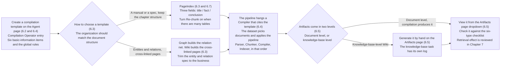
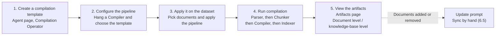
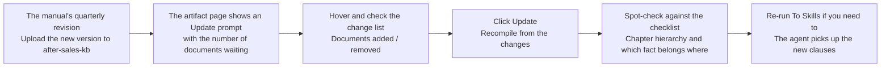

# Chapter 6 Knowledge compilation and knowledge artifacts

> Chapter guide: Chapter 4 cut the After-sales Policy Manual (after-sales-policy.pdf) into chunks, and Chapter 5 fitted those chunks with retrieval enrichment, so when support asks "what is the compensation standard for shipping damage" it can already be recalled steadily. But support will ask next: "how many parts does the manual have? which chapter is the return process in? which clauses did this revision change?" Chunks cannot answer those questions. A chunk is a "point", and a structural question is a "surface". This chapter covers RAGFlow's answer: knowledge compilation. Above the chunks, an LLM processes the document again into a structured knowledge artifact: a navigation index, a graph, a tree, a mind map, a timeline, a Wiki page. This chapter covers: how to choose among the six built-in templates, how to tune the dedicated configuration surface, how a template is applied through an Ingestion Pipeline, how to view and update an artifact on the Artifacts page, the common pitfalls, and our running example, generating a navigation artifact for the after-sales manual so the support Agent looks at the table of contents before it drills into retrieval. By the end of this chapter, you can: choose the right compilation template for any document; walk the full flow from template to artifact; and set up an operations rhythm in which artifacts stay in step with document revisions.



*Flowchart for this chapter*

## When you need it

Three typical situations, and three ways to use this chapter.

**The document structure is clear (a manual, a report, a specification), and what the user asks is "which chapter talks about what" rather than a specific point of knowledge**: see Section 6.3 and choose a PageIndex or Tree template, then see our running example in Section 6.7. A navigation artifact lets question answering give the table of contents first, then drill into retrieval.

**You want to pull the entity relations in a document (people, organizations, products, clauses) out for associative queries, or settle scattered documents into Wiki pages that link to each other**: see the Graph and Wiki template configuration surfaces in Section 6.3. Both are driven by entity / relation specifications.

**Compilation finished, but you cannot see the artifact, the result is not what you expected, or you changed the template and it did not take effect**: go straight to Section 6.6. Wiki has to be generated manually on the Artifacts page, and changing a template does not recompile on its own. The entries whose behavior runs against intuition are all gathered there.

Prerequisites: the dataset from Chapter 3 is ready (our running example is after-sales-kb); parsing and chunking from Chapter 4, and indexing and enrichment from Chapter 5, are already tuned. Knowledge compilation processes exactly those products.

## 6.1 Overview: another pass above the chunks

The official definition, in one sentence (docs/guides/knowledge_compilation/overview.md, verified 2026-10-27): **knowledge compilation turns unstructured documents into structured knowledge content. The system uses a large language model to analyze the information in the document and, according to the compilation template the user chose, generates different types of knowledge artifacts**. The artifacts that come out can be used for knowledge retrieval, intelligent question answering, and Agent applications, and they help users understand and use the key information in a document quickly.

Chapter 4 said that chunks solve the retrieval-grain problem of "semantic matching wants something small and focused". Knowledge compilation solves another dimension: **reorganize chunks and parse results into "knowledge that has structure"**. The division of work can be remembered like this:

```text
A chunk covers a point: "运输破损的赔偿标准是多少？" ("What is the compensation standard for damage in transit?") → recall the compensation-clause chunk
An artifact covers the shape: How many parts does the manual have? Which chapters does the return flow touch?
                          → The hierarchy index gives the contents first, then you drill in
```

Six kinds of knowledge artifacts are supported now (the overview original; template names stay exactly as the half-width strings on the interface):

| Artifact type | Template name | Document form it fits | Capability in one sentence |
|---------|--------|-------------|-----------|
| Knowledge graph | Graph | Content such as relations among people, organization structure, and product relations | Shows the entities in the document and their relations |
| Knowledge tree | Tree | Chapter structure, topic classification, a knowledge system | Organizes document content by levels |
| Page index | PageIndex | Manuals, specifications, reports | Keeps the original document structure and strengthens chapter location |
| Mind map | MindMap | Documents whose overall structure needs to be grasped quickly | Unfolds content relations around a core topic |
| Timeline | Timeline | Historical material, project records, event tracking | Organizes event information in time order |
| Knowledge page | Wiki | Enterprise knowledge, product material, domain knowledge | Generates knowledge pages that link to each other |

**The relation to a dataset**: an artifact is not a new object floating outside the dataset. Knowledge compilation generates it by processing again, based on **the documents in the dataset and the parse results**, and you view and browse it on the dataset's **Artifacts** page. But creating and maintaining an artifact (template configuration, generation, update, regeneration) is not done on the Artifacts page. It is done on the compilation-template and Pipeline side (the original dataset Artifacts document). By generation scope, artifacts also split into two levels: document level and knowledge-base level. That dividing line is the most important behavioral difference in this chapter. Section 6.5 develops it.

One sentence of background is enough. The official docs position the direction RAG is evolving as the base of an **agent context engine**: the bottleneck of an LLM's performance is not the model's intelligence, but the quality of the context it receives. The knowledge core of a context engine relies on structured retrieval such as TreeRAG and GraphRAG to close the semantic gap (docs/basics/agent_context_engine.md). A knowledge artifact is where that positioning lands in the product: **chunks are raw material for the retriever, and artifacts are structured context for the Agent**. What the Agent receives is not only several related fragments. It also receives a skeleton of "what the knowledge looks like". The glossary in Chapter 1 mentioned that knowledge compilation was reworked starting in v0.27.0, replacing the separate GraphRAG and RAPTOR entries. Looking back from Chapter 6: the Graph template takes over graph-style needs, and the Tree template takes over hierarchical-summary needs.

## 6.2 Knowledge compilation at a glance: a five-step pipeline

### Three core concepts

| Concept | English | Definition in one sentence |
|------|------|-----------|
| Compilation template | Compilation Template | Defines how knowledge compilation generates: which information types to extract, what structure to organize by, and what generation rules to follow |
| Knowledge artifact | Knowledge Artifact | The structured result knowledge compilation produces: Graph, Tree, PageIndex, MindMap, Timeline, Wiki |
| Compilation node | Compilation Node | A processing node in the compilation flow that executes a specified compilation task; when you use it, it has to be associated with the corresponding compilation template |

The three are a "rules → product → execution slot" relation: the template defines how to compile, the artifact is the result that comes out of compiling, and the compilation node is the execution slot in the Pipeline where the template is mounted.

### The standard workflow (five steps)



Step by step, corresponding to the official documentation (the Standard Workflow in the overview):

1. **Create a knowledge compilation template**: when you create a new Agent on the Agent page, choose **Compilation Operator**, then create a template by the artifact type you want to generate and finish the parameter configuration. Note that the entry is on the Agent page, not inside the knowledge-compilation function itself. The first time you use it, it is easy to look in the wrong place here;
2. **Configure the Ingestion Pipeline**: add Compiler to the Pipeline, and choose the compilation template you created;
3. **Apply the Pipeline**: in the Dataset, choose the documents to process, and apply the Pipeline you configured;
4. **Execute knowledge compilation**: the system parses the documents according to the Pipeline configuration, and generates the corresponding artifacts according to the chosen template;
5. **View the knowledge artifacts**: after compilation finishes, view Graph, Tree, PageIndex, MindMap, Timeline, or Wiki on the Artifacts page.

A typical pipeline in one picture: **Parser is responsible for parsing, Chunker is responsible for splitting, Compiler is responsible for knowledge compilation, and Indexer is responsible for building the index for later retrieval**. That is, Compiler is inserted between the splitting in Chapter 4 and the indexing in Chapter 5. Above the chunks, and before they are stored.

### Trigger, generation, and update

Gather the behavior the official docs scatter across documents, by lifecycle:

| Stage | Behavior | Source |
|------|------|------|
| Trigger | An artifact is generated only when the template is referenced by CompilerOperator and the document actually executed a Pipeline that contains Compiler. **A template only defines "how to compile". By itself it produces nothing** | the original apply document |
| Generation | Document-level artifacts (Graph/Tree/PageIndex/MindMap/Timeline) are produced directly as the document is compiled; a knowledge-base-level artifact (Wiki), after compilation finishes, still has to be manually generated on the Artifacts page | the original apply document |
| Update | The system keeps detecting document changes inside the dataset, but **it does not automatically regenerate artifacts**. After documents are added or removed, an update prompt is shown, and a person has to click Update to sync | the original apply document |

Two of the three say "will not do it automatically". That is where the mental model of knowledge compilation differs from "change the configuration, reparse, and it takes effect" in Chapters 4 and 5, and it is also the source of the most questions in Section 6.6.

### Preparation before you start

The four prerequisites the official docs list, checked one by one: a usable LLM is configured, and the model has fairly strong text understanding, structured output, and reasoning (the model channel in Chapter 2); an Ingestion Pipeline that contains Parser, Chunker, Compiler, and Indexer has been created or is planned; source documents with a clear topic and reliable content are ready; the template type has been settled according to the target knowledge structure. There is one more official suggestion worth executing as discipline: **the first time you use it, choose a small number of representative documents and run a trial, and only scale up after you confirm the output structure and quality**. Compilation is heavy LLM work. The cost of redoing the full batch is an order of magnitude larger than parsing.

## 6.3 Built-in templates and dedicated configuration

### How to choose a template

The essence of choosing a template is a mapping from "document form → way of organizing knowledge" (the template-selection suggestion table, the overview original):

| Template | Where it fits (condensed from the official original) |
|------|------------------------|
| Graph | Extract the entities in the document and the relations among them, such as people, organizations, products, and their relations |
| Tree | Organize document content by topic and level, and arrange the knowledge into a tree |
| PageIndex | Keep the document's original chapters and page structure, build a hierarchical index, and use it for quick location and retrieval |
| MindMap | Extract the core topic and the branch content, and show the knowledge structure as a mind map |
| Timeline | Documents that contain clear time information and events, organized and shown in time order |
| Wiki | Documents with a large amount of content and relations among topics, organized as Wiki pages that link to each other |

Our recommendation: read this table as one judgment. **What you want is not "the most advanced artifact". It is "a way of organizing that is isomorphic to the document's natural structure".** A manual has a natural chapter tree, and forcing a graph out of it takes the long way around. Support notes are full of "who looked up whom, and because of what", and forcing a timeline throws the relations away. Choosing the wrong template is the first cause of poor artifact quality, and this mistake happens before compilation. Tuning parameters cannot save it.

### Dedicated configuration surfaces at a glance

After you choose a template, you can adjust at two levels, global rules and template-specific configuration (the overview original). The dedicated configuration surfaces of the six templates:

| Template | Dedicated configuration items |
|------|-----------|
| Graph | Global rules; EntitySpecification; RelationSpecification; Re-splitting Parser output |
| Tree | Global rules; Summarization Prompt (including Claim Extraction Prompt); Maximum Tokens; Clustering Threshold; Clustering Ratio; Re-chunk by Tree Leaves |
| PageIndex | Global rules; Re-chunk parser output; EntitySpecification (fields); RelationSpecification |
| MindMap | Global rules; EntitySpecification (node types); RelationSpecification (relations); adding, deleting, and editing nodes |
| Timeline | Global rules; EntitySpecification (timestamp/event); RelationSpecification (ordered) |
| Wiki | Global rules; Wiki mode; EntitySpecification; RelationSpecification; ClaimSpecification; ConceptSpecification; Blueprint (including Instruction) |

Of these, Graph, Tree, and PageIndex are closest to our running example, and they are developed below. The MindMap and Timeline configuration surfaces are thinner (four node types, CentralTopic/Branch/Sub-branch/Keyword; entities of only the two types timestamp/event, and only the one relation ordered). Take them from the table as they stand.

### Entity and relation specifications: Graph and Wiki

EntitySpecification and RelationSpecification are the core of graph-style templates. Every specification has the three-piece set **Type (type name) / Description (definition and scope) / Rule (extraction constraint)**. The types the system provides by default:

| Graph default entities | Wiki default entities (added on that base) |
|---------------|------------------------------|
| person, org, product, regulation, location, other | Also system (technical system / platform / framework) and equipment (equipment / hardware), 8 types in all |

| Graph default relations | Wiki default relations (added on that base) |
|---------------|------------------------------|
| owns, part_of, caused_by, regulates, located_in, other | Also uses (a use relation), 7 types in all |

The official configuration advice (the built_in_templates document), condensed into four items: **keep only the types the business needs**, and delete default configuration that has no actual use, so invalid extraction is reduced; keep type names and descriptions clear, and do not use several types to express similar concepts; relation semantics have to be explicit, and avoid a definition that is too wide; in a complex scene, use the Rule field to add domain constraints. For example, a global rule can be written as "只抽取文档中的核心人员、组织、产品与关键事件，实体名保持完整，无法确认的不生成实体" ("Extract only the core people, organizations, products, and key events. Keep entity names intact. Do not emit an entity you cannot confirm.") ("extract only the core people, organizations, products, and key events in the document, keep entity names complete, and do not generate an entity that cannot be confirmed").

Wiki has three further layers. **Wiki mode** decides how pages are organized: Entity mode (entity mode, one page per entity / concept) or Topic mode (topic mode, where the LLM groups related entities onto the same page by relations and context). **ClaimSpecification** extracts complete factual statements (it requires the associated entities to come from information already extracted, and it avoids speculative content that cannot be verified from the document), and it fits scenes that need the knowledge checked. **Blueprint** defines the page-structure template. Six are preset, Brand/Engineering/General/Market/Product/Interview, plus Custom. After you select one, you can preview the page structure in the Example area and then decide to generate. The official suggestion: for structurally complex content such as an enterprise knowledge base or product documentation, enabling Plan is suggested.

### Tree clustering parameters

The final shape of a Tree template is controlled by four parameters, and it is the one of the six templates whose engineering parameters are densest:

| Parameter | What it does | Turn it up | Turn it down |
|------|------|------|------|
| Summarization Prompt (including Claim Extraction Prompt) | The prompt that extracts atomic claims from the leaf chunks before clustering; leave it empty to use the built-in rules, and customize it only when there is a domain-specific need (see below) | — | — |
| Maximum Tokens | The maximum length of a node summary | Keeps more summary information; fits a complex document | The summary is tighter; fits a quick look at the whole |
| Clustering Threshold | The match degree of content clustering | The division is stricter, and topic nodes are finer | More related content is merged, and the structure is more concentrated |
| Clustering Ratio | The clustering ratio in the Tree structure | The levels are richer | Fewer nodes, and the whole is simpler |

Two details that often trip people up: **Claim Extraction Prompt** controls the prompt that extracts atomic claims from the leaf chunks before clustering. The extraction result carries source-chunk evidence, and it is used for clustering so the effect of layout noise is reduced. Leave it empty to use the built-in rules, and customize it only when there is a domain-specific need. After **Re-chunk by Tree Leaves** is turned on, RAGFlow merges the source chunks of each leaf cluster into one new retrieval chunk (the original chunks are kept but marked not retrievable), so the final retrieval boundary follows the Tree's semantic boundary rather than the original chunk boundary. **Only one Tree template in the same template group can enable this option** (the built_in_templates original).

### PageIndex fields and relations

PageIndex generates a hierarchical index by the document's chapter structure. The configuration surface turns on "which fields to extract, and which relations to build":

- **EntitySpecification (fields)**: three fields by default. title (the title; keep the original text, without a page-number index), fact (key facts / rules / definitions), and conclusion (the summary and important conclusions). Each field likewise has the Type/Description/Rule three-piece set;
- **RelationSpecification (relations)**: between chapters, include is the default for containment (a document contains chapters, a chapter contains subsections), and the system's default relation-type table also provides conclusion (a conclusion relation);
- **A suggestion for global rules** (condensed from the official original): keep the original chapter structure, prefer the original titles as index node names, extract only the key information related to the chapter topic, and do not force a chapter node for content that has no clear title.

When the **Re-chunk parser output** option is on, RAGFlow reorganizes the parsed chunks according to Rechunking rules before it runs PageIndex compilation. It tries to keep the original content order, the heading levels, and the chapter boundaries, and it keeps tables, lists, and code blocks whole, so the compilation input is more suitable for building a hierarchical structure. When it is off, the Parser's original chunks are used directly.

## 6.4 Applying a template: from basic information to the Pipeline

### Basic information

Creating or editing a compilation template starts with the basic information. All template types share six items (the basic_information_configuration document):

| Configuration item | Explanation |
|--------|------|
| Template Name | The template name; the suggestion is to name it by the actual use, so the name directly reflects the scene it is used in |
| Template Description | Describes the template's function, the scenes it fits, and the main content it processes |
| Default Extraction Model | The default extraction model: during compilation it is used to understand and analyze the document, and to finish extraction and structured generation by the template rules |
| Template | Choose the artifact type to generate: Graph / Tree / PageIndex / MindMap / Timeline / Wiki |
| Global Rules | Requirements the current template follows uniformly when it executes; different templates control different scopes (Graph constrains entity and relation extraction, Wiki controls content organization and generation) |
| Re-Split Parser Output | Controls whether Compiler reorganizes and re-splits the Parser output before it executes compilation; after the template is saved, this setting takes effect when the template is used for compilation |

**The boundary between Re-Split and Chunker** (a condensation of item 6 of the official FAQ): the former controls whether Compiler, before compilation, reorganizes and re-splits the Parser output according to the current template's processing requirements, and the latter is responsible for the document's chunking inside the Pipeline. The two act on **different processing stages**, and Re-Split **does not replace** Chunker. Remember one sentence: the chunks Chunker cuts serve retrieval, and Re-Split only reorganizes the input for compilation.

### Referencing a template in a Pipeline

The four landing steps after a template is created (the original apply document):

1. Create or open an Ingestion Pipeline;
2. Add and connect the four nodes Parser, Chunker, Compiler, and Indexer;
3. Open CompilerOperator, and choose the target CompilationTemplate from the template list;
4. Check the node connections and the required parameters, and save the Pipeline.

Stress the weight of the official Note once more: **a CompilationTemplate only defines "how to compile". A KnowledgeArtifact is generated only when the template is referenced in CompilerOperator and a document actually executed this Pipeline**. Create a template and never hang it on a Pipeline, and nothing happens.

### Applying it in a Dataset

1. Enter the Dataset page, and create a dataset or open an existing one (our running example is after-sales-kb);
2. Upload the documents to process;
3. In the file list, choose **Configure Ingestion Pipeline**;
4. Choose the Ingestion Pipeline that contains CompilerOperator;
5. Start parsing, and confirm in the task log that Parser, Chunker, Compiler, and Indexer finish in order.

One rule you will certainly meet: **after a template is modified, documents whose compilation has already finished are not recompiled automatically**. You need to reparse or rerun the Pipeline by the operation the product currently provides, and only then does the new configuration take effect (the original apply document). The operational meaning: during template tuning, treat "change the template → rerun → compare artifacts" as one fixed action, rather than expecting it to hot-update.

## 6.5 Managing and consuming artifacts

### Viewing: the Artifacts page and the two artifact levels

After compilation finishes, enter the corresponding knowledge base (dataset), and choose **Artifacts** in the left sidebar. The dropdown at the top right of the page chooses the artifact type to view: **Wiki**, **To Skills**, **Tree/Page index**, **Graph**, **Mind map**, **Timeline** (the original apply document; when the dataset Artifacts document gives examples, it also calls this kind of hierarchical-index form **Navigation**. Naming follows the dropdown items on the interface. Between the two names, this book uses "navigation" for the Tree/PageIndex form).

The behavioral difference of the two levels is the weight of this section:

| Generation scope | Artifact | How it is generated |
|---------|------|---------|
| Document level | Graph, Tree, PageIndex, MindMap, Timeline | Produced directly as the document is compiled; click the file name in the file list to view the corresponding result |
| Knowledge-base level | Wiki (some artifacts can be promoted to knowledge-base level) | After the related documents finish compiling, go to the Artifacts page and click **generate**. The system generates from the compilation results currently in the base. A knowledge-base-level task has its own log |

Look at the two-level behavior in the table above from the Artifacts page itself first. Screenshot taken on 2026-11-04 in the same environment: the Artifacts page of after-sales-kb, with the type dropdown at the top right open. Compilation has not been executed yet, and the center of the page is the empty state.


The dropdown is in fact five items: Wiki, Tree/PageIndex, Graph, Mind map, and Timeline. Of the six items listed in the body, **To Skills** is not among them. It is an operation entry inside the artifact content page, and it does not occupy the type dropdown. The interface spells the hierarchical-index kind as Tree/PageIndex, and there is no separate "Navigation" item. The body says "naming follows the dropdown items on the interface", and the result confirmed in testing lands here. The empty-state copy in the center of the page, "No wiki yet——Compiled automatically when documents are parsed", writes the timing of compilation onto the interface: compilation hangs on the document-parsing flow. Compilation has not been executed, so the artifact area is empty, as a matter of course. Record one discrepancy honestly: this empty-state sentence says Wiki is compiled automatically along with parsing, while the apply document (Section 6.6) says that after Wiki compilation finishes you still have to generate manually on the Artifacts page. The interface copy and the documentation wording do not agree. Leave it to be checked after the compilation flow is verified hands-on.

### Quality checks: what to inspect for each of the six artifact types

After an artifact is generated, check the content and structure against the template you used, and see whether they match what you expected (the original table in the apply document; memorize it directly as the acceptance sheet):

| Type | What to inspect |
|------|---------|
| Graph | Whether entities are duplicated; whether relation direction is correct; whether there are nodes or edges with no basis |
| Tree | Whether the levels are clear; whether sibling nodes are at a similar level of abstraction; whether the summaries are accurate |
| PageIndex | Whether the chapter levels are kept; whether facts and conclusions come from the corresponding chapter |
| MindMap | Whether the central topic is clear; whether branches are duplicated or crossed; whether node names are concise |
| Timeline | Whether the times are accurate; whether the event order is correct; whether a relative time was misread |
| Wiki | Whether the page topics are reasonable; whether the links between pages work; whether the facts agree with the source |

### Updates: by prompt, not automatic

The system keeps detecting document changes in the dataset, but artifacts are **not** regenerated automatically along with them. When a change is detected, an **Update** button appears at the top left of the artifact page, with the number of documents waiting to be updated shown beside it. Hover over the prompt area to see the concrete changes: newly added documents (uploaded after the artifact was generated, and not yet included), removed documents (already deleted, but the related content has not yet been synced out), and a count indicator. After you confirm that a sync is needed, click Update, and the system updates the artifact based on the current document changes. The rule in one sentence: **uploading or deleting a document does not itself update an existing artifact immediately. After the prompt appears, you have to click Update by hand** (the original Note in the apply document).

### To Skills: from artifact to skill

**To Skills** on the Artifacts page takes an artifact that has already been generated and further arranges and converts it into reusable **Skills** that an Agent can use. Enter the Artifacts page and open the artifact → choose To Skills from the dropdown at the top right → the system extracts and arranges content from the artifact and generates Skills → the generated result is shown in the Skills list, and a click views the details on the right. A generated Skill usually contains name and description, plus rules, methods, or instructions extracted and arranged from the artifact. Two properties: To Skills **does not modify the original artifact**. It only derives from the artifact that exists. It builds the bridge from a knowledge artifact to an Agent capability. The "surface"-level structure of the artifact, through Skills, becomes a methodology the Agent can cite directly.

### Who consumes them

The official positioning of what an artifact is for (the overview original): knowledge retrieval, intelligent question answering, and Agent applications. Landed on this book's chapter map:

- **The chat assistant** (see Chapter 8): after a dataset is configured with compilation artifacts, how retrieval and citation on the question-answering side benefit is developed in the configuration context of the chat assistant;
- **The canvas Agent** (see Chapter 10): the entry for creating a compilation template is on the Agent page (Compilation Operator in Section 6.2). How artifacts and Skills enter the orchestration of the support Agent is one of the inputs of the support-Agent instance in Chapter 10;
- **Retrieval testing** (see Chapter 7): whether an artifact was built well has to come back, in the end, to verifying the recall effect. Whether a navigation path of "table of contents first, then drill down" really improves location is for the retrieval test to say.

Our recommendation: do not treat an artifact as another vase feature that you "glance at after it is generated". **An artifact is a second asset of the dataset**. Chunks serve single-point recall, and artifacts serve structural navigation and the settling of methodology. In one knowledge chain, both are present.

## 6.6 Common questions and pitfalls

The official FAQ (knowledge_compilation/faq.md) has eight items, gathered into four groups by "symptom → prescription".

**Group 1: compilation finished, and nothing shows in Artifacts**

- *Why is there no Wiki to see after compilation finishes?* Wiki is generated differently from the other artifacts. Graph, Tree, PageIndex, MindMap, and Timeline are document-level artifacts, and they can be viewed as soon as compilation finishes. Wiki is a knowledge-base-level artifact. After the documents finish compiling, you still have to go to the dataset's Artifacts page and click generate.
- *Why was no artifact generated at all after compilation?* Check five things in order: whether Compiler was added to the Pipeline; whether Compiler chose the right template; whether the compilation task executed successfully; whether the template was configured correctly and saved; whether the default extraction model is available. If the task failed, use the task-execution log to locate the concrete reason.

**Group 2: an artifact was generated, but the result is not what you expected**

- *The artifact is incomplete, or it does not match what you expected?* Generation quality is affected together by the original document content, the chosen template, the default extraction model, and the template configuration. The handling order the official docs give: **first confirm that the original document's parse result is complete, then adjust the global rules and the corresponding template parameters, and compile again**.
- *If the result is unsatisfactory, what do you adjust first?* On the premise that parsing is normal, check in order: the default extraction model → the global rules → the concrete configuration parameters of the current template. After adjusting, compile again and compare.
- *Why does the same document give a different result when the model changes?* The model is responsible for entity extraction, content understanding, and structure generation. Different models differ in understanding, context length, and generation. Choose the model by document type, content complexity, and the template in use.

**Group 3: template changes and multiple templates**

- *After you modify a template, do the artifacts already generated update automatically?* No. You have to execute compilation again with the updated template before the new configuration acts on the generated result.
- *Can the same document use different templates?* Yes. Choose different templates by the scene of use, and generate different types of artifacts (Graph, Tree, PageIndex, MindMap, Timeline, and so on).

**Group 4: telling concepts apart**

- *What is the difference between Re-Split Parser Output and Chunker?* See Section 6.4: different processing stages. The former serves reorganization of the compilation input, and it does not replace Chunker.

Our recommendation adds one pitfall outside the FAQ: **do not take "compilation succeeded" for "the artifact is usable"**. A green light in the task log only says the flow finished. The six-type checklist (Section 6.5) is the acceptance line. In particular, a Graph node with no basis, and a Timeline misreading of a relative time, are both typical of "it ran through, and it is wrong".

## 6.7 Running case: give the after-sales manual a navigation artifact

Back to our running example. After Chapters 3-5, the After-sales Policy Manual in after-sales-kb (after-sales-policy.pdf, 50 pages including tables) is already retrieval material with its chunks complete and its index ready. A point question such as "the compensation standard for shipping damage" can already be answered steadily. Now add the "surface": the structural questions support staff ask at high frequency. "How many parts does the manual have? Which chapter is the return process in? Which clauses did this revision change?"

**The choice**: a manual is a typical document whose "chapter titles are clear, and the structure needs to be kept for quick location". Against the selection table in Section 6.3, the answer is **PageIndex** (the official wording of the applicable scene: books, reports, and specification documents). Do not use Graph: the entity relations in the manual (product-policy-channel) are sparse and not worth building a net for. Do not use Tree: Tree leans toward topic-clustering summaries, and what a manual wants is to keep the original chapter structure faithfully.

**The configuration**: keep the default base, and move only two places. Write the global rules, following the official suggestion, as "保留文档原始章节结构，索引节点名优先采用原文章节标题，只抽取与章节主题相关的关键信息" ("Keep the document's original chapter structure. Prefer the original section titles as index node names. Extract only the key information that belongs to the section topic.") ("keep the document's original chapter structure, prefer the original chapter titles as index node names, and extract only the key information related to the chapter topic"). Keep the default three EntitySpecification fields title/fact/conclusion (exactly the "what this chapter is about, what the key clauses are, and what the conclusion is" that support wants). Keep the default relation include. The manual contains a large number of tables (the compensation-standard table). Turn **Re-chunk parser output** on, so the compilation input keeps the tables and the chapter boundaries.

**Generation and acceptance**: hang CompilerOperator on the Pipeline of after-sales-kb and reference the template, and execute compilation on the manual. After the task log confirms that Parser → Chunker → Compiler → Indexer finish in order, enter the Artifacts page and choose **Tree/Page index** in the dropdown to view it (that is, the **navigation artifact** as this book calls it; the official dataset document calls this kind of hierarchical-index form Navigation). Accept it against the checklist: the chapter levels agree with the manual's table of contents; each chapter's fact really comes from the corresponding chapter (spot-check the two chapters "shipping damage" and "customs-clearance delay"); and no node was forced into existence for content that has no title.

**Consumption**: the path the support Agent (developed in Chapter 10) takes on a structural question changes from "blind retrieval" to "table of contents first, then drill down". The navigation artifact first gives "return process → Chapter 4 → 4.2 return time limit and 4.3 refund method", and then the hit chapters are retrieved in detail. Questions about what a revision changed ("which clauses did this revision move") rely on the update mechanism: after the new edition of the manual is uploaded, the artifact page shows an Update prompt and the count waiting to be updated, and operations checks the change list and then syncs by hand. Along the way, turn the fact of the "return process" chapter into a Skill with **To Skills**, and settle it as a return operating procedure the Agent can cite directly. The step from artifact to skill is finished inside the Artifacts page.

**The operations rhythm**: the manual is revised by quarter, and the artifact enters a fixed cycle along with it.



Not one step of this cycle is automatic. **Recompiling on a revision is an operations action, not system behavior**. Write it into the knowledge-base update SOP (who checks, who clicks, who spot-checks, and how often the inspection runs). That is the actual subject of team collaboration and knowledge-base operations in Chapter 13.

## Chapter summary

1. **Chunks govern points, and artifacts govern surfaces**: above the chunks, knowledge compilation uses an LLM to process a document again, by a template, into six kinds of structured artifacts (Graph/Tree/PageIndex/MindMap/Timeline/Wiki). An artifact is structured context for the Agent, and a chunk is raw material for the retriever.
2. **A template only defines "how to compile"**: CompilerOperator references the template, and the document actually executes the Pipeline, and only then is an artifact generated. The typical pipeline is Parser → Chunker → Compiler → Indexer.
3. **Choosing is a mapping from "document form → way of organizing"**: choosing the wrong template happens before compilation, and tuning parameters cannot save it. Trim entity / relation specifications to the business, and delete default types that have no use.
4. **The two levels behave differently**: document-level artifacts (Graph/Tree/PageIndex/MindMap/Timeline) are there as soon as compilation finishes. A knowledge-base-level artifact (Wiki) has to be manually generated on the Artifacts page.
5. **Update is by prompt**: adding or removing documents does not regenerate artifacts automatically. After the Update prompt appears, a person clicks to sync. Modifying a template is the same: it takes effect only when you recompile.
6. **Next**: Chapter 7 uses retrieval testing and tuning to verify the real recall effect of the "artifact + chunk" combination. Knowledge that has been built has to pass review on the retrieval side.

## Acceptance checklist

By the time you have read this far, you should be able to:

- ☐ State the document form each of the six artifact types fits, and for the three documents "After-sales Policy Manual", "project milestone record", and "company organization chart" choose one template each and give the reason;
- ☐ Walk the full flow: create a compilation template → the Pipeline references it → the Dataset applies it → view it on Artifacts, and state why "a template that is not hung on a Pipeline produces no artifact";
- ☐ Tell document-level artifacts apart from knowledge-base-level artifacts, and explain why Wiki still needs one manual generate after compilation finishes;
- ☐ Do one quality check of a Graph artifact against the checklist, and point out how each of the three problems (duplicated entities, relation direction, nodes with no basis) is found;
- ☐ Explain the stage difference between Re-Split Parser Output and Chunker, and "why the artifact did not update automatically after a new document was uploaded";
- ☐ Write one operations beat for your own knowledge base: "document revision → Update sync → spot check → Skills update".

## Further reading

- **Chapter 4 (parsing and chunking)**. The raw-material side of compilation: an incomplete parse is the prime suspect for poor artifact quality (the first step of the handling order in the official FAQ is to go back and check the parse).
- **Chapter 7 (retrieval testing and tuning)**. The final judge of an artifact: whether a navigation path improves location is verified with a retrieval test, not by eye.
- **Chapter 10 (agents and workflows)**. The entry for creating a compilation template is on the Agent page. How artifacts and Skills enter the support Agent's orchestration meets in the support-Agent instance.
- **Chapter 13 (team collaboration and knowledge-base operations)**. Where the update cycle at the end of this chapter is written into an SOP and the inspection beat is settled.
- **The whole official Knowledge Compilation section (docs/guides/knowledge_compilation/)**. The original material of this chapter. The lists of default entity / relation types for the six templates follow the official pages, and when there is a dispute, check back.

## Review checklist (before publication)

- [x] The Artifacts page type dropdown was confirmed in testing on 2026-11-04 (screenshot in Section 6.5): five items, Wiki, Tree/PageIndex, Graph, Mind map, and Timeline. The Compilation Operator entry, the Update button, and the To Skills flow are still to be walked through (the compilation flow was not executed, and the artifact area is the empty state)
- [x] The interface naming of "Navigation" and "Tree/Page index": the interface confirmed in testing spells it **Tree/PageIndex** (one item, with no separate Navigation item), and the body's "naming follows the dropdown items on the interface" lands from that
- [ ] The lists of default entity / relation types for the six templates (Graph 6+6, Wiki 8+7, MindMap 4+4, Timeline 2+1, PageIndex fields 3 + relations 1) have been checked against built_in_templates_and_dedicated_configuration.md (2026-10-27); check them once more before publication
- [ ] The semantics of Wiki's Plan switch (the official docs have only the one sentence "enabling is suggested") are still to be filled in from a measurement in the environment
- [ ] The PageIndex configuration decisions of our running example (the global-rules wording, and turning Re-chunk parser output on) are an elaboration of our recommendation, and the actual parameter effects are to be filled back in after measurement
