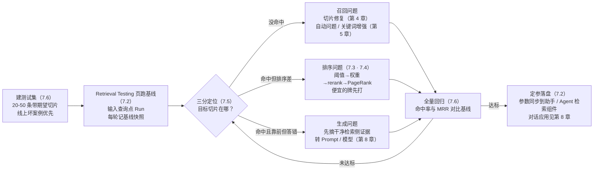
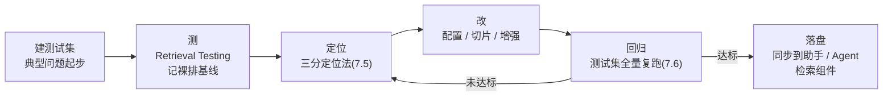
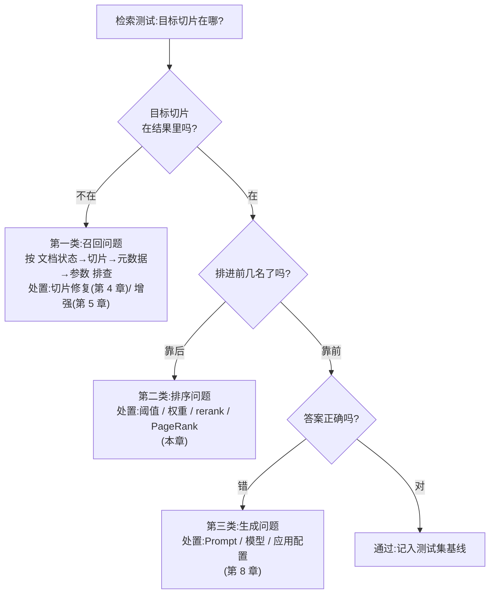

# Chapter 7 Retrieval testing and tuning

> Chapter guide: the three kinds of documents in after-sales-kb are parsed, chunked, and in the index, and the support team is ready to put the After-sales Assistant (「售后助手」) online. The first day of the trial falls over: someone asks 「TWS 耳机充电仓保修多久」, and the system answers something other than what was asked. This is not a deployment problem. It is a retrieval-quality problem, and it does not show up on deployment day. It shows up inside real questions. This chapter moves "the chunks are in the index" forward to "retrieval you can trust": use the Retrieval Testing page to establish a bare-ranking baseline, learn to read the two weights of hybrid search, use PageRank to handle priority across multiple datasets, then use a three-way diagnosis to place every bad case into one of three root causes, recall, ranking, or generation, and finally settle the test questions into an evaluation asset you can regress. When you finish this chapter, you can: finish one round of retrieval tuning for a dataset, with a baseline; and, for any one bad answer, locate in three steps which class of problem it belongs to and which chapter to go back to in order to fix it.



*Operations flowchart for this chapter*

## When you need this

Three typical situations, and three ways to use this chapter.

**The documents are parsed, and you do not know whether retrieval quality is good enough.** Start with 7.2 (the Retrieval Testing page), run one round with typical questions, and establish a bare-ranking baseline. The official documentation's own words are: running a retrieval test is never superfluous or redundant. Like calibrating a precision instrument, RAGFlow needs careful tuning before it can deliver its best question-answering performance (v1.0.0-rc2 docs, verified 2026-10-27).

**The retrieval results look wrong, and you do not know where to start.** Go straight to 7.5 (three-way diagnosis). First judge whether it missed, ranked poorly, or answered wrong. The fixes for the three classes are completely different, and mixing them only wastes time.

**Several datasets are attached together, and one of them can never outrank the others.** See 7.4 (PageRank). This is the dataset-level ranking lever, and the division of labor with chunk-level repair is in this section.

Prerequisites: parsing and chunking from chapter 4 (one of the three root causes is fixed there); Extractor enrichment from chapter 5 (the other hand for strengthening recall).

## 7.1 Overview: the tuning loop

State the position first: **retrieval quality is operated into existence, not deployed into existence.** Deployment only guarantees that "the path is connected": the query goes out, and chunks can come back. Operations are what guarantee that "the lookup is accurate": the right chunk stably ranks in the place the user needs. The first is what chapter 2 delivers. The second starts in this chapter and runs through the long-term work of chapter 13.

The RAGFlow official documentation writes this position down as an operating recommendation: after documents finish parsing, first test with typical questions in Retrieval Testing, confirm that the recalled chunks are correct, the content is complete, and the ranking is reasonable, and only then use the dataset for chat (Chat), search (Search), or an agent (Agent). It is also a debugging tool: if the correct chunk can already be recalled and the answer is still unsatisfactory, the problem is in the model, the prompt, or the application configuration; if the target chunk was not recalled at all, the problem is in document parsing, chunking, metadata, and retrieval parameters.

A complete round of tuning is a loop, not a straight line:



*The retrieval tuning loop*

Two conventions among the five steps have to be set down first:

- **"Measure" always comes before "change".** Have a baseline before any parameter adjustment, or you cannot say whether the change made things better or worse. The official documentation stresses the same point: test repeatedly with multiple representative queries, and set the parameters from the overall recall, rather than tuning the configuration from a single test.
- **"Change" has three layers, and the further forward a layer is, the higher its cost.** Retrieval configuration (this chapter) changes sliders and switches. Chunks (chapter 4) and enrichment (chapter 5) change the data itself, and that requires parsing again. The generation side (chapter 8) changes the prompt and the model. If an earlier layer can solve it, do not drag it into a later layer.

Five terms that recur in this chapter are defined here, once:

| Term | English | One-sentence definition |
|------|---------|-------------------------|
| Dataset | Dataset | The carrier of a knowledge base, and the basic unit of retrieval (the v1 rename of the v0 term 「知识库」) |
| Chunk | Chunk | The smallest retrieval unit that parsing produces |
| Retrieval Testing | Retrieval Testing | The page, inside a dataset, that checks whether a query can recall the expected chunk |
| Rerank | Rerank | Use a rerank model to recompute relevance for candidate chunks, then sort them |
| Hybrid Search | Hybrid Search | Weighted keyword similarity and weighted vector similarity (or a rerank score) together decide the composite score |

## 7.2 The Retrieval Testing page: a lab bench and its six knobs

### Entry and prerequisites

The entry is **Retrieval Testing** on the dataset details page. There is only one prerequisite (official Tip): documents used for testing must have finished parsing and be in the enabled state. The page is split in two. The **Setting** area on the left holds the parameters and the test input. After you enter a query, click **Run** to execute. The **Results** area on the right shows the results. Each row contains the recalled chunk content, the relevance information, and the source document, sorted by the current retrieval configuration, with the result total at the top. When a dataset has many documents, the **File** filter at the top right of Results can show recall for only one document.

The official guidance has one suggestion about the query itself: use questions close to how a real user phrases them, and prepare several types of queries. That suggestion is the seed of the test set in 7.6.

### The parameters, one by one

The adjustable parameters in the Setting area are as follows (taking the v1.0.0-rc2 docs as the authority, verified 2026-10-27):

| Parameter | What it does | Direction and effect | Default |
|-----------|--------------|----------------------|---------|
| Similarity threshold | Filters out chunks whose composite similarity is below the threshold | Raise it: the recall range narrows and the results get stricter, but useful content may be missed. Lower it: the range widens and irrelevant results increase | `0.2` |
| Vector similarity weight | The share of vector similarity in the composite score. The remaining weight goes to full-text/keyword similarity | Setting it to `0.3` means vector takes `0.3` and full-text takes `0.7`. The tradeoff is in 7.3 | `0.3` |
| Rerank model | Further computes relevance for candidate chunks and sorts them. The rerank score joins the composite score | Not selected: keyword similarity + vector cosine similarity. Selected: keyword similarity + vector rerank score. **It noticeably increases response time** | Not enabled |
| Cross-language search | Select one or more target languages. The system translates the query with the default chat model, then matches | The target language must really exist in the dataset. If none is selected, retrieval stays in the current language and may miss relevant content in other languages | Not enabled |
| Metadata | Restricts the retrieval range by metadata conditions | Once set, retrieval runs only inside chunks that meet the conditions. The subject of sample three in 7.7 | None |
| Top | The maximum number of candidate results returned | Choosing Top 10 returns at most 10 chunks that meet the conditions. Adjust it when you want to see more or fewer candidates | Not stated in the docs |
| Use Knowledge Graph | Brings the graph's entity descriptions, relation descriptions, and community-report chunks into retrieval | Meaningful only for a dataset whose graph was built successfully. **Graph chunks use only vector cosine similarity and do not go through hybrid search.** Noticeably increases response time | Off |

A note on the last two rows: the official documentation does not state a default for Top, and this book does not invent one. Generation of knowledge-graph chunks is in chapter 6. This table only cares about their ranking behavior when they take part in retrieval. They are an exception to the hybrid-search rules.

On the rc2 screen, the table above looks like this. Screenshot measured on 2026-11-04, RAGFlow v1.0.0-rc2 deployed with Docker on this machine: a full view of the parameters in the Setting column on the left of the Retrieval testing page. The Results column on the right is still the empty state "No test has been run yet". The test has not started.


rc2 presents the hybrid weight as **Keyword similarity weight**, one slider with full-text 0.70 labeled at one end and vector 0.30 at the other. The "vector similarity weight 0.3" in the parameter table is the vector 0.30 here. The two wordings are the same fact: the two paths complement each other and sum to 1. The explanatory text at the top of the screen is the original wording of the Note in "Key behavior: test parameters are not persisted" below: changes are not saved automatically, and must be applied to the chat assistant or the Retrieval agent component settings. There is one other discrepancy with the body, recorded as it stands: 7.3 says Rerank candidates is "a parameter that does not exist on the Retrieval Testing page", but the rc2 measurement puts it directly in the test page's Setting (default 64). The parameter surfaces of the test page and the application side are partly aligned in rc2, so 7.3's reminder to "check the candidate pool when you carry settings over" is correspondingly lighter, but the discipline that the application side still has to be configured separately does not change.

### How the composite score is calculated

Before you can make sense of tuning, look at what the composite-score formula looks like. The official documentation gives one measured example: in hybrid search with no rerank model, composite score = weighted keyword similarity + weighted vector cosine similarity:

```text
综合相似度 28.56 = 25.17(词项相似度)× 0.7 + 36.49(向量相似度)× 0.3
```

After you switch in a rerank model, the vector-cosine term is replaced by the vector rerank score. This formula decides where each knob acts: the threshold gates the final composite score, the weight allocates how much say the two similarities have, and the rerank model replaces the scorer on the vector side.

Outside that official worked example, this book recomputed the same formula on a real run. Screenshot measured on 2026-11-04 in the same environment: on the Retrieval testing page, enter the query 「退货时限是几天」 and click Run. The Results column on the right returns 5 rows.


The first hit is exactly the 「退货时限是几天」 row of product-faq.xlsx. It has the four-column table shape Title/Content/Category/Year, and the content column gives the answer 「自签收之日起 30 个自然日内可无理由退货」. The second is clause 2.2 of the policy handbook, on cross-border orders (Hybrid 41.00). The scores can be recomputed row by row: 0.7×31.51+0.3×80.62=46.25, and the second row 0.7×24.10+0.3×80.42=41.00. The composite-score formula above is fulfilled on real data, and the query keywords are also marked with a cyan highlight in the results.

### Running a baseline and recording it

The operation itself is minimal (the official steps are just two): enter a query in the Setting area, click **Run**, and read the results in the Results area. If you are not satisfied, adjust the parameters above and run again. The real work is in the record. **This book's position: every round of testing leaves a baseline snapshot, or "test repeatedly" degenerates into "poke at it repeatedly".** A snapshot contains at least this table:

| Item recorded | Content | Use |
|---------------|---------|-----|
| Question text | A query close to how a real user phrases it | Seed of the test set in 7.6 |
| Expected chunk | The chunk a person has confirmed should hit (it can be located to a document) | The basis for scoring: whether it hit, and what the rank is |
| Actual rank | The rank of the expected chunk under this round's configuration. If it did not enter the results, record "—" | The first signal for locating the problem, fed straight to the three-way method in 7.5 |
| Configuration snapshot | This round's values for threshold / weight / rerank switch / Top | The baseline for regression comparison. Prevents "where did I tune it to" amnesia |
| Class | The class assigned by the three-way diagnosis (7.5) | After you roll them up, you can see how the problems are distributed |

The first baseline for after-sales-kb is exactly this table: 32 questions, configuration snapshot `0.2 / 0.3 / no rerank`, which produced the three failed samples that 7.7 walks through. There is nothing ceremonial about the baseline record itself. It is a plain ledger. But the regression in 7.6 depends on it entirely.

### Key behavior: test parameters are not persisted

This is the most important official Note on this page, and it gets a section of its own: **parameter changes in Retrieval Testing apply only to the current test, and they are not synced automatically to the chat assistant (Chat Assistant) or to an Agent.** Once suitable parameters are settled, they must be configured separately in the application that actually uses the dataset, or in the **Retrieval** component (pointing to chapters 8 and 10).

**This book's position: treat Retrieval Testing as the lab bench, and treat application configuration as the production line.** Optimal parameters tuned on the lab bench, and never carried onto the production line, are the same as not having tuned them. And "tuned it, then forgot to carry it over" is exactly the most common way this falls over: the test page looks perfect, and what runs after launch is still the default parameters. The last step of the tuning loop in 7.1, "persist", exists specifically to prevent that.

### What to look at in the results

The official list of what to look at in the results has six points. This book groups them by use into three groups:

| Group | Official points |
|-------|-----------------|
| Whether recall is right | Whether the target chunk was recalled successfully; whether the needed content was excluded by metadata or another filter |
| Whether the source is right | Whether the recalled chunk comes from the correct document; whether the chunk content is relevant to the query and contains the information needed to answer |
| Whether the ranking is good | Whether highly relevant content appears near the front; whether a large number of chunks unrelated to the query were recalled |

The official documentation has one more methodological sentence worth recording on its own: **the point of a retrieval test is not to compare some one-off score in isolation, but to confirm that, under the current retrieval configuration, the needed chunk can be recalled accurately and ranked reasonably.** A score means something only in a comparison. That is exactly the theoretical basis of the regression test in 7.6.

## 7.3 Reading hybrid search parameters: weights and rerank

### Two similarities, two strengths

In hybrid search, vector similarity and keyword (full-text) similarity are two complementary paths. The official documentation gives a clear scenario description of how the work is divided:

| Similarity | What it is good at | Typical scenario |
|------------|--------------------|------------------|
| Vector similarity | Semantic match: different wording can still hit | The user asks in spoken language, and the document is written language (「东西坏了想退钱」 ↔ 「退货退款政策」) |
| Keyword/full-text similarity | Literal match: an exact hit on a proper name, product model, identifier, or fixed term | Model-number queries (「TWS- Pro 3」), error codes, industry terms |

The corresponding weight tradeoffs:

| Symptom | Adjustment | Reason |
|---------|------------|--------|
| Spoken questions hit poorly, and literal-match noise ranks in front instead | Raise the vector weight | The user's wording differs a lot from the source text, so the semantic side should have more say |
| Model-number and code queries hit inaccurately, and semantically close "near-answers" get in the way | Lower the vector weight | This kind of query depends on an exact literal match, and semantic similarity is the interference |

**This book's position: start from the default `0.3`, probe both ends, then converge.** There is no theoretical optimum for the weight, but trial and error has a cheap path: on the test set, run the two ends `0.1` and `0.5`, compare the direction the hit rate moves, then converge toward the better direction. That is much faster than nudging one notch at a time by feel. The value after-sales-kb settled on in practice is in sample two of 7.7.

### The rerank model: bare-ranking baseline first, then rerank

The official description of the rerank model is restrained: it can further improve final ranking quality, but it introduces an extra model call and **noticeably increases response time**. Once enabled, the composite score changes from "keyword similarity + vector cosine" to "keyword similarity + vector rerank score".

**This book's position: rerank is the last card for a ranking problem. Play out the cheap cards before you play it.** The order should be:

1. First, under bare ranking with no rerank, get the weight and the threshold into place, and record the baseline. This step is free.
2. If, under bare ranking, the target chunk can enter the top few but cannot take first place, then turn rerank on and compare.
3. Keep it only when the gain on the ranking metrics (7.6) is worth the latency cost. Question-answering applications are sensitive to time to first token. Search applications are sensitive to ranking quality. The tradeoff changes with the application type.

### An extra knob on the application side: Rerank candidates

When you carry a test conclusion into an application, you meet a parameter that does not exist on the Retrieval Testing page: **Rerank candidates**, inside the retrieval settings (Search Settings, the configuration on the search-application side, expanded in chapter 9). It sets the number of candidate chunks that enter the rerank stage. Setting it to `100`, for example, means at most 100 candidate chunks enter the later rerank. The official adjustment guidance: turn it up, and the candidate pool grows, so highly relevant content is less likely to be missed at the first-pass stage, but processing cost increases. Turn it down, and it is faster, but a small candidate pool may miss relevant content. For a large knowledge base, or when you need broader retrieval coverage, you can turn it up somewhat.

**This book's position: for an application with rerank turned on, when you see the sign that "the target chunk can clearly enter the first pass, yet it is not in the final results", check the candidate pool first.** A candidate pool that is too small blocks the target chunk before rerank, and the rerank model never gets a chance to see it. This is one hidden source of "rerank works on the test page, and rerank in production works only sometimes": the parameter surfaces of the test page and the application side are not fully aligned, so when you carry a conclusion over you have to check the candidate pool along with it.

Remember one exception: **knowledge-graph chunks do not play this game.** Whether rerank is on or off, graph chunks are retrieved with vector cosine similarity only (official documentation). While tuning, do not take the rank of a graph chunk as a signal about hybrid search.

## 7.4 Multi-dataset retrieval and PageRank

### Multiple datasets on the application side

Retrieval Testing is a test inside one dataset. On the application side (a chat assistant, Search, and the retrieval component of an Agent), several datasets can be attached at once, and the system retrieves from every selected dataset at the same time. The official documentation then gives one constraint: choose datasets by purpose, and avoid attaching a large number of knowledge bases unrelated to the topic. That only adds irrelevant results. The way after-sales-kb is split (policy handbook, FAQ, and shipping notices in separate datasets) is exactly so each application can combine them as needed.

Searching several datasets at once immediately brings a new problem: both datasets recalled chunks that look equally relevant. Which one ranks in front? Chunk-level tuning can no longer manage that. You need a dataset-level ranking lever.

### PageRank: a dataset-level bonus

The definition in the official Configuration documentation: PageRank sets the dataset's PageRank score. At retrieval time, that score is **added onto the hybrid similarity score of matching chunks in that dataset**, raising their ranking weight. It applies, when several datasets are retrieved together, to the case where the content of some datasets needs higher priority.

Three points decide the boundary of where it applies:

- **It is dataset-level.** It acts on every chunk of that dataset, and the grain is coarse. It fits a demand such as "the shipping-notice dataset as a whole should rank ahead of the FAQ dataset". It does not fit "one particular chunk inside the FAQ dataset should rank ahead". That is a job for the weights in 7.3, or for chunk repair in chapters 4 and 5.
- **It is a bonus.** It stacks on top of hybrid similarity, it does not change the meaning of the threshold or the weights, and it is a pure comparison bias.
- **You should move it only when you have evidence.** The official documentation gives no numeric recommendation. What follows is This book's position.

### What value to set: This book's position

1. **Start from 0.** Do not intervene by default. First look, on the test set, at the hit distribution of each dataset. Most knowledge-base combinations do not need PageRank.
2. **Turn it up only with systematic evidence.** The shape of the evidence: queries against one dataset have a low hit rate overall, and the business says that dataset should come first (for example, time-sensitive shipping notices have the highest priority for support questions and answers).
3. **Small steps, plus regression.** Move the PageRank of only one dataset each time, and after the move run the regression in 7.6. What it squeezes is the rank of the other datasets. You must confirm you did not push someone else off a cliff.
4. **Record every adjusted value and the regression result.** This ledger is an input to the quality inspection in chapter 13.

See the four ranking levers together, and the work divides like this:

| Lever | Grain | What it solves | Chapter |
|-------|-------|----------------|---------|
| Metadata filtering | Retrieval range | Keep content that should not take part in retrieval on the outside | 7.7 of this chapter / chapter 8 |
| Similarity threshold and weights | Query level | How tight or loose one query's recall is, and how much say the two paths have | This chapter |
| Rerank model | Query level | Fine ranking inside the candidate pool | This chapter |
| PageRank | Dataset level | Priority among datasets when several are searched together | This chapter |

## 7.5 Three-way diagnosis for retrieval quality

The four sections above gave the tools. This section gives the method. The debugging order in the official documentation is **document status -> chunk -> metadata -> retrieval parameters**: first confirm that the knowledge content itself entered the dataset correctly, then tune the retrieval parameters. That locates the problem fastest. This book unfolds that order into a decision model you can pin to the wall. For any "retrieval looks wrong", first ask where the target chunk is. There are only three answers, and each one corresponds to one class of root cause, one set of actions, and one chapter as the main reference.



*Three-way diagnosis decision flow*

### One table for the three classes: a decision table you can pin to the wall

| | Class one: no hit | Class two: a hit, but a poor rank | Class three: a hit near the top, but the answer is wrong |
|---|-------------------|------------------------------------|----------------------------------------------------------|
| **What the evidence looks like** | A person can find the target content, but it is not in the Results area; or the whole page is nearly empty | The target chunk is in the results, but it ranks outside the top 5; the front is occupied by irrelevant or weakly relevant chunks | The target chunk is rank 1, the content contains the answer, and the final answer is still wrong or answers something other than what was asked |
| **Problem layer** | Recall problem | Ranking problem | Generation problem |
| **Common root causes** | The document did not parse successfully; the chunk was not generated or was cut badly; metadata filtering is too strict; the threshold is too high; Top is too small (the official list) | Weights are mismatched; the threshold is too low and lets in a large amount of noise; bare ranking is not strong enough when there is no rerank; there is no priority among datasets when several are searched together | Defects in prompt design; the model is not capable enough; a context-assembly problem; an application-configuration error |
| **Action** | Debug in the official order: document status -> chunk -> metadata -> parameters. Chunk-level repair goes back to chapter 4. Automatic questions, keywords, and context enrichment go back to chapter 5 | Adjust the threshold to squeeze out noise; adjust the weights to change who has the say (7.3); turn on rerank for fine ranking (7.3); in a multi-dataset scenario set PageRank (7.4) | Turn to the generation side: check the prompt, change the model, check the application configuration. That is chapter 8's job |
| **Repair cost** | High (you touch the data, and you may have to parse again) | Low (you touch the configuration, and it takes effect immediately) | Medium (you touch the prompt or the model, and you need session-level verification) |

The value of this table is in the criterion for class three: **only when the evidence on the retrieval side is clean can you assign the problem to the generation side.** The official documentation records a real case (issue #5627): a problem that was investigated for a long time was finally located as an LLM capability limit. Being able to confirm that "the correct chunk can be recalled" is the precondition for turning attention elsewhere. If class one and class two of the three-way diagnosis have not been ruled out, you are not entitled to a class-three conclusion.

### Class one: no hit. First prove the knowledge is in the dataset

Evidence collection has a fixed method. First use the File filter in the Results area to see whether the target document has zero recall, then go through the source document by hand and confirm that the target content really exists. Those two steps draw the boundary of the problem (whether it is "in the dataset but not findable" or "not in the dataset at all"). Then follow the official order: document status -> chunk -> metadata -> retrieval parameters. The official list of common root causes is already given: the document was not parsed, there is no usable chunk, metadata filtering is too strict, the similarity threshold is too high, Top is too small.

Two pieces of experience (This book's position): **do not skip "document status" and jump straight to tuning parameters.** When a document did not parse successfully, any combination of parameters is a wasted move. **Watch for the hidden form of a chunk that was cut badly.** The content is clearly in the dataset, yet it always shows up as a "fragment-level hit", and the recalled fragments cannot be pieced into a complete answer. That is really a chunk-quality problem from chapter 4. Parameters will not tune it out. Go back and fix it on the chunk method and the Chunker parameters.

### Class two: a hit with a poor rank. Play the cheap cards first

The evidence for this class is in the rank numbers, and the magnifying glass is the composite-score formula in 7.2: split open the front-rank scores of one test (term score × weight + vector score × weight), and see which path lifted an irrelevant chunk up and pressed the target chunk down. Chunks that are literally dense but irrelevant occupy the front -> the keyword path has too much say, so lower the keyword weight or raise the threshold. A target chunk whose scores are not high on either path -> an expression problem. Go back to the class-one enrichment actions (automatic questions / keywords) instead of grinding on the parameters.

The order of play follows cost: **threshold -> weight -> rerank -> PageRank**. Play the cheap card first, and run one regression (7.6) every time you play a card. Rerank and PageRank are both cards with a cost. The former adds latency. The latter squeezes the other datasets. Playing a card needs evidence behind it.

### Class three: a hit near the top, but the answer is wrong. Clear the retrieval side first

Before you turn to the generation side, three pieces of evidence must all be present: the target chunk ranks 1st; the chunk content really contains the answer; and, among the chunks that entered the context in the same round, there is no "near rival" that would interfere with the answer (an old version, an adjacent clause, a similar FAQ). The third item is the easiest to skip, and it is exactly where misjudgment clusters. In sample three, old-version and new-version chunks share the round. On the surface it is "the model is making things up". In fact the context is contaminated: the model draws lots between the two versions, and drawing the wrong one is not a capability problem. Only after the retrieval side is cleared do you turn to chapter 8, and you take an evidence pack with you (the original query, the list of hit chunks, and the final answer), so the investigation on the generation side does not have to start from zero.

### Three rules of use

- **Change only one variable at a time.** If you adjusted the weight and switched rerank and changed the threshold, then even when regression passes you do not know whom to thank, and the next time it falls back you do not know whom to guard against.
- **Each class of problem goes back to its own chapter to be fixed.** Class one goes to chapters 4 and 5, class two stays in this chapter, and class three goes to chapter 8. Fixing across layers at random is the main reason tuning sinks into the mud.
- **After the fix, you must regress** (7.6). A fix often pushes one problem down and lets another bob up: raising the threshold saved you from the noise, and may have killed recall for queries on the margin.

## 7.6 Test-set accumulation and regression

### The test question set is an evaluation asset

7.2 mentioned the official suggestion "several classes of representative queries, test repeatedly, set the parameters from the whole". The implied precondition is that you hold a fixed set of questions. **This book's position: this set of questions is not a consumable of testing. It is an evaluation asset of the knowledge base**, with the same standing as a codebase's test suite. Without it, every parameter change is by feel. With it, every change has proof that you "did not change what used to be right into something wrong".

The three sources of test questions, ordered by value:

| Source | example (after-sales-kb) | Character |
|--------|--------------------------|-----------|
| Real questions from production | Bad cases actually typed by support (all three samples in 7.7 come from here) | The most realistic, and the densest in bad cases; settled from online traces (chapter 12, the Langfuse book) |
| High-frequency questions from the business side | 「退货要运费吗」 and 「充电仓保修多久」 | Covers the core business paths. The business side can provide them directly |
| Historical tickets / original FAQ questions | The question column of the FAQ table itself | A zero-cost way to start, suitable for a cold start |

**A starting size of 20-50 items is enough** (This book's position). That is enough to block most configuration regressions. Better to guarantee that every item has an "expected chunk" a person has confirmed than to chase something large and complete. after-sales-kb started with 32 items, every one annotated with an expected chunk.

The way the test set is organized is equally plain. Each record has five fields (This book's position):

| Field | Role |
|-------|------|
| Question text | Keep the user's original phrasing. Do not rewrite it into formal written language. Rewriting would damage how well it represents the real query distribution |
| Expected chunk | The chunk a person confirmed should hit. The only basis for scoring a regression |
| Source | Settled from production / high frequency in the business / cold start. Used to judge the coverage of the test set itself |
| Question type | Recall-sensitive (spoken questions) / literal-sensitive (model numbers and terms) / version-sensitive (content that involves timeliness). Corresponds directly to the weight tradeoff in 7.3 and the version filter in 7.4 |
| Date added and current conclusion | Ledger fields. Input to the inspection in chapter 13 |

The "question type" field is worth one more sentence. It is the bridge between the test set and the tuning action. How the weight should move depends on which of two classes of questions rises and which falls. Whether the version filter has a leak, you find out by running the version-sensitive subset once. Without this field, regression can only give one total score, and it cannot locate which kind of capability regressed.

### Regress after every change

When regression is triggered: a retrieval-parameter adjustment, the rerank switch, a PageRank change, a document update or a reparse, a chunk-method adjustment. The last two are often ignored, and they are exactly what changes the chunk itself, the easiest way to quietly break retrieval (the reparse convention in chapter 4).

How to run a regression, in four steps (This book's position):

1. **Rerun the full set.** Run every test question against the baseline configuration snapshot. Do not sample. The point of regression is "turning over the whole old ledger". Sampling misses regressions on the margin.
2. **Compare with the baseline.** Compare, item by item, how the expected chunk's rank changed, produce the hit rate and the MRR, and lay them side by side with the previous round.
3. **Classify the failures.** Classify the questions that got worse by the three-way method in 7.5. Dropping out of the results is a class-one signal. A rank that slides is a class-two signal. Only after they are classified do you know whether the change should be rolled back or a companion action should be added.
4. **Archive it.** Record what changed this time, the parameter values, and the regression conclusion in the ledger (the source voucher for the inspection in chapter 13).

One special case deserves a rule of its own: **after documents are reparsed, fix the test set first, and only then talk about regression.** Reparsing may change chunk boundaries. The expected chunk itself gets split, merged, or moved to a different place. At that point the mapping "question -> expected chunk" fails as a whole, and running regression directly only produces a pile of false alarms. The right order is to check, by hand, the expected chunks of the affected items, update the test set, and only then run the full set.

### Starting metrics: hit rate and MRR

The official documentation does not define evaluation metrics. The following choice of metrics is **This book's position**: at the start you only need two numbers. Do not roll in a full RAG evaluation framework on day one.

| Metric | Definition | Starting suggestion |
|--------|------------|---------------------|
| Hit rate (Recall@K) | The share of test questions whose expected chunk appears in the top K | Look at Recall@top_n first. If it is not met, class-one and class-two problems have not been cleared |
| MRR (mean reciprocal rank) | Take the reciprocal of the expected chunk's rank for each question, then the average | Measures "how near the front". Below 0.5, consider rerank or a weight adjustment first |
| Noise ratio | The share of irrelevant chunks in the front ranks | An observation item. When it is too high, raise the threshold first, then consider rerank |

The position of watching only two numbers is not laziness. The three-way diagnosis has already translated "the metric is bad" into concrete actions. An inflated set of metrics only postpones getting started.

### How online traces and offline tests divide the work

Offline tests (this chapter) and online traces (chapter 12, the Langfuse book) are not substitutes for each other. They are the two halves of a closed loop. **The offline test is the gatekeeper before a configuration change**, answering "is this version of the configuration better than the last one". **The online trace is the scout of the real distribution**, answering "have real users' questions fallen outside what the test set covers". New bad cases the scout finds settle into the test set and become the exam questions for the next round of gatekeeping. The test set therefore keeps growing. That is where "retrieval quality is operated into existence" lands, in the mechanism. How often to inspect, and who is responsible, is agreed in chapter 13.

## 7.7 Running case: three failed samples in after-sales-kb

In one round of testing before launch, the 32-item test set of after-sales-kb exposed three typical failures, one on each class of the three-way diagnosis. The overview comes first, then the walkthrough one by one:

| Sample | Question | What happened | Class | Root cause | Where the fix points |
|--------|----------|---------------|-------|------------|----------------------|
| One | 「TWS 耳机充电仓保修多久」 | The target FAQ row is not in the results at all | Class one: recall | The question column of the FAQ table chunk does not cover 「充电仓」 | Chapters 4 and 5 |
| Two | 「退货要运费吗」 | The target chunk hits, ranked 9th | Class two: ranking | A vector weight of 0.3 suppressed the semantic match of the spoken question | 7.3 of this chapter |
| Three | 「耳机保修期政策」 | The target chunk is 1st, but the production answer cited an outdated 2024 clause | A variant of class two, plus missing governance | Old and new document versions coexist, with no version metadata and no filter | Chapter 13 |

### Sample one: no hit. An FAQ table-chunk problem

**What you see**: In the product FAQ dataset built in chapter 4 (XLSX, about 200 rows, Table parsing, one chunk per row), testing 「TWS 耳机充电仓保修多久」 puts no FAQ row in the Results area. Everything returned is a clause chunk from the policy handbook about whole-device warranty.

**Walk the three-way method**: The target chunk is not in the results, so this is class one, a recall problem. Debug in the official order. Document status: the FAQ is parsed and enabled, and it has chunks (ruled out). Metadata: no filter is set (ruled out). Retrieval parameters: the threshold `0.2` is the default, and it does not count as high (ruled out). Chunk: a hand check of the table confirms that 「充电仓 6 个月」 is written in the answer column of some row, but that row's question column says 「耳机保修多久」. The query term 「充电仓」 has zero overlap with the chunk's question column. It does appear in the answer column, yet the composite similarity of the whole-row chunk is still pressed below the threshold.

**What to do**: This is a chunk-content problem, not a parameter problem. However you tune the parameters, you are only treating the symptom. Two actions: rewrite that row's question column so the high-frequency ways of asking (「充电仓」 and 「充电盒」) enter the question column (in-row governance for Table parsing, chapter 4); and, at the same time, turn on automatic-question (Automatic Questions) enrichment for the FAQ dataset, so the model fills in, for each chunk, the ways a user might ask (the Extractor, chapter 5).

**Regression**: After reparsing, rerun the test set. The target query hits at rank 1, the other 31 items do not regress, and the loop is closed.

### Sample two: a hit ranked 9th. A weight problem

**What you see**: Testing 「退货要运费吗」, the target chunk (the FAQ row 「退货运费谁承担」) is in the results, but ranked 9th. The front ranks are long return-policy chunks from the policy handbook. They do not contain a direct answer to 「运费谁出」. Their term score is high only because 「退货」 and 「运费」 appear densely in the literal text.

**Walk the three-way method**: The target chunk is in the results but far back, so this is class two, a ranking problem, and it belongs to this chapter. The evidence matches "literal noise overrunning a semantic hit": the query is a short spoken sentence, the need for a semantic match is high, and there are zero proper names. That is exactly the "raise the vector weight" scenario in the table in 7.3.

**What to do**: Raise the vector similarity weight from `0.3` to `0.5`, rerun this query, and the target chunk rises to 1st. Following the discipline in 7.3, first probe the two ends (`0.1` / `0.5`) to confirm the direction, then converge. **Rerank was not turned on first.** The last card for a ranking problem should not be the first one played. A problem bare ranking can solve is not worth paying latency for.

**Regression**: Rerun the full set. Across the 32 items the hit rate does not change, and MRR rises from 0.41 to 0.63. After checking the 3 literal queries (model numbers and error codes) one by one and finding no regression, the settled parameter is `0.5`.

### Sample three: a hit near the top, but the answer is wrong. A version-governance problem

**What you see**: Testing 「耳机保修期政策」, the 2026 clause chunk ranks 1st. The retrieval side looks perfect. But when it is connected to the After-sales Assistant (chapter 8) for a trial run, the answer cites the warranty period of the old 2024 policy. Test-set regression exposes more: every version-related question (5 in all) has a chance, in production, of citing the old version.

**Walk the three-way method**: Looking at a single query, it looks like class three (a generation problem). But a class-three conclusion requires the evidence on the retrieval side to be clean, and the evidence from test-set regression is not clean: old chunks of the 2024 policy handbook are still in the dataset and still take part in retrieval. Old-version and new-version chunks enter the context at the same time, and the generation side "draws lots" between the two versions. This is a variant of class two (the old version steals the rank) stacked with missing governance (the old document was not taken down). The root cause is not on the generation side.

**What to do**: Three steps. Add version metadata to the documents (for example a version number and an effective date; the metadata mechanism is in chapter 3). Set a Metadata filter in the application-side retrieval settings, so only the version currently in effect takes part in retrieval (the Metadata parameter in 7.2 of this chapter; the assistant-side configuration is in chapter 8). Put the takedown and archive flow for old-version documents into the knowledge-base update SOP. That is an operations-mechanism problem, expanded in chapter 13.

**Regression**: After the filter takes effect, rerun. All 5 version-related questions stably cite the 2026 version. "The old-version chunks were filtered out" did not affect the other queries. **The lesson of this sample: one test passing does not mean the system has no problem. Test-set regression is what turns "an occasional draw of lots" into "evidence that always reproduces".**

With the three samples fixed, the settled parameters of after-sales-kb (weight `0.5`, threshold `0.2`, no rerank, version-metadata filtering) are persisted, in sync, into the retrieval configuration of the After-sales Assistant. The "not persisted" warning in 7.2 is fulfilled here. The prompt and the model choice on the generation side are taken over by chapter 8.

## Chapter summary

1. **Retrieval quality is operated into existence, not deployed into existence.** The official recommendation is to test after parsing is finished, then put it into use. Tuning is the loop "build a test set -> measure -> locate -> change -> regress", not a one-time action.
2. **Retrieval Testing is the lab bench**: six parameters (threshold / weight / rerank / cross-language / metadata / Top) are tried over and over. **Test parameters are not persisted.** Once they are settled, they must be configured separately on the chat assistant or on the Agent's retrieval component.
3. **Hybrid search = weighted keyword similarity + weighted vector cosine (or a rerank score).** Raise the vector weight for spoken queries, and lower it for model-number and terminology queries. Rerank is the last card for ranking: take a bare-ranking baseline first, then compare. Knowledge-graph chunks go through vector cosine only.
4. **PageRank is the dataset-level ranking lever.** When several datasets are searched together, add points to the dataset that should come first. Start from 0, turn it up a little only when there is systematic evidence, and regress after every move.
5. **Three-way diagnosis**: no hit -> a recall problem (chapters 4 and 5); a hit with a poor rank -> a ranking problem (this chapter); a hit near the top but a wrong answer -> a generation problem (chapter 8). Only when the evidence on the retrieval side is clean are you entitled to call it class three.
6. **The test question set is an evaluation asset.** Start with 20-50 items that carry an expected chunk. Regress the full set after every change. At the start, look only at hit rate and MRR. Bad cases found by online traces flow back into the test set and close the operations loop.

Parameters and chunks are both tuned. The next step is to turn that into an application the user actually talks to: **chapter 8**, chat assistants and sessions.

## Acceptance checklist

By the time you reach here, you should be able to:

- ☐ Run one complete tuning round for an after-sales-kb-style dataset: build a test set, record a bare-ranking baseline, tune the parameters, regress, and persist them into the application configuration;
- ☐ Say what a hybrid-search composite score is made of, and explain who the other `0.7` belongs to when the vector weight is set to `0.3`;
- ☐ For a concrete scenario (a spoken consultation vs a model-number query), judge whether the vector weight should go up or down, and give the reason;
- ☐ Use the three-way diagnosis to classify one bad answer, and point to which chapter each class should go back to for the fix;
- ☐ State PageRank's grain and the boundary of where it applies, and the basis for "start from 0, and turn it up only with evidence";
- ☐ Build a regression test set of 20-50 items for a knowledge base, and use hit rate and MRR to produce two baseline reports that can be compared.

## Further reading

- **Chapter 4 (parsing and chunking).** The repair site for class one, "no hit": choosing a chunk method and the Chunker parameters.
- **Chapter 5 (retrieval enrichment and indexing).** The other hand for strengthening recall: automatic questions, automatic keywords, and choosing index fields.
- **Chapter 8 (chat assistants and sessions).** Where the tuning result is persisted: assistant-side retrieval parameters, the prompt, and the model. The site where class three, "wrong answer", is handled.
- **Chapter 13 (team collaboration and knowledge-base operations).** Where the test-set ledger, the PageRank adjustment log, and the inspection SOP come to rest.
- **Official documentation: Retrieval Testing / Search Settings / Dataset Configuration.** The source of every parameter behavior and default in this chapter (v1.0.0-rc2, verified 2026-10-27).

## Review checklist (before publication)

- [ ] Check the whole chapter against the original text of retrieval_testing.md, search_settings.md, configuration.md (the PageRank and Basic Information sections), and notes_and_faqs.md (the retrieval section) (source material verified 2026-10-27)
- [x] Outside the official worked example "composite score 28.56", recomputed on a real run on 2026-11-04: the scores of two results for the query 「退货时限是几天」 are 0.7×31.51+0.3×80.62=46.25 and 0.7×24.10+0.3×80.42=41.00 (screenshot in 7.2). The formula is fulfilled on real data
- [x] The Retrieval Testing page in 7.2 and part of the UI path in 7.7 were measured on 2026-11-04 (screenshots in this chapter). The walkthrough of the Metadata filter configuration is still to be added
- [x] The Top parameter: the chat-assistant-side Top N default of 8 has been confirmed by measurement (consistent with the table in 8.4.2 of the body). The default reading of the same-named field on the retrieval test page is still to be added
- [ ] The Example numbers for MRR / hit rate (0.41→0.63) are values set for the case, not measured data. They are already stated in the body in the voice of the running case. Confirm there is no ambiguity
- [ ] A screenshot of the configuration entry, on the Agent retrieval component (Retrieval component) side, for "test parameters are not persisted" is still to be added (cross-check in chapter 10)
