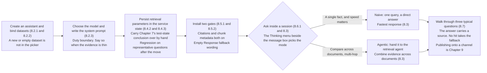
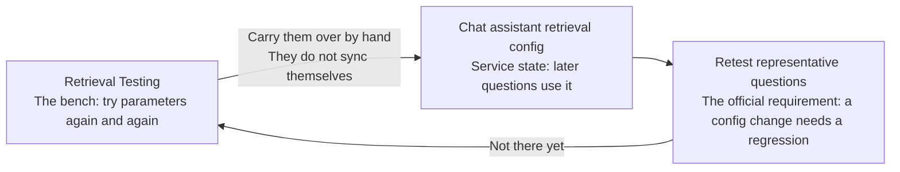

# Chapter 8 Chat assistants and sessions

> Chapter guide: at the end of Chapter 7, the retrieval parameters of after-sales-kb (weight 0.5, threshold 0.2, no rerank) are settled and waiting to be carried over. But the question "carried over to where" does not have an answer until this chapter. A chat assistant is the conversation entry point RAGFlow hangs on a knowledge base: the support team does not have to understand what a chunk or hybrid search is. They open the chat window and ask. This chapter actually builds that entry point: create an assistant and bind datasets; write a system prompt with a clear boundary, forced citations, and fallback wording; understand which questions Naive and Agentic, the two thinking modes, each fit; persist the retrieval-tuning conclusions from the test state into the service state correctly; and finally walk through three typical questions and answers, to verify how "better no answer than a fabrication" plays out in the product. When you finish this chapter, you can: create and configure, on your own, a chat assistant that can go live; pick the right thinking mode and fallback strategy for your scenario; and write an after-sales assistant prompt at support-team grade.



*Operations flowchart for this chapter*

## When you need this

Three typical situations, and three ways to use this chapter.

**The knowledge base is built, and business colleagues need to use it directly.** See Section 8.2 and 8.3. Create a chat assistant, bind the datasets built in Chapters 3 to 5, pick the model, write the prompt, and the team immediately has a question-answering entry point.

**The retrieval parameters tuned in Chapter 7 do not seem to have taken effect after launch.** Go straight to Section 8.4. Parameters in Retrieval Testing apply only to that test. They are not persisted. Production parameters have to be configured separately in the chat assistant (or in the Agent's retrieval component).

**A support scenario, where a wrong answer is worse than no answer.** See Section 8.5 and 8.7. Citation display makes every conclusion traceable to the original text. Empty Response makes "nothing found" return preset wording, rather than letting the model improvise.

Prerequisites: Chapter 2 has already configured a chat model; the datasets from Chapters 3 to 5 have been parsed into usable chunks; Chapter 7 has finished one round of retrieval tuning (not having done it does not block you either; 8.4 explains the relationship of the two states, and you can go back and fill it in).

## 8.1 Overview: a conversation entry point on top of the knowledge base

The official definition of Chat, in one sentence: it is used to create a question-answering application based on datasets. After the datasets, the large model, the system prompt, and the retrieval parameters are configured, users can ask questions in the chat interface based on the dataset content (docs/guides/chat/feature_overview_and_creation.md, v1.0.0-rc2, verified 2026-10-27). It supports dataset retrieval, citation display, keyword analysis, multi-turn conversation optimization, cross-language search, Web search, and other capabilities.

Three roles in that sentence have to be kept apart. A dataset is the source of knowledge (Chapter 3). A chunk is the basic unit of retrieval and citation (Chapter 4). A chat assistant is the application layer that assembles the two into "a product that can hold a conversation". Terms for this chapter:

| Term | English | One-sentence role |
|------|---------|-------------------|
| Chat assistant | Chat Assistant | A conversation application attached to a dataset. The subject of this chapter |
| Dataset | Dataset | The carrier of knowledge. It bounds the assistant's retrieval and citation range (Chapter 3) |
| Chunk | Chunk | The basic unit of retrieval and citation (Chapter 4) |
| Retrieval Testing | Retrieval Testing | The parameter-tuning lab bench inside a dataset (Chapter 7) |
| Agentic mode | Agentic mode | The thinking level introduced in v1.0.0-rc2, replacing the old Low/Medium/High/Ultra (see Section 8.3) |

### Division of labor with canvas Agents

RAGFlow has two roads to a question-answering application: the chat assistant, and the canvas Agent (Chapter 10). The official documentation does not give a ruling table for "when to use which". The table below is Our recommendation:

| | Chat assistant | Canvas Agent |
|---|----------------|--------------|
| Form | A configuration-style application, ready to use | A flow orchestrated from components on the canvas |
| Fits | Single-turn and multi-turn knowledge Q&A: FAQ, policy, document retrieval | Complex tasks that have a flow to orchestrate: calling tools, branches, multi-step reasoning |
| Configuration cost | Low: pick datasets, write a prompt | High: components, wires, debugging |
| Speed to go live | Fast | Slow, but the capability ceiling is high |

**Our recommendation: for knowledge Q&A, start with a chat assistant. Move up to a canvas Agent after a need for flow orchestration has grown.** The after-sales domain of our running example is exactly this road: the After-sales Assistant in this chapter answers after-sales policy, and the "After-sales support Agent" in Chapter 10 orchestrates actions such as order lookup and a refund trial calculation on the same knowledge base.

Publishing outward (web embed, iframe, API) does not belong to this chapter. Access channels are gathered in Chapter 9. Programmatic integration is in Chapter 11.

## 8.2 Creation and dataset binding

### 8.2.1 Creation steps

The shortest path the official documentation gives is six steps (docs/guides/chat/feature_overview_and_creation.md):

1. In the left navigation, choose **Chat**;
2. Click **Create chat**;
3. Enter the assistant name;
4. Confirm creation;
5. Open **Chat setting**, and configure the datasets, the model, the system prompt, and the retrieval parameters;
6. Save the settings, and open the chat window to test it.

Two official reminders are worth noting first. **You do not have to finish every setting at creation time.** You can return to that assistant from the list at any time and keep configuring. **After you change the configuration, rerun the test with representative questions**, and confirm the new settings match what you expect. The first lowers the barrier to getting started. The second is the Chapter 7 discipline, "a change means a regression", continued at the application layer.

The three-piece set of basic information:

| Item | Use |
|------|-----|
| **Name** | The display name in the list, on the publish page, and in embed scenarios |
| **Avatar** | The assistant's avatar |
| **Description** | A short account of the purpose, the service scope, who it is for, and what the datasets cover |

### 8.2.2 Binding datasets

Datasets decide the range of data the assistant can retrieve and cite (docs/guides/chat/chat_configuration.md, v1.0.0-rc2). Three rules:

- One assistant can bind **one or more** datasets, and answers are retrieved within the range of the bound datasets;
- **A new or empty dataset generally does not appear in the selection list.** Only a dataset that parsed successfully and has usable chunks is a valid knowledge source (the parsing discipline of Chapter 4 is borne out here);
- A dataset that has been deleted, or that has no usable chunks, is marked **unavailable**, and you need to choose another.

The tradeoff of searching several datasets together was covered in Chapter 7: choose datasets by purpose, and avoid attaching a large number of datasets unrelated to the topic. That only adds irrelevant results. The three-dataset split of after-sales-kb (policy / FAQ / notices, see Chapter 3) was prepared exactly for combining them as needed.

There is also one official Tip that connects directly to the prompt: **if you want the answer to stand on the retrieved knowledge, consider keeping the `{knowledge}` placeholder in the system prompt.** It stands for the chunks this retrieval recalled.

### 8.2.3 System prompt and opening greeting

Two blocks on the configuration surface have to do with "wording", and their duties are completely different:

| | System prompt | Opening greeting |
|---|-------------------------------|-------------------------------------|
| Scope | **Model behavior across the whole conversation** | Only the initial content shown when the user enters Chat |
| What it can define | Role, answer scope, language and tone, how to use the datasets, answer format, how to handle missing information | What the assistant is for, the range of its capabilities, how to use it, Example questions |
| Official positioning | "Affects the whole conversation" | "Mainly provides an introduction and guidance, and does not control later answer behavior" |

The system prompt is the main subject of Section 8.7. Here, first record the four options the official documentation gives, and two disciplines. You can require the assistant to: answer in a specified language; stay concise and professional, or output in a specified format; **say so plainly when it cannot confirm from the information on hand**; refuse questions outside the current assistant's scope. The disciplines: the clearer the prompt, the more stable the behavior, and it has to be polished continuously on the basis of tests; **avoid settings that conflict with each other, and rules that are overly complex**.

Model choice (same document): models differ in context length, reasoning ability, response speed, tool-calling ability, and cost. Ordinary dataset Q&A prefers response speed. Complex analysis and synthesis across multiple documents choose a model with stronger reasoning. The models you can use depend on the models already added and configured in the system (the model channel in Chapter 2).

## 8.3 Agentic mode: investigate before answering

Record one version fact first: **v1.0.0-rc2 introduces Agentic mode for chat, replacing the old Low/Medium/High/Ultra thinking levels** (docs/release_notes.md, the v1.0.0-rc2 entry, released 2026-10-16; verified 2026-10-27). Splitting into four levels by "depth of thinking" is gone. Only two levels remain. The criterion has changed from "how deep to tune" to "whether to hand the turn to a retrieval agent".

### What actually differs between the two levels

The official definition (docs/guides/chat/chat_configuration.md): thinking mode decides how Chat investigates the data before it answers. "Retrieval" means searching for evidence before answering. If the assistant has datasets bound, it retrieves chunks. If Web search is on, or the current version provides PageIndex and Graph capabilities, those sources can also serve as supplementary evidence. **The final answer should be based on the retrieved content.**

| | Naive | Agentic |
|---|-------|---------|
| What it does | Retrieves directly, with no complex analysis | Hands the turn to a retrieval agent: it locates passages itself, reads documents in depth, and combines evidence across multiple documents |
| Fits | Direct factual questions whose identifier, term, or location appears explicitly in a document | Cross-document questions, comparisons, multi-step research |
| Speed | Generally one query, and the fastest response | Slower, and it calls the model more times |
| How it works with fallback and citations | Can be used together with Empty Response and citations | The judgment of an empty reply comes later (see Section 8.5.2) |

### When to turn it on, and when not to

The official documentation gives the decision sentence: when you are unsure, use Naive for a direct question or when you want speed; use Agentic when the answer is incomplete or you need a comparison across documents. Our recommendation, unfolded into two lines for the support scenario:

- **Leave it off (stay on Naive)**: pure FAQ direct answers and single-point facts ("保修多久" ("How long is the warranty?") and "退款几天到账" ("In how many days does the refund arrive?")). One query can hit. Turning Agentic on only spends more time.
- **Turn Agentic on**: multi-hop retrieval and combination across documents ("对比 Shopee 与 Temu 的退货时效" ("Compare the return windows of Shopee and Temu") and "保修与退货政策冲突时按哪个" ("Which policy wins when warranty and returns conflict?")). The answer is scattered across multiple documents. The agent has to find it, read it, and assemble it.

One clarification, against a misreading: the "retrieval tools" above mean Agentic's investigation actions (the official original wording: Agentic investigates the data with its own retrieval tools), not the external tool orchestration of a canvas Agent. That is Chapter 10's business.

This choice **is not on the configuration surface**. It is inside the session: the **Thinking** menu beside the message box, chosen item by item before you ask. Under the same assistant, support can finish ordinary questions on Naive first, then switch to Agentic when a stubborn cross-document question shows up. **Allocate compute by how hard the question is, rather than one cut for the whole assistant** (Our recommendation).

## 8.4 Generation and retrieval parameter surfaces: test state and service state

The question buried in this chapter's guide is answered here: the parameters tuned in Chapter 7, "carried over to where"? First look at the assistant's two kinds of parameter surface.

### 8.4.1 Generation parameters

The Web configuration-surface documentation does not give generation parameters a section of their own. The HTTP API's Create chat assistant defines `llm_setting` (docs/references/http_api_reference.md, v1.0.0-rc2):

| Parameter | What it does | Default |
|-----------|--------------|---------|
| `temperature` | Randomness: lower is more conservative, higher is more divergent | `0.1` |
| `top_p` | Nucleus sampling: sample only from the candidate words with the highest probability | `0.3` |
| `presence_penalty` | Penalize content that has already appeared, to suppress repetition | `0.4` |
| `frequency penalty` | Similar to the previous one, suppresses high-frequency repetition (the key name is like this in the original, including the space) | `0.7` |

Whether the interface provides an editing entry for these parameters follows the actual interface (this book has not verified hands-on it, and it is on the review checklist at the end of the chapter). **Our recommendation: in a support scenario, keep all of them at the default.** The conservative lean of `temperature` `0.1` is exactly on point: an after-sales answer wants stability and traceability, not creativity. Raising the divergence introduces the variance of "two ways of answering the same question", and that is a source of support-quality incidents.

### 8.4.2 Retrieval parameters: bring in the conclusions from Chapter 7

Five items of retrieval configuration on the configuration surface (docs/guides/chat/chat_configuration.md):

| Parameter | What it does | Direction of adjustment |
|-----------|--------------|-------------------------|
| Similarity threshold | The lowest similarity score for a recalled chunk | Raise it and it is stricter and more relevant, but it may miss. Lower it and recall is broad, but irrelevant content comes in |
| Vector similarity weight | How much say vector semantics and full-text match have in hybrid search | A high vector weight leans semantic. A high full-text weight leans keyword |
| Top N | The number of candidate chunks returned on each retrieval | Larger means a more complete context, but context length, response time, and cost increase |
| Rerank model | Rerank the candidates, and put the more relevant ones in front | An available rerank model has to be configured first (Chapter 7: the last card for ranking) |
| Metadata | Narrow the retrieval range with document or chunk metadata | Filter by document type, date, and source (the metadata fields from Chapter 5 show up here) |

These five correspond almost one to one with the knobs on the Chapter 7 test page, because they are two landing places of the same set of parameters. The persisted values for after-sales-kb: weight `0.5`, threshold `0.2`, no rerank, and an `effective_date` version filter, which is the settled parameters of Section 7.7 in Chapter 7 written, unchanged, into the retrieval configuration of the After-sales Assistant.

### 8.4.3 Test state and service state: tune in one place, take effect in two

The official Note from Chapter 7 is worth repeating here, and repeating it is not too much: **parameter changes in Retrieval Testing apply only to the current test, and they are not synced automatically to the chat assistant or the Agent. Once suitable parameters are settled, they must be configured separately in the application that actually uses the dataset, or in the Retrieval component.**

| | Test state (Retrieval Testing) | Service state (chat assistant / Agent retrieval component) |
|---|-------------------------------|--------------------------------------------------------------|
| Where | The dataset details page | Chat setting / the canvas Retrieval component |
| Scope | The current test, not persisted | Later questions and answers of that assistant |
| Retrieval range | A single dataset | Every bound dataset |



*Carry-over and regression loop for service-state parameters*

**Our recommendation: the test state is the laboratory, and the service state is the production line. The last mile of a tuning conclusion is "carry it over", and after you carry it over you must regress.** "Verified it hands-on, then forgot to carry it over" and "carried it over, then did not retest" are the two classic ways this step falls over. The regression question set from Section 7.6 is the acceptance tool here. Also note: the test state is a single dataset, and the assistant side can search several datasets together. When you carry a conclusion over, the multi-dataset priority (PageRank) covered in Section 7.4 has to be rechecked on the assistant side.

## 8.5 Citations and provenance: better no answer than a fabrication

### 8.5.1 Citation display

Answer and display settings control how generated content is presented. The official documentation says they **generally do not change the dataset retrieval range** (docs/guides/chat/chat_configuration.md):

| Setting | Behavior when on |
|---------|------------------|
| **Show citations** | The answer shows the dataset content it cited and its source. The user can check the evidence and trace it to the original text. Off, and citation information is not shown |
| **Show chunk metadata** | Overlay the corresponding chunk's metadata on the citation (source, author, date, and so on), helping the user understand where the cited content came from and what its attributes are |

On the API side this corresponds to the `quote` parameter, default `true` (docs/references/http_api_reference.md). Citation display is the factory default. **Our recommendation: a support scenario must turn citations on, and overlay chunk metadata.** A citation is not decoration. It is the handle a support lead uses to spot-check answer quality (when an answer is wrong, you can chase it to which document and which clause), and it is the basis of user trust. The metadata fields configured in Chapter 5 (doc_type, effective_date, site) become, here, "evidence attributes" visible to the eye on the citation.

### 8.5.2 Fallback on no hit: Empty Response

Retrieval is "search for evidence before answering". What if the search finds nothing? That is the **empty reply (Empty Response)**: the preset content returned when the system cannot get enough information from the datasets. The official Example wording: "数据集中未找到相关内容。请补充更多信息后重试。" ("Nothing related was found in the dataset. Add more detail and try again.") Three points of the mechanism (docs/guides/chat/chat_configuration.md):

1. **Trigger condition**: only when retrieval cannot find usable content. As long as there is any usable result, the system continues generation normally. It does not use "whether the final answer is complete" as the criterion;
2. **The consequence of not configuring it**: when the datasets have no relevant content, the model may go on answering from its own knowledge. That is exactly the entrance to fabrication;
3. **Interaction with thinking mode**: before Agentic answers, it investigates the data with its own retrieval tools, and it does more retrieval and reasoning than Naive before it returns an empty reply. It falls back only when the system has finally determined that it cannot answer.

Three configuration positions (the official list):

| Position | What to do | Scenarios it fits |
|----------|------------|-------------------|
| Strictly use the datasets | Configure an empty reply | Internal policy, **support**, compliance, product documentation |
| Allow the model to answer freely | Leave it blank | Scenarios where an answer from the model's own knowledge is acceptable |
| Guide the user to a next step | Write clear instructions inside the empty reply | Add information, retry, contact an administrator |

**Our recommendation: the After-sales Assistant installs both gates. Write fallback wording in Empty Response, and at the same time write "say so plainly when the evidence is not enough" in the system prompt.** The two together are what make "better no answer than a fabrication": when the retrieval layer finds nothing, Empty Response takes over; when the retrieval layer has results but not enough to support a conclusion, the prompt's declaration takes over. Either layer alone has a gap.

## 8.6 Session management

### 8.6.1 Session operations and retrieval-enhancement options

After you enter an assistant, the session list is on the left, the current session is in the middle, and the input box is at the bottom. One assistant can contain multiple sessions. **Each session maintains its own context, while every session shares the knowledge base, model, system prompt, and retrieval parameters configured on the assistant** (docs/guides/chat/using_chat_sessions.md, v1.0.0-rc2). Context is isolated by session, and configuration is shared by assistant. That boundary is the main subject of Section 8.6.2.

| Operation | How |
|-----------|-----|
| New session | Click **+** in the session list. After the first message is sent, the system generates a session name from the conversation |
| Switch session | Click the session name, open the history, and continue |
| Search sessions | The search box filters by name |
| Delete a session | The **More** menu beside the session. Multi-select batch delete is supported |

Details of asking: Enter sends, Shift+Enter inserts a line break. While generation is in progress you can click **Stop** to interrupt it. Before asking you can choose a Thinking mode (Section 8.3), toggle Web search, and add an attachment.

Before asking you can also turn on retrieval-enhancement options as needed (the official note: enable them by scenario, and you do not have to turn them all on):

| Option | What it does | Fits |
|--------|--------------|------|
| Keyword analysis | Analyze the question and extract keywords to assist retrieval | Questions that contain distinctive keywords such as product names, technical terms, and numbers |
| Multi-turn conversation optimization | Use conversation history to optimize the current retrieval query, and understand context, references, and omissions | A multi-turn conversation on the same topic |
| Cross-language search | Improve recall when the question's language differs from the language of the dataset documents | Cross-language Q&A |

The official documentation gives one rule of use: **use a different session for a different topic.** After you finish chatting about one product question, create a new session before you start a completely different task, so the earlier context does not affect later answers. Together with multi-turn optimization (history takes part in rewriting the current query), this rule matters more: context is a double-edged sword, and when the topic drifts it helps the wrong way.

### 8.6.2 Attachments and voice: extra context, not ingestion

You can upload an attachment in a session (the paperclip icon, or drag and drop). A text file is parsed into text for the model to refer to. Image handling needs a multimodal model. **The boundary, in one sentence: a file uploaded in a session only supplies extra context, and it is not added to the knowledge base automatically. To make it permanently retrievable, it must be added to a dataset and finish parsing** (the flow in Chapters 3 and 4). This boundary is often misunderstood. Support drags a temporary file into the session, the answer is right on the spot, but a different person or a different session "forgets". Knowledge that really needs to be kept goes through a dataset, not through a session attachment. Voice input is the same idea: a speech-recognition model has to be configured first, and the recording is turned into text and then sent as the question.

### 8.6.3 Relationship to API sessions

Every session you see on the interface is a corresponding session object in the HTTP API: `POST /api/v1/chats/{chat_id}/sessions` creates one, `GET .../sessions` lists them with paging, `PATCH .../sessions/{session_id}` updates one, and there are also endpoints for deleting messages one by one and for message feedback (docs/references/http_api_reference.md, v1.0.0-rc2). In other words: **a session is not exclusive to the interface. A program can create a session, send messages, and fetch history just the same.** Platform-side system access goes through the API (expanded in Chapter 11). Interface sessions are for a person to try them and for operations. The same assistant, two kinds of entry, sharing the same configuration and the same session space.

About "session logs": the interface-side material does not describe a separate log-export entry. Session history is retained in the list, one session at a time. Programmatic pull and audit go through the session API in Chapter 11. Logs and compliance from a governance point of view are in Chapter 12.

Embedding outward, in one sentence as we pass: **Embed into website**, beside the assistant name, can embed the assistant into an external web page (an iframe has to obtain an API key first, or it reports an error). The full picture of the channels is in Chapter 9.

## 8.7 Running case: the After-sales Assistant goes live

Now land all of Section 8.2 through 8.6 on after-sales-kb, and produce an after-sales support configuration you can copy away directly. Three documents (Chapter 3): after-sales-policy.pdf (the after-sales policy handbook), product-faq.xlsx (the product FAQ), and shipping-notice.html together with .eml (the shipping-time notice).

### Assistant configuration sheet

| Configuration item | Value | Basis |
|--------------------|-------|-------|
| Datasets | All three datasets of after-sales-kb attached | After-sales and shipping time are both in the service scope (Section 8.2.2) |
| Model | The chat model the team has already configured, oriented to ordinary Q&A | 8.2.3: response speed first |
| Retrieval configuration | Threshold `0.2`, weight `0.5`, no rerank, `effective_date` filter | The settled parameters from Chapter 7, persisted (Section 8.4.2) |
| Empty Response | "抱歉,知识库中暂未查到相关内容。请换个问法,或回复"转人工" ("transfer to a human")联系值班客服。" ("Sorry, nothing related is in the knowledge base yet. Try another wording, or reply "转人工" ("transfer to a human") to reach the on-duty agent.") | Position one in Section 8.5.2 |
| Citations | Show citations and Show chunk metadata both on | 8.5.1 |
| Multi-turn optimization | On | Support conversations are multi-turn by nature (Section 8.6.1) |

Landing this configuration sheet, item by item, onto the real panel looks like what follows. This screenshot was taken on 2026-11-04 on RAGFlow v1.0.0-rc2 deployed with Docker on this machine. The model deepseek-flash is connected through an OpenAI-compatible gateway, and the embedding is qwen3-embedding:0.6b (a local Ollama service). After "售后助手" ("After-sales Assistant") is created, the gear opens the Chat setting sidebar:


Every item on the configuration sheet has a place on this panel. Opening greeting corresponds to the opening greeting, Datasets corresponds to dataset binding, and after Advanced settings is expanded there is the Empty response text area and the retrieval-related settings, with the Show citations switch just under them. The screenshots in the two chapters label the same-named knowledge base after-sales-kb with different embeddings: Chapter 3 shows text-embedding-v4 (demo-gateway), and this chapter shows qwen3-embedding:0.6b@local-ollama. Do not read that as a successful model switch after the dataset was created. Chapter 3 states that the choice is locked at creation. These may be different test rounds. The official reminder in Section 8.2.1, "you do not have to finish every setting at creation time", holds here too: from the assistant list you can return to this gear at any time and keep editing.

### System prompt (copy it and adapt it)

```text
你是"售后助手",跨境电商团队的售后客服助理,服务对象是内部客服人员。

【职责边界】
- 只回答售后域问题:退货、换货、维修、退款、保修与售后时效。
- 物流时效问题(线路运输时长、清关延误)依据《物流时效公告》回答,引用要求相同。
- 政策条款依据《售后政策手册》,常见问题优先查《商品 FAQ》。
- 商品售前咨询、平台规则、营销活动不在服务范围:礼貌说明,建议用户咨询对应渠道。

【回答规则】
- 优先依据知识库内容回答;知识库证据不足或未查到时,不要凭常识补充,
  明确说"我暂无法确认",并建议用户回复"转人工"。
- 引用要求:每条结论后附出处文档名;同一条答案内不同结论各附各的出处。
- 用简体中文回答,语气专业克制;涉及金额与时效,先说明条款适用条件,再给结论。
```

The prompt above is kept in Chinese because the corpus is Chinese. English gloss: You are the After-sales Assistant, serving internal support staff at a cross-border commerce team. Answer only after-sales questions: returns, exchanges, repairs, refunds, warranty, and after-sales timing. Shipping-time questions follow the shipping-time notice, with the same citation rule. Policy clauses follow the after-sales policy manual, and common questions look at the product FAQ first. Pre-sales questions, platform rules, and promotions are out of scope: say so politely and point the user elsewhere. Answer from the knowledge base first. If the evidence is missing, do not fill the gap from general knowledge: say "我暂无法确认" ("I cannot confirm that yet") and suggest the user reply "转人工" ("transfer to a human"). After each conclusion, name the source document, and give each conclusion in one answer its own source. Answer in simplified Chinese, in a restrained professional tone. For amounts and timing, state the conditions first, then the conclusion.


This prompt corresponds to the four official options in Section 8.2.3: answer scope (the duty boundary), a specified language and format (the answer rules), saying so plainly when it cannot confirm (the first fallback), and refusing questions outside the scope (out-of-domain guidance). The opening greeting only guides. It is not written into the rules (Section 8.2.3):

```text
您好,我是售后助手,只回答售后相关问题(退货、换货、维修、退款、保修)与物流时效。
提问时建议带上站点(Shopee/Temu/1688)与商品类型,答复会更准。政策之外的问题我无法回答。
```

The greeting above is kept in Chinese because the corpus is Chinese. English gloss: Hello, I am the After-sales Assistant. I only answer after-sales questions (returns, exchanges, repairs, refunds, and warranty) and shipping times. Include the site (Shopee, Temu, or 1688) and the product type when you ask, and the answer will be more accurate. I cannot answer questions outside policy.


### Walkthrough of three typical questions and answers

| # | User question | Mode | Walkthrough point |
|---|---------------|------|-------------------|
| Q1 | "TWS 耳机充电仓保修多久?" ("How long is the warranty on a TWS earbud charging case?") | Naive | The same one that fell over in Chapter 7: the FAQ and the policy hit, and the answer carries a source. The retrieval fix, now showing up in the live assistant |
| Q2 | "发泰国多久到?" ("How long does shipping to Thailand take?") then a follow-up: "那 Temu 呢?" ("And what about Temu?") | Naive | Time limits are answered, by the boundary statement, from "物流时效公告" ("the shipping-time notice"). The follow-up's reference depends on multi-turn optimization rewriting the query |
| Q3 | "退款能退到朋友的银行卡吗?" ("Can the refund go to a friend's bank card?") | Naive | The policy has no such clause, so retrieval has no usable content, so Empty Response falls back. It does not fabricate, and it guides the user to a human |

The walkthrough, item by item:

**Q1 (in-domain direct answer)**: A direct factual question. After the tuning in Section 7.7, the target chunk stays stably near the front. Naive, one query, is the fastest, and citation display is on. Support can open the source and check the clause. If this question is still answered wrong, trace it back with the three-way diagnosis from Chapter 7. Do not change parameters directly in the service state (a change must go back to the test state to be verified, 8.4.3).

Q1, run on a real instance, looks like what follows. This screenshot was taken on 2026-11-04 on RAGFlow v1.0.0-rc2 deployed with Docker on this machine. The model deepseek-flash is connected through an OpenAI-compatible gateway, the embedding is qwen3-embedding:0.6b (a local Ollama service), and the question is asked in Naive mode:

![After-sales Assistant session window: under the opening greeting the user asks "TWS 耳机充电仓保修多久？" ("How long is the warranty on a TWS earbud charging case?"), and the answer is "TWS 耳机的充电仓作为配件单独保修 6 个月，独立于整机保修期计算 [1][2]。若充电仓故障经检测确认非人为损坏，可免费更换 [2][6]。" ("The charging case of the TWS earbuds is warranted for 6 months as an accessory, counted apart from the device [1][2]. If a fault is confirmed as not caused by the user, it can be replaced for free [2][6]."); under the answer there is a Thought fold and a source thumbnail card (after-sales-policy.pdf, citation badge [2]); the mode dropdown beside the message box shows Naive](../assets/images/demo/ragflow-08-chat-citation.png)

The form that citation display from Section 8.5.1 takes in the product is a citation number suffixed to the answer, plus a source card. Support opens the thumbnail and can check the original clause, and a wrong answer can be chased to a specific document. This answer cites both "商品 FAQ" ("the product FAQ") and "售后政策手册" ("the after-sales policy manual"), and the two conclusions each carry their own source, corresponding to the multi-dataset search in Section 8.2.2 and the citation requirement in the system prompt. The dropdown beside the message box is stopped on Naive. The "knob inside the session" that 8.3 talks about is this control, in the screenshot.

**Q2 (across datasets, plus multiple turns)**: "发泰国多久到" ("How long does shipping to Thailand take?") hits the notice dataset. The follow-up "那 Temu 呢?" ("And what about Temu?") is only three characters. Without multi-turn optimization, retrieval takes those three characters and bumps them against the datasets. With Multi-turn conversation optimization on, the system uses the conversation history to optimize the query into a complete question of the kind "Temu 线路的运输时长" ("the transit time of the Temu route"). That is exactly the official definition of this option.

**Q3 (fallback on no hit)**: The knowledge base has no clause for "refund to someone else's account". The retrieval layer cannot find usable content, so the Empty Response preset copy takes over, and the model does not take part in fabricating. If retrieval brings back chunks that are vaguely related but not enough to settle a conclusion, the "say so plainly when the evidence is not enough" in the prompt takes over. The two gates in Section 8.5.2 each cover one stretch here.

The fallback behavior was confirmed in testing with a similar out-of-domain question, "公司年假有几天？" ("How many days of annual leave does the company give?") (in the session list on the left you can also see Q3's "退款能退到朋友的银行卡吗？" ("Can the refund go to a friend's bank card?")). This screenshot was taken on 2026-11-04 on RAGFlow v1.0.0-rc2 deployed with Docker on this machine, with the model and embedding configured the same as the figure above:


There is one version difference that has to be recorded as it stands: what is saved in the panel is the Chinese fallback wording (consistent with the configuration position in Section 8.5.2), but what rc2 outputs at runtime is the system's default English copy. The custom copy of Empty response did not take effect in that version, and it has to be rechecked after an upgrade to a newer version. But the fallback behavior the body cares about itself holds: when retrieval has no usable content, a fixed reply is returned rather than a model fabrication, and the answer carries no citation either. The floor of "better no answer than a fabrication" holds.

One more sentence on where Agentic sits: all three walkthroughs choose Naive, because all of them are point questions. Change it to "对比 Shopee 与 Temu 的退货时效差异" ("the difference in return windows between Shopee and Temu"), and you should switch to Agentic on the Thinking menu, so the retrieval agent combines evidence across documents. That is the choice discipline in Section 8.3.

One operations tail, left for last: the shipping-time notice is updated by the quarter (version governance is in Chapter 13). After the notice dataset is updated, the assistant does not need a prompt change. The content change is digested on the knowledge side. But the prompt itself is also an asset: if the channel for "转人工" ("transfer to a human") inside the fallback wording changes, or the service scope expands, both go through a prompt revision and a regression. Version management of the prompt, the responsible person, and the review cadence are expanded in Chapter 13.

## Chapter summary

1. **A chat assistant is the conversation entry point on top of a knowledge base**: a configuration-style application, a four-piece set of datasets, model, system prompt, and retrieval parameters. Start knowledge Q&A with it. Move up to a canvas Agent after a need for flow orchestration has grown (Chapter 10).
2. **Agentic mode replaces the four thinking-depth levels** (v1.0.0-rc2): Naive answers directly and wants speed, and Agentic hands the turn to a retrieval agent. It is a knob inside the session, beside the message box, allocated by how hard the question is, not one cut for the whole assistant.
3. **Test state and service state are two configurations**: Retrieval Testing is not persisted, and production parameters are set separately on the assistant (or on the Agent retrieval component). After you carry them over, you must regress with representative questions.
4. **Keep generation parameters conservative**: the `temperature` default of `0.1` is exactly right for a support scenario. Divergence is a creative parameter, not a support parameter.
5. **"Better no answer than a fabrication" needs two gates**: Empty Response covers retrieval with no hit, and the prompt's "say so plainly when the evidence is not enough" covers results that are not enough to settle a conclusion. Citation display makes every conclusion traceable.
6. **A session is the unit that isolates context**: separate topics, and attachments are not ingested. An interface session and an API session are two entries to the same object (Chapter 11).

Next: Chapter 9 publishes the assistant and connects more channels. Chapter 10 assembles the "After-sales support Agent" on the canvas. If the team wants a direct connection from the platform side, the API session endpoints in Chapter 11 are the expansion of the endpoints in Section 8.6.3.

## Acceptance checklist

By the time you reach here, you should be able to:

- ☐ Create a chat assistant from zero and bind multiple datasets, and say why "a new or empty dataset does not appear in the selection list";
- ☐ Restate the difference in duty between the system prompt and the opening greeting (one affects behavior for the whole conversation, and one only guides on entry);
- ☐ Choose Naive or Agentic for one concrete question, and state the basis of the judgment (a single-point fact vs combination across documents);
- ☐ Persist, correctly, the parameters tuned in the Chapter 7 test state into the assistant's retrieval configuration, and run one regression of representative questions;
- ☐ Configure Empty Response for a support assistant and write the fallback wording, and explain which stretch it covers and which stretch the prompt's "say so plainly when the evidence is not enough" covers;
- ☐ State the boundary between a session attachment and a dataset document (extra context vs permanently retrievable), and the relationship between an interface session and an API session.

## Further reading

- **Chapter 7 (retrieval testing and tuning).** Where every retrieval parameter in Section 8.4 comes from, how to tune in the test state, and how to build the regression question set.
- **Chapter 9 (search apps and access channels).** The outward publishing forms of an assistant, and how to choose a channel. The full picture of iframe embedding.
- **Chapter 10 (Agents and workflows).** The other side of the division-of-labor table in Section 8.1: how a flow-orchestration application reuses the same knowledge base.
- **Chapter 11 (outward integration: API and MCP).** The full expansion of the session API in Section 8.6.3. Programmatic sessions on the platform side.

## Review checklist (before publication)

- [x] The creation steps in Section 8.2, the session operations in Section 8.6, and the Chat setting panel (model, opening greeting, datasets, Empty response, citation switch) were confirmed in testing on 2026-11-04 (screenshots in this chapter): create an assistant, enter settings through the gear, then the panel items above and a session question and answer. Consistent with the flow in the body. The interface editing entry for the generation parameters in Section 8.4.1 stays as the body says: this book has not verified it hands-on, and it is not part of this item
- [x] The 8.7 walkthrough was confirmed in testing on 2026-11-04: Q1 answers with citations, and an out-of-domain question triggers the Empty response fallback. **The version difference is recorded as it stands**: Empty response has the Chinese wording saved, and rc2 at runtime still outputs the system's default English copy (the custom copy did not take effect in that version; the fallback behavior itself holds). The conversation walkthrough of Q2's multi-turn optimization is still to be added
- [ ] Multi-model comparison (docs/guides/chat/Mutimodel_comparison_and_FAQ.md), TTS, and voice input are not brought into the body. A selection practice is still to be added
- [ ] Cross-chapter references throughout the chapter (Chapters 3, 4, 5, 7, 9, 10, 11, 12, and 13) get a full check before publication
