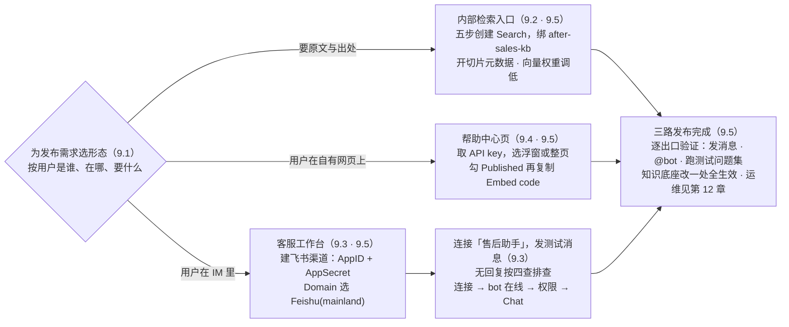
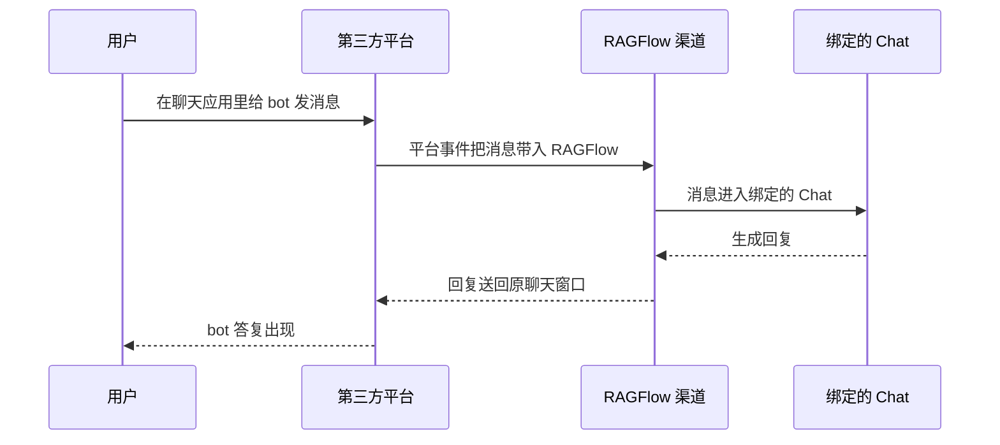

# Chapter 9 Search apps and access channels

> Chapter guide: the After-sales Assistant (「售后助手」) was tuned in chapter 8, and retrieval quality was verified in chapter 7. But it still lives only inside the RAGFlow interface: log in, enter the Chat page, select a session, and only then can you use it. Finished knowledge needs an "exit", and there is more than one kind of exit. Support wants to look up the original wording of a policy precisely. A user in the help center wants a window they can ask. A colleague in Feishu does not want to switch apps. This chapter covers RAGFlow's three outward forms: a retrieval-style search page (the Search app), a conversation channel (Chat Channel), and web embedding. For each, the scenarios it fits, how to configure it, and the access steps. The running case then finishes one three-way publish of the After-sales Assistant. When you finish this chapter, you can: choose among the three forms for a publishing need; create a Search app and adjust the retrieval settings for the scenario; connect Chat into a third-party IM and finish a connectivity check; and embed an Agent into your own web page as a full page or a floating window.

*Operations flowchart for this chapter*

## When you need this

Three typical situations, and three ways to use this chapter.

**You want to give the team an entry for "looking up documents", rather than yet another chat window.** See 9.2. Needs such as support checking the original wording of a policy, or looking up a clause by order number, want the original text and the source. A Search app is more direct than a conversation.

**You want users or colleagues to ask directly inside the chat tool they already have.** See 9.3. After the channel is connected, a user @bot in Feishu, WeCom, or Discord and gets an answer, with no need to log in to RAGFlow.

**You want to put the assistant into your own website or product page.** See 9.4. A help center, and the floating window at the bottom right of an official site, both belong to this class. If you are not sure which form to choose, look first at the comparison table and the selection decision in 9.1.

Prerequisites: the dataset (Dataset) built in chapter 3 is the shared granary of the three exits. What a channel hangs behind it is the chat assistant (Chat Assistant) configured in chapter 8.

## 9.1 Overview: finished knowledge needs an "exit"

The end of chapter 7 tuned retrieval quality to something you can trust, and chapter 8 tuned the After-sales Assistant until it can hold a conversation. But all of that is the work of "coming in". The value of a knowledge base is fulfilled at the moment a person uses it, and "being used" happens outside RAGFlow: on a help-center web page, inside a support agent's chat tool, at an internal team's retrieval entry. What this chapter covers is "going out". RAGFlow provides three outward forms, corresponding to three completely different scenarios of use.

A comparison of the three forms:

| Form | What it is | Where the user is | Typical interaction | The object behind it |
|------|------------|-------------------|---------------------|----------------------|
| Search app | A retrieval-style search page | RAGFlow's **Search** page | A natural-language question, plus document filtering | Datasets + retrieval settings |
| Chat Channel (conversation channel) | A passage into a third-party chat app | IMs such as Feishu, WeCom, Discord, and Telegram | Conversational multi-turn Q&A | The bound Chat (a WeCom channel can also bind an Agent) |
| Web embedding | Embed an assistant or an Agent into your own site | Your web page (a full page, or a floating window) | Conversational multi-turn Q&A | An Agent (see chapter 10) or a chat assistant |

The three forms divide the work cleanly, and the choice follows "who the user is, where they are, and what they want":

| Your scenario | What to choose | Reason |
|---------------|----------------|--------|
| You want the original text and the source (document retrieval, ticket assistance) | Search app | The retrieval form returns chunks and sources directly, and does not pass through a generation step |
| The user is in an IM and does not want to switch apps | Chat Channel | The channel carries the message in, and sends the answer back to the original chat window |
| The user is on your own web page (a help center, an official site) | Web embedding | A full-page chat or a floating window, embedded in a page you control |

**This book's position: first use the form to pin down the need, then talk about parameter tuning.** The three forms share the same knowledge base, and the cost of switching is not high. But the decision "conversation or retrieval" affects what the user expects. Forcing a conversation onto an occasion that should have been given the original text always produces a rewritten answer, and that adds confusion. The other face of outward integration, letting an external program consume this knowledge through an API or MCP, does not belong to this chapter. See chapter 11.

## 9.2 The Search app: a retrieval-style search page

### Creation and dataset binding

Search provides retrieval capability for a knowledge base. The user enters a natural-language question, and can narrow the range with options such as document filtering and the number of results. Creation is five steps (official documentation, v1.0.0-rc2):

1. Enter the **Search** page from the top navigation bar;
2. Click **Create Search**;
3. Enter a name and confirm;
4. Open the new Search, and enter **Search Settings**;
5. Under **Datasets**, select at least one knowledge base, and click **OK** to save.

After creation you must bind a dataset. A Search with no dataset bound has nothing to retrieve. Besides basic retrieval, Search also supports three enhancements, AI Summary (a summary of the results), Related Search (related searches), and Query Mind Map (a mind map of the query). All three are optional switches.

### Search settings: nine parameters in three groups

Search Settings configures the knowledge source, the retrieval strategy, and how results are presented. After you change them, click **Save**. The nine parameters are grouped by the three faces in the official documentation:

| Group | Parameter | What it does | How to tune it (the official documentation's wording) |
|-------|-----------|--------------|------------------------------------------------------|
| Knowledge source | **Datasets** | Which knowledge bases to retrieve. Multiple selection is allowed, and multiple selections are retrieved at the same time | Choose by purpose. Stuffing in a large number of unrelated knowledge bases makes unrelated results increase |
| Retrieval strategy | **Similarity threshold** | The minimum similarity threshold, filtering out low-relevance chunks | Too many results, and they are unrelated: turn it up. You can never find the expected content: turn it down |
| Retrieval strategy | **Vector similarity weight** | The weight of vector similarity and full-text retrieval (for example `0.3` = vector 0.3, full-text 0.7) | The user's wording differs a lot from the original text: turn it up (lean semantic). An exact match on a proper name, product model, or identifier: turn it down (lean full-text) |
| Retrieval strategy | **Rerank candidates** | The number of candidate chunks that enter the rerank stage | A large dataset, or you want coverage: turn it up (cost increases). You want speed: turn it down |
| Retrieval strategy | **Rerank model** | Whether to enable a rerank model to sort the results again | Accuracy first: enable it (adds latency and model calls). Speed first, or no model configured: turn it off |
| Result presentation | **Show chunk metadata** | Whether to show chunk metadata in the results | You need to check the source: enable it. You only care about the content itself: you can leave it off |
| Result presentation | **AI summary** | Whether to generate an AI summary of the retrieval results | You want to grasp the main points quickly: enable it. One more model call, which adds time and cost |
| Result presentation | **Enable related search** | Whether to generate related-search suggestions from the current query | Content exploration, research, and open-ended search: enable it. You only look at the current results: turn it off |
| Result presentation | **Show query mindmap** | Whether to present the topic structure of the query as a mind map | Knowledge exploration and complex topics: enable it. A simple factual query: unnecessary |

The four retrieval-strategy parameters share their origin with the Retrieval Testing page in chapter 7. The principles of the threshold and the weights, and "bare ranking first, then rerank", are already covered in chapter 7 (see chapter 7). This section does not repeat them. It only stresses two differences on the application side. One: **Rerank candidates** is an extra knob on the application side. What it controls is the size of the candidate pool, not the final number of rows returned. Two: Search settings are persisted configuration, different in kind from the lab-bench nature of Retrieval Testing, where "test parameters are not persisted". Tuning here affects everyone who uses this Search. Verify on the test page before you change it.

The nine parameters, landed on the real panel, look like what follows. This screenshot was measured on 2026-11-04 on RAGFlow v1.0.0-rc2 deployed with Docker on this machine. A Search app newly named 「售后检索」, with its Search settings panel on the right:

The correspondence between the panel and the nine-parameter table is plain at a glance. Two measured details are worth pointing out. First, the weight field on the rc2 interface is called **Keyword similarity weight**, presented as two numbers, full-text and vector (0.70 / 0.30). It is the same knob as the official documentation's Vector similarity weight. Only the wording runs the other way. Second, Datasets carries a required asterisk. Bind a dataset after creation, before you use it outward. That is exactly the last of the five creation steps at the start of this section. Similarity threshold shows 20, which is the percentage wording of the threshold 0.2, and it shares its origin with the settled parameters in chapter 7.

### Where it fits

A Search app fits occasions where "you want to find the content itself". Two typical ones:

- **Document retrieval**: support checks the original text of "the compensation standard for damage in transit". What they want is the original clause and the source, not a model's retelling. Turn **Show chunk metadata** on, and lower the vector weight to strengthen full-text match on clause numbers.
- **Ticket assistance**: while handling a ticket, retrieve historical solutions by product model and fault code. What they want is an exact hit. The same approach.

The other way around, an occasion where the question is open and needs a clarifying follow-up (「我的耳机充不进电怎么办」) is conversation's territory. Do not force Search to take it.

The typical scene "support checks the original text of the compensation standard for damage in transit", run on a real instance, looks like what follows. This screenshot was measured on 2026-11-04 on RAGFlow v1.0.0-rc2 deployed with Docker on this machine. The Search app queries 「运输破损的赔偿标准是多少」 and returns 9 chunks:

The largest difference from Chat is visible at a glance. What comes back is the original chunk itself, with no model retelling: compensation table 4-1 keeps its row-and-column structure, each band's cap, and the evidence requirements intact. That is direct evidence, on the retrieval side, of the DeepDoc table recognition in chapter 4. The bottom of each chunk is labeled with a source-document badge, and the query terms are highlighted inside the hit chunks. The reason for choosing "original text and source" (9.1) is, in this figure, the product form itself.

The internal retrieval exit of the running case is configured along this line of thought (expanded in 9.5): bind after-sales-kb; turn **Show chunk metadata** on, because support has to check the source; turn **Vector similarity weight** down, because model numbers and codes depend on full-text match; leave **Rerank model** off at first, and compare against the bare-ranking baseline from chapter 7. If the accuracy is not enough, turn it on then.

## 9.3 Chat Channel: connect the assistant into a chat app

### Channel overview

A conversation channel (Chat Channel) lets a user talk to Chat directly inside chat apps such as Discord, Telegram, WeCom (企业微信), and Feishu / Lark: the user's message enters RAGFlow from the third-party platform, and the bound Chat generates a reply and sends it back to the original chat window. The channel's place, in one sentence: **a channel is only responsible for platform access and message forwarding. The reply content, the knowledge-base range, the model's capability, and the answer quality are decided by the bound Chat.** Supported channels:

| Channel | How it connects | Needs an open platform / developer console | Scenarios the official documentation gives |
|---------|-----------------|--------------------------------------------|--------------------------------------------|
| Discord | `BotToken` | Yes | Community support, product Q&A, collecting user feedback |
| DingTalk | `ClientID` + `ClientSecret` | Yes | Knowledge Q&A inside an organization, process consultation, collaboration support |
| Feishu / Lark | `AppID` + `AppSecret` | Yes | An enterprise knowledge assistant, internal business Q&A |
| QQ Bot | `AppID` + `ClientSecret` | Yes | QQ user service, community Q&A, channel interaction |
| Telegram | `BotToken` | Yes | Service for users overseas, community operations, real-time conversation |
| WeCom | `Webhook` or `WebSocket` | Yes | Employee service, knowledge Q&A, a business bot |
| WhatsApp | Scan to pair | No | A service scenario that uses WhatsApp to contact external users |

Choose the platform by looking first at where the users are. If the internal team is on Feishu / WeCom, choose the corresponding channel. Users overseas go through Telegram / WhatsApp. A developer community goes through Discord.

### Access flow

The entry is **User Settings** -> **Chat channels**: the upper half of the page shows channels already added, and the lower half, **Available channels**, lists platforms you can add. The general flow is seven steps:

1. Enter the **Chat channels** page;
2. Choose a platform in **Available channels**;
3. Create a channel and fill in a name;
4. Fill in the corresponding credentials for the platform, or finish scan-to-pair;
5. Save the channel configuration;
6. Connect the channel to a Chat;
7. Go back to the third-party platform and send the bot a test message.

Two points of behavior are worth knowing in advance. First, **after you save, the page may need a few seconds** before it shows the connection status, a QR code, or a later prompt. Wait as the page tells you to. Do not create the channel over and over before the QR code or the status has been generated. Second, **when a channel is enabled but not connected to a Chat, RAGFlow can receive the external message, but it will not generate a reply.** "Received, and no reply" is this cause most of the time. Also, after you change credentials or the channel type, RAGFlow restarts the channel connection automatically. When the credentials are wrong, the channel may fail to start, and you need to go back to the third-party platform and check the bot's status, permissions, and keys.

### Connecting Chat and verifying

After a channel is added successfully, it has to be connected to a Chat before a user's message enters the Chat and generates an answer (taking WeCom as the example, a channel can also bind an Agent; see the subsection below). Five steps:

1. On the **Chat channels** page, find the channel you added;
2. Click that channel's connect or edit entry;
3. Choose the target Chat from the list of available Chats;
4. Save the configuration;
5. Go back to the third-party platform and send the bot a test message.

When a test message gets no reply, debug in order: **first check whether the channel is already connected to a Chat**, then check whether the bot is online, whether the third-party platform's permissions are complete, and whether the Chat itself can answer normally on the RAGFlow page. Four checks, front to back. The first three are on the channel side. The last one takes the channel out and verifies the Chat itself.

Once it is connected, the full journey of one message (the data flow the official documentation describes):

*Channel message flow: the channel carries, Chat answers*

### Per-platform differences and easy pitfalls

Each platform's credentials are obtained from its own open platform / developer console. The official documentation writes, platform by platform, the concrete consequences of a wrong parameter (cannot connect, authentication fails, send or receive fails). Beyond what they share, every channel has one or two difference points that are easy to fall over on:

| Channel | Easy pitfalls (the official documentation's wording) |
|---------|------------------------------------------------------|
| Discord | If `MessageContentIntent` is not enabled, the bot may show as online and still be unable to read the body of a user's message. The OAuth2 invite link selects the `bot` scope, and grants permission to send and receive messages and to read history |
| DingTalk | Replies depend on the session `Webhook` returned by the message event. The user must send the bot a message first, and only then can RAGFlow reply in the corresponding session |
| Feishu / Lark | Choosing the wrong **Domain** (mainland Feishu chooses **Feishu(mainland)**, and the international edition chooses **Lark(international)**) causes authentication or API calls to fail |
| QQ Bot | Leave **BaseURL** empty in ordinary use, and the default address is used. Fill it in only for a proxy or a specified API address |
| Telegram | Use in a group requires adding the bot to the target group. Group privacy mode affects whether the bot can read ordinary group messages |
| WeCom | `Webhook` and `WebSocket` credentials cannot be mixed. The former needs the five items `CorpID` / `AgentID` / `Secret` / `Token` / `AESKey`. The latter needs only `BotID` / `Secret` (first create an intelligent bot in WeCom) |
| WhatsApp | Scan to pair: phone WhatsApp -> Settings -> **Linked devices** -> **Link a device**, then scan. It depends on the backend `WhatsAppGateway`. After you delete the channel or clear the login state, you have to scan again |

### Binding a channel to an Agent: the WeCom special case

According to the official documentation, a WeCom channel can bind a custom Flow Agent in addition to a Chat. Incoming messages are answered by the workflow you designed on the Agent canvas, rather than by an ordinary Chat (the canvas and workflows are in chapter 10). The connection dialog is a single dropdown, and entries carry a type prefix: `[Chat assistant]` is a Chat of the current tenant, and `[Agent]` is a Flow Agent the current tenant can access. Selecting one fills in the corresponding id automatically. No external credential is needed. Three binding rules: only one target can be bound at a time, and selecting another replaces it; clearing the selection disconnects it; if a component of the selected Agent has no model configured, it replies with an error message at runtime. The precondition is that the Agent belongs to the tenant the channel belongs to, or is shared to that tenant with `team` permission.

**This book's position:** "a channel can bind an Agent" is so far seen in the material only for the WeCom channel. Do not casually generalize it to every channel. But the direction is worth noticing. It means what can run inside an IM is no longer only "question answering". It is "a flow".

## 9.4 Web embedding: embed the assistant or Agent into your own site

### Embedding forms

Web embedding puts conversation capability into a page you control. Two forms (the official documentation's wording):

| Form | What it looks like | Typical use |
|------|--------------------|-------------|
| **Fullscreen chat(traditional iframe)** | A full-page chat | A standalone conversation page. The page is the conversation |
| **Floating widget(Intercom-style)** | A floating window | "Ask any time" in a corner of a help center or an official site, without interrupting browsing |

The material for this chapter (v1.0.0-rc2) gives the embed entry with a **Workflow Agent** as the example, aimed at a self-managed deployment (self-managed deployment). The embed entry on the chat-assistant side has not been measured by this book, and it is on the review checklist at the end of the chapter.

### Embedding steps

Prerequisite: obtain an API key at **User settings > API** (the API Key system is in chapter 11). Then six steps:

1. On the Agent page, open the edit page of the target Agent;
2. Click **Management > Embed into webpage** at the top right of the canvas, and open the embed settings;
3. In **Embed Setup**, choose **Fullscreen chat(traditional iframe)** or **Floating widget(Intercom-style)**;
4. Set **Language**, **User ID**, and the display options as needed. Enabling **Published** uses the Agent's published version;
5. For the floating-window form, use **Widget Customization** to adjust the title, text, and colors, and click **Save widget settings** to save;
6. Copy the **Embed code** into your web page. Use **Open in new tab** to preview the effect.

The **Published** switch is worth a sentence of its own: once it is checked, what is embedded is the published version. This book's position: this means a draft change on the canvas does not appear on the embedded page automatically. "Publish" is the gate that makes an embed take effect (the publish mechanism is in chapter 10). After you change an Agent, remember to publish again, or the window on the web page keeps performing the previous version's script.

## 9.5 Running case: publishing the After-sales Assistant

The After-sales Assistant (chapter 8) now has to be published to three exits, each taking one form:

| Exit | Form and configuration | Reason for the choice |
|------|------------------------|-----------------------|
| Help center page | Web embedding: an Agent embedded as a **Floating widget** floating window. Bind the After-sales Assistant first. After it is turned into a flow, upgrade it to the canvas Agent "After-sales support Agent" (see chapter 10) | The user self-serves on a web page, and a floating window does not interrupt browsing. The question is open (「耳机充不进电」), and a conversation form can clarify with a follow-up |
| Support workbench | Chat Channel: a Feishu channel, `AppID` + `AppSecret`, **Domain** set to **Feishu(mainland)**, bound to the After-sales Assistant | Support spends the day in Feishu. Zero training, zero switching. The channel only forwards. Answer quality is guaranteed by the Chat tuned in chapters 7 and 8 |
| Internal retrieval entry | Search app: bind after-sales-kb, turn **Show chunk metadata** on, and turn the vector weight down to strengthen full-text match on model numbers and codes | When support checks the original text of a policy, or looks up a historical solution by model number, what they want is the original text and the source, not a model's retelling |

After the three-way publish, there are two disciplines. First, **the three exits share the same dataset**. The chunks tuned in chapter 4 and the retrieval parameters tuned in chapter 7 take effect on all three exits at the same time. Change the foundation in one place, and all three exits benefit together. That is the architectural point of separating the forms and unifying the knowledge. Second, **verify each exit on its own**: send a test message on the help center, @bot in Feishu, and run the test question set settled in chapter 7 on the Search page. The exits differ, and the failure surfaces differ (a web embed may stick on the API key, and a channel may stick on platform permissions). One exit's verification cannot stand in for another's. Operations and monitoring after launch are in chapter 12.

## Chapter summary

1. **Finished knowledge needs an exit.** Three outward forms: a Search app (a retrieval-style search page), a Chat Channel (connected into a third-party IM), and web embedding (a full page or a floating window). They correspond to three classes of scenario: "want the original text", "in an IM", and "on your own web page".
2. **A Search app's nine parameters fall into three groups**: knowledge source (Datasets), retrieval strategy (threshold / vector weight / rerank candidates / rerank model), and result presentation (metadata / AI summary / related search / mind map). The four strategy parameters share their origin with Retrieval Testing, but here they take effect once persisted. Verify on the test page before you change them.
3. **A channel only carries. Quality is in the Chat.** A channel is responsible for platform access and message forwarding. Reply content, knowledge range, and answer quality are decided by the bound Chat. A channel not connected to a Chat "receives, and does not reply".
4. **Access verification is one chain**: credentials -> save -> connect Chat -> test message. When there is no reply, check the connection first, then whether the bot is online, the platform permissions, and the Chat itself.
5. **Embedding uses publish as the gate.** The **Published** switch decides which version of the Agent runs on the web page. Choose a floating window or a full page by the scenario.
6. **Forms separated, knowledge unified.** The running case's three-way publish shares after-sales-kb. Change the base in one place, and all three exits benefit together.

## Acceptance checklist

By the time you reach here, you should be able to:

- ☐ Given one publishing need (the user, the place, and whether they want the original text or an answer), choose among the three forms and state the reason;
- ☐ Create a Search app, bind a dataset, and, for an "exact match on a proper name" scenario, say which two parameters to tune and which direction to tune them;
- ☐ Finish one channel connection: take credentials from the platform, create the channel, connect Chat, and send a test message on the third-party platform to verify;
- ☐ When you meet "the channel can receive messages but does not reply", locate the problem in the four-check order;
- ☐ Embed an Agent into a web page, and explain the relationship between the **Published** switch and the published version.

## Further reading

- **Chapter 7 (retrieval testing and tuning).** The principles and the tuning method of the four retrieval-strategy parameters of a Search app. The Search page can use the test question set settled in chapter 7 directly, for an exit-level regression.
- **Chapter 8 (chat assistants and sessions).** The object that answers questions behind a channel. Tune the Chat itself before you connect a channel.
- **Chapter 10 (Agents and workflows).** The Workflow Agent that web embedding supports, and the Flow Agent a WeCom channel can bind. Their canvas and publish mechanism are expanded in this chapter.
- **Chapter 11 (outward integration: API and MCP).** The program side of outward integration: let an external system consume the same knowledge base through an API or MCP.
- **Chapter 12 (production operations).** The configuration, monitoring, and operations surface after an exit goes live.

## Review checklist (before publication)

- [ ] Check the whole chapter against the official documentation v1.0.0-rc2 (search/create_search, search/search_settings, the three chatchannel pieces, and agent/embed_into_web_pages), verified 2026-10-27
- [x] Search app creation and dataset binding were measured on 2026-11-04 (screenshot in 9.2): creation, binding after-sales-kb, and retrieving results, the whole path goes through
- [ ] Not measured: the full flow of any one channel (planned to use Feishu or WeCom as the reference), from creating the channel to a test message
- [ ] Not measured: the connection dialog for a WeCom channel binding a Flow Agent, and the `[Chat assistant]` / `[Agent]` prefixes
- [ ] Not measured: Agent embedding (Embed Setup, Widget Customization, Embed code). The embed entry and parameters on the chat-assistant side are still to be added
- [ ] "A channel is only responsible for access and forwarding, and quality is decided by the bound Chat" is a paraphrase of the source material's intent. Before publication, check the wording against the English original
