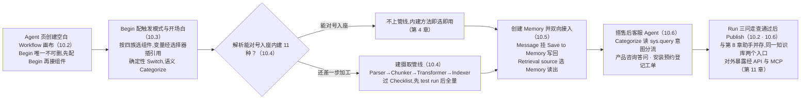
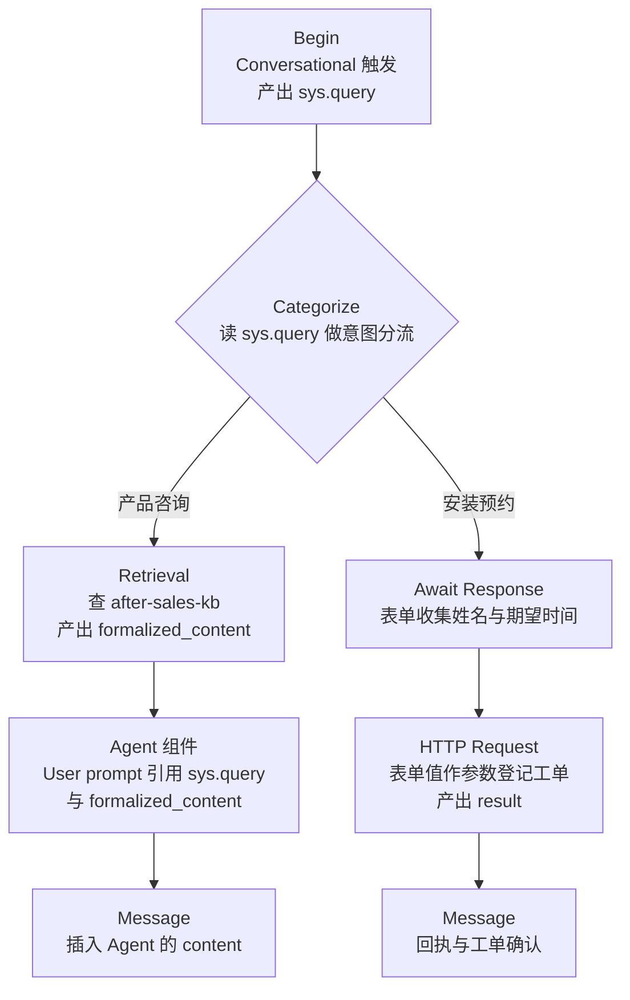

# Chapter 10 Agents and workflows

> Chapter guide: The "After-sales Assistant" that Chapter 8 put into service can answer questions that are in the knowledge base, but when a user says "help me book an on-site installation", it can only search awkwardly and then apologize. A configuration-style application only retrieves and generates. It does not get things done. This chapter brings in RAGFlow's third layer: the canvas Agent. Connect components on a visual canvas and pass variables, and you can orchestrate a full business flow of "intent routing, then knowledge retrieval, then model generation, then a call to an external system". On the data side there is also an Ingestion Pipeline for a custom parsing pipeline, and on the memory side there is Memory, which stores and retrieves interaction history across sessions. This chapter keeps the after-sales running case and upgrades the Chapter 8 "After-sales Assistant" into an "After-sales Support Agent", explaining node by node how variables are passed. By the end of this chapter, you can: read the canvas model of nodes, edges, and variables; choose components by family for a business flow; create a custom ingestion pipeline and finish a test run; configure an Agent's memory for both writing and retrieval; and build, from scratch, a customer-service Agent that can be published.



*Flowchart for this chapter*

## When you need it

Three typical situations, and three ways to use this chapter.

**The knowledge base can retrieve, but what the user wants is for something to get done**: judge the intent first, then search the base or call an interface, and finally return a result. One continuous flow, where one question and one answer are not enough. See 10.1 and 10.3, then build along with 10.6.

**Built-in parsing is not enough**: a special format needs a different parser combination, chunks need summaries and tags, or the material even needs to be compiled into a knowledge artifact. See 10.4. It is the orchestratable version of the built-in parsing in Chapter 4.

**The Agent has to remember what the user said last time**: preferences across sessions, historical tickets, and continued context. See 10.5, and configure both directions of memory, write-back and retrieval.

Prerequisites: Chapter 2 has already configured a chat model; the after-sales-kb from Chapters 3-5 has already been parsed into usable chunks; the chat assistant from Chapter 8 is the comparison object (not a hard prerequisite, but the division of work in 10.1 and the comparison in 10.6 keep pointing back to it).

## 10.1 Overview: the canvas model and the split with the chat assistant

The official definition of an Agent, in one sentence: **connect components on a visual canvas to build an automated workflow**. Connections define execution order. Conditions, categorization, and loops control which steps run (docs/guides/agent/agent_overview.md, v1.0.0-rc2, verified 2026-10-27).

That sentence pulls out three elements of the canvas model:

| Element | What it is | Analogy |
|------|--------|------|
| Node (component) | One processing step: retrieve, generate, call an interface, decide | A box in a flowchart |
| Edge (connection) | Defines execution order: draw from an upstream component's connector to a downstream one | An arrow in a flowchart |
| Variable | The mechanism that passes data between nodes: a downstream node references an upstream output | A parameter between functions |

Of the three, the variable is the easiest to overlook. A line on the canvas only answers "what happens first and what happens next". It does not answer "how data flows from the previous step to the next step". Variable references do that. Section 10.3 covers it on purpose, and 10.6 walks it node by node.

### The split with the chat assistant

Chapter 8 already gave a comparison table for the two (see 8.1). The official split, in one sentence: **Chat fits applications whose main job is knowledge-base question answering and multi-turn conversation; Agent fits business workflows that need conditional branches, tool calls, data processing, or multi-step orchestration**.

For the decision itself, if any one of three tests hits, it is time to move up from a chat assistant to a canvas Agent:

1. **A multi-step flow**. One request has to pass through several steps of "look up A first, then compute B, then summarize", where one retrieval and one generation are not enough.
2. **Tool calls**. It has to touch something outside the knowledge base: an HTTP interface, a database, an MCP tool, or custom code.
3. **Conditional branches**. Different inputs take different paths: after-sales questions search the policy base, appointment requests go into a form, and complaints are handed to a human.

The typical scenes the official docs list match this: answer from a knowledge base; recognize intent and route it to different processing flows; call an HTTP interface, a database, an MCP tool, or custom code; split and batch-process long text; save session memory or export a processing result.

One detail that is easy to miss: the Retrieval component has two uses inside an Agent. It can be an **ordinary workflow node** (a fixed position, a fixed retrieval), or it can hang under the Agent component as a **tool** (the LLM decides on its own when to retrieve). The first is the canvas version of the Chapter 8 style of question answering. The second is the one that carries a bit of "autonomy". Section 10.6 of this chapter uses the first. It is easier to understand and easier to debug.

### Terms in this chapter

| Term | English | One-sentence place |
|------|------|-----------|
| Dataset | Dataset | The carrier of knowledge, and the retrieval target of Retrieval (Chapter 3) |
| Chunk | Chunk | The basic unit of retrieval and citation (Chapter 4) |
| Ingestion pipeline | Ingestion Pipeline | An orchestratable flow of parse, chunk, enrich, and index (10.4 in this chapter) |
| Knowledge artifact | Artifact | A form produced by knowledge compilation, such as a knowledge tree or a Wiki (Chapter 6) |
| Chat assistant | Chat Assistant | A configuration-style question-answering application attached to a dataset (Chapter 8) |
| Memory | Memory | Saves session content and execution results for reuse across sessions (10.5 in this chapter) |

## 10.2 The canvas at a glance: creating and managing

### Entry and three ways to create

After login, click **Agent** in the top navigation. Agents already created are shown as cards. Click a card to keep editing. Three ways to create (docs/guides/agent/creation_and_management.md, v1.0.0-rc2):

| Path | Starting point | Fits |
|------|------|------|
| **Create from template** | The template already presets components and connections (Deep Research, Knowledge Base Q&A, Data Analysis, E-commerce Customer Service, and others) | The business scene is close to the template, and you only need to change the model, knowledge base, prompts, interface address, or output content |
| **Create from blank:Workflow** | The canvas has only `Begin` | A conversational Agent, the main subject of this chapter |
| **Create from blank:Ingestion pipeline / Compilation operator** | The pipeline starts with `Begin → Parser` | Custom parsing (10.4); knowledge compilation (see Chapter 6) |

When creating from blank, first choose the type (Workflow / Ingestion pipeline / Compilation operator), name it, confirm, and then enter the canvas. There is also a non-interactive path: on an old Agent, **Management > Export** exports JSON, which you then import under a new name. That is the official way to "copy", and it is also the only way to back up a configuration (deletion also deletes every saved version, so export before you delete).

### Begin rules and canvas operations

Remember two hard rules first:

- `Begin` is the start of the workflow. **Each Agent can have only one, and it cannot be deleted**. Configure Begin first, then configure the components that follow.
- **A component that is not connected to the execution path does not run**. Before deleting a component, check the upstream and downstream connections and the variable references, so a downstream node is not left without an input.

Day-to-day canvas work is three things: click the **+** beside a component and choose the next component; click the component itself to open the configuration panel on the right (fields, input variables, output variables, and execution settings are all here); draw a line from an upstream component's connector to a downstream one. The meaning of a connection: sequential components run along a single path; branch components such as `Switch` and `Categorize` route the flow to different outlets by condition; `Iteration` runs a sub-flow in a loop.

The recommended use of the configuration panel is one motto: **first confirm which variable the component reads, then configure the processing logic, then verify that the output referenced downstream is correct**. After each component is configured, pass it through these three steps. Most wiring mistakes show up on the spot.

### Save, run, and publish

The editor shows the time of the latest autosave. Four actions, each with its own job:

| Action | What it does | When to use it |
|------|------|--------|
| **Save** | Saves the edited configuration | After each component change |
| **Run** | Tests inside the editor: enter a test question and watch each component's execution result | Debugging, and required before publish |
| **Launch** | Opens the session page (Conversational mode) | Check the conversation experience yourself |
| **Publish** | Creates a published version | After the test passes |

When a component produces no output during Run, check five places in order: input variables, model configuration, knowledge-base permissions, the external interface address, and tool configuration. That is the troubleshooting surface the official docs give. Pay special attention to the first item: nine out of ten cases of "a silent component" are a variable reference with the wrong name, or a reference pointed at the wrong upstream node.

### The management panel

**Management** on a Workflow canvas provides six items:

| Item | Use |
|------|------|
| Conversation variable | Configure session-level variables |
| Version history | Browse saved versions and view the canvas configuration; a history entry is **not the same as** a published version |
| Log | Search execution records by ID/title and date, view details such as state and version, and export the current page |
| Export | Export the Agent configuration (backup/copy) |
| Settings | Agent settings |
| Embed into webpage | Options for embedding in a web page |

## 10.3 A map of component families: four families and variable passing

### Variable passing: the blood of the canvas

In a component's input field, type `/` or click the variable icon beside the input box to open the variable picker, and choose from three sources (docs/guides/agent/understand_the_canvas.md, v1.0.0-rc2): **system variables**, **global variables defined by the Begin component**, and **outputs of upstream components**. After you choose, a reference is inserted automatically. The reference is a component that really exists on the canvas. Names in the Example are only illustrative. Do not type them by hand.

Four variables are used most often and recur throughout the book. They are worth memorizing:

| Variable | Contents | Who produces it, who consumes it |
|------|------|----------------|
| `sys.query` | The question in the current user input | The system provides it; Categorize, Retrieval, and the Agent prompt all read it |
| `formalized_content` | The tidied text output by a Retrieval, SQL, or tool component | Produced by retrieval/tools; consumed by the Agent's User prompt |
| `chunks` | The set of fragments output by a document-parsing or chunking component | Flows inside a pipeline (10.4) |
| `content` | The main text output of a component such as Agent or Code | Produced by generation components; consumed by Message |

### The four-family component table

Components on the Workflow canvas can be grouped into four families by duty (the official docs give each component its own page and do not publish an official grouping; the grouping in the table below is this book's position, and the component list follows the docs):

| Family | Component | Duty | Typical use |
|----|------|------|---------|
| Dialogue and generation | `Begin` | The start: trigger mode, opening line, input variables | Every Agent must have one; see below |
| | `Agent` | Calls the LLM for reasoning, generation, planning, and tool calls | The "brain" on the canvas; see below |
| | `Message` | Outputs a reply to the user | The last baton of a fallback flow; often inserts `content` or a receipt text |
| | `Await response` | Collects input from the user midway and waits | Form collection: name, time, options (the appointment branch in 10.6) |
| Data operations | `Retrieval` | Retrieves from a knowledge base or from Memory | `sys.query` in, `formalized_content` out; see below |
| | `Execute SQL` | Queries an external database and turns the result into text/a table | Inventory lookup, pulling numbers for a report (six databases; see the note after the table) |
| | `Code` | Runs custom code to process data | Parse the JSON response of HTTP, tidy fields |
| | `Text processing` | Text processing | A light transformation of upstream text |
| Flow control | `Categorize` | Classifies input by semantics and routes it to the matching outlet | Intent routing (the lead of 10.6) |
| | `Switch` | Branches on a conditional expression | Deterministic conditions: numeric comparison, boolean judgment |
| | `Iteration` | Runs a sub-flow in a loop | Batch processing of long text in segments |
| External tools | `HTTP Request` | Calls a REST API | Ticket registration, notification push; see below |
| | MCP tools | MCP Server tools connected through the Agent component's tool picker | A standardized way to connect external tools (see the MCP book) |
| | Search tools (Tavily, Google, DuckDuckGo, SearXNG, Keenable, Sofya, Search1API, and others) | Web, news, and academic retrieval | Public information that is not in the knowledge base |
| | `Email` / `Document Generator` / `Browser` | Send email / generate a document file / extract a web page with natural language | Delivering results and grabbing source material |

A rule of thumb for choosing: **use `Switch` for a deterministic judgment, and `Categorize` for a semantic judgment**. Connect a fixed external call as an `HTTP Request` node. Hang a call on the Agent component's tool list only when the LLM must decide on its own whether to call it.

The official docs do not give `Code` or `Text processing` a page of their own. The duties in the table are summarized from the source material. For the other components, the sections below are the reference.

### Begin: the start and trigger modes

`Begin` configures three things: the trigger mode, the opening line, and input variables (docs/guides/agent/agent_workflow/basic_component.md, v1.0.0-rc2).

| Trigger mode | Mechanism | Fits |
|---------|------|------|
| **Conversational** | Triggered by conversation, and an opening line can be set | An ordinary chat-style Agent (the default) |
| **Task** | Started as a task | A non-conversational automated flow |
| **Webhook** | Triggered by an external HTTP request | System integration, automation, third-party callbacks |

Webhook is the heaviest of the three modes to configure. Four points: copy the generated URL and choose the allowed request methods; under **Security**, configure authentication. Token authentication requires the caller to carry an `X-Webhook-Token` header whose value matches, and an external request also needs `Authorization: Bearer <RAGFlow API key>` (the account must have permission to access that Agent); under **Schema**, choose `application/json` and define the request fields (multipart file upload is not supported, and the response is HTTP `501`); under **Response**, pick one of two. **Accepted response** confirms first and then continues in the background. **Final response** waits until the flow finishes and returns the result message.

Input variables (Input) define the parameters the user must provide before the session starts. Later components reference them through the variable picker. There are seven types: single-line text, paragraph text, dropdown options, file upload, number, boolean, and JSON object. Note the boundary of file upload: a file is available only inside the current workflow, and **it is not ingested automatically**. A document upload needs a parser selected and is referenced through `sys.files`. An image upload needs a vision model selected on the Agent component. Video is not supported, and the content must fit inside the model's context limit.

### The Agent component: the brain on the canvas

The Agent component calls a large model for reasoning, generation, task planning, and tool calls. It can handle a user's question on its own, and it can also collaborate with retrieval, HTTP, code, a database, and sub-Agents to finish a multi-step task. Configuration items: `Model`, `System prompt`, `User prompt`, `Tools`, `Agent`, `Message window size`, `Max retries`, `Delay after error`, `Max reflection rounds`, `Output`.

**How to write prompts** carries the discipline of Chapter 8: the System prompt defines the role and the behavioral boundary, and the User prompt defines the current task and the input data. When it follows a retrieval component, the standard structure of the User prompt is "question + reference material + constraint". After typing `Question: `, insert `sys.query`. On a new line, after typing `Reference: `, insert the upstream Retrieval's `formalized_content`, and then add one instruction:

```text
Answer using the reference. If it does not contain the answer, say so.
```

(The Example comes from the original official documentation. For a Chinese scenario you can write 「仅依据参考资料回答,资料没有就说没有,并追问用户」.)

**Tools and sub-Agents**: once a tool or a sub-Agent is hung under the Agent component, the current Agent's role becomes **planner**. The model decides when to call which capability. The built-in tool picker includes knowledge retrieval (Retrieval), Execute SQL, Code, search, and others. MCP tools are chosen on the **MCP tab** (the configuration entry is **User settings > MCP > Add MCP**; the user who runs it must have permission for the selected Server; for the protocol details of connecting external tools through MCP, see the MCP book). Two boundaries that are easy to trip on: `HTTP Request` is a workflow node, and it is **not in** the Agent component's built-in tool picker; **Max reflection rounds** appears on the panel only after a tool or a sub-Agent is attached, and **Tool timeout** appears only after an MCP tool is selected. When a tool should be used has to be written into the System prompt. The wording of the official Example is worth copying: "Use Retrieval for product questions; if no relevant content is found, ask the user for more details."

**Structured Output**: the default output is `content` (natural-language text). After **Structured output** is turned on, it returns `structured` according to a custom JSON Schema, so downstream nodes such as `Code`, `HTTP Request`, `Execute SQL`, and `Switch` can read it programmatically. This is the key mechanism of "Agent output, then structured consumption", and it is much more reliable than digging fields out of free text.

Two items in **advanced settings** are commonly used:

| Parameter | What it does | Suggestion |
|------|------|------|
| Message window size | How many historical messages are kept during reasoning; a larger window is a fuller context and a higher token cost | Usually keep the default; turn it up for multi-turn conversation, and turn it down for a single-turn task |
| Citation | Whether the answer carries citation information | Turn it on for knowledge-base question answering (the same discipline as Chapter 8) |

The official docs have one performance reminder worth posting at the desk: tool calls, reflection rounds, and session history all stretch the response time. **Start ordinary question answering from a simple workflow, and add tools or sub-Agents only when the task really needs them**.

### The Retrieval component: knowledge retrieval

On the canvas, Retrieval retrieves relevant content from a specified knowledge base or from Memory. It can be an ordinary workflow node, or a tool of the Agent component (already mentioned in 10.1). Five configuration steps: choose the **Query variable** (often `sys.query`); under **Retrieval source**, choose one or more knowledge bases, or choose Memory; in advanced settings, adjust **Similarity threshold**, **Keyword similarity weight**, **Rerank candidate count**, and **Top N** (choose a **Rerank model** when needed); for a cross-language scene, choose **Cross-language search**; Run a trial retrieval.

The meaning of the parameters continues from Chapter 7. Here, only the differences on the canvas side:

| Parameter | Initial value/default | The point |
|------|------------|------|
| Similarity threshold | 0.2 (the percentage control shows 20) | Higher is stricter, and may miss; 0.2 is loose recall, 0.5 is ordinary question answering, 0.8 is a strict match |
| Keyword similarity weight | 0.7 (vector 0.3) | The panel shows both weights at once; turning it up leans toward keywords, turning it down leans toward vectors |
| Rerank candidate count | 64 | The number of candidates that enter reranking, which is a different thing from Top N |
| Top N | 8 | The number of chunks passed downstream; 3-5 for FAQ material, 5-10 for product documents, 10-20 for long documents |

When several knowledge bases are retrieved together, make sure they use the **same embedding model**. When retrieval results are missing, check the **Meta data** filter conditions. Rerank usually improves ranking but adds model-call latency. An Agent that is sensitive to speed can leave it off at first. Chapter 7 already argues this tradeoff in full (see Chapter 7).

### Tool components: connecting to the outside world

Tool components bring external search, databases, HTTP APIs, email, document generation, and web-page extraction into the Agent (docs/guides/agent/agent_workflow/tool_components.md, v1.0.0-rc2). Three of the most used are expanded below. Match the rest to the selection table.

**Execute SQL** connects to an external database, runs SQL, and formats the result as text or a table. The points: supported database types are `mysql` / `postgres` / `mariadb` / `mssql` / `trino` / `oceanbase`; `max_records` defaults to 1024 and limits how many records a single statement returns; the address must be reachable from the RAGFlow server; the `sql` field supports canvas variables and can be joined with upstream output into a query. Give the Agent read-only permission. The canvas executes the statement you wrote, but variable splicing means the contents are not fully under your control.

**HTTP Request** calls an external REST API, and that is how a business system joins the canvas. Configuration table:

| Configuration | Description |
|------|------|
| Url | The API address, and canvas variables can be inserted |
| Method | GET / POST / PUT |
| Timeout | Seconds, default 60 |
| Headers | A JSON object |
| Parameter | Click `+` to add; the value can be a constant or a variable |
| Clean HTML | Strip HTML markup from the response |

The output is `result` (the response-body text). When the URL is rejected, the output is `_ERROR` and `result` is null. **Before consuming `result`, check `_ERROR` first**. To use fields inside a JSON response body, pass it through a `Code` component to parse it.

**Search tools**. The official selection table, condensed: for general web retrieval choose Tavily (designed for LLMs, and `formalized_content` goes straight into the prompt), DuckDuckGo (no key), or a self-hosted SearXNG; for content on a specified site use Tavily's Include Domains or Keenable's site parameter; for academic papers use Google Scholar / ArXiv / PubMed; for extracting the body of a web page use Tavily Extract or Browser (with a chat model, driven by a natural-language instruction). The product convention matches retrieval: `formalized_content` is for the Agent's prompt, and `json` is for a downstream node to read fields.

## 10.4 Ingestion pipelines: a custom parsing flow

When Chapter 4 talked about parsing, it mentioned one sentence: a dataset's parsing entry splits into two paths, Built-in and Pipeline (a custom ingestion pipeline). Built-in is "choose one chunking method, and leave the rest to the platform". **An Ingestion Pipeline opens parse, chunk, enrich, and index into an orchestratable canvas**. It is created on the Agent page, and it is the second kind of canvas in this chapter's canvas model.

### Creating one and the typical flow

Entry: **Agent > Create agent > Create from blank**, and choose the type **Ingestion pipeline** (docs/guides/agent/ingestion_pipeline/create_ingestion_pipeline.md, v1.0.0-rc2). The canvas starts with `Begin → Parser`. The typical flow:

**Begin → Parser → Token Chunker → Transformer → Indexer**

Transformer is optional. After Transformer you can also choose Compiler and take the knowledge-compilation path (one Compiler per canvas; the template group is prepared through **Compilation operator**; see Chapter 6).

### Five core components

| Component | Duty | The matching built-in concept in Chapters 4-6 |
|------|------|------------------------|
| `Parser` | Reads and understands a file (PDF, image, email, and so on) and extracts text and structure | Built-in parsers (DeepDOC and others, Chapter 4) |
| `Token Chunker` | Cuts a long text into chunks by a target token count | The chunk size of General chunking (Chapter 4) |
| `Title Chunker` | Chunks by heading structure | Title Chunker / Hierarchy and Group (Chapter 4) |
| `Transformer` | Enriches a chunk with a summary, keywords, questions, tags, and metadata; one node can turn on several | The enrichment stage of Extractor (Chapter 5) |
| `Indexer` | The last link: sends the processed data into the document engine, and supports full-text plus vector hybrid retrieval | Indexer (Chapter 5) |
| `Compiler` | Uses a compilation template group and a model to organize chunks into a knowledge tree, a mind map, or a Wiki | Knowledge compilation (Chapter 6) |

### test run: samples before the full batch

The way to validate a pipeline is not Run. It is **test run**: after configuring each component, passing the **Checklist**, and Save, run sample documents against a **test knowledge base**, confirm that the products of parsing, chunking, enrichment, and indexing each match what you expect, and only then process the whole batch of documents (docs/guides/agent/ingestion_pipeline/test_run.md). This comes from the same discipline as Chapter 4: the cost of choosing the wrong parsing is not an error report. It is quietly cutting out bad chunks. A pipeline opens each stage precisely so that a "quiet error" shows itself on the sample.

### Built-in or pipeline: the tradeoff

**This book's position: choose built-in for standard cases, and a pipeline for special handling.**

| | Built-in parsing | Ingestion pipeline |
|---|---------|---------|
| Cost | Choose a method and use it, with zero orchestration | Build the canvas and configure component by component |
| Coverage | 11 chunking methods, the great majority of forms (Chapter 4) | Components combined freely, and enrichment and compilation can be inserted |
| Fits | Mainstream documents, team self-service, getting volume up quickly | Special formats, a Transformer enrichment to insert, a Compiler to attach so artifacts come out, fine control of every step by document family |

A rule of thumb: if one of the 11 built-in methods in Chapter 4 can be matched to the file, do not put it on a pipeline. Only when, after that match, you are still short "one processing step" do you add that step on a pipeline.

## 10.5 Memory: making the Agent remember interactions

Chapter 1 planted a distinction: RAG and Memory share the same technical base, and the difference is where the data comes from. **RAG faces existing knowledge prepared in advance, and Memory faces dynamic data produced in real time during interaction** (see Chapter 1). RAGFlow makes these two things the two optional sources of the Retrieval component. This chapter turns that distinction into configuration.

### How Memory and the knowledge base complement each other

| | Knowledge base (RAG) | Memory |
|---|-------------|--------|
| What is stored | Existing knowledge: manuals, policies, FAQ | Interaction memory: session content and extraction results produced while the Agent is executing |
| When the data is produced | Prepared and updated before go-live | Written in real time during each conversation and execution |
| A typical question | "What is the return policy" | "What was the ticket number of my last repair report" |
| Role | Makes an answer something you can check | Lets the Agent reuse historical context across sessions |

### Creating a Memory

Entry: **Memory page > Create memory**. Four steps: name it; choose the memory type; choose an embedding model; choose a large language model; Confirm (docs/guides/memory/create_memory.md, v1.0.0-rc2). After creation you enter the list or the detail page. Memory also has its own **Messages** page, which you will use later to verify writes.

### Both directions: write-back and retrieval

Memory has to be connected to an Agent before it takes effect, and usually **both directions have to be configured** (docs/guides/memory/connect_to_an_agent.md, v1.0.0-rc2):

**Write-back (Write to memory)**: on the Agent canvas, select or add a `Message` component, find **Save to Memory** in its configuration, and choose the target memory. When history needs to be separated by user, configure the user ID. Save and run one test, then go back to the memory's **Messages** page and confirm that a new message was produced. Note the mount point: `Save to Memory` lives on the Message component. If the Agent only outputs and does not store, there is no write-back without a Message node.

**Retrieval (Retrieve from memory)**: on the canvas, select or add a `Retrieval` component, use `sys.query` for **Query variable** (the common choice), under **Retrieval source** choose **Memory** and check the target memory, adjust Similarity threshold, Vector similarity weight, and Top N, connect the retrieval result to the downstream LLM or answer component, save and test, and confirm that the answer correctly cites historical memory.

The elegant part of the design: reading a knowledge base and reading Memory are the **same Retrieval component**. The only thing that changes is the Retrieval source. So one after-sales Agent can hang two Retrievals at once. One searches after-sales-kb (policies and product material). One searches Memory (this user's repair history). In the downstream Agent's prompt, the two `formalized_content` values each occupy a section.

Also keep a pair of concepts apart. The Agent component's **Message window size** is context inside a session (the history window of a multi-turn conversation, 10.3 in this chapter). Memory is persistence **across sessions**. The window governs "how much of this conversation I remember". Memory governs "what I remember from the last session". The two complement each other. One does not replace the other.

## 10.6 Running case: the After-sales Support Agent

Now upgrade the Chapter 8 "After-sales Assistant" into a canvas Agent, the "After-sales Support Agent". The skeleton is taken from the official quickstart "Build a Customer Support Agent" (docs/guides/agent/quickstarts/build_customer_support_agent.md, v1.0.0-rc2). The domain is changed to after-sales: the knowledge base is the after-sales-kb built in Chapters 3-5, and the flow adds one ticket-registration step beyond the quickstart.

### Canvas overview



*After-sales Support Agent canvas: two branches, five kinds of variable reference*

### A node-by-node walkthrough: how variables are passed

**(1) Begin: produce sys.query**. Choose the type Workflow and the trigger mode Conversational. The opening line states the capability boundary in one sentence: "Hello, I am after-sales support. I can answer questions about product use and after-sales policy, and I can also register an installation appointment." The opening line produces no variable. Every sentence the user types in the conversation is carried by the system variable `sys.query`, for every downstream node to reference.

**(2) Categorize: read sys.query, output a route**. Add it after Begin. The query variable uses `sys.query`, and the model is the chat model configured in Chapter 2. Define two categories. Give each category a name, a description, and an example sentence. The description and the example sentence are this node's "retrieval prompt". The more they sound like a real user's wording, the more accurate the routing:

| Name | Description | Sample sentence |
|------|------|------|
| Product inquiry | Product features, how to use it, and troubleshooting | How do I reset Model A? |
| Installation appointment | Book an on-site installation, schedule a repair | I want to book a technician to come and install it |

Variables in and out: it reads `sys.query`. The output is a route. Whichever category hits, the flow takes that outlet. There is no text variable to reference here. The classification result shows up as which edge is taken.

**(3) Retrieval: the product-inquiry branch**. Add it after the "Product inquiry" outlet. Query variables use `sys.query`. Retrieval source chooses after-sales-kb. The parameters follow the conclusion settled in Chapter 8, section 8.4.2: Similarity threshold 0.2, Keyword similarity weight 0.5, Rerank off. The tuning conclusion from Chapter 7 has to **stay consistent** in both the chat assistant and the canvas Agent. That is the base of one knowledge service with two entries. Variables in and out: it reads `sys.query` and produces `formalized_content` (the tidied text of the hit chunks).

**(4) Agent component: LLM generation**. The system prompt sets the boundary (you can copy it and adapt it):

```text
你是售后客服,依据产品资料回答产品使用与售后政策问题。
资料中没有的,明确说没有,并追问一个澄清问题;不猜测、不编造。
```

Assemble the User prompt in the standard structure: after typing `Question: `, insert `sys.query` through the variable picker (type `/`); on a new line, after typing `Reference: `, insert the `formalized_content` of Retrieval (3). Turn Citation on. Variables in and out: it reads `sys.query` and `formalized_content`, and produces `content` (a natural-language answer).

**(5) Message: reply to the user (the end of the product-inquiry branch)**. Insert the `content` of (4). The variable chain closes here: `sys.query` (the user's question), then `formalized_content` (the retrieval result), then `content` (the answer). Three references, and that is the whole trunk of the canvas data flow.

**(6) Await Response: the installation-appointment branch, collecting a form**. Add it after the "Installation appointment" outlet. Show the user a form, collect the customer's name and the desired installation time, and wait for the user to submit (the official Example in the quickstart uses this component to collect these two items). Variables in and out: the trigger condition comes from the category route; it produces the form submission result, for downstream nodes to reference.

**(7) HTTP Request: register a ticket**. Add it after (6): Method POST, Url pointing at the create interface of the after-sales ticket system, and in Parameter use the name and time collected in (6) as request fields (choose variables as the values, not constants). Variables in and out: it reads the form result of (6) and produces `result` (the response-body text). Two disciplines: before consuming `result`, check `_ERROR` first; when POST fails, Message needs fallback wording, and it should not throw `_ERROR` at the user as-is.

**(8) Message: the receipt (the end of the installation-appointment branch)**. Insert the `result` of (7), or assemble a confirmation: "Your installation appointment has been registered. Name X, time Y, ticket number Z."

There is one deliberate departure from the quickstart. This book's position: **the appointment branch in the original quickstart stops at "collect and display", and does not actually place an order**. That is clean for teaching, and it leaves a debt in production. The after-sales Example in the official agent_overview happens to supply this link: "If the user asks for an installation appointment, use an HTTP request to call the external ticket system." (7) is that link. It upgrades "collect preferences" into "register a ticket".

### A three-question walkthrough and troubleshooting

After Save, Run. Three test questions, each taking one path:

| Input | Expected |
|------|------|
| How do I reset Model A? | The product-inquiry branch; the after-sales-kb passage "reset requires holding the reset key for 5 seconds" is retrieved and cited in the answer |
| Does Model A support Bluetooth? | The product-inquiry branch; the Agent says clearly that the material does not mention it, and asks a follow-up |
| I want to book a technician to come and install it | The installation-appointment branch; a form appears, and after submit the receipt contains the registration information |

Three troubleshooting items (summarized from the quickstart text): if the route is wrong, refine the category descriptions and example sentences; if retrieval is empty, check the parsing status, the knowledge-base selection, and the query words; if the answer ignores the retrieved text, check the Agent's variable references. Variables again. It is no accident that they rank first in the five checks of 10.2.

Only after both branches work as expected do you click **Publish**. After publishing, this Agent and the Chapter 8 "After-sales Assistant" coexist on the same after-sales-kb: the same knowledge, two entries, each answering its own kind of question. That is the division-of-work table in 8.1, landed in a real setup.

## Chapter summary

1. **Three elements of the canvas model**: nodes (components), edges (execution order), and variables (data passing). Edges govern order. Variables govern data. The latter is the source of nine out of ten mistakes.
2. **The split with the chat assistant**: if any one of the three tests hits (a multi-step flow, tool calls, conditional branches), move up from an assistant to a canvas Agent. Leave pure knowledge question answering in Chapter 8.
3. **Choosing a component family**: use `Switch` for a deterministic judgment and `Categorize` for a semantic judgment; connect a fixed call as an `HTTP Request` node, and hang something on the Agent tool list only when the LLM decides on its own; the four commonly used variables `sys.query`, `formalized_content`, `chunks`, and `content` are the trunk of the data flow.
4. **A pipeline is built-in parsing, opened up**: Begin, then Parser, then Chunker, then Transformer, then Indexer; choose built-in for standard cases and a pipeline for special handling; test run before the full batch, from the same discipline as Chapter 4.
5. **Memory in both directions**: hang Save to Memory on the Message component to write back, and choose a Memory source on the Retrieval component to read it out; the window governs inside a session, and Memory governs across sessions.
6. **The After-sales Support Agent**: two branches and five kinds of variable reference; the quickstart's "collect and display" has to be filled in, in production, with HTTP ticket registration before it deserves to be called "getting something done".

Next: a canvas Agent is reachable only inside the RAGFlow UI. **Chapter 11** opens the HTTP API and the MCP Server, so external applications and platform-side Agents can consume this knowledge capability too.

## Acceptance checklist

By the time you have read this far, you should be able to:

- ☐ State the three elements of the canvas model (node/edge/variable) and the split with the chat assistant, and use the three tests to choose once for a new requirement;
- ☐ Complete one variable reference on the canvas: in the Agent component's User prompt, insert `sys.query` and the upstream Retrieval's `formalized_content`;
- ☐ Configure Begin with a non-default trigger mode (Webhook), and explain the tradeoff among the Token header, the Bearer credential, and the two Response modes;
- ☐ Use the four-family component table to choose and connect a three-step business flow, and explain where `Switch` and `Categorize` each apply;
- ☐ Create one Ingestion Pipeline (Begin, then Parser, then Token Chunker, then Transformer, then Indexer), and explain why test run comes before a full import;
- ☐ Configure both directions of memory for an Agent: the Message component writes back, the Retrieval component reads out, and you verify that a new message appears on the Messages page;
- ☐ Build the After-sales Support Agent as in 10.6, get the three-question walkthrough passing, and point out which step is the production completion of the quickstart.

## Further reading

- **Chapter 8 (chat assistants and sessions)**. The configuration-style route for pure knowledge question answering, and the alternative to this chapter's canvas route. The comparison conclusion in 10.6 is built on the division-of-work table in 8.1.
- **Chapters 4-5 (parsing and chunking / enrichment and indexing)**. The built-in counterpart of every component in the 10.4 pipeline. Read them before reading the pipeline, so you know what each node is replacing.
- **Chapter 6 (knowledge compilation and knowledge artifacts)**. The full expansion of the `Compiler` component in a pipeline and of Compilation operator.
- **Chapter 11 (external integration: API and MCP)**. The Agent in this chapter is reachable only inside the UI. The two ways to expose it outward, and the protocol details of connecting external tools through MCP (see the MCP book).
- **The original official quickstart (Build a Customer Support Agent)**. The source of the skeleton in 10.6. The original English version can serve as a checklist while you build.

## Review checklist (before publication)

- [ ] Check the facts in the whole chapter, section by section, against the official source material (seven files under docs/guides/agent plus two files under docs/guides/memory, v1.0.0-rc2, verified 2026-10-27)
- [ ] The canvas Agent in 10.6 has not been walked through on a real machine: the three-question walkthrough results and the HTTP Request ticket registration are both deduced from the docs, and a measured record from a real machine is still to be added
- [ ] The 10.4 test run has not been measured: the test-knowledge-base validation flow still has to be walked through on a real machine
- [ ] Creating a Memory in 10.5 and connecting both directions have not been measured; the Save to Memory mount point and the Vector similarity weight field name follow the real panel
- [ ] The form-configuration details of Await Response (the appointment-collection Example in dialogue_component.md) were not read in depth; (6) in 10.6 is expanded only from the quickstart overview
- [ ] The retrieval parameters in (3) of 10.6 follow the conclusion of Chapter 8, section 8.4.2 (0.2/0.5/no rerank); on a real machine, check whether the parameter items on the Agent retrieval-component panel are the same set as on the chat assistant
