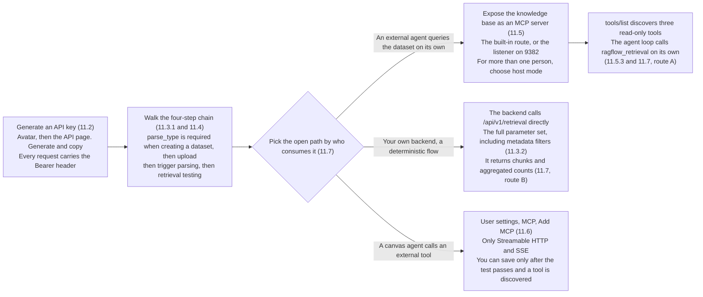
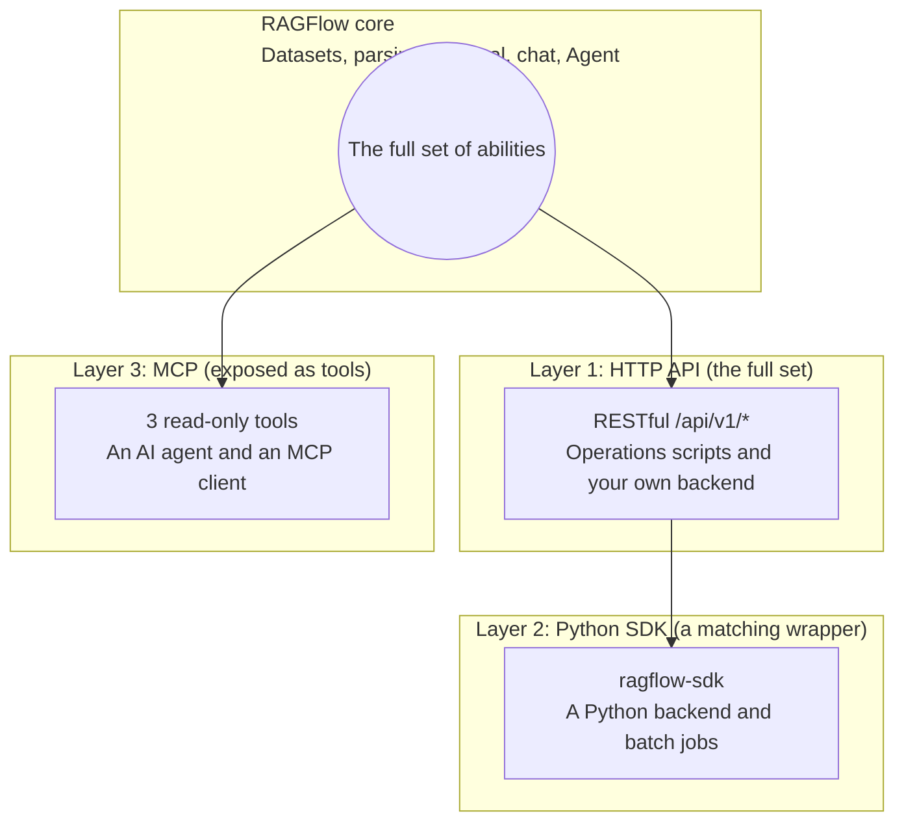
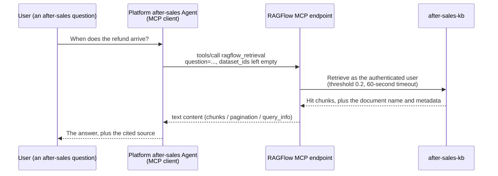

# Chapter 11 External integration: API and MCP

> Chapter guide: By the end of Chapter 10, after-sales-kb has grown a canvas Agent, but its capability is still locked inside RAGFlow's own UI. The after-sales team's operations scripts want to import ticket documents in bulk, a backend of their own wants to embed retrieval into a business interface, and the Agent in the middle-platform after-sales domain from the MCP book wants even more to "search the knowledge base" directly. These demands point at the same thing: RAGFlow has to open itself up. This chapter sorts out three layers of the open surface: the HTTP API (the full capability, programmatic), the Python SDK (an isomorphic wrapper), and MCP (Model Context Protocol, a tool-shaped exposure aimed at Agents). It gives the way to obtain an API key and authenticate, navigates over a hundred endpoints by domain, and then walks into MCP's two-way role: RAGFlow is both the MCP Server that exposes a knowledge base as tools, and the MCP Client that hangs external tools onto a canvas Agent. By the end of this chapter, you can: choose the right open path for each of the three consumers, "operations scripts, your own backend, and an external Agent"; walk through the API chain "create a dataset, then upload, then parse, then retrieval testing"; and state the configuration points and the tradeoff of RAGFlow's two-way MCP roles.



*Flowchart for this chapter*

## When you need it

**You need to write scripts that maintain the knowledge base in bulk** (import historical tickets, sync documents on a schedule, inspect parsing status). Take the HTTP API in Section 11.3 or the Python SDK in Section 11.4. Which one depends on your stack. This kind of script also meets the CLI inspection of Chapter 12 (production operations).

**You need to embed RAGFlow's retrieval or conversation capability in a backend of your own**. Take the HTTP API / SDK the same way, and focus on the retrieval endpoint in Section 11.3 and the tradeoff analysis in Section 11.7. For the details of connecting a Java backend, see the AgentScope Java book.

**You need to let a platform Agent outside RAGFlow (or an IDE, a ChatBot, or any other MCP client) search your knowledge base directly**. That is 11.5, RAGFlow as an MCP Server. **The other way around, you need the canvas Agent to call tools in the outside world** (web search, a third-party system). That is 11.6, RAGFlow as an MCP Client.

Prerequisites: the dataset concept from Chapter 3, the retrieval parameters from Chapter 7, and the Agent and tool components from Chapter 10.

## 11.1 Overview: three layers of the open surface

RAGFlow's outward open surface has three layers. Capability narrows from the bottom up, and the barrier to use drops from the top down:

| Layer | Form | Typical consumer | Coverage |
|----|------|-----------|--------|
| HTTP API | RESTful endpoints, `/api/v1/*` | Operations scripts, your own backend, any language that can send an HTTP request | The full capability: datasets, documents, chunks, chat assistants (Chat Assistant), sessions, Agents, memory, search apps, files, system |
| Python SDK | The `ragflow-sdk` package, an object wrapper | Python backends, data-analysis and batch scripts | Isomorphic with the HTTP API, organized by the same set of domains |
| MCP | Tools exposed by an MCP Server | AI Agents and every MCP client | Three retrieval and listing tools: read-only, aimed at "search the knowledge base" |

The division of labor among the three layers: **the HTTP API is the full set of capability**. The SDK is its "less trouble" version for Python users. MCP is a remodeling aimed at Agents. It does not turn every one of the hundred-plus endpoints into a tool. It exposes only the three that "an Agent actually needs": retrieve, list datasets, and list chat assistants.



*Three layers of the open surface: the HTTP API carries the full set, the SDK is an isomorphic wrapper, and MCP remodels it for Agents*

**Our recommendation**: the essential difference among the three layers is not "how many features", but **the caller's autonomy**. Scripts and backend code know exactly what they are going to call, so they get the full set and the parameters. An Agent decides on its own, inside a conversation, whether to search a knowledge base and which one to search, so it gets only a small number of tools with clear semantics and full descriptions. That is the principle from Chapter 6 of the MCP book, "the model chooses a tool by its description", landed on the RAGFlow side.

## 11.2 API keys and authentication

The three layers of the open surface share one credential: a RAGFlow API key. The steps the official docs give (acquire_ragflow_api_key, verified 2026-10-27):

1. In the RAGFlow UI, click the avatar in the upper right and enter the configuration page;
2. Click **API** to switch to the API page;
3. On that page, generate and copy the API key.

Authentication is a standard Bearer header. Every HTTP API request carries it:

```text
Authorization: Bearer <YOUR_API_KEY>
```

The base URL is the RAGFlow service address. The Go API port defaults to `9380` (the SDK Example writes it as `http://<YOUR_BASE_URL>:9380`). MCP's optional listener (Section 11.5) uses port `9382` separately, and in `host` authentication mode it also accepts three headers besides `Authorization: Bearer`: `api_key`, `X-API-Key`, and `Api-Key`.

Before troubleshooting, separate the **two layers of error codes**. Check the HTTP status code and the business code in the response body apart from each other:

| Layer | Value | The point of the meaning |
|----|-----|---------|
| HTTP status code | `200` | The request was processed, but the business result is the body's `code` |
| | `400` / `401` / `403` / `404` / `409` / `500` | Bad request / unauthorized / forbidden / not found / conflict / server error |
| Response body `code` | `0` | Success; `message` defaults to `"success"` |
| | `101` / `102` | Invalid request parameters / invalid or missing data |
| | `106` / `108` / `109` | The operation is still in progress / permission error / authentication error |
| | The rest | `10` not in effect, `100` exception, `103` operation error, `105` connection error, and others |

A version guardrail: RAGFlow 1.0 moved the public REST API from the Python backend to Go, and the docs list a batch of **removed alias endpoints**. When an old script is upgraded, check it against this list first (a selection; the full list is in the official reference "Removed API aliases"):

| Removed alias (available only on the Python backend) | The 1.0 replacement endpoint |
|------|---------|
| `POST /api/v1/chats/{chat_id}/completions` | `POST /api/v1/chat/completions` |
| `PUT /api/v1/chats/{chat_id}/sessions/{session_id}` | `PATCH` (the same path) |
| `PUT .../chunks/{chunk_id}` | `PATCH` (the same path) |
| `GET /v1/system/healthz` | `GET /api/v1/system/healthz` |
| The `POST /api/v1/file/*` series | Folded into the `POST` / `GET` / `DELETE /api/v1/files` series |

Dataset creation also replaced the old `chunk_method` with `parse_type` + `parser_id`. The Go backend's response carries an `X-API-Source: go` header, and during migration you can use it to confirm which backend is actually serving. The official docs also remind you: some validation business codes, error messages, and authentication HTTP statuses on the Go backend differ from Python. **Branch on the documented business codes. Do not match on the message text**.

On a real instance this page looks like the following. This screenshot was taken on 2026-11-04 on a local Docker deployment of RAGFlow v1.0.0-rc2. The entry is the avatar in the upper right, then User settings, then API:


Several key pieces of this section are on the same screen in this picture: the button that generates and copies the API key, the API server address, and the official wording of the "two layers of error codes". The HTTP status codes table lists 200 and 400/401/403/404 row by row, and the hint on the 200 row, "Check the response body code for the business result", is the source of the two-layer error codes. The Langfuse area at the bottom of the page (Traces, evals, prompt management) is only passed by in this chapter. Chapter 12 uses this same area of the same page when it configures tracing.

## 11.3 A map of the HTTP API

The HTTP API reference is organized by domain. This section gives a map of "domain, then duty, then a representative endpoint" (based on the v1.0.0-rc2 reference catalog, verified 2026-10-27). The specific parameters follow the official reference:

| Domain | Duty | Representative endpoint |
|----|------|---------|
| OpenAI-Compatible API | Connect a chat assistant and an Agent directly with an OpenAI client | `POST /api/v1/openai/{chat_id}/chat/completions` |
| Dataset management | Create, delete, update, and list datasets (Dataset) | `POST /api/v1/datasets` |
| Documents inside a dataset | Upload, update, download, list, delete, and trigger parsing | `POST /api/v1/datasets/{dataset_id}/documents`, `POST /api/v1/datasets/{dataset_id}/chunks` |
| Chunk management | Create, delete, update, and list chunks (Chunk), metadata, retrieval | `POST /api/v1/retrieval` |
| Chat assistant management | Chat assistant configuration | `POST /api/v1/chats` |
| Session management | Sessions, conversation, TTS/STT, and related questions for assistants and Agents | `POST /api/v1/chats/{chat_id}/sessions` |
| Agent management | List, create, update, delete, and versions of Agents | `GET` / `POST /api/v1/agents` |
| Memory management | Create, delete, update, list, and retrieve Memory and its messages | The memory series of endpoints |
| System and files | Health check, user file management (including Git-style commits/versions) | `GET /api/v1/system/healthz`, `POST /api/v1/files` |
| Search apps | Search app management | The endpoint group for creating, deleting, updating, and listing search apps |

### 11.3.1 A walkthrough: the four-step chain from creating a dataset to retrieval

Using the after-sales knowledge base of our running example, walk the most central chain in four steps (**none of the curls below has been verified hands-on**; the paths and fields are taken from the original official reference, and the measurement list is in the review checklist at the end of the chapter):

Step one, create a dataset. Note the `parse_type` that 1.0 requires (`1` is a built-in parser and needs `parser_id`; `2` is an ingestion pipeline and needs `pipeline_id`; see Chapter 4):

```bash
curl --request POST \
     --url http://{address}/api/v1/datasets \
     --header 'Content-Type: application/json' \
     --header 'Authorization: Bearer <YOUR_API_KEY>' \
     --data '{"name": "after-sales-kb", "language": "Chinese",
              "parse_type": 1, "parser_id": "general"}'
```

Step two, upload a document. `multipart/form-data` carries the file, and more than one can be sent at once:

```bash
curl --request POST \
     --url http://{address}/api/v1/datasets/{dataset_id}/documents \
     --header 'Content-Type: multipart/form-data' \
     --header 'Authorization: Bearer <YOUR_API_KEY>' \
     --form 'file=@./faq.docx'
```

Step three, trigger parsing. Pass the document ID returned by the previous step to the parsing endpoint (built-in pipeline datasets only; an ingestion-pipeline dataset uses `POST /api/v1/documents/ingest` instead):

```bash
curl --request POST \
     --url http://{address}/api/v1/datasets/{dataset_id}/chunks \
     --header 'Content-Type: application/json' \
     --header 'Authorization: Bearer <YOUR_API_KEY>' \
     --data '{"document_ids": ["<document_id>"]}'
```

Step four, retrieval testing. Turn the parameters tuned in Chapter 7 into an API call (threshold `0.2`, keyword weight `0.7`, no rerank):

```bash
curl --request POST \
     --url http://{address}/api/v1/retrieval \
     --header 'Content-Type: application/json' \
     --header 'Authorization: Bearer <YOUR_API_KEY>' \
     --data '{"question": "退货的钱什么时候到",
              "dataset_ids": ["<dataset_id>"],
              "similarity_threshold": 0.2}'
```

The sample question is kept in Chinese: "退货的钱什么时候到" ("When does the refund arrive?").

In a successful response, each chunk in the `data.chunks` array carries fields such as `content`, `similarity`, `term_similarity`, `vector_similarity`, and `document_id`, and `data.doc_aggs` gives the hit counts aggregated by document. It is the same set of data you see on the retrieval-testing page in Chapter 7.

**Our recommendation**: this four-step chain is the programmatic projection of the "knowledge-base data plane". Whatever clicking a button in the UI can do, this can do. Operations scripts (scheduled import, batch parsing, inspection of parsing status) and the CLI of Chapter 12 (production operations) share the same base layer. When you write a script, reuse the tuning conclusion of Chapter 7 first, instead of tuning again inside the script.

### 11.3.2 The parameter surface of the retrieval endpoint

`POST /api/v1/retrieval` is the full-capability retrieval entry. Its parameter surface is much wider than the MCP tool (11.5 opens only part of it). Beyond the walkthrough, these parameters are worth remembering on their own:

| Parameter | Default | Description |
|------|------|------|
| `page_size` | `30` | Chunks per page |
| `similarity_threshold` | `0.2` | The minimum similarity threshold |
| `keywords_similarity_weight` | `0.7` | The keyword-similarity weight; the vector weight is `1 - this value` |
| `knn_top_k` | `1024` | How many chunks take part in the vector cosine calculation; the old parameter `top_k` is deprecated and is only an alias |
| `knn_num_candidates` | `max(2048, knn_top_k)` | The neighbor-candidate count, which must be >= `knn_top_k` (currently takes effect only on Elasticsearch) |
| `rerank_candidates_count` | `64` | How many candidates enter reranking, which must be >= `page x page_size` |
| `metadata_condition` | — | Metadata filtering: `logic` (`and`/`or`) plus an array of conditions (field name, comparison operator, value) |
| `use_kg` | `false` | Retrieve knowledge-graph-related chunks, aimed at multi-hop questions (the graph must be built first; see Chapter 6) |
| `include_knowledge_compilation` | `true` | Whether to include knowledge-artifact chunks; `knowledge_compilation_scope` chooses `dataset`/`document`/`all` |
| `highlight` / `cross_languages` / `keyword` | `false` | Highlighting, cross-language retrieval, keyword matching |

The full set of comparison operators for metadata filtering: `contains`, `not contains`, `start with`, `empty`, `not empty`, `=`, `≠`, `>`, `<`, `≥`, `≤`. **Our recommendation**: this table is the parameter dictionary for "persisting the Chapter 7 tuning conclusion into code". When scripted retrieval goes wrong, first reproduce it in Chapter 7's test state, then migrate the parameters against this table. Do not tune blindly inside the script.

## 11.4 Python SDK: the isomorphic shortcut

After `pip install ragflow-sdk`, the SDK wraps the HTTP API as an object model: `RAGFlow` is the entry, and objects such as `DataSet`, `Document`, `Chunk`, `Chat`, `Session`, and `Agent` hang under it. **Isomorphism** shows up in two places. First, the official Python reference and the HTTP reference are organized under the same set of domain headings (dataset management, documents, chunks, and so on), and each endpoint corresponds to one method. Second, object methods correspond one to one with REST endpoints, such as `DataSet.upload_documents()` for document upload and `DataSet.async_parse_documents()` for triggering parsing.

```python
from ragflow_sdk import RAGFlow

# Not tested: adapted from the official reference example; see the checklist at the end of the chapter
rag = RAGFlow(api_key="<YOUR_API_KEY>",
              base_url="http://<YOUR_BASE_URL>:9380")

dataset = rag.create_dataset(name="after-sales-kb")

with open("./faq.docx", "rb") as f:
    dataset.upload_documents(
        [{"display_name": "faq.docx", "blob": f.read()}])

docs = dataset.list_documents()
dataset.async_parse_documents([d.id for d in docs])  # Trigger parsing asynchronously

chunks = rag.retrieve(
    question="退货的钱什么时候到",  # "When does the refund arrive?"
    dataset_ids=[dataset.id],
    similarity_threshold=0.2,
)
```

Three details of the SDK Example are worth noticing: the parameter for uploading a document is a list of dictionaries `{"display_name": ..., "blob": ...}`, and the file contents are read in as bytes; parsing is **asynchronous**. `async_parse_documents()` only submits the task, and formally polling the parsing status uses the document's `run` state (progress and troubleshooting are in Chapter 4 and Chapter 12); the signature of `RAGFlow.retrieve()` is isomorphic with the retrieval endpoint in Section 11.3 (`page_size` defaults to 30, `vector_similarity_weight` defaults to 0.3), but note that it goes through the SDK wrapper and not the OpenAI-compatible layer.

When do you choose the SDK over bare HTTP? **Our recommendation**: a Python project prefers the SDK in every case. It saves the boilerplate of authentication headers, envelope parsing, and retries. A non-Python backend (such as a Java service) goes straight to the HTTP API, and there is no need to introduce a layer of Python just to call the API (for the knowledge-base integration topic on the Java side, see the AgentScope Java book).

## 11.5 RAGFlow as an MCP Server

The first three layers of the open surface are given to "programs". This section is given to "Agents". RAGFlow exposes knowledge-base capability as MCP (Model Context Protocol) tools, and any MCP client -- an external platform Agent, an IDE, a ChatBot -- can discover and call them. The protocol itself (tool discovery, transport, authentication semantics) is not expanded in this chapter. For the systematic explanation, see Chapter 2 of the MCP book. Here the focus is how RAGFlow exposes itself (based on the official MCP docs, verified 2026-10-27).

### 11.5.1 Two endpoints and two authentication modes

RAGFlow's Go API process provides two MCP paths:

| Endpoint | How it is turned on | Transport | Authentication |
|------|---------|------|------|
| `POST /api/v1/mcp` (Go API port 9380) | Available with the API service | Streamable HTTP, JSON response | Each client brings its own RAGFlow credential (the `Authorization` header) |
| Optional MCP listener (default `127.0.0.1:9382`) | `mcp.enabled: true` or `RAGFLOW_MCP_ENABLED` | Streamable HTTP (`/mcp`); legacy SSE (`/sse` + `/messages/`) | `host` or `self-host` mode |

The optional listener is configured in the `mcp` section of `conf/service_conf.yaml`. The minimal Example for enabling it locally (following the official original):

```yaml
mcp:
  enabled: true
  host: 127.0.0.1
  port: 9382
  launch_mode: host
  transport_sse_enabled: true
  transport_streamable_enabled: true
  json_response: true
```

Every field has an environment variable of the same name, `RAGFLOW_MCP_*`, that can override the YAML (such as `RAGFLOW_MCP_ENABLED`, `RAGFLOW_MCP_PORT`, and `RAGFLOW_MCP_HOST_API_KEY`). When both transport switches are off, Streamable HTTP is enabled again with a streaming response. An illegal port or launch_mode prevents startup. A Docker deployment exposes `RAGFLOW_MCP_HOST=0.0.0.0` and `SVR_MCP_PORT` (default `9382`) to the host, and the container has to be rebuilt after a change. Authentication has two grades:

| Mode | How the credential is handled |
|------|---------|
| `host` | Each request is authenticated by the credential it brings itself; `Authorization: Bearer <key>` is recommended; each client operates **as its own identity** |
| `self-host` (the default) | `host_api_key` must be configured before startup; **every client that connects shares the identity of the configured user**, regardless of which header the machine itself brings |

**Our recommendation**: when more than one person or more than one Agent connects, use `host` mode. Under `self-host`, every client shares one identity, and both the permission boundary and the audit get smeared. The official docs also remind you that this mode is only for trusted clients and should be constrained with a firewall. This matches the authorization-layer conclusion of Chapter 10 of the MCP book, "deployment and security": the granularity of the credential decides whom you can audit down to.

### 11.5.2 The tool set: three read-only tools

The Go MCP runtime registers three tools, executed as the authenticated user, with a server-side timeout of 60 seconds:

| Tool | Duty | Key parameters |
|------|------|---------|
| `ragflow_retrieval` | Retrieve relevant chunks from datasets | `question` (required); `dataset_ids` (if omitted, every dataset that user can access); `document_ids`; `page_size` (1-100, suggested <= 50); `similarity_threshold` (default 0.2); `vector_similarity_weight` (default 0.3); `keyword`, `top_k`, `rerank_id`, and others |
| `ragflow_list_datasets` | List the datasets that can be accessed | `page`; `page_size` (default 100) |
| `ragflow_list_chats` | List the chat assistants that can be accessed | `page`; `page_size` (default 30) |

Three implementation details, and they are a model of "making a knowledge base into an Agent tool that is good to use":

1. **Retrieval returns structured JSON**: a single text content contains `chunks` (chunks, with the dataset name, the document name, and metadata), `pagination` (`page` / `page_size` / `total_chunks` / `total_pages`), and `query_info` (the question and the parameters echoed back). From that, an Agent can judge whether to turn the page and whether to tighten the conditions.
2. **Dynamic description injection**: in the schema returned by `tools/list`, RAGFlow **appends the dataset information the currently authenticated user can access into the descriptions of the retrieval tool and the list-datasets tool**, and appends the chat-assistant information that can be accessed into the description of the list-chats tool. When the model chooses a tool, it can already "see" which bases can be searched, and it does not have to blindly call the list once first.
3. **Parameter guardrails are built in**: `page x page_size` must not exceed the rerank-candidate window of 512, and going past it reports an error directly; the upper bound of `top_k` is 1024. The guardrail is written into the schema and the validation, and it does not rely on a prompt to persuade. That is another echo of Chapter 6 of the MCP book, "write the constraint into the structure".

### 11.5.3 The meeting point: the knowledge base becomes a tool of the platform Agent

For an external Agent, connecting takes only three steps: in the MCP client configuration, point at RAGFlow's MCP endpoint (the built-in route or the listener URL) and bring the credential; the client finishes initialize and `tools/list` and discovers the three tools; after that, the Agent can call `ragflow_retrieval` on its own during a conversation to search the base. The far-reaching part of this step: **the knowledge base no longer requires the consumer to understand RAGFlow's domain model** (datasets, chunks, weights). It is compressed into one task-level tool with clear semantics: "retrieve knowledge-base chunks by question". That is the promise of Chapter 8 of the MCP book, "connecting clients across frameworks": the same Server, common to different frameworks. For how a platform-side Agent consumes these tools inside its loop, see Chapter 8 of the MCP book. Section 11.7 walks this meeting path in full with our running example.

## 11.6 RAGFlow consuming external MCP: both directions are MCP

In the previous section RAGFlow is the Server being consumed. In this section the role reverses. A canvas Agent (Chapter 10) can mount tools from an external MCP Server, and RAGFlow becomes an MCP Client.

The entry is in the UI: **User settings → MCP → Add MCP**. Fill in four items: Name (at most 64 characters, letters, digits, underscores, and hyphens), URL (the full MCP endpoint), Server type (`streamable-http` or `sse`), and Authorization Token (optional, sent as `Authorization: Bearer <token>`). Click refresh to test the connection and discover tools. The official design is that **the Save button stays disabled until the test succeeds and at least one tool is discovered**. A configuration that cannot connect does not get into the system. After tools are discovered, enable them as needed inside the Agent component (such as `web_search` / `web_fetch` in the official Parallel Search Example). The official docs specifically remind you: importing a Server does not automatically make it the Agent's default search tool.

Four engineering points (all from the official docs):

- **Only two transports are supported, Streamable HTTP and SSE**. It does not connect directly to a `stdio` MCP Server. To use a stdio service, first turn it into an HTTP endpoint through a gateway or a proxy (Chapter 10 of the MCP book is exactly the expansion of this kind of gateway).
- **Non-public addresses are rejected by default**: the URL must be `http(s)://`, and every address that DNS resolves must be publicly routable. Loopback, private, link-local, and Docker network ranges are all rejected, to prevent SSRF. Connecting a self-hosted private-network MCP requires `ALLOW_ANY_HOST=true` in the backend environment (note that this is a shared switch, and it also allows private database hosts).
- **It does not use the system proxy**: the Go MCP client connects directly to the address after validation, and it does not read HTTP proxy environment variables. When troubleshooting an enterprise intranet, do not waste effort on the proxy variables.
- **The smallest credential surface**: the form exposes only Bearer Token as an authentication method. To customize request headers, import a JSON file, and `headers` must be an object of string to string. Real credentials should not go into a configuration file that is committed to a repository.

When a connection fails, the official troubleshooting table can be checked directly (a selection):

| Symptom | Where to look |
|------|---------|
| `Invalid MCP url` or a scheme error | The endpoint must be a full `http(s)://` address, and the `/mcp` or `/sse` path has to be right |
| `URL resolves to a non-public address` | Check DNS from the RAGFlow backend environment; a public domain name is also rejected if it resolves to a private address (a proxy tool in Fake-IP mode will trigger this) |
| Connection or discovery timeout | Outbound network, transport type, endpoint path; the discovery timeout defaults to 10 seconds |
| Authentication failure | Check the Token, or switch to a JSON import with custom headers |
| Save stays gray | Test the current configuration again, and confirm that the server has declared at least one tool |

**Our recommendation**: two-way MCP lets RAGFlow occupy two places in the MCP topology at once. Outward, it is the provider of "knowledge-base tools". Inward, it is the tool aggregator of the canvas Agent. This is not a confused role. It is the natural result of the two sides of the same protocol: the protocol only specifies that a Server exposes tools and a Client consumes tools, and RAGFlow happens to have a need on both sides. When you connect an external tool to a canvas Agent, still follow the discipline of Chapter 10: the tool has to be hung on the Agent component and enabled explicitly, and "imported" does not mean "in effect".

## 11.7 Running case: the platform-side after-sales Agent retrieves after-sales-kb

The middle-platform after-sales domain in the MCP book has one main line: 20 middle-platform interfaces are aggregated into 6 after-sales tools and, through a Gateway, consumed by Agents of several frameworks. Now this platform-side after-sales Agent meets a new requirement. The user asks "when does the refund money arrive", and the Agent needs to search the after-sales knowledge base (the after-sales-kb built in Chapters 1-8), and not only the ticket interfaces. Two routes:

**Route A: connect through an MCP tool (for a general Agent to reuse).** The platform-side Agent connects to RAGFlow's MCP endpoint as an MCP client and discovers the three tools, including `ragflow_retrieval`. The call inside the Agent loop is: `question="退货的钱什么时候到"` ("When does the refund arrive?"), and `dataset_ids` is left empty (search every dataset the user can access, or call `ragflow_list_datasets` first to confirm). The returned `chunks` carry the document name and metadata, and the Agent stitches the citations into the answer. The whole path is zero code: on the RAGFlow side you only finished building the base and tuning in Chapters 1-7, plus one MCP configuration; the consumer only needs an MCP client.



*Route A: the platform-side Agent retrieves the knowledge base through an MCP tool. RAGFlow exposes only the one action, "search"*

**Route B: connect the HTTP API directly (for a backend of your own).** If the after-sales domain wants to control retrieval **inside its own backend service** -- for example, embed `POST /api/v1/retrieval` into an existing ticket-query interface, and do a second pass on the returned chunks, add a cache, and add authorization -- go directly to the API in Section 11.3 (for the implementation details of a Java backend, see the AgentScope Java book). This route gets the full parameter surface (`metadata_condition`, `use_kg`, `include_knowledge_compilation`). The MCP tool opens only part of it.

The tradeoff, written as a table:

| | Route A: MCP tool | Route B: direct HTTP API |
|----|----------------|---------------------|
| Consumer | Any MCP client (a platform Agent, an IDE, and so on) | Your own backend code |
| How it is called | The model **chooses on its own** inside the Agent loop | The code calls it explicitly; timing and parameters are decided by engineering |
| Parameter surface | The commonly used retrieval parameters (threshold, weight, pagination) | The full set (metadata filtering, knowledge graph, knowledge artifacts) |
| Cost of reuse | Configure once, common to many frameworks (Chapter 8 of the MCP book) | Each backend implements a client of its own |
| Audit and governance | Tool-call logs on the Agent side | Backend logs, and you can build your own instrumentation |

**Our recommendation**: the two are not a choice of one or the other. They are **split by the nature of the consumer**. For a knowledge base shared by "many Agents that decide on their own", take MCP, and let RAGFlow model the tools for you. For retrieval embedded in "a deterministic business flow", take the HTTP API, and keep the parameters and the timing in your own hands. The final form of the platform-side after-sales Agent is both at once: interactive question answering by the Agent takes the MCP tool, and the automatic summary of the ticket system takes a direct backend connection. There is only one knowledge base, and each open surface takes what it needs.

## Chapter summary

1. **Three layers of the open surface, divided by the caller's autonomy**: the HTTP API is the full capability (scripts and your own backend), the Python SDK is an isomorphic wrapper (the less-trouble version on the Python side), and MCP is three tools (aimed at an Agent that decides on its own).
2. **One credential, two layers of error codes**: `Authorization: Bearer <KEY>` covers all three layers; check the HTTP status code and the response body's `code` apart from each other; during the 1.0 migration, use `X-API-Source: go` to verify the backend.
3. **The API chain in four steps**: create a dataset (`parse_type` is required), then upload, then trigger parsing (the built-in pipeline and the ingestion pipeline use different endpoints), then retrieval testing with `POST /api/v1/retrieval`.
4. **As an MCP Server**: two paths, the built-in route `/api/v1/mcp` and the optional listener (9382); `host` mode keeps identities separate, and `self-host` mode shares an identity and should be used with care; three read-only tools are modeled with dynamic descriptions and parameter guardrails.
5. **As an MCP Client**: a canvas Agent can hang external MCP tools, only Streamable HTTP and SSE are supported, and non-public addresses are rejected by default; "the test passed and tools were discovered" is the precondition for saving.
6. **Both directions are MCP, split by the consumer**: reuse by a general Agent takes MCP, and a deterministic business flow takes the HTTP API. One after-sales-kb, two layers of open surface.

A suggestion for the next step: merge this chapter's operations scripts and the CLI inspection of Chapter 12 (production operations) into one task list. If you want to connect the MCP exposure to an enterprise gateway and authentication, Chapter 10 of the MCP book is the next stop.

## Acceptance checklist

By the time you have read this far, you should be able to:

- ☐ State the typical consumer of each of the three layers of the open surface, and assign one path to each of the three requirements "bulk-import historical tickets", "a Java backend embeds retrieval", and "a platform Agent searches the knowledge base";
- ☐ After you have an API key, use curl with an authentication header to complete the four calls "create a dataset, then upload a document, then trigger parsing, then retrieval testing";
- ☐ Distinguish an HTTP status code from a business code in the response body, and state the 1.0 migration change in which `chunk_method` was replaced by `parse_type` + `parser_id`;
- ☐ Use the SDK to write a minimal script for upload (`display_name` + `blob`) and asynchronous parsing (`async_parse_documents` + `list_documents`);
- ☐ Configure one connection with RAGFlow as an MCP Server: state the difference between the two endpoints and the two authentication modes, and explain what the dynamic description of `tools/list` means for the model choosing a tool;
- ☐ Connect an external MCP Server inside a canvas Agent, and state the transport limit (stdio is not supported) and the precondition that "it can be saved only after the test passes";
- ☐ Make the split decision for our running example: which consumers take the MCP tool, which take a direct HTTP API connection, and why.

## Further reading

- **Chapter 12 (production operations)**. Where this chapter's HTTP API scripts go when they become operations: inspection, batch processing, and troubleshooting.
- **MCP book Chapter 2 (core concepts of the protocol)**. The protocol mechanism behind this chapter's MCP endpoints: tool discovery, transport, and authentication semantics.
- **MCP book Chapter 8 (connecting clients across frameworks)**. The full chain by which the platform-side after-sales Agent consumes `ragflow_retrieval`: the Agent loop and the multi-framework support matrix.
- **AgentScope Java book Chapter 22 (RAG knowledge-base integration)**. The Java implementation of route B: how a backend of your own consumes RAGFlow's API.
- **The official MCP docs (overview / use_ragflow_as_mcp_server / mcp_tools / connect_external_mcp_server)**. The original basis of the four subsections of this chapter. The parameter tables follow them.

## Review checklist (before publication)

- [ ] Every Example in this chapter is **not verified hands-on**: the four curls in Section 11.3, the SDK script in Section 11.4, and the MCP configuration in Section 11.5/11.6. Before publication, run each one through on a v1.0.0-rc2 instance and record the version;
- [ ] The endpoint-domain table (Section 11.3) is summarized from the catalog. Before publication, check the domain split and the spelling of the representative endpoints against the latest HTTP API reference;
- [ ] The field list of the MCP environment variables and the `mcp` configuration section was not expanded item by item. Before citing it, check it against the official original of use_ragflow_as_mcp_server;
- [ ] The two-layer error-code table includes the commonly used codes. When using low-frequency codes such as `10`/`100`/`103`/`105`, check the original again;
- [ ] Cross-book references (MCP book Chapters 2/8/10, AgentScope Java book Chapter 22) get a full check before publication so none of them break.
