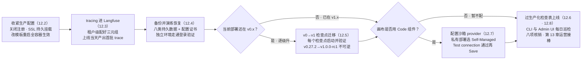
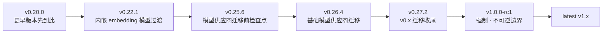

# Chapter 12 Production operations

> Chapter guide: after-sales-kb finished tuning in Chapter 7, the "After-sales Assistant" was connected to the support desk in Chapter 8, and retrieval quality passed during the trial run. Now the support lead asks three questions: "Everyone goes live next week. What if the data is lost? If the service goes down, who finds out first? How do we move up to the next version?" Those three questions are the distance between a single-machine trial and production. This chapter splits that distance into six things: tune the configuration from "it can run" to "it can take the load" (12.2); tracing sends every question and answer into an observability platform (12.3); a backup and a restore drill make a disk failure no longer an incident (12.4); an upgrade follows checkpoints instead of swapping an image (12.5); the CLI and the Admin UI give an administrator a cockpit (12.6); the code execution sandbox (Code Execution Sandbox) shuts untrusted code in a cage (12.7). By the end of this chapter, you can: list an executable production checklist for after-sales-kb; finish a backup, a restore drill, and v0-to-v1 upgrade preparation on your own; and finish the daily inspection with the CLI and the Admin UI.



*Flowchart for this chapter*

## When you need it

Three typical situations, and three ways to use this chapter.

**after-sales-kb goes live for everyone next week**. Go straight to the production checklist in 12.8. Every item in the table is marked with its section. The details of tightening the configuration and encrypting the entry are in 12.2.

**In production, answers miss the question, or the service is abnormal, and you do not know where to look**. Two lines in parallel: the service status in 12.6 shows whether dependencies and processes are healthy, and the tracing in 12.3 shows what actually happened on the model side for this question and answer.

**You have an old v0 deployment to move up to v1, or you just went through a disk alert**. 12.5 (the checkpoint upgrade route and the irreversible boundary) and 12.4 (the backup scope and the restore drill).

Prerequisites: the Docker deployment and the configuration system from Chapter 2; the building of after-sales-kb in the running case (Chapters 3-10).

## 12.1 Overview: from a single-machine trial to production

The deployment goal of Chapter 2 is "get it running". The goal of this chapter is "sleep at night". The gap between the two can be listed as a table, and the table is also the map of this chapter:

| Dimension | Single-machine trial state | Production state | This chapter |
|------|-----------|--------|------|
| Capacity | Run all the way on the default configuration | Account for a resource limit container by container, and reserve embedding resources | 12.2 |
| Observability | When something breaks, flip through container logs | Every question and answer goes into a tracing platform, and can be looked up by tenant and session | 12.3 |
| Backup | None, or an occasional manual copy of a volume | The eight kinds of persistent data backed up as a set, with a periodic restore drill | 12.4 |
| Upgrade | Change an image tag and restart | Verify checkpoint by checkpoint, and treat an irreversible boundary on its own | 12.5 |
| Management plane | Go straight into a container, change the database | CLI and Admin UI: users, service status, system settings | 12.6 |
| Security | Default ports, open registration | An SSL entry, registration closed, account governance, sandbox isolation | 12.2/12.6/12.7 |

Version baseline: every fact in this chapter follows the official docs of RAGFlow v1.0.0-rc2 (released 2026-10-16, Go backend), verified 2026-10-27. Pay special attention: the Go backend of v1 and the Python backend of v0 are two generations of runtime. Going from v0 to v1 is a "migration" and not an "update" (see Chapter 1). That is also why 12.5 is its own section, and the one written with the most weight.

## 12.2 Production configuration

### 12.2.1 The configuration system, reviewed

Section 2.3 of Chapter 2 already introduced how the configuration files of a Docker deployment divide the work. Here they are reviewed from a production angle. Before you troubleshoot "I changed the configuration, why did it not take effect", first confirm you changed the right file:

| File | What it governs | A typical production change |
|------|--------|-----------------|
| `docker/.env` | Images, service profiles, external ports, the various credentials | Close registration, adjust ports, configure an image source |
| `docker/service_conf.yaml.template` | System-level configuration consumed by the Go service (API/MySQL/MinIO/S3/Kvrocks) | Switch the S3 backend, tune the connection pool |
| `docker/docker-compose.yml` | The choice of the RAGFlow service and dependency profiles | Add a persistent mount for certificates to a service |
| `docker/docker-compose-base.yml` | Shared dependencies: the document engine, the metadata database, MinIO, Kvrocks, NATS, ClickHouse | External storage, or a different document engine |

Among them, `service_conf.yaml` is generated from the template when the container starts, and the environment variables in it are replaced. Editing the generated file by hand is pointless. Edit the template. Any change to the files above takes effect only after every container is restarted:

```bash
docker compose --env-file docker/.env -f docker/docker-compose.yml up -d
```

### 12.2.2 A checklist of production points

Items in `.env` and `service_conf` that are worth going through one by one at production deployment:

| Configuration item | Default | What production cares about |
|--------|--------|-----------|
| `SVR_WEB_HTTP_PORT` / `SVR_WEB_HTTPS_PORT` | 80 / 443 | The public entry for the browser and the API; 9380 is the internal API port, and business traffic should go through the Nginx public port |
| `MEM_LIMIT` | about 7.52 GiB | A limit **per container**: it is not the host's memory requirement, it is not a guarantee of the total, and it does not mean each container really uses that much; account container by container |
| `ENABLE_REGISTER` | 1 (open registration) | Set it to 0 in production, and have accounts created by an administrator (12.6) |
| `MYSQL_MAX_PACKET` | 1 GiB | With an external MySQL, the server's `max_allowed_packet` has to stay compatible |
| `mysql.max_connections` / `stale_timeout` | 900 / 300 seconds | The connection-pool defaults of a Go deployment; tune them by concurrency |
| `DB_TYPE` / `METADATA_DB_PROFILE` | mysql | OceanBase can be connected through the MySQL-compatible protocol |
| `STORAGE_IMPL` + the `s3:` section | MinIO | Switch to an S3-compatible backend (Tigris/AWS S3/OSS and others); **build a restore point before you change the storage layout** (12.4) |
| `api.trusted_proxies` | loopback only | An explicit list is a **replacement**, not an append: keep the loopback entry and then add the proxy range; if it is emptied, no proxy header is trusted |
| `TEI_MODEL` | - | A local embedding service; reserve memory/video memory by measured model, precision, and concurrency |
| `RAGFLOW_IMAGE` | the official image | When pulls are restricted, a Huawei Cloud or Alibaba Cloud image source can be used |

`trusted_proxies` gets a sentence of its own: it decides which proxies the Go API trusts for the `X-Forwarded-For` / `X-Real-IP` headers when restoring the client address. Login audit records and an Agent webhook's `ip_whitelist` both depend on it. If a reverse proxy other than the Nginx in front was put in place and this was forgotten, everything the audit records is the proxy's address.

### 12.2.3 SSL certificates: HTTPS at the entry

Put HTTPS on the public entry. The official path is to replace the site configuration of Nginx inside the RAGFlow container (taking the container `docker-ragflow-cpu-1` as the example):

```bash
# ① 宿主机准备 Nginx 格式证书,拷入容器
docker cp ./fullchain.pem docker-ragflow-cpu-1:/tmp/fullchain.pem
docker cp ./privkey.pem   docker-ragflow-cpu-1:/tmp/privkey.pem

# ② 容器内部署
docker exec -it docker-ragflow-cpu-1 /bin/bash
mkdir -p /etc/nginx/ssl
mv /tmp/fullchain.pem /etc/nginx/ssl/ && chmod 644 /etc/nginx/ssl/fullchain.pem
mv /tmp/privkey.pem   /etc/nginx/ssl/ && chmod 600 /etc/nginx/ssl/privkey.pem

# ③ 切换到 HTTPS 配置模板
cd /etc/nginx/conf.d/
mv ragflow.conf ragflow.conf.bak
cp /etc/nginx/ragflow.https.conf ./ragflow.conf
vi ragflow.conf        # 确认 ssl_certificate 与 ssl_certificate_key 指向 /etc/nginx/ssl/
nginx -t && nginx -s reload   # 语法校验通过后重载;无效则退出容器重启 ragflow-cpu
```

⚠️ **Persistence warning**: changes made with `docker cp` and `docker exec` are all lost after the container is rebuilt. After the test passes, store the certificates and `ragflow.conf` on the host, and add a persistent volume mount for them on the `ragflow-cpu` service in `docker-compose.yml`. Otherwise, the next upgrade or container rebuild quietly drops HTTPS back to HTTP.

## 12.3 Observability: tracing into Langfuse

RAGFlow has a built-in Langfuse integration. It records chat traces and generation observations of the chat model. There is only one prerequisite: a Langfuse workspace (cloud-hosted or self-hosted both work) and its project-level Public Key / Secret Key. The key is scoped to the project. Every environment that writes into the same project can share one pair.

Credentials are stored per tenant. Two configuration paths:

- Web UI: the avatar in the upper right, then **API**, then scroll to the bottom **Langfuse Configuration**, fill in Host, Public Key, and Secret Key, and save;
- HTTP API (see Chapter 11).

The "scroll to the bottom" of the Web UI path looks like the following on a real instance. This screenshot was measured on 2026-11-04 on a local Docker deployment of RAGFlow v1.0.0-rc2. It is the same API page as the figure in Chapter 11, and here you look at the bottom of the page:


The "scroll the API page to the bottom" in the body is fulfilled in this picture: the Langfuse Configuration area hangs under the status-code table of ERROR CODES, on the last row at the bottom of the page. Click Configuration to enter the filling and saving of the triple, Host, Public Key, and Secret Key. The API key is at the top of the page, and the tracing configuration is at the bottom of the page. One page apart, and the two actions use the same entry.

After saving, the Go chat pipeline uses these credentials to report on chat requests that **use a knowledge base or web search**. A chat that is traced looks like this in Langfuse:

| What is observed | What is recorded |
|---------|---------|
| trace: `openai_chat` | `userId` = the tenant ID; `sessionId` = the chat ID; metadata includes whether it is streaming and the number of configured knowledge bases |
| generation: `chat` | The model name; the input includes the prompt, the citation prompt, and the model message list |
| completion update | An output summary, plus the three token counts prompt / completion / total |

Delivery is asynchronous: a failed tracing delivery does not block the chat response. The availability of the observability platform is decoupled from the business (this book's position: this also means "a failed report" itself has no alert, and the health of the observability platform itself has to be watched on the platform side).

The internal structure of a trace, evaluation, and multi-tenant data analysis are work on the Langfuse side (see the Langfuse book). The minimum requirement for operations is: on the day of go-live, get traces into the platform. Carry out item 8 of the checklist in 12.8.

## 12.4 Backup and restore

### 12.4.1 What to back up

The positioning of the official v1 backup docs is restrained: create a same-version restore point, and move house to another host. An upgrade is a downstream action of it. Before any upgrade, do the backup in this section first. The first step in fixing the backup scope is always to look at the real mounts, and not to recite a list:

```bash
docker compose -p docker -f docker/docker-compose.yml ps --all
for container_id in $(docker compose -p docker -f docker/docker-compose.yml ps --all -q); do
  docker inspect "$container_id" --format '{{.Name}}{{range .Mounts}}{{println "" .Type .Source .Name .Destination}}{{end}}'
done
```

Under the default deployment, the checklist the official docs give is eight kinds of persistent data. Business data is the first three rows: the metadata database, object storage, and the retrieval index. The rest is supporting data and logs:

| Service / data | Persistent location |
|------------|---------|
| Metadata database (built-in MySQL) | `docker_mysql_data` |
| Object storage (built-in MinIO, uploaded files) | `docker_minio_data` |
| Elasticsearch index | `docker_esdata01` |
| Infinity index (if enabled) | `docker_infinity_data` |
| Kvrocks cache and checkpoints | `docker_kvrocks_data` |
| NATS JetStream data | `docker_nats_data` |
| Kibana data (if enabled) | `docker_kibana_data` |
| RAGFlow logs | the `docker/ragflow-logs` bind mount |

This table is a checklist. **The final backup scope follows the output of `docker inspect`**. Data that exists outside a Docker volume (such as external storage) has to be included too. Logs are only for troubleshooting. Missing them does not affect restoring business data. Besides the data volumes, also save `docker/.env`, the configuration templates, the certificates, and custom mount files. They contain credentials, and the backup itself has to be protected. Before shutdown, use `df -h` and `docker system df` to confirm host space. Prepare the `alpine:3.20` image in advance for an offline host.

### 12.4.2 The backup flow

Stop everything first, so the database, object storage, and index are not still changing while you archive. Then pack each recorded volume and verify it:

```bash
docker compose -p docker -f docker/docker-compose.yml down

backup_dir="backup-ragflow-v1-$(date +%Y%m%d-%H%M%S)"
mkdir "$backup_dir"

volume_name=docker_mysql_data    # 对每个记录的卷重复执行
docker volume inspect "$volume_name" >/dev/null &&
  docker run --rm -v "$volume_name":/source:ro -v "$PWD/$backup_dir":/backup alpine:3.20 \
    tar czf "/backup/$volume_name.tar.gz" -C /source . &&
  tar tzf "$backup_dir/$volume_name.tar.gz" >/dev/null
```

Finally `ls -lh "$backup_dir"` confirms that every volume has a matching `.tar.gz`. Note that the `tar tzf` step is not a ceremony. An archive that cannot be read is the same as no backup.

### 12.4.3 Restore, and the position on drills

Restore onto the target host: install the **same version** of RAGFlow, restore the saved configuration, put the backup directory at the repository root, and keep the services stopped. For each archive, if the target volume already exists, inspect it before using it. After `docker volume create`, unpack. Do not keep using a volume whose unpack failed. After confirming there is no data in it that must be kept, switch to a new empty volume and retry. Restore a bind mount to the same path on the source host. After that, start with `up -d`, look at the status with `ps --all` and `logs --tail=200 ragflow-cpu`, and finally log in and confirm: the knowledge bases and files are all there, files can be opened, and retrieval returns the content of parsed documents.

This book's position: **a backup that has not been through a restore drill is only a hope that occupies disk**. The official upgrade-preparation checklist likewise requires "restore and verify in an independent test environment, and the test deployment must not connect to production volumes". A restore drill is the cheapest disaster insurance. Schedule it as a periodic action (for a suggested cadence, see 12.8).

## 12.5 Upgrade and migration

### 12.5.1 The upgrade route: checkpoints, not swapping an image

There is an officially specified standard route from v0.x up to v1.x. An earlier deployment (below v0.20.0) first uses the files that version ships with to move up to v0.20.0. Note that Agents created before v0.20.0 are incompatible with what came after. The definitions are kept only as reference. After moving up to v0.20.0, rebuild them and retest:



*The standard upgrade route: every arrow is an independent upgrade and verification*

Two disciplines, with the weight of the official original:

- **You must start and verify every target version on the route**. Only changing an image tag, or copying volumes, does not execute that version's database and data migration.
- **Start from the first checkpoint that is newer than the current version**. Never downgrade, and never start an old version against data that a newer version has already used.

The verification checklist for each checkpoint: an old user can log in and see datasets; existing files can be listed and opened; retrieval on old documents has results; a new document can be uploaded, parsed, and retrieved; model providers, credentials, and the tenant's default models are correct; a representative Agent can run through. If the current checkpoint does not pass, do not enter the next one. The two checkpoints `v0.26.4` and `v0.27.2` keep `--init-model-provider-tables` on the first start, and check the migration logs.

General preparation before an upgrade (it holds for any version change): record the current version, the services that are enabled, whether you use Elasticsearch or Infinity, the storage backend, and custom mount files. Then stop every write task, such as document import, parsing, Agents, and sync. Then, while stopped, back up the configuration and every persistent volume. Then restore and verify in an independent test environment. Keep the original backup until that version passes acceptance.

### 12.5.2 v0.27.2 → v1.0.0-rc1: the irreversible boundary

This is the only **irreversible** step on the whole route. It introduces the v1 runtime and executes the data migration. Before you start, you must: stop every write task, and create and verify a complete v0.27.2 restore point. The engine and behavior changes this step brings:

| Change | The effect on operations |
|------|-------------|
| NATS replaces Redis as the message queue | Redis/Valkey data files are incompatible with Kvrocks/NATS storage; a Redis backup is only for rollback, and **is not restored into v1** |
| Kvrocks stores cache and checkpoints; ClickHouse is added | All three use brand-new empty volumes. Do not mount v0's Redis volume onto them |
| Deprecated HTTP API aliases are removed | Callers check the interfaces against Chapter 11 |
| Tag files are no longer bound to a dataset | A Tag dataset of the Python backend is invalid after migration: reconfigure the tag files on the Go backend and verify |
| The local sandbox and the early Team/Me permission behavior are not supported | The sandbox moves to the provider configuration in 12.7; for the permission system, see Chapter 13 |
| The GraphRAG / RAPTOR configuration pages go offline | Content already generated can still be retrieved |

Aligning the terms: the "knowledge base (Knowledge Base)" in the upgrade docs is the "dataset (Dataset)" this book says throughout. v1 changed the name, and the upgrade material was not all changed.

The operational skeleton (the default four-volume deployment of MySQL + MinIO + Redis + Elasticsearch):

```bash
# ① v0.27.2 停机并创建恢复点(四归档逐一校验可读)
docker compose -p docker -f docker/docker-compose.yml down
backup_dir="backup-v0.27.2-$(date +%Y%m%d-%H%M%S)"
bash docker/migration.sh backup "$backup_dir"
for archive in mysql_backup.tar.gz minio_backup.tar.gz redis_backup.tar.gz es_backup.tar.gz; do
  tar tzf "$backup_dir/$archive" >/dev/null || exit 1
done

# ② 新目录部署 v1.0.0-rc1:用新模板 .env 拷入旧值,RAGFLOW_IMAGE=infiniflow/ragflow:v1.0.0-rc1
# ③ 启动并跟踪迁移日志,直到迁移完成、服务起来
docker compose -p docker -f docker/docker-compose.yml up -d
docker compose -p docker -f docker/docker-compose.yml logs -f ragflow-cpu

# ④ 健康检查(默认 web 端口 80,改过 SVR_WEB_HTTP_PORT 则用实际值)
curl -f http://127.0.0.1/api/v1/system/healthz
```

The failure discipline, said once and clearly: if the migration reports an error, stop the v1 deployment and keep the logs. **Do not retry against partially migrated data**. Restore the complete v0.27.2 restore point, find the cause in an independent test environment, and start again from the restore point. RAGFlow does not provide an automatic reverse migration. Pointing the old application at the new database is not a rollback. A large base needs enough startup time left for schema changes and for backfilling session history. Keep parallel application replicas stopped until one migration attempt finishes.

Closing verification after the upgrade: log in and confirm the data and the configuration are there, and test one retrieval, one new-document upload, one chat, and one Agent run. A deployment that uses Tongyi Qianwen has to reselect the Base URL in the model provider and save again. Reconfigure Tag datasets according to the table above. Keep the v0.27.2 backup until the new deployment passes acceptance and runs steadily under normal load.

Later upgrades inside v1.x are much simpler: first do the backup in 12.4, then follow the official upgrade-from-v1.x docs. When the Go backend starts, it executes database migrations gated by version. The full record of each schema/data change and version marker is in the official Database Change Log. When troubleshooting a migration problem, follow that map. Understanding the main line of an upgrade does not depend on it.

## 12.6 CLI and Admin UI

The Go backend of v1 ships with two management planes: the command-line RAGFlow CLI (Admin mode) and the browser management interface (Admin UI). Both face the system administrator, both connect to the Go Admin Service (port 9381 by default inside the container, corresponding to `ADMIN_SVR_HTTP_PORT` in `.env`), and both should be exposed only to trusted administrators. Ordinary users use business functions such as the knowledge base, chat, and Agent, and do not need to touch them at all.

### 12.6.1 RAGFlow CLI

Install (in production, pin a version):

```bash
curl -fsSL https://raw.githubusercontent.com/infiniflow/ragflow/main/tools/scripts/install.sh \
  | VERSION=v1.0.0-rc2 sh
ragflow-cli --version
```

Connect in Admin mode (the default is `127.0.0.1:9381`; when the host port published by Docker is different, use the actual mapped port of `ADMIN_SVR_HTTP_PORT` in `docker ps`):

```bash
ragflow-cli --admin --host 127.0.0.1:9381 --user admin@ragflow.io
```

The password is entered at an interactive prompt. **Do not** pass a real password with `--password`. Command-line arguments are visible to other local processes, and they also go into shell history. `--output` can switch among `table` (the default) / `plain` / `json` (this book's position: inspection scripts use `json`, and a person reading uses `table`). The commands are SQL style: they end with a semicolon, they are case-insensitive, the prompt is `RAGFlow(admin)>`, and you remember them by command family:

| Command family | Representative commands | What they do |
|--------|---------|--------|
| Session | `LOGIN ADMIN` / `LOGOUT` / `PING` / `SHOW VERSION` | Connection and identity; `PING` and others do not require logging in first |
| Service | `LIST SERVICES` / `SHOW SERVICE '<name>'` | Dependency health plus runtime processes registered by heartbeat (`api_server` / `ingestor` / `file_syncer`) |
| User | `LIST USERS` / `CREATE USER` / `ALTER USER ACTIVE` / `ALTER USER PASSWORD` / `DROP USER` | The account lifecycle; before `DROP` you must first `ACTIVE off` (an active user refuses deletion); an administrator account cannot be deleted |
| Configuration | `LIST VARS` / `SHOW VAR '<name>'` / `LIST CONFIGS` / `LIST ENVS` | Runtime settings and an environment summary |
| Ingestion | `LIST INGESTORS` / `LIST INGESTION TASKS` | The ingestion processes and the task surface (for the orchestration of an ingestion pipeline (Ingestion Pipeline), see Chapter 10) |
| Message queue | `MQ SHOW` / `MQ LIST [PENDING]` / `MQ PUBLISH` / `MQ PULL` | Diagnose the NATS JetStream task stream; `PUBLISH` sends a test message, `PULL` acknowledges by default, and `NOACK` is a negative acknowledgement that can be redelivered |
| Meta-commands | `\h` / `\q` | Help and quit |

A typical inspection session:

```text
RAGFlow(admin)> LOGIN ADMIN 'admin@ragflow.io' PASSWORD '********';
RAGFlow(admin)> LIST SERVICES;
RAGFlow(admin)> SHOW SERVICE 'mysql';
RAGFlow(admin)> MQ SHOW;
```

### 12.6.2 Admin UI

The entry is `/admin` (for example `http://192.168.1.5/admin`). Three pages cover three kinds of system-level operations:

| Page | What it can do | Key constraints |
|------|---------|---------|
| Service status | View dependency health and process heartbeats: MySQL, the document engine (ES/Infinity), object storage, Kvrocks, NATS, and each process `api_server` / `ingestor` / `file_syncer`; in Actions, look at `elapsed` and the status message | A dependency row `alive` means the health check passed; a process row `alive` means there was a heartbeat within 45 seconds. This place does not provide an entry for container/log troubleshooting. To keep investigating, use the deployment environment's own tools |
| User management | Query users, create users, start and stop with `Active`/`Inactive`, reset passwords, delete, and view details (most recent login time, and so on) | You cannot disable, change the type of, reset, or delete the account you are currently logged in as; deletion is a high-risk action, so hand over resources first and set `Inactive` first; grant `Superuser` only to people who truly need to enter the Admin UI |
| Sandbox settings | Choose and test the code-execution sandbox provider | A system-level setting; saving takes effect for the whole deployment (12.7) |

The first of the three pages looks like the following on a real instance. This screenshot was measured on 2026-11-04 on a local Docker deployment of RAGFlow v1.0.0-rc2, entering the Service status page of the main site /admin with a Superuser account:


The "cockpit" in the body is this screen: five dependency rows (database, doc_engine, storage_engine, cache, message_queue) plus three runtime-process rows (api_server, ingestor, file_syncer), all Alive. Item 8 of the checklist in 12.8, "put Admin UI service status into the daily inspection", is scanning this. Two measured points, written down on their own: the entry of the Admin UI is the /admin path of the main site, not the root path of port 9381; and only a Superuser can enter. Measured with an ordinary account, the visit returns 403.

The initial administrator: when the Admin Service starts with `--init-superuser` and there is not yet a superuser, it creates `admin@ragflow.io` (initial password `admin`). Change the password immediately on the first login. This account is used for system initialization and for creating later administrators. **It is not a day-to-day operations account shared for the long term**. The meaning of account status: `Active` can log in and be used normally; `Inactive` forbids login, but the account and the data are kept. The official line on passwords: the create form's frontend validates at least 6 characters, and resetting a password at least 8 characters. A production environment should impose a stronger unified password policy.

The User management page looks like the following on a real instance. This screenshot was measured on 2026-11-04 on a local Docker deployment of RAGFlow v1.0.0-rc2. There are 4 users, and one row is redacted:


Status and User type are both inline dropdowns. Starting and stopping an account, and granting Superuser, are changed in these two columns. The constraint in the table above, "you cannot disable, change the type of, reset, or delete the account you are currently logged in as", can also be seen in the picture: for the account currently logged in, Shuzhou (书舟), these two columns are static badges, with no dropdown. An ordinary account and a Superuser are obvious at a glance in the User type column. The "minimum grant of Superuser" in 12.7.2 is the discipline of this column.

## 12.7 The code execution sandbox and the security surface

### 12.7.1 The sandbox: deciding where code runs

The Code component of an Agent canvas (see Chapter 10) can execute Python or JavaScript. That code may come from the canvas author, and it may also be generated by the model. This book's position: **untrusted code does not enter the production process**. Handing the code to an isolated environment to execute is the precondition for putting a canvas that has a Code component into production. That is why the code execution sandbox (Code Execution Sandbox) exists: in v1, an administrator must first select and configure a sandbox provider before the Code component can be used.

The provider decides where the code actually runs:

| Provider | Where the code runs | When to choose it |
|----------|-----------|---------|
| **Self-Managed** | Python/Node.js Runner containers managed by the Sandbox Executor Manager in your own environment | The default option; the first choice for a private deployment that keeps control of execution |
| **SSH** | An existing remote Linux host | You already have a suitable execution server, and you can manage SSH access and host keys |
| **Aliyun Code Interpreter** | An execution environment hosted by Alibaba Cloud | The organization already uses Alibaba Cloud and wants a hosted environment |
| **E2B** | An E2B cloud sandbox | You want external hosting and do not want to operate local Runner containers |
| **Tenki** | A one-shot microVM created for each execution | You want strong isolation and a short lifetime on every run |
| **UCloud Agent Sandbox** | A hosted sandbox in a region UCloud supports | You need a hosted sandbox inside a UCloud region |

A private deployment is recommended to use Self-Managed. The standard form has three stages: RAGFlow sends the execution request to the Sandbox Executor Manager, the Manager picks a Python or Node.js Runner container, and the Runner executes the code and returns the output and the generated files to RAGFlow. The Sandbox settings page of the Admin UI is only responsible for configuring the connection from RAGFlow to the Manager. Three things in all:

| Field | Use |
|------|------|
| Executor Manager Endpoint | The Manager address, which must be reachable from the RAGFlow process/container |
| Executor Manager API Token | A shared token, which must match `SANDBOX_EXECUTOR_MANAGER_API_TOKEN` on the Manager side |
| Request Timeout (seconds) | The maximum wait for a single Manager request |

Runner images, capacity, memory, service timeouts, and network access belong to deployment-side settings, and they are managed on the Manager side. Before saving, you must go through **Test connection**. It really executes a small Python program (under Self-Managed this is equivalent to verifying that the Manager can start a Runner; looking only at `/healthz` is not enough). Save only after the result is `PASSED`.

⚠️ A sandbox provider is a **system-level setting**: saving takes effect for every later Code component run. Before replacing a provider that is in use, test through on the new configuration first. Before choosing a cloud provider, confirm three things: the deployment can reach its API, the credential is valid, and the quota and region are enough.

### 12.7.2 A checklist of the security surface

The lines of defense from each section of this chapter, gathered into one table, as the draft for a security review:

| Surface | Production baseline | Source |
|----|---------|------|
| Entry | HTTPS is live, and the certificates are mounted persistently so a container rebuild does not fall back; business traffic goes through the Nginx public port | 12.2.3 |
| Accounts | `ENABLE_REGISTER=0`; the default `admin` password is changed on the first login; `Superuser` is granted to the minimum; before deleting a user, hand over first and set `Inactive` first | 12.2.2 / 12.6 |
| The precondition of audit | `api.trusted_proxies` is configured correctly, so the login audit and the webhook `ip_whitelist` can get the real client address | 12.2.2 |
| Sandbox | Before a Code component goes into production, configure the provider and test it through; choose the isolation form by data sensitivity (container / microVM / cloud) | 12.7.1 |
| Backup | `.env`, the certificates, and the backup packages all contain credentials, so tighten access | 12.4 |

## 12.8 Running case: a production checklist for after-sales-kb

Back to the current state of the running case: three kinds of after-sales documents (a 50-page policy-manual PDF, an FAQ XLSX of about 200 rows, and a shipping-time notice) have become a tuned dataset (Chapters 3-7), the "After-sales Assistant" serves support question answering (Chapter 8), and the canvas support Agent handles returns and exchanges (Chapter 10). The checklist before everyone goes live:

| # | Check | Action | Source |
|---|--------|------|------|
| 1 | Capacity accounting | Check each container's `MEM_LIMIT` against support concurrency; for local TEI embedding, reserve the measured peak plus a margin | 12.2.2 |
| 2 | Tighten the configuration | `ENABLE_REGISTER=0`; support accounts are created one by one by an administrator in the Admin UI | 12.2.2 / 12.6.2 |
| 3 | Encrypt the entry | Configure the domain certificate by the official flow, and finish the persistent mount | 12.2.3 |
| 4 | Backup cadence | A backup is required before an upgrade; day to day, a full backup once a week is suggested (inside a downtime window). "Once a week" is this book's position. The official docs do not prescribe a cadence | 12.4 |
| 5 | Restore drill | Before go-live, finish one "backup, then restore, then login verification" drill in an independent environment, and repeat it quarterly after that | 12.4.3 |
| 6 | Upgrade window | Schedule the upgrade by checkpoints, and do not swap the image in place; you are already inside v1.x, so back up before every upgrade | 12.5 |
| 7 | Sandbox switch | The support Agent canvas does not use a Code component, so do not configure a provider for now. The Code component being unavailable is exactly the desired state. If you need it later, configure Self-Managed first and test it through | 12.7 |
| 8 | Monitoring hookup | Configure the Langfuse triple at tenant level, and produce the first batch of traces on the day of go-live; put `/api/v1/system/healthz` into probing; put Admin UI service status into the daily inspection | 12.3 / 12.6 |

Item 7 is worth one more sentence: the after-sales-kb canvas uses only retrieval and LLM components, and it has no Code component, so the sandbox can be "not configured". In v1 that means the Code component is unavailable. For a deployment that does not use it, that is exactly the off switch you want. Go-live is not the end. After the platform is steady, the long-term quality of the knowledge base is carried by operations. The permission system and the inspection SOP of **Chapter 13** are the next baton.

## Chapter summary

1. The gap between production and a trial is six things: capacity, observability, backup, upgrade, the management plane, and security. Each section of this chapter closes one of them, and the checklist in 12.8 strings them back to after-sales-kb.
2. Change configuration in `.env` and the template, and restart every container for it to take effect. `MEM_LIMIT` is a per-container limit. `trusted_proxies` has replacement semantics. Production must check `ENABLE_REGISTER=0` and the persistent SSL mount.
3. Tracing connects to Langfuse per tenant: one chat equals one `openai_chat` trace (`userId` is the tenant, `sessionId` is the session) plus one `chat` generation plus token counts. Delivery is asynchronous, and it does not block the business.
4. Backup equals the eight kinds of persistent data plus configuration and certificates. The scope follows `docker inspect`. The `tar tzf` check is not a ceremony. A restore drill is the only proof that a backup is valid.
5. v0 to v1 is a migration checkpoint by checkpoint: v0.22.1, then v0.25.6, then v0.26.4, then v0.27.2, then v1.0.0-rc1. Swapping only the image does not run the migration. v0.27.2 to v1.0.0-rc1 is irreversible. On failure, restore the complete restore point, and do not retry against partially migrated data.
6. Two management planes: the CLI manages services, users, configuration, and MQ by command family; the Admin UI's three pages manage status, accounts, and the sandbox. The initial account `admin@ragflow.io` is only for initialization.
7. Code from a Code component is untrusted: before it goes into production, configure a sandbox provider and test it through. A provider is a system-level setting, and saving takes effect for the whole deployment.

Next: once the platform is steady, content operations takes the baton. **Chapter 13** covers the permission system, Team sharing, and the knowledge-base operations SOP. The long-term quality of after-sales-kb depends on operations, not on go-live.

## Acceptance checklist

By the time you have read this far, you should be able to:

- ☐ State the six gaps between the trial state and the production state, and point out which of them after-sales-kb is currently missing;
- ☐ Finish one SSL configuration, and say why the certificates are not lost after a container rebuild (a persistent mount);
- ☐ Configure Langfuse tracing at tenant level, and say which field in a trace holds the tenant ID and which holds the session ID;
- ☐ In an independent environment, finish one drill of "backup, then restore, then login verification", and list the backup checklist of the eight kinds of persistent data;
- ☐ Draw the v0-to-v1 upgrade route, and restate the two disciplines "swapping only the image does not run the migration" and "partially migrated data cannot be retried";
- ☐ Log in to the Admin Service with the CLI, and finish one look at service health plus creating and disabling one user;
- ☐ Choose a sandbox provider for the Code component, and state the meaning of "Save only after Test connection passes" and of taking effect at system level.

## Further reading

- **Chapter 2 (deployment and model channels)**. The first appearance of this chapter's configuration system (`.env` / `service_conf`). Production work goes back here to fill in what was skipped.
- **Chapter 13 (team collaboration and knowledge-base operations)**. This chapter governs platform stability, and Chapter 13 governs content quality: the permission system, Team sharing, and the operations inspection SOP.
- **Chapter 11 (API and MCP)**. `healthz`, the HTTP API, and the programmatic operations surface beyond tracing.
- **The Langfuse book**. Trace structure, evaluation, and alerting, expanded on the observability-platform side.
- **The official `docs/administrator/` directory**. The source of all the material in this chapter. The Database Change Log records the Go backend's database migration steps and version markers in detail.

## Review checklist (before publication)

- [x] The Admin UI (Service status, User management) was measured on 2026-11-04 (screenshots in 12.6.2): the entry is /admin on the main site (the root path of 9381 returns JSON), and only a Superuser can enter (an ordinary account gets 403); `docker compose`, `migration.sh backup`, the seven SSL steps, and the CLI command families are still to be measured section by section
- [ ] The full v0.27.2 to v1.0.0-rc1 migration flow has not been drilled (an irreversible operation, and it needs a dedicated environment that can be thrown away)
- [ ] Check the interface elements of the Admin UI's three pages one by one against the actual v1.0.0-rc2 version
- [ ] A measured connection to self-hosted Langfuse (trace fields and asynchronous delivery behavior)
- [ ] Check the "eight-item backup table" against the `docker inspect` output of the actual deployment (deployment forms that enable Infinity / Kibana)
