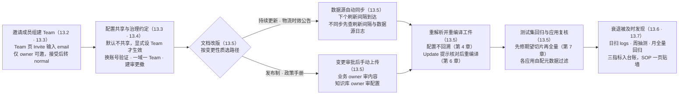
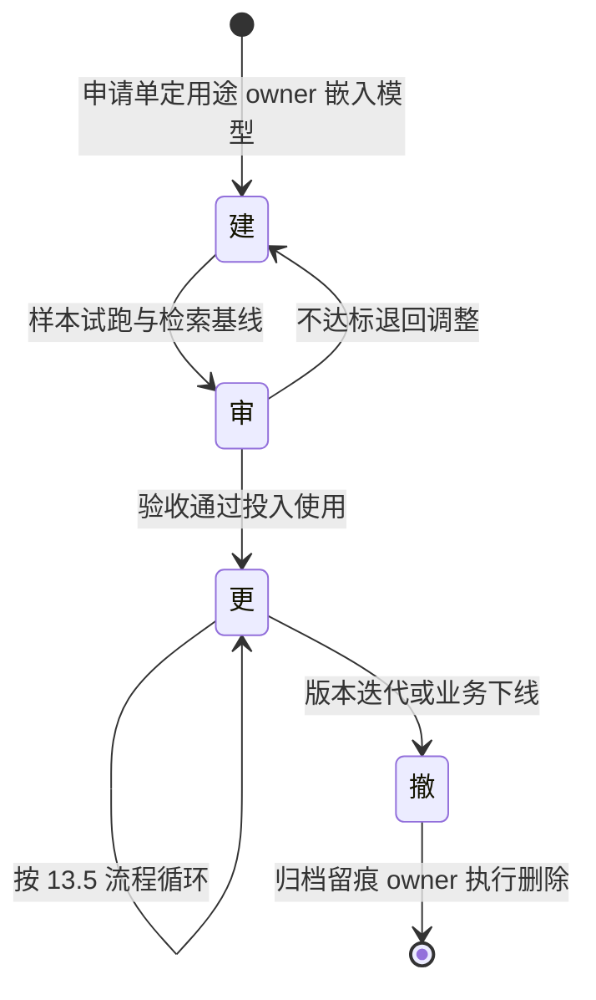
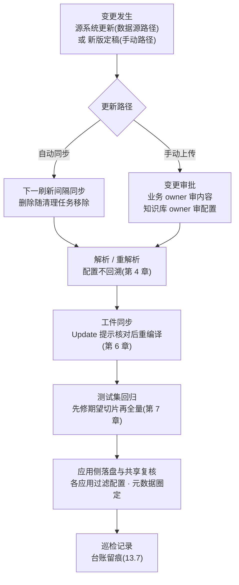

# Chapter 13 Team collaboration and knowledge-base operations

> Chapter guide: after-sales-kb is live. The platform is already steady (Chapter 12), and support is using the "After-sales Assistant" (Chapter 8) and the canvas support Agent (Chapter 10). Then the October revision arrives: the policy manual is replaced, the new clauses take effect only for some sites, and a few days later support is still citing the old clauses. That is knowledge rot: go-live is only the start, and a knowledge base with nobody governing it quietly goes bad. Old clauses are not withdrawn, chunks expire, nobody dares to touch it, and nobody is responsible. This chapter closes the book. It covers three operations jobs: permission and sharing governance, who can do what to what (13.2-13.4); the document update flow, making the new version take effect "for certain" (13.5); and quality inspection, so decay is found in time (13.6-13.7). At the end, one full-flow drill of the October revision collects the running case, and the whole book's 12-chapter route is reviewed in one sentence each. By the end of this chapter, you can: configure permissions and sharing for a team, walk through one end-to-end update loop for a revision, inspect on a daily/weekly/monthly cadence, and take away a one-page operations SOP you can put into practice.

*Flowchart for this chapter*

## When you need it

Three typical situations, and three ways to use this chapter.

**Several people use one RAGFlow, and it is unclear who can move what**. See 13.2 and 13.3. The three-layer permission model and the five steps of the effective rules are the official order of judgment. Section 13.4 adds one more layer, the governance split of "the system governs permissions, the SOP governs order". A verbal agreement becomes system behavior plus a written process.

**A document was revised, and you need the new version to take effect "for certain"**. Go straight to 13.5. Two paths, data-source sync and manual upload, and the downstream actions of re-parsing and recompiling artifacts. The October revision drill at the end is the complete demonstration.

**The knowledge base has been in use for a few months, and answers start coming out good one time and bad the next**. See 13.6 and 13.7. Layered location through logs, periodic regression of the test set, and a daily/weekly/monthly inspection cadence, together with three operations metrics kept in the books.

Prerequisites: creating a dataset and the Permissions field from Chapter 3 (its first appearance is there); the production baseline of Chapter 12. If the platform is not steady, there is no operations to talk about.

## 13.1 Overview: go-live is only the start, and then what

Chapter 1 said that the first major limit of an LLM is static knowledge. Outside the training snapshot, it does not know. RAG's countermeasure is "the retrieval stage fetches the latest content from an external knowledge base in real time", but that countermeasure has a hidden premise: **somebody has to keep feeding the latest content into the knowledge base**. If nobody feeds it, RAG degenerates into a "machine that quickly retrieves old documents", and because it carries citations and answers with certainty, **wrong old knowledge is more believable than having no knowledge**. Sample three in Chapter 7 (the old 2024 clauses cited as current policy) is the preview.

This decay has an industry name: knowledge rot. This book's position adopts that wording, and it is not an official term. Landed on a RAG knowledge base, there are four typical symptoms:

| Symptom | How it shows up | The matching operations action |
|------|------|-------------|
| Mixed versions | Old and new documents coexist, and retrieval "draws lots" between the two versions | Version metadata plus taking the old version down (13.5) |
| Expired content | The source document changed, and the chunks and artifacts are still the old ones | The update flow (13.5) |
| Responsibility hanging in the air | Nobody can say clearly who built this base, who reviews it, and who runs it | Permissions and governance (13.2-13.4) |
| Quality drift | The configuration was changed by several people, and nobody rechecks the effect | Inspection and regression (13.6-13.7) |

What fights it is three jobs, the main structure of this chapter:

| The three operations jobs | The question they answer | Where |
|-----------|-----------|--------|
| Permission and sharing governance | Who can do what to what? How is a resource handed over? | 13.2, 13.3, 13.4 |
| The update flow | After a document changes, how does the new version take effect "for certain"? | 13.5 |
| Quality inspection | How is decay found in time, and attributed in time? | 13.6, 13.7 |

The terms that recur in this chapter follow the glossary of the whole book and add two (the Chinese-English pairs are gathered here for the first time):

| Term | English | A one-sentence definition |
|------|------|-----------|
| Dataset | Dataset | The carrier of the knowledge base (v1's renaming of v0's "knowledge base"; see Chapter 1) |
| Chunk | Chunk | The smallest retrieval unit produced by document parsing |
| Retrieval testing | Retrieval Testing | The page inside a dataset that verifies "whether a query can recall the expected chunks" (see Chapter 7) |
| Knowledge artifact | Artifact | A structured product of knowledge compilation: Wiki, Graph, Tree, PageIndex, and others (see Chapter 6) |
| Team / personal sharing space | Team / Me | The two values of a resource's sharing scope: visible to the team, versus visible only to the owner |

The factual boundary, stated first: the permission model, sharing scope, and member management in 13.2 and 13.3, and the log capability in 13.6, all follow the official docs (docs/guides/team/, docs/guides/dataset/logs.md, source material verified 2026-10-27). The governance design in 13.4 and the metrics and cadence in 13.7 are **this book's position**. The official docs give the "skeleton" of permissions. The "muscle" of order has to be grown by each team itself.

## 13.2 The permission system: who can do what to what

### The three-layer model

The official definition of the permission system, in one sentence (docs/guides/team/permission_system_overview/index.md, verified 2026-10-27): **RAGFlow manages team collaboration and resource permissions through three layers: team membership, resource sharing scope, and resource operation permissions**. Each layer answers one question, and each layer tightens:

| Layer | English | The question it answers | Who sets it |
|----|------|-----------|---------|
| Team membership | Team membership | Is this person in the team? | The team owner (by invitation) |
| Resource sharing scope | Resource sharing scope | Is this resource visible to the team? | The resource owner (by configuring Permissions) |
| Resource operation permissions | Resource operation permissions | After it is visible, which operations can be done? | The system judges by resource type and permission level |

The right order for reading this table is top to bottom: **not in the team, and nothing is discussable; in the team but the resource is not shared, and you still cannot see it; you can see it but the operation is beyond permission, and you are blocked anyway**. The three layers are an "and" relationship, not an "or".

### Team and Me: two sharing spaces

Every RAGFlow user owns a **personal workspace** (the Me space) as soon as they register. The team page is titled "nickname + workspace". By default, every user has a team named after their own username. The team page has two areas: **Team members** (members of the current workspace) and **Joined teams** (other workspaces I have joined or been invited to join). Mechanically, RAGFlow records membership with the `user_tenant` relation: **joining a team means being added into the team owner's workspace**. There are four team roles in all:

| Role | Meaning |
|------|------|
| owner | The owner of the workspace; **only the owner can invite members and remove members** |
| normal | A member who has accepted the invitation and formally joined |
| invite | Invited, but not yet accepted |
| admin | A role value used by the backend |

Two official boundaries to remember. First, **a team member cannot invite anyone else**. Invitation and removal are actions exclusive to the owner. Second, **a team role is not the same as enterprise-edition role management (Enterprise roles)**. A team role only defines "whether you belong to this workspace, and which team-level actions you can take". An enterprise-edition role manages operation permissions on administrative resources. A reader of the open-source edition only needs to remember the former. Keep an impression of the latter, so the two sets of concepts are not mixed in use.

### Effective rules: the order of the five-step check

When a user performs an operation on a resource, RAGFlow evaluates permissions in the following order (the original order of permission_effective_rules.md):

1. Whether the user has **formally joined** the team the resource belongs to;
2. Whether the resource's **sharing scope** allows team access;
3. Whether the user has **Read, Write, or Manage** permission at knowledge-base level, resource level, or collaborator level;
4. Whether the target document still has a **document-level** Read, Write, or Manage permission requirement;
5. Whether the current operation is allowed by the **permission table** of that resource type.

Three accompanying rules: **the resource owner always has every permission**; when a resource is set to Only me, only the owner can access it, and when it is set to Team, only team members who meet the permission conditions can access it; if a finer-grained permission exists (such as document-level permission inside a knowledge base), it **stacks** on top of the resource access permission and keeps taking effect.

Run the five steps through one walkthrough. A newly invited store-operations member wants to access after-sales-kb (a demonstration of the running case; when the base was created in Chapter 3, Permissions was already set to Team): (1) she accepted the invitation, her role is normal, and she is in the team; (2) the dataset's sharing scope is Team; (3) the knowledge-base-level permission allows her to read; (4) the target document has no extra document-level restriction; (5) her operation is viewing and asking questions, which is inside what the permission table allows. All five gates pass, and access holds. If at step (3) she has only Read-level permission and the operation is uploading a file, the judgment stops there. The official docs also state clearly: team members of a shared knowledge base **can upload and parse files** (share_knowledge_bases.md). Step (3) usually lets a member who "uses the base" through to write operations, and it does not let through "deleting the base": **deleting a knowledge base is stricter, and generally requires the operator to be the creator** (resource_sharing_from_the_team_perspective.md).

### Resource types and permission levels

Operation permissions cover seven resource types in all. The common permission levels are **Read, Write, and Manage**. Different resources use different combinations of levels. The owner always has the highest permission on that resource:

| Resource type | Description |
|---------|------|
| Knowledge base (dataset) and its documents | The main battlefield of the permission system, and the object this chapter governs |
| Chat assistant (Chat app) | A question-answering application bound to a dataset (see Chapter 8) |
| Agent | A task flow orchestrated on a canvas (see Chapter 10) |
| MCP Server | The channel that exposes knowledge capability outward (see Chapter 11) |
| Memory and Memory messages | The Agent's memory assets (see Chapter 10) |
| Search app (Search) | A knowledge application biased toward retrieval and display (see Chapter 9) |
| Model providers, model instances, and default model configuration | The model channel (see Chapter 2) |

An honest note: the official docs list seven resource types and three common levels, but **they do not give, one by one, a complete mapping table of "which level corresponds to which concrete operations" for each resource type**. That layer follows what the interface actually shows, and this book does not invent it. The granularity that is enough for operations is: Read roughly corresponds to viewing and using, Write corresponds to uploading, parsing, and configuration changes, and Manage corresponds to heavy operations such as sharing and permission management. For an operation you are not sure about, follow whether the button is visible on the interface and whether it reports a permission error.

## 13.3 The sharing mechanism: not shared by default, and it takes effect only when set explicitly

### Sharing-scope configuration (open-source edition)

In the open-source edition, the sharing scope is configured through the **Permissions** field on the resource configuration page. Two options (the original of open_source_edition_sharing_scope_configuration.md):

- **Only me**: only the resource owner can access it;
- **Team**: the resource is shared inside the team.

The most important sentence of official original is placed here on its own: **a resource is not shared automatically. To let other users use it, you must explicitly configure the sharing scope or the permissions**. This is not a restriction. It is a safe default: a knowledge base stays in the Me space by default, until the owner decides to hand it to the team. At the same time, do not forget the three-layer structure of 13.2: setting it to Team does not necessarily make it visible to everyone. The system still checks whether the user belongs to the owner's team, whether the resource supports team sharing, and whether the operation is allowed by the permission rules.

### Where the three resource types are shared

Resources that support team sharing -- knowledge bases, Agents, chat assistants, search apps, and Memory -- each have their own configuration entry, and the landing point differs:

| Resource | Sharing entry | Default | What team members can do after it is shared |
|------|---------|--------|----------------------|
| Knowledge base (dataset) | The **Permissions** field on the dataset configuration page | Only me | View and use; **upload files and parse documents** (share_knowledge_bases.md) |
| Agent | The **permission** field in the Agent settings dialog | Only me | Use the shared Agent (team_management/index.md) |
| Memory | Configured in Memory advanced settings, the two values `me`/`team` | Only me (me) | After sharing, access follows the permission rules; the backend also defines an `all` value, but the interface exposes only Only me and Team |

A shared knowledge base has a behavior difference worth remembering on its own: the bar for using it and the bar for changing it are different. **Members can upload and parse** (the official docs state this clearly), while deleting a knowledge base generally requires the creator in person. The operations meaning: think of a shared base as "the team's public workbench, but the door lock and the right to demolish it are in the owner's hands".

Beyond sharing inside the team there is a larger exit: knowledge is exposed through an MCP Server for a platform-side Agent to consume (see Chapter 11) (see the MCP book). An MCP Server is likewise one of the seven resource types. The governance agreement for knowledge versions and content when it is shared with a platform Agent is expanded in the MCP book. This chapter first gets the "people" layer under control.

### Inviting and managing members (light)

The invitation flow has four steps (invite_members.md): open the **Team** page, click **Invite** in the **Team members** area, enter the other person's email, and click **OK**. Three boundaries: the email must belong to a **RAGFlow user who already exists**, otherwise a user-not-found error is returned; a user who has already joined, or who is already in an invitation, is rejected on a repeated invitation; after the invitation is created, the member record exists with the `invite` role, and **it turns into normal only after the other person accepts**. Pending invitations can be seen in the Joined teams area of the team page.

The starting screen of the four-step flow is the following picture. This screenshot was measured on 2026-11-04 on a local Docker deployment of RAGFlow v1.0.0-rc2, the Team page of the owner account Shuzhou (书舟):

The "team page is titled nickname + workspace" from 13.2 is this page: the 书舟 workspace in the title is the owner's workspace, and the Joined teams area always has the creator's own row. The workspace is the team, and you yourself are the first member. The entry for the invitation action is the Invite member button at the upper right, and the four-step flow starts here.

After entering demo2@ragflow-book.local in the Invite dialog and confirming, the same page becomes the following (measured the same day, on the same instance):

The previous paragraph's "after the invitation is created, the member record exists with the invite role" is fulfilled here: the Invite badge in the State column is the invite role. Before acceptance it does not count as formally joined, and the owner can withdraw the invitation at any time from the delete icon in the Action column. One measured premise to add: before the invitation, the other person must already have finished registration. Measured, inviting an unregistered email reports "102 user not found", and the dialog says Only registered users can be invited, which matches this section's boundary that "the email must belong to a RAGFlow user who already exists".

The same invitation looks like this on the invitee's side. This screenshot was measured the same day: the Team page after switching to the Demo Two (演示二号) account and logging in, matching the body's "pending invitations can be seen in the Joined teams area":

A pending invitation is not in a notification. It is in the invitee's own Joined teams area, and the accept action is on this row. After Accept, the membership of 13.2 (the `user_tenant` relation) is formally established, and the role turns from invite to normal. Decline declines it directly. The first two pictures and this one together are the two sides of the invitation chain: the owner side sees the Invite badge, and the member side sees Accept/Decline.

Member management, summarized in one sentence: by default each person has one team of the same name; **only the owner can invite and remove**; after a member joins, they can help with three things the official docs name: upload documents to a shared dataset, parse documents in a shared dataset, and use a shared Agent. The last step is an operations action (this book's position): after sharing is configured, **log in with a member account and verify visibility**. A sharing scope set in the wrong direction (one that should be Team left on Only me) or set too far (something that should not be shared, shared) can be seen only by switching accounts.

The measured result of "log in with a member account and verify visibility" is the following picture. This screenshot was measured the same day: after Demo Two (演示二号) accepts the invitation, they log in to their own Dataset page:

"A resource is not shared automatically, and it takes effect only when configured explicitly" is verifiable in this picture: after the owner sets Permissions to Team, the same dataset appears in the member account's Dataset list, and the card marks the sharing source with another person's nickname, "书舟". A sharing scope set in the wrong direction (one that should be Team left on Only me, or something that should not be shared, shared) can be seen only by switching accounts this way, and the operations action of this section has evidence from that.

## 13.4 Multi-tenant knowledge-base governance: the system governs permissions, the SOP governs order (this book's position)

> The governance design of this section and of 13.7 is **this book's position**: what the official docs provide is the permission capability, and what this section gives is a method for organizing that capability into order.

### Calibrate "multi-tenant" first

The "tenant" in the open-source-edition context has to be distinguished from SaaS multi-tenancy: in RAGFlow each user is a workspace (tenant), and the essence of team collaboration is **adding members into the owner's tenant** (the `user_tenant` relation of 13.2). When Chapter 12 configures Langfuse tracing, "`userId` = the tenant" points at exactly this layer. So when one deployment serves several business teams, the isolation form is **logical multi-tenancy** (the wording of this book's position): each business team builds a Team with one account as owner, the knowledge assets belong to the owner's workspace, and the isolation boundary is made of the team boundary plus the sharing scope. It is not physical isolation. It is permission isolation.

### Splitting by business domain and store

The setting of the running case (Chapter 3): the Permissions of after-sales-kb is set to Team, "shared by support and the operations of each store". Generalize that into a governance agreement (this book's position): **one business domain, one Team, and a batch of datasets belonging to the owner of this Team**. The criterion for the split is not the organization chart. It is the boundary of how the knowledge is used: whoever retrieves this batch of knowledge day to day, and whoever is responsible for its correctness, should be inside the same domain. Cross-domain consumption does not rely on pulling everyone into one oversized team. It relies on composition at the application layer. Multi-dataset retrieval in Chapter 7 has already demonstrated it: an application mounts datasets as needed, and datasets belong by domain.

### Dataset naming rules

Once there are many datasets, the first order on the list page is naming. This book's position gives one minimal rule: `{business-domain}-{content-type}[-{qualifier}]`, lowercase and hyphenated:

| Name | Judgment | Reason |
|------|------|------|
| `after-sales-kb` | Compliant | Business domain (after-sales) plus content type (kb), the demonstration of Chapter 3 |
| `after-sales-faq-sea` | Compliant | An extended form with a qualifier (the site) |
| `客服专用库2` | Non-compliant | No business domain, no content type, and a sequence number with no meaning |
| `zhangsan-test` | Non-compliant | A personal-name prefix. A personal experiment base should not enter the team's shared space |

Two accompanying rules: write the name into the base-creation request (see below); leave a personal trial dataset in your own Me space, and **share one only after it has matured and been named to the rule**. Keep the list page of the shared space clean.

### Lifecycle: create, review, update, retire

Every dataset has a lifecycle, four states (this book's position):

*Dataset lifecycle (this book's position)*

| Stage | The point | System capability / chapter basis |
|------|------|-------------------|
| Create | The base-creation request: purpose, owner, embedding model, name. The embedding model **is fixed at creation** (Chapter 3), which is why the request must fill it in first | The five creation items of Chapter 3 |
| Review | Upload a sample and run retrieval testing before the full batch (the low-cost trial-and-error method of Chapter 4); the baseline report of Chapter 7 is the acceptance artifact | Retrieval Testing |
| Update | Document updates follow the 13.5 flow, and that is the normal state of the lifecycle, not the exception | 13.5 |
| Retire | Take the old version down and archive it; **deleting a knowledge base generally requires the creator**, so "retire" is executed by the owner and left in the ledger | The effective rules of 13.2; sample three of Chapter 7 |

The two ends, "review" and "retire", are the weakest places in governance, and they are also the direct lesson of sample three in Chapter 7: **nobody carried out "retire" on the old 2024 document that year, and that is how old and new chunks ended up drawing lots in the same place**. Taking something down is not a matter of deleting the file and being done. Leave an archive trail (when it was taken down, who approved it, and which document is the replacement version), so "why the 2024 version is not in the base" can be answered at any time.

### Whoever owns it inspects it, plus the system/SOP split

The position of this section can be pressed into one sentence: **whoever owns it, inspects it**. The owner permission is already given by the system (they always have the highest permission). The inspection duty has to be carried out by the SOP (13.6, 13.7). The overall table of how official capability and team order divide the work:

| Governance need | System capability (official) | Filled in by the SOP (this book's position) |
|---------|---------------|-------------------|
| Access control | The three-layer permission model plus the five-step effective rules | A periodic permission review (the weekly inspection in 13.6) |
| Resource ownership | The owner always has full permission; deletion requires the creator | Naming rules plus a base-creation ledger |
| Version control | Metadata plus retrieval filtering (Chapter 7) | The flow for taking an old version down and archiving it |
| Business-domain isolation | The Team boundary plus the sharing scope | The agreement of one domain, one Team |
| Quality responsibility | -- (the system has no such concept) | Whoever owns it, inspects it; the cadence table and the metrics |

How to read the table: the left column is the goal, the middle column is what the system already gives you, and the right column is the part that must be written into the team rules and assigned to a responsible person. **Most of the work of a governance design is in the right column, and that is exactly why this section exists**.

## 13.5 The document update flow: making the new version take effect "for certain"

### Two update paths

The first fork of a document update: where the content comes from. The cadence of the two paths is completely different:

| Path | Content it fits | When it takes effect | Key mechanism |
|------|---------|---------|---------|
| Automatic data-source sync | Content native to an external system: email, a network drive, a collaboration tool, and so on | **The first sync imports the existing stock; content added or modified externally is usually synced when the next refresh interval arrives**; after sync deleted files is turned on, content deleted at the source is removed from the index in a later sync or cleanup task | The refresh interval, the sync status, and the data-source logs; once the connection is in place, **Test connection** first (Chapter 3) |
| Manual upload | Documents under a release process: policy manuals, standards, content that is a commitment to the outside | A human cadence: approve, then upload, then parse | Change approval plus re-parsing (below) |

The official docs also give a troubleshooting entry for the most common problem on the automatic-sync path: "I clearly changed it, so why is the knowledge base still the old one". **First check whether the refresh interval has arrived, the sync status, and the data-source logs** (add_to_knowledge_base_and_sync.md; section 3.4 of Chapter 3 already gave the same prescription). Continuously updated content such as the shipping-time notice (shipping-notice) takes the data-source path. Content such as the "After-sales Policy Manual", where "one version is finalized, and a revision needs approval", takes the manual path. The running case has both kinds, and that is not a coincidence: **choose the path by the nature of how the content changes, and not by the document format** (this book's position).

### Change approval, re-parsing, and artifact recompilation

The first gate of the manual path is **change approval** (this book's position): the business owner reviews the content (whether the clauses are right, and which sites the effective scope covers), and the knowledge-base owner reviews the configuration (whether the new document's metadata and parsing configuration are carried on). After approval, enter the chain of actions on the technical side. Each step has an agreement already set in Chapters 4 and 6:

- **Re-parse**: a configuration change does not apply backward (4.6.3). Changing the chunking configuration, column roles, or metadata rules takes effect only for **later parsing**. Existing documents must be parsed again before they pick up the new configuration. The agreement of Chapter 4 is promoted to a discipline here: **"change the configuration, then re-parse, then retrieval testing" is one action, not three steps**.
- **Recompile artifacts**: artifacts are not regenerated automatically when documents are updated (Chapter 6). After documents are added or deleted, the Artifacts page shows an **Update** prompt and a count waiting to be updated. Check it, then sync manually. The prompt behavior for a content update of the same document follows what is measured on the interface, but whether or not the prompt appears, **after the new version finishes parsing, navigation artifacts must be confirmed and recompiled by a person**, and sampled against the checklist in 6.5.
- **The special case of changing models** (the official FAQ, verified 2026-10-27): changing the embedding model triggers a compatibility check. It samples and compares the old and new vectors, and a switch is allowed, **with no re-parse**, only when the average similarity is not below `0.9`. If it does not meet that, you must clear the chunks and re-parse, or build another dataset with the new model. Changing the reranker only affects ranking, and changing the LLM only affects generation. **Neither needs a re-parse**.

Combine the downstream actions of common changes into one table, and follow the list when you update:

| Change type | Chunk layer | Artifact layer | Application layer | Basis |
|---------|--------|--------|--------|------|
| Document content update (a new version of the same document) | Re-parse that document | Confirm the Update prompt / recompile by hand | Regression plus each application checking its filter | Chapters 4, 6, and 7 |
| Chunking configuration / column roles / metadata rules | Does not apply backward; a re-parse is required | Sync artifacts after the re-parse | Regression | 4.6.3 |
| A compilation-template adjustment | -- | Documents already compiled **are not recompiled automatically**; you must rerun | Regression after the artifacts change | Chapter 6 |
| A retrieval-parameter adjustment | -- | -- | **Parameters on the test page are not persisted**, and must be configured separately onto the assistant / Agent / Search | Chapter 7 |
| Changing the embedding model | A compatibility check >= `0.9` skips the re-parse; otherwise clear the base and re-parse | Sync along with the re-parse | A full regression | Official FAQ |
| Changing the reranker / LLM | **No re-parse is needed** | -- | Each takes effect on its own application side | Official FAQ |

### The full update flow

*The document update flow: two paths join the same technical chain*

### Running case: a full-flow drill of the October revision of the After-sales Policy Manual

String every mechanism from the first half of this chapter into one real revision (the dates and the site setting are an elaboration of the running case):

| Step | Action | Path and basis |
|----|------|-----------|
| 1 | **Notice published (D0)**: the business side publishes the revision notice. The new manual is finalized as the October 2026 edition, the new return clauses take effect only for the Southeast Asia sites, and the remaining clauses apply to every site | The start of the flow, not a system action |
| 2 | **Policy document updated (D+1)**: the new after-sales-policy.pdf takes **manual upload** (a release process); in the same period the shipping-time notice is updated by the source system and takes **automatic data-source sync** | The two paths of 13.5 |
| 3 | **Approval and re-parse (D+1)**: the business owner reviews the clauses, and the knowledge-base owner reviews the configuration; add the metadata `version=2026-10` and `region=SEA` (the values are an elaboration of the case); re-parse the new version | Approval in 13.5; 4.6.3 |
| 4 | **Navigation artifacts recompiled (D+2)**: after checking the changes on the Artifacts page, sync the **Navigation** artifact; sample the chapter hierarchy and the fact attribution against the checklist in 6.5; Skills related to the return flow are regenerated through To Skills | The Update-prompt system of Chapter 6 |
| 5 | **Test-set regression (D+2)**: re-parsing may change chunk boundaries. First fix the expected chunks of the 32-item test set, then run a full regression; all 5 items of the version-sensitive subset cite the 2026-10 edition | The agreement of Chapter 7, section 7.6 |
| 6 | **Sharing-scope review (D+3)**: the After-sales Assistant (Chapter 8) and the search app (Chapter 9) **each** configure Metadata filtering. Parameters on the test page are not persisted, and each application configures its own. Verify from a store-operations account that is not a Southeast Asia site: they can enter the base (Team sharing), but they cannot retrieve the SEA-only clauses | Metadata filtering in Chapter 7 |
| 7 | **Inspection record (D+3)**: the revision latency D0 to D+2, the regression hit rate and MRR, and the takedown and archive of the old version, all go into the ledger | 13.6 / 13.7 |

Step 6 is worth saying through on its own. It is the meeting point of this chapter's permission mechanism and Chapter 7's retrieval mechanism: **the sharing scope governs "who can enter the base", and metadata filtering governs "which item they can see"**. Team sharing lets store operations in both Southeast Asia and Europe access after-sales-kb. Isolating the difference at site level does not rely on building another dataset. It is done at the content layer by metadata plus retrieval filtering. Each of the two layers governs one stretch. Using them mixed (for example, building an independent dataset for every site) makes the number of datasets swell and the maintenance double. Using only one layer (building metadata and not configuring the filter) is the same as no isolation.

## 13.6 Quality inspection: so decay is found in time

### Which ledger to read first: logs

The first entry of an inspection is the dataset's **Logs** page (docs/guides/dataset/logs.md, verified 2026-10-27). At the top of the page is a statistics row: **Total files**, **Processing**, **Downloading**, and others. Below, it splits into two layers by log type. Note that the official docs emphasize in particular: **the two are not parent-child logs or a summary relationship. They record different types of tasks**:

| | Document logs | Dataset-level logs |
|---|---------|-------------|
| What is recorded | Task execution of a single document | Tasks whose processing object is the whole dataset |
| Typical tasks | Parsing, task cancellation, success and failure (such as **Parse**) | **Knowledge Compilation** (a Processing type such as **Wiki**) |
| Main fields | ID, Filename, Source, Ingestion pipeline, Start date, Task, Status, Operations | ID, Start date, Processing type, Status, Operations |
| The symptom it fits | A single document that has not finished parsing for a long time, a parsing failure, an abnormal chunk count | A dataset-level task that failed, that has not finished for a long time, or whose execution result needs to be confirmed |

A one-sentence troubleshooting motto (summarized from the official original): **first judge whether the problem happened on a single document or on the whole dataset, then go look at the matching log**. If Status is Failed, open the log detail in Operations and look at the concrete error. If it stays on Pending, Running, or Schedule for a long time, first check the status and the start time, and then judge whether it is still running normally. Logs turn "parsing is broken" from a feeling into a record. The daily inspection of 13.6 scans this ledger.

This ledger looks like the following on a real instance. This screenshot was measured on 2026-11-04 on a local Docker deployment of RAGFlow v1.0.0-rc2, the Logs page of after-sales-kb, with all four documents finished parsing:

One measured difference from the comparison table above, given as it is: the logs in rc2 are actually split into **three side-by-side tabs, File / Dataset / Data source**, one Data source layer more than the "two layers" written in the official docs (the logs of data-source sync tasks). The interface is the reference. The Ingestion pipeline column in the task table shows directly which parsing pipeline each document used. The first three go through general, and the .eml mail archive goes through email. The data-source connection of Chapter 3 and the pipeline choice of Chapter 4 leave a record here. Success 4 / Failed 0 on the Processing card at the top is the number the daily inspection has to scan.

The location framework beyond the logs follows the four steps of the official FAQ: when "the answer is wrong", layer it first. Whether the document was parsed correctly, then whether the chunks contain the expected content, then whether **Retrieval Testing** can recall the relevant chunks, and only when retrieval is normal and the answer is still wrong do you check the application settings, the prompt, and the model. Two accompanying FAQ conclusions are worth posting in the inspection manual: a successful parse is **not the same as** a successful retrieval (it still has to pass the gates of chunks, embedding, the threshold, and rerank); an answer being in the base is **not the same as** it being retrieved, and still less the same as the model following it (the three checks for hallucination: index, recall, generation). These two are the basis, during an inspection, for "do not rush to blame parsing" and "do not rush to blame the model".

### Periodic regression: the test set is the inspection dashboard

The whole technical base of 13.6 is in Chapter 7: the 32-item test set, the expected chunks, the hit rate, and MRR. In the inspection context, only three operations agreements are added (this book's position):

- **Sample on the weekly check, and run the full set on the monthly check**: the weekly inspection runs only the version-sensitive subset (the kind most likely to regress after a revision); the monthly inspection reruns the full set against the baseline configuration snapshot, and produces the hit rate and MRR side by side with last month.
- **After a re-parse, fix the test set before the regression**: once chunk boundaries change, the expected-chunk mapping fails as a whole. Running it directly only produces false alarms (the special-case clause of 7.6).
- **Attribute a regression item by item**: classify regressed items by the three-way location method (7.5). Only after they are classified do you know whether the change should be rolled back or a companion fix added. The inspection record stores the "conclusion", and not only the "score".

### The inspection cadence

Combine logs, regression, permissions, and artifacts into one cadence table (this book's position; the frequencies and the responsible people are suggested values, and a team trims them by scale):

| Frequency | Check | Responsible person | Tool and source |
|------|--------|--------|-----------|
| Daily | Scan logs for failed tasks; data-source sync status | Dataset owner | The Logs page (this section); data-source logs (Chapter 3) |
| Daily | Service status and a `healthz` probe | Platform on-call | Admin UI (Chapter 12) |
| Daily | Mark and collect bad cases from production | Support lead | Session records; traces (Chapter 12) (see the Langfuse book) |
| Weekly | Sample the version-sensitive subset | Knowledge-base owner | Retrieval Testing (Chapter 7) |
| Weekly | Check and sync the artifact Update prompt | Knowledge-base owner | The Artifacts page (Chapter 6) |
| Weekly | Take stock of sharing and member changes (newly shared resources, new members, members who left) | Team owner | The Team page / Permissions (13.2, 13.3) |
| Monthly | A full regression of the test set; the hit rate and MRR go into the ledger | Knowledge-base owner | Chapter 7, section 7.6 |
| Monthly | A permission review and a lifecycle stocktake (datasets waiting to be retired, archives) | Team owner plus business owner | 13.4 |
| Monthly | A summary of the metrics and a revision of the SOP | Operations lead | 13.7 |

The inspection record of the drill (step 7 of 13.5) lands on this table as three ledger rows: the update latency D0 to D+2 (the manual path, including approval), the regression hit rate level with the previous round and the version-sensitive subset all passing, and the 2024 manual already taken down and archived (the approver, and a trail of the replacement version). **The ledger does not have to be pretty. It has to exist**. It is the raw voucher of the metrics in 13.7.

## 13.7 Operations metrics and the SOP (this book's position)

### Three starter metrics

Operations has to keep books, and metrics come before a dashboard (see the Langfuse book: its production metric system governs "answer quality", and the three numbers in this section govern "knowledge supply". The two complement each other, and they do not repeat). At the start, record only three:

| Metric | Definition | How to measure it | A healthy signal |
|------|------|--------|---------|
| Update latency | The time from the source document being finalized to the new content being stably retrievable | A ledger of the time each step of the 13.5 flow takes; measured on every revision (the drill: D0 to D+2) | The manual path stays stable inside the target number of days; the data-source path does not exceed the order of magnitude of the refresh interval |
| Inspection hit rate | The hit rate and MRR of the monthly full regression | The metrics of Chapter 7 (7.6), side by side with the baseline | Not below the previous round; every regressed item is closed with an attribution |
| Ticket feedback count | The number of items, that month, settled into the test set from bad cases in production and from complaint tickets | The "source" field of the test-set ledger (the question source of 7.6) | Stays greater than zero. The test set grows with the business, and it does not sit still the moment it is built |

The third metric is the easiest to overlook and the most important: **feeding tickets back into the test set is the mechanism that closes "retrieval quality is operated into existence" (Chapter 7)**. For a question support cannot answer well, first check whether the knowledge never entered the base (13.5), entered the base but was not recalled (Chapter 7), or was recalled but not answered correctly (Chapter 8). After it is located, settle the question into the test set, and the next round of regression has a new exam question. Production traces (Chapter 12, see the Langfuse book) and tickets are its two inputs.

### A one-page SOP

Press every action of this chapter into a one-page checklist you can put into practice, and post it on the wall to use (the frequencies and roles follow the cadence table in 13.6, except the triggered items):

| # | Frequency | Action | Responsible person | Tool and source |
|---|------|------|--------|-----------|
| 1 | Daily | Scan logs for failed tasks and the sync status | Dataset owner | The Logs page (13.6) |
| 2 | Daily | Service status and a `healthz` probe | Platform on-call | Chapter 12 |
| 3 | Daily | Mark and collect bad cases from production | Support lead | Traces (see the Langfuse book) |
| 4 | Weekly | Sample the version-sensitive subset | Knowledge-base owner | Chapter 7 |
| 5 | Weekly | Check and sync the artifact Update prompt | Knowledge-base owner | The Artifacts page (Chapter 6) |
| 6 | Weekly | Take stock of sharing and member changes | Team owner | 13.2, 13.3 |
| 7 | Monthly | A full regression of the test set, plus the metrics into the ledger | Knowledge-base owner | Chapter 7; 13.7 |
| 8 | Monthly | A permission review and a lifecycle stocktake | Team owner plus business owner | 13.4 |
| 9 | Triggered | A document revision goes through the full 13.5 flow (approve, then re-parse, then artifacts, then regression, then review, then record) | Business owner plus knowledge-base owner | 13.5 |
| 10 | Triggered | After a bad case is attributed, settle it into the test set and regress | Knowledge-base owner | Chapter 7 |

### Closing the book: a one-line review of the 13-chapter route

Finally, collect the whole road the running case walked: deploy, then build, then tune, then consume, then operate. One sentence per chapter, and each sentence lands one footprint of the case:

| Chapter | A one-sentence review | Footprint of the running case |
|----|-----------|-------------|
| 1 First look at RAGFlow | The core of RAG is Retrieval, and the main battlefield is parsing and chunking | A 50-page PDF goes into the vector base, and sets up the negative target |
| 2 Deployment and model channels | Docker starts the service, the model channel is opened, and the first chain is verified | The engine runs for the first time |
| 3 Datasets | The five decisions of creating a base, and connecting and syncing data sources | after-sales-kb is built, and permissions are set to Team |
| 4 Parsing and chunking | Choosing a chunking method, column roles, and the meaning of re-parsing | Each of the three kinds of documents gets its own parsing plan |
| 5 Retrieval enrichment and indexing | Extractor enrichment, index strategy, and sub-chunks | Question forms of the "charging case" kind are filled in |
| 6 Knowledge compilation and knowledge artifacts | Chunks govern points, artifacts govern the surface; an update-prompt system | A PageIndex navigation artifact for the manual, the table of contents first and then drill down |
| 7 Retrieval testing and tuning | The three-way location method, and the test set is an evaluation asset | A 32-item test set, and the parameters are settled and persisted |
| 8 Chat assistants and sessions | Where the retrieval configuration is persisted, and Agentic mode | The "After-sales Assistant" goes live |
| 9 Search apps and access channels | The Search app, web embedding, and Chat Channel | The retrieval entry of the support desk |
| 10 Agents and workflows | The component families of canvas orchestration, and connecting Memory | The "After-sales Support Agent" handles returns and exchanges |
| 11 External integration: API and MCP | The HTTP/Python API and an MCP Server expose knowledge | Handed to the platform-side Agent through MCP (see the MCP book) |
| 12 Production operations | Monitoring and tracing, backup and restore, version upgrades | Langfuse connected, and the backup and upgrade checklist |
| 13 This chapter | Operations takes the baton: permissions, updates, inspection | A full-flow drill of the October revision |

The start of this line is the support question answering that went off the road in Chapter 1: "what is the compensation standard for damage in transit" answered with three unrelated passages of logistics text. The end is this chapter: the same company's policy manual finished its October revision, the new clauses took effect "for certain" for the specified sites within two days, the old version was archived with a trail, and the regression is all green with a ledger. **Between the start and the end there is not one line of magic code. It is the engineering method of 13 chapters, taking the baton**: deployment gets the engine running (Chapter 2), building the base and parsing put the knowledge in (Chapters 3 and 4), enrichment and compilation process the knowledge (Chapters 5 and 6), tuning makes retrieval trustworthy (Chapter 7), applications put the knowledge in the user's hands (Chapters 8-11), operations keeps the platform steady (Chapter 12), and operating makes all of this **continue** to hold (this chapter).

## Chapter summary

1. **Go-live is only the start**: knowledge rot is the default trend when nobody governs. What fights it is the three operations jobs: permission and sharing governance, the update flow, and quality inspection. Each section of this chapter corresponds to one.
2. **Three permission layers plus five effective steps**: team membership, then sharing scope, then operation permissions, tightening layer by layer. Judgment follows the official five-step order. The owner always has full permission, and deleting a knowledge base generally requires the creator.
3. **Not shared by default, and it takes effect only when set explicitly**: the open-source edition's Permissions field has two grades, Only me and Team. After a knowledge base is shared, members can upload and parse. Only the owner can invite, and the invite role turns into normal only after acceptance.
4. **Governance equals system capability plus an SOP**: the system governs the permission boundary, and the SOP governs naming, the lifecycle (create, then review, then update, then retire), and the inspection duty. Whoever owns it, inspects it (13.4, this book's position).
5. **An update is a flow, not an event**: two paths (automatic sync / manual upload) join the same technical chain: approval, re-parsing (configuration does not apply backward), prompt-driven recompilation of artifacts, test-set regression, and persisting on the application side plus a sharing review. "The sharing scope governs who can enter the base, and metadata filtering governs which item they can see."
6. **Quality is inspected into existence**: logs split into a document level and a dataset level; sample weekly, and run the full regression monthly; keep books on the three metrics of update latency, hit rate, and ticket feedback, and post the SOP on the wall as one page.

End of the book. The next step is not in the book. It is on your knowledge base: turn the SOP table of Chapter 13 into your team's version, fill in real names and frequencies, and start from today's first ledger entry.

## Acceptance checklist

By the time you have read this far, you should be able to:

- ☐ State, in order, the three-layer permission model and the five steps of the effective rules, and walk the judgment through once with an example of a new member accessing a shared dataset;
- ☐ Walk a new member through the full flow "invite, then accept, then configure sharing, then switch accounts and verify visibility", and say why only the owner can invite;
- ☐ State the source and the operations meaning of the two rules "Team sharing is not the same as automatically visible" and "deleting a knowledge base generally requires the creator";
- ☐ For one document revision, list the full downstream action list: approval, re-parsing, artifact recompilation, test-set regression, and persisting on the application side plus a sharing review, and say what happens if each step is left out;
- ☐ Distinguish the symptoms that document logs and dataset-level logs fit, and lay out an inspection roster for your own knowledge base by the daily/weekly/monthly cadence table;
- ☐ Keep one month of books for your team's operations with the three metrics of update latency, inspection hit rate, and ticket feedback count;
- ☐ Tell a new colleague the 13-chapter route table: one sentence per chapter, and point out in which chapter the running case finishes which step.

## Further reading

- **Chapter 12 (production operations)**. The other half of this chapter: Chapter 12 governs platform stability, and this chapter governs content quality. The two chapters together are the full meaning of "production ready".
- **Chapter 7 (retrieval testing and tuning)**. The technical base of inspection regression. The test-set ledger and the three-way location method connect to this chapter's cadence table.
- **Chapter 6 (knowledge compilation and knowledge artifacts)**. The source of the Update-prompt system and the artifact checklist. The basis of step 4 of the drill in 13.5.
- **(see the MCP book)**. Version coordination and content governance when knowledge is shared with a platform-side Agent through MCP (see Chapter 11). This chapter governs sharing for "people", and that side governs sharing for "Agents".
- **The full Team section of the official docs (docs/guides/team/) and dataset/logs.md**. The original of this chapter's material on permissions, sharing, members, and logs. The permission model evolves quickly with versions. When there is a dispute, the latest official docs win.

## Review checklist (before publication)

- [ ] Check the whole chapter against the original official source material (the three groups under docs/guides/team/: permission_system_overview, sharing_scope_configuration, and team_management; docs/guides/dataset/logs.md; docs/guides/data_source/add_to_knowledge_base_and_sync.md; the related entries of docs/faq.mdx; source material verified 2026-10-27). The permission and sharing model evolves quickly with versions, so check it again before publication
- [x] Some interface operations were measured on 2026-11-04 (screenshots in this chapter): the full invitation flow on the Team page (invite, then the invite badge, then Accept on the invitee's side, then switch accounts and see the shared dataset), and the Logs page; **a measured addition: before an invitation, the other person must already have finished registration** (an unregistered email reports 102 user not found)
- [ ] Still to be measured: the actual visibility matrix after the Permissions field is switched, the sharing entries of the Agent settings dialog and of Memory advanced settings, and the Update prompt on the Artifacts page
- [ ] The official docs do not record, one by one, the mapping from Read/Write/Manage to concrete operations. Section 13.2 gives only an operations-granularity wording of the "common levels". Decide whether to add more after interface screenshots confirm it
- [ ] "Does re-parsing the same document trigger an artifact Update prompt": the official docs state clearly that document **adds and deletes** trigger the prompt, and the prompt behavior of a content update of the same document is still to be measured (it affects the wording of step 4 of the drill in 13.5)
- [ ] The drill settings (the revision date, the Southeast Asia site split, and the `version`/`region` metadata values), the inspection cadence, the metric definitions, and the SOP role split are all this book's position or an elaboration of the case, and they are not official source material. They are already marked in the text. At finalization, confirm the marks are complete
- [ ] The one-sentence reviews of Chapters 8, 9, and 10 in the closing table of 13.7 were written from the route map of Chapter 1 and the connecting passage of Chapter 12, and the original of each chapter was not checked one by one. Before publication, check them against each chapter's summary
