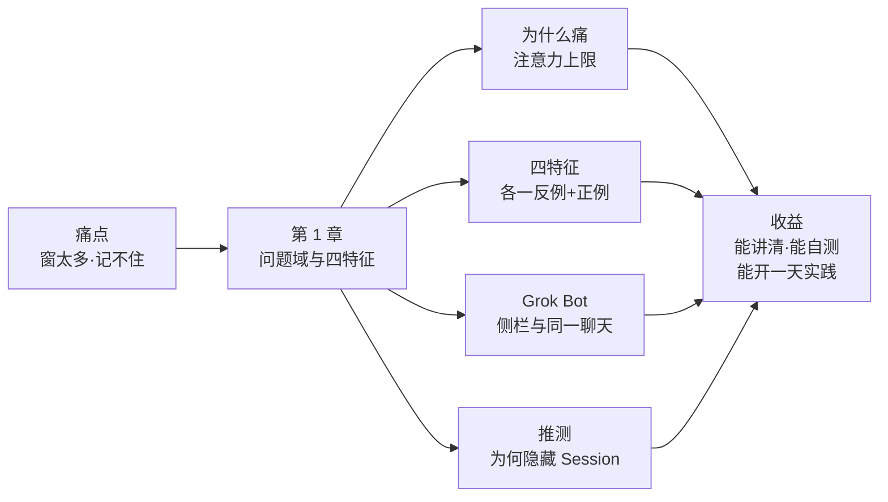
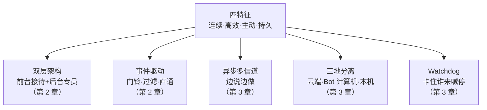
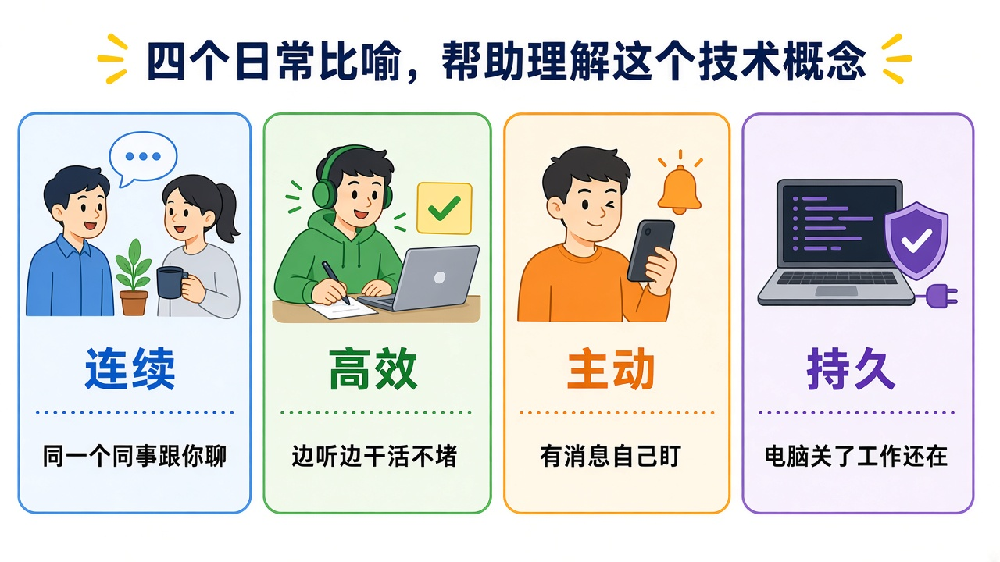
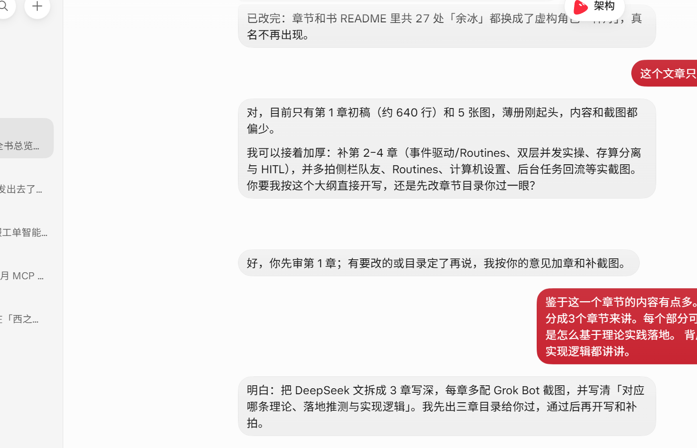
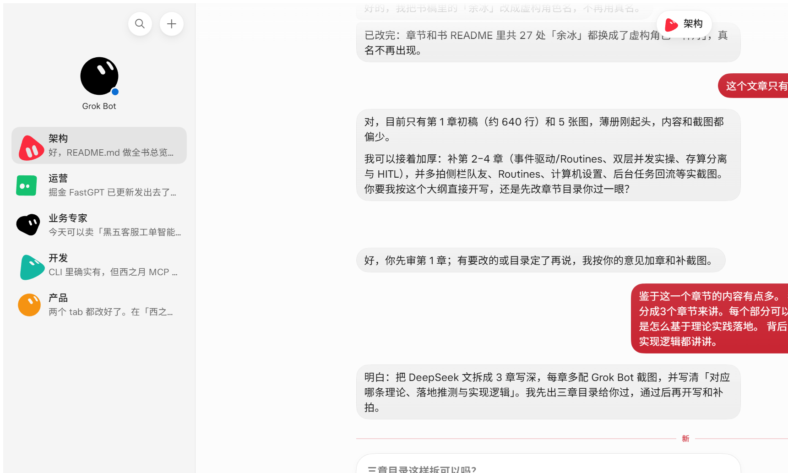
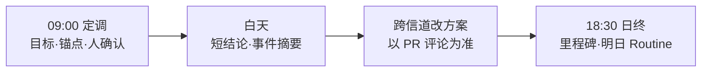
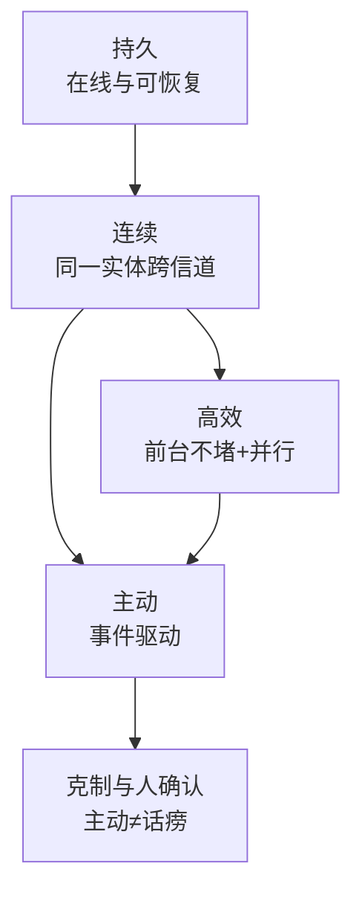

# 第 1 章 问题域与四特征：从单 Session 到连续实体

> 本章导读：星帆出海的中台工程师**林舟**，这周要把 `open-api-platform` 的订单域适配做完——对渠道、写适配层、提 PR、盯 CI、回群里的方案争论。过去他得同时开好几个聊天窗和本地会话，还得自己记住「方案 A 说过没有」。本章先用生活比喻讲清「为什么痛」，再拆开连续、高效、主动、持久四个特征；每节都落到 Grok Bot 你能看见的界面，并标明**实现逻辑推测**（基于可见行为的合理推测，不是官方实现披露）。**立场：本文不是 DeepSeek 产品说明书；Grok Bot 是对照实例，不是论文复刻。**读完你能：向同事讲清「多任务上限为什么卡在人的注意力」；用四特征自测自家助手；并按贯穿案例写出一天定调话术。



*本章导览图*

## 你什么时候需要它

三种处境，三种读法。

**你在选型，听到 Super-agent，想先搞清它解决什么**——读「为什么痛」和「四特征」。先有共同语言，再决定要不要读第 2、3 章。

**你已经有助手（比如 Grok Bot），想量一量离「连续、高效、主动、持久」还有多远**——跳到每节里的「Grok Bot 你能看见什么」和对照表。这是决策节，不是布道节。

**你这周就要推进类似「订单域适配」的多线工程任务**——读贯穿案例的定调话术，把「同一助手」「前台不堵」「Routines」「人确认」排进日程。Router、事件、Watchdog 分别在第 2、3 章。

与后文：本章只立问题与特征；**双层架构与事件见第 2 章**；**异步、存算分离与 Watchdog 见第 3 章**。

## 概述

先想一件生活事。

你同时在跟三个群聊、两封邮件、一个修水管师傅打电话。真正累的不是「每一件事很难」，而是**你得当自己的总机**：记住谁说过什么、该先回谁、方案改了没有。

Agent（智能体，能用工具做事的 AI 助手）也一样。单件活——读仓库、改代码、跑测试——模型已经很强。卡点换成了：**人能不能同时盯住足够多的并行线**。

主流设计仍以**单一 Session**（一次独立对话/会话）为基本单位。不同 Session 互不认识。用户并行推进多项工作时，必须手动切换，并自己记上下文。DeepSeek Harness 团队观察：一个人通常只能同时跟进 **3～5 个**活跃 Session。于是：

| 看什么 | 上限卡在谁身上 |
|--------|---------------|
| 单件活干得成不成 | 模型能力 |
| 多件活能不能一起推 | **人的注意力** |

只给本地 Agent 加 CLI、连接器或消息入口，它虽能「听到」外部世界，仍可能：

1. 主循环卡在一次长工具调用上，新消息进不来；
2. 多任务细节挤在同一上下文，互相干扰；
3. 笔记本合盖，Agent 就停。

论文把突破这些限制的形态叫 **Super-agent**（超级智能体）：跨会话保持上下文、同时推进多项复杂任务且互不干扰的**连续实体**。

本书依据微信文《Super-agent 设计探索：迈向更自主的 Agent 系统》（DeepSeek Harness 团队，核实日期 2026-11-07）解读，再用 **Grok Bot** 对照。请记住两句：

1. **原文已声明**：那是工程思路探讨，**不是** DeepSeek 现有产品说明书；
2. **本书同理**：Grok Bot 用来把抽象特征落到一天工作里——**不是**宣称它实现了论文全部模块。

### 四个特征（先记人话版）

| 特征 | 人话 | 做不到时你会怎样 |
|------|------|-----------------|
| **连续** | 换群、换 PR，仍觉得是同一个助手 | 「Session X 里说过方案 B 吗？」 |
| **高效** | 前台还能聊，后台可并行多件活 | 发新指令要等当前工具跑完 |
| **主动** | 环境有事会跟进；没事就安静 | 每件事都要人 @ 才动，或没事也刷屏 |
| **持久** | 合盖、换设备，主线还在 | 笔记本一合，助手人格蒸发 |

### 五个模块（后两章展开）



*五模块如何撑住四特征（据原文结构归纳）*

**业务上推荐优先用**：先把四特征写成团队体验标准，再决定要不要自建调度层；不要一上来就复刻论文五模块。



*图：`21-four-traits-analogy.jpg`。用日常画面讲清连续 / 高效 / 主动 / 持久各像什么——这张图证明「四特征是生活感受，不是黑话清单」。*

---

## 为什么痛：注意力上限

### 一句话结论

单件活已经够强；多件活一起推时，瓶颈是人的注意力，不是模型不会干。

### 小例子（林舟）

周一上午，林舟同时开着：

- 本地 Agent Session A：写 `OrderGateway` 适配骨架；
- Session B：查渠道字段文档；
- 聊天窗 C：跟同事争论幂等键；
- 手机：CI 红了想随口问一下。

到下午三点，他忘了上午在 Session A 里说过「先用渠道单号 + 店铺 ID」。方案分裂成三份记忆——**林舟自己成了总机**。

### 对应 DeepSeek 哪一点

原文问题域：单任务质量由模型决定；多任务吞吐由人的注意力决定。常见上限约 3～5 个活跃 Session。Super-agent 要把「上下文管理与并发执行」下沉为系统职责，让用户侧淡化 Session。

### Grok Bot 你能看见什么

打开同一助手的主聊天，把「今天主线」说清楚；长任务丢后台；不要为同一订单域再新建一个「不记得上午约定」的助手。侧栏可以有多个助手，但**同一主线绑同一个实体**（见后文裁切图）。

### 实现逻辑推测（标明推测）

**推测**：产品把「助手身份」做在会话之上——你面对的是同一个 Bot，底层可能仍有多段执行上下文，但对用户折叠。这与「Session 应是实现细节」同向，但**不等于**源码里已经没有 Session。

### 「加连接器」治不好结构病

| 常见补丁 | 表面感觉 | 结构上还缺什么 |
|----------|---------|---------------|
| 接 IM / GitHub webhook | 「助手能听到群了」 | 主循环仍可能同步卡住 |
| 加 MCP / CLI 工具 | 「手变多了」 | 多任务细节仍挤在一窗 |
| 提示词写「请开子代理」 | 「好像会分工」 | 模型临场可能从不委派 |

第 2 章会说明：为什么「结构上的前台接待 + 后台专员」优于「只靠提示词委派」。

---

## 特征一：连续——换地方，还是同一个人

### 一句话结论

连续不是「会话 ID 一样」，而是你不必当记忆管理员。

### 小例子（林舟）

**反例**：上午主聊天约定幂等键 = `渠道单号 + 店铺 ID`；下午林舟在另一个窗问「按哪个？」——助手两眼一抹黑，要他重贴上下文。

**正例**：下午 PR 评论改成 `channel + out_trade_no`；回到同一助手主聊天，它按「以 PR 评论为准」调整代码说明——林舟不用重讲整个上午。

### 对应 DeepSeek 哪一点

原文检验句：「我不用想 Session X 的上下文里有没有 Y。」跨 IM / GitHub / 邮件等信道，感觉始终是同一个 Agent。

### Grok Bot 你能看见什么

对话区是你跟「同一个人」说话的地方；侧栏是「不同职责的不同助手」入口。



*图：`31-crop-chat-body.png`（对话区裁切）。这张图证明「连续」落在同一聊天正文里延续任务语境——不是再开一个互不认识的全窗。*


*图：`30-crop-sidebar-only.png`（侧栏裁切）。这张图证明：产品允许多个助手实体；**连续的边界**是「一主线一实体」，不是「侧栏能新建就下午再开一个忘了上午约定的助手」。*

| 用法 | 合不合「连续」 |
|------|--------------|
| 个人琐事用助手 A，星帆订单域用助手 B | 合理：职责边界 |
| 同一订单域拆成三个互不知晓的助手 | 不合理：人为割裂 |
| 主助手协调、后台专员干活 | 更接近第 2 章的前台/后台 |

### 实现逻辑推测（标明推测）

**推测**：存在「助手级」长期身份与任务记忆，跨入口路由到同一逻辑实体；底层可能仍有多段执行上下文，但对用户折叠。产品刻意**隐藏 Session 概念**，是为了不让用户当人工 Router——若 UI 上到处标 Session，人又会开始数窗口。

---

## 特征二：高效——前台不堵，后台可并行

### 一句话结论

高效 = 你随时能插话 + 多件活互不污染。

### 小例子（林舟）

**反例**：助手在跑全量单测，输入框像被锁住；林舟想补一句「退款回传先不做」，只能干等。

**正例**：单测在后台跑；林舟在主聊天改幂等键说明；跑完后主聊天收到短结论，而不是日志墙。

### 对应 DeepSeek 哪一点

原文「高效」两层：交互层——随时可发下一条；执行层——多任务并行且上下文隔离。后文用异步 ReAct（边说边做）支撑（第 3 章）。

### Grok Bot 你能看见什么

主聊天继续对话时，后台长任务可继续；完成后回主会话给结论。要求助手：「主会话只回表：渠道字段 / 中台字段 / 动作。日志放后台。」

### 实现逻辑推测（标明推测）

**推测**：前台对话循环与耗时工具执行已解耦（异步任务或后台 worker）；完成结果再作为事件回灌主会话。长任务在隔离上下文中执行，避免与主对话细节互相污染。

| 症状 | 人话原因 | 先怎么缓 |
|------|---------|---------|
| 发新指令要等编译完 | 前台被堵死 | 长任务丢后台 |
| 一窗改三个模块互相污染 | 缺执行隔离 | 一次一主线 |
| 回复塞满工具日志 | 信道太「吵」 | 要短结论 |

---

## 特征三：主动——有事跟进，没事安静

### 一句话结论

主动的另一半是安静；主动 ≠ 话痨。

### 小例子（林舟）

**反例**：中台群讨论团建，助手长篇回复「我可以帮你们订餐厅」——吵且贵。

**正例**：CI 红了，摘要进主会话，修复草案在后台准备；合进分支前林舟点头。团建消息：忽略。

### 对应 DeepSeek 哪一点

原文：输入从「人类逐条提示词」转向环境半结构化事件（群聊、邮件、CI、评审）。Agent 过滤噪音；不需要时保持安静。原文甚至演示过无人 @ 也主动提修复 PR——那是**上界参考**，不是中台默认。

### Grok Bot 你能看见什么

Routines（例行任务：按定时或 GitHub / Slack / 邮件等触发助手行动）可把 CI / PR 摘要推进来。产品层你先记住行为目标；具体 Routines 面板截图以实开面板为准（本书暂不拿未确认的全窗图冒充面板）。

主动等级（订单域建议）：

| 等级 | 行为 | 星帆建议 |
|------|------|---------|
| L0 被动 | 只响应你键入 | 基线，吞吐不够 |
| L1 摘要 | CI / PR / 邮件摘要进主会话 | **默认推荐** |
| L2 草稿 | 后台准备补丁、PR 描述、邮件草稿 | 推荐，等人确认 |
| L3 静默落笔 | 无人确认就提 PR / 发群 / 改生产 | **默认禁止** |

### 实现逻辑推测（标明推测）

**推测**：存在 Trigger（触发器，环境事件入口）与策略配置层；默认偏「可关闭、可预期」。强主动（静默提 PR）未作为默认姿态。过滤可能是程序规则 + 模型判断的组合。

---

## 特征四：持久——合盖了，主线还在

### 一句话结论

持久 = 不绑死在某一台正在合盖的笔记本上。

### 小例子（林舟）

**反例**：林舟合上笔记本去开会，回来本地 Agent 全停；上下文像「人格重置」。

**正例**：云端仍能找回同一助手；Routines 按设定观察；本机仓库任务等设备上线再续——不是「人没了」。

### 对应 DeepSeek 哪一点

原文：计算可弹性、状态可持久、执行环境可按需接入；长期运行还要能从异常恢复。完整三角与 Watchdog（看门狗，外部控制回路）见第 3 章。

### Grok Bot 你能看见什么

换浏览器 / 换设备仍能打开同一助手；Bot 计算机提供助手侧执行环境；经授权可接用户本机。合盖 ≠ 助手消失。

### 实现逻辑推测（标明推测）

**推测**：计算与部分状态在云端；执行可打到托管环境或用户本机（BYOM，Bring Your Own Machine，自带机器）。本机离线时云端身份仍在，本机任务排队。任务级「停止 / 审批 / 重试」有运维感，但**不宜对等**为独立 Watchdog Session。



*图：`14-main-chat-clean.png`。全书只在这里放一张完整窗，证明「用户始终有一个稳定的协调入口」；后文改用裁切与比喻图，避免同一全窗反复贴。*

---

## 四特征对照速览

| 特征 | 文章侧人话 | Grok Bot 你怎么用 |
|------|-----------|------------------|
| 连续 | 换信道仍是同一个 | 同一助手跨主聊天与 inbound 延续；一主线一实体 |
| 高效 | 边说边做；专员并行 | 前台不堵；后台长任务并行；要短结论 |
| 主动 | 事件驱动；过滤噪音 | Routines 拉摘要/草稿；闲聊安静；关键动作人确认 |
| 持久 | 存算分离 + 自愈 | 云端可找回；Bot 计算机；可接本机；清单近似自愈 |

> **声明**：若展开「实现推测」列，一律标为基于可见行为的合理推测，**不是**官方实现披露。

---

## 用反面症状自测

林舟可在迭代评审里直接打勾。

### 连续

- [ ] PR 评论改了方案，回主聊天助手知道「以哪次为准」
- [ ] 我不用维护「哪个窗口说过什么」的私人笔记
- [ ] 同一订单域没有拆进互不知晓的多个助手

### 高效

- [ ] 后台跑检查时，我仍能在主聊天插话
- [ ] 汇总默认是短结论，不是日志墙
- [ ] 并行任务没有把字段表和团建讨论搅在一起

### 主动

- [ ] CI 红或关键 PR 评论会进待处理面
- [ ] 团建讨论不会触发长篇回复
- [ ] 对外邮件 / 群公告默认停在草稿

### 持久

- [ ] 换设备仍能找回同一助手与主线
- [ ] 合盖后 Routines 仍可按设定观察（若已配置）
- [ ] 本机任务在设备上线后能续上，不是人格重置

---

## 贯穿案例：林舟的语言骨架（本章）

本章只给**怎么说**；怎么调度见第 2、3 章。

### 09:00 定调（连续 + 门禁）

> 「今天主线：open-api-platform 订单域适配。渠道字段表在群文件；中台订单接口以 `OrderGateway` 为准。方案先按『渠道单号 + 店铺 ID』做幂等；若 PR 上有人反对，以评论为准。对外邮件只许草稿。生产配置禁止自动改。」

| 你说的半句 | 对应什么 |
|-----------|---------|
| 「今天主线……」 | 连续：给实体一个稳定目标 |
| 「以 `OrderGateway` 为准」 | 连续：锚定事实源 |
| 「若 PR 反对，以评论为准」 | 连续：跨信道优先级 |
| 「对外邮件只许草稿……」 | 主动克制 + 人确认 |

### 10:30 只要短表（高效）

> 「主会话只回表：渠道字段 / 中台字段 / 动作。日志放后台。」

### 11:05 CI 红（主动 L1/L2）

摘要进主会话；修复草案可后台准备；合进工作分支前林舟确认。

### 16:20 群噪音（安静面）

团建讨论：助手应安静。若话痨，把过滤写进团队约定（第 2 章）。

### 18:30 日终（持久务实版）

> 「汇总三条里程碑 + 未决项；明早 Routine 拉 CI 与 PR 评论摘要。我合盖后，本机任务等明天设备上线再续。」



*林舟一天的语言骨架（本章）*

---

## 和「更强的聊天机器人」差在哪

| 看什么 | 更强的单窗聊天 | Super-agent（文章） | Grok Bot 对照（本书） |
|--------|--------------|-------------------|---------------------|
| 基本单位 | 你看得见的单 Session | 连续实体；Session 是细节 | 主聊天作协调面；后台可并行 |
| 谁驱动 | 人键入 | 事件 + 人键入 | Routines + 主聊天 |
| 并行 | 常靠人开多窗 | 专员隔离并发 | 后台长任务并行 |
| 失败了 | 刷新重来 | Watchdog / 恢复 | 停止、改派、审批、清单近似 |
| 人在哪 | 逐步盯梢 | 决策与验收 | 人确认门禁表 |

**业务上推荐优先用**：先把四特征写成体验标准，再谈自建 Router；不要一上来复刻五模块。

---

## 林舟最容易踩的三天（反例）

### 窗口增殖日

早上助手 A 谈字段，中午新建 B「专心写代码」，晚上手机默认助手问 CI → 幂等键分裂成三份。

**纠正**：一天一条主线，一个实体；手机也打开同一助手。

### 提示词委派日

系统说明写「请优先开子任务」，主会话仍亲自跑长测试，新消息不断打断。

**纠正**：用产品层后台任务真正隔离；不要只靠提示词碰运气（第 2 章）。

### 强主动翻车日

助手「好心」直接提了修复 PR，但幂等键仍是旧方案 A，评审炸锅。

**纠正**：投机执行只到草稿；PR 创建默认人确认。



*四特征互相依赖：持久撑连续；连续撑高效与主动；主动必须配克制*

---

## 可粘贴的团队 RFC 小节

```text
标题：星帆出海 · 助手工作方式 RFC（草案）
范围：open-api-platform 订单域适配
对照：DeepSeek 四特征；落地实例 Grok Bot
立场：非厂商说明书；不把推测写成事实

1. 连续
- 同一业务主线绑定同一助手实体。
- 冲突优先级：PR 评论 > 群聊口头 > 旧对话顺口一句（除非显式改口）。
- 禁止把同一主线拆进互不知晓的多个助手。

2. 高效
- 前台随时可插话；耗时工作默认后台。
- 主会话默认短结论：结论 / 风险 / 下一步。
- 禁止把完整工具日志贴进 IM。

3. 主动
- 允许：CI / PR / 指定邮件的摘要与草稿。
- 禁止：无人确认的生产配置变更、对外群发、合并主分支。
- 闲聊与团建默认忽略。

4. 持久
- 合盖不等于助手消失；本机任务可等待设备上线。
- 日终必须有里程碑与未决项。
- Watchdog 先用清单近似，不宣称已有独立外部控制回路。
```

---

## 本章小结

1. **痛点**：多任务上限是人的注意力；只加连接器治不好结构病。
2. **四特征**：连续、高效、主动、持久——用反例/正例与自测清单最有效。
3. **主动分等级**：中台默认 L1 摘要 + L2 草稿；L3 静默落笔对订单域通常过贵。
4. **Grok Bot**：同一聊天体现连续；侧栏是边界不是借口；后台并行体现高效；Routines 体现主动；云端可找回体现持久。
5. **推测须标注**：隐藏 Session 是为了不让用户当总机——这是基于可见行为的推测。
6. **下一步**：第 2 章用「前台接待 / 后台专员」讲透 Router/Worker 与事件。

---

## 验收清单

- [ ] 能用生活例子解释：为什么「多任务上限 = 人的注意力」
- [ ] 能默写四特征，并各举一条反例症状
- [ ] 能说明「加连接器」为何不够
- [ ] 能对照 Grok Bot：连续 / 高效 / 主动 / 持久分别怎么用（含侧栏边界）
- [ ] 能口头区分「可见行为」与「实现推测」
- [ ] 能按林舟定调话术写出自己的人确认三句（对外发送、合并 PR、生产配置）
- [ ] 能说明本章立场：非 DeepSeek 说明书；Grok Bot 是对照实例

---

## 延伸阅读

- DeepSeek Harness 团队微信文《Super-agent 设计探索：迈向更自主的 Agent 系统》（https://mp.weixin.qq.com/s/zoS7GlReWPhfCjENGxXCdg ，核实日期 2026-11-07）——问题域与四特征依据；开篇声明非产品说明书。
- 本书第 2 章《双层 Router/Worker 与事件驱动》——前台接待 / 后台专员、门铃与过滤。
- 本书第 3 章《异步交互、存算分离与 Watchdog》——边说边做、三地分离、卡住谁来喊停。
- 书架 **agentscope-java** 书：权限与人工介入——要把人确认落到 Java Agent 平台时。
- 书架 **mcp** 书：中台接口 → 工具 → Gateway——订单域适配常伴随工具化，「手」的互补。
