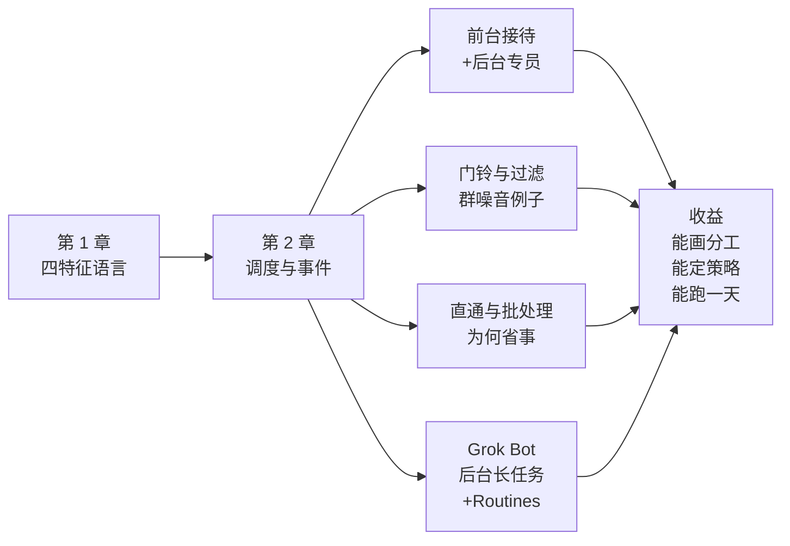
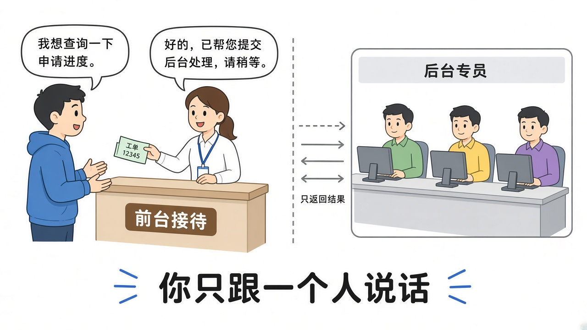
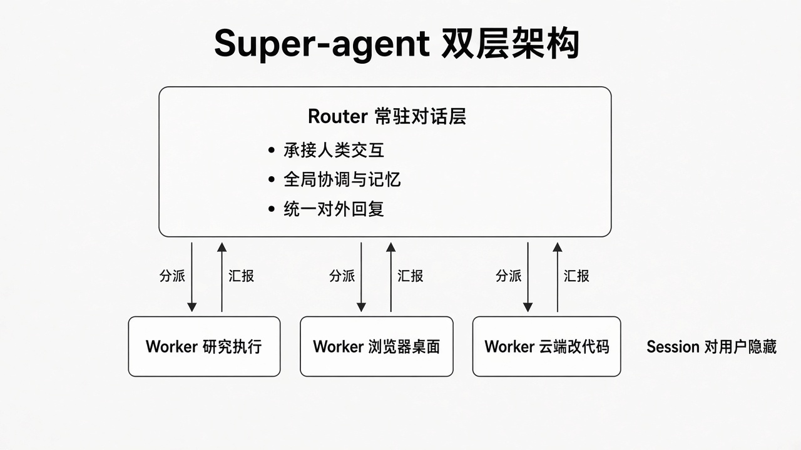
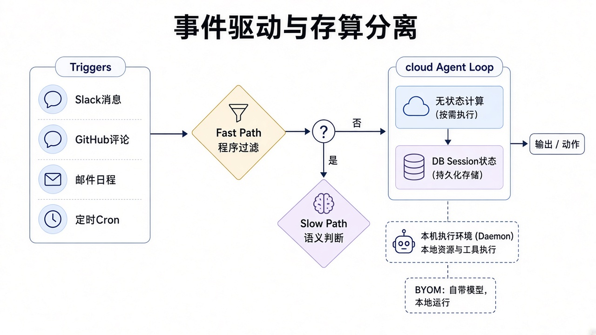
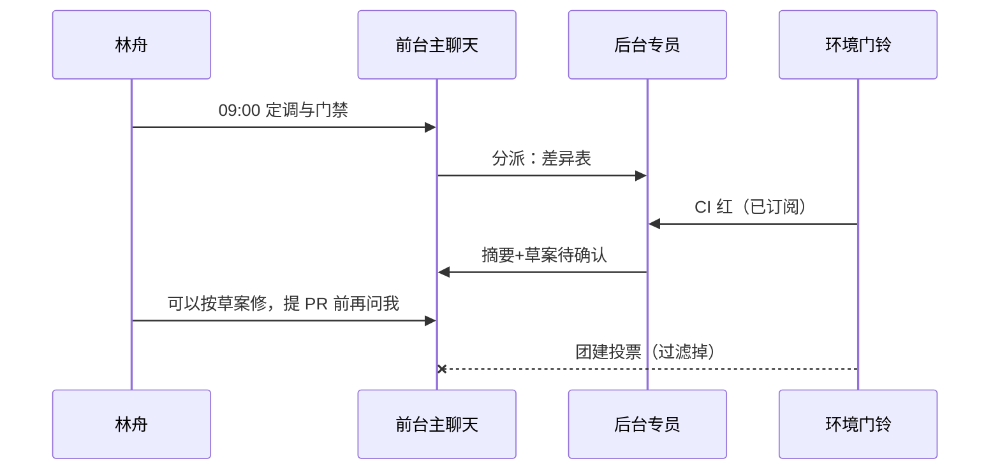

# 第 2 章 双层 Router/Worker 与事件驱动

> 本章导读：第 1 章立住四特征后，林舟马上会问——「底层怎么拆，才能既连续又高效？群消息一多，怎么不把人吵死？」本章用**前台接待 / 后台专员**讲透 Router 与 Worker；用**门铃**讲透事件；用**群消息噪音**讲过滤与订阅。每一节仍按：一句话结论 → 林舟小例子 → DeepSeek 对应点 → Grok Bot 可见行为 → 实现逻辑推测 → 一张专属图。读完你能：向同事画清谁对外说话、谁埋头干活；定一套中台可接受的 Trigger 策略；并把「直通 / 过滤 / 克制投机」跑成一天语言约定。

*本章导览图*

## 你什么时候需要它

**你认同「多任务上限 = 人的注意力」，但不知道系统该怎么拆**——读前台接待 / 后台专员两节。

**助手能干活，但群消息一多又吵又贵，或 CI 总挤爆主对话**——读门铃、过滤与直通。

**你想让助手「后台先做，有价值再交付」，又怕订单域被假阳性主动搞砸**——读投机执行与克制行。

**你在写团队约定**——直接用文末「林舟的一天（调度版）」与对照表。

## 概述

先想酒店前台。

客人只跟**前台接待**说话：问路、改预约、投诉。真正查房态、送行李、修空调的是**后台专员**。如果每个专员都直接冲出去跟客人喊话，大厅会乱成菜场；如果所有事都让前台亲手干，前台会累死，客人还要排队。

Agent 系统也卡在同一权衡：

| 极端做法 | 连续性（像不像同一个人） | 吞吐（能不能并行） | 你会感觉怎样 |
|----------|------------------------|-------------------|-------------|
| 所有事进同一会话 | 最高 | 低（串行） | 细节搅成一锅，干得慢 |
| 每条消息新开会话 | 低 | 最高 | 好几个机器人刷屏，记不住谁是谁 |
| **前台 + 后台** | 高（前台持全局序） | 高（专员隔离并发） | 对外一个人，对内多人干 |

原文选第三种：常驻 **Router**（路由层，对外统一接待与分派）+ 上下文隔离的 **Worker**（工人层，埋头执行具体任务）。用户侧淡化 Session——Session 应是系统细节，不是你的认知负担。

主动性则换驱动方式：主要输入从「人逐条键入」变成环境里的半结构化事件，即 **Trigger**（触发器，门铃）。围绕一条事件，原文依次谈：两级过滤、订阅与直通、Inline & Spill（内联与溢出，短记与长文归档）、投机执行。

**业务上推荐优先用**：先把「主会话只做交互与分派、长任务进后台」用熟，再叠 Routines 过滤；不要一上来追求「无人 @ 也提 PR」。

*图：`22-router-analogy.jpg`。这张图证明 Router/Worker 首先是生活分工——前台对外、专员对内——不是必须在 UI 里看到这两个英文开关。*

---

## 前台接待：Router 是谁

### 一句话结论

Router = 常驻的全局序点：只接待、分派、记事，不埋头搬砖。

### 小例子（林舟）

林舟对主聊天说：「把字段差异表做出来，再盯今晚 CI。」  
好的前台会：记下目标、把「做表」和「盯 CI」分给后台、自己只回「已安排，表好了叫你」。  
坏的前台会：自己开始跑十分钟工具，期间林舟插不进「退款回传先不做」。

### 对应 DeepSeek 哪一点

原文：Router 承接所有入口的人类交互，充当全局**序点（Sequence Point）**、协调点与记忆；为避免成为瓶颈，**不直接执行具体任务**，甚至可以不配备重型执行工具。它与常见 Agent Team 的 Lead 不同——重心是任务之间的高层关联与分派，而不是单任务内的步骤拆解。

| 看什么 | 常见 Agent Team 的 Lead | Super-agent 的 Router |
|--------|------------------------|----------------------|
| 重心 | 单复杂任务内的角色协作 | 任务之间的分派与关联 |
| 负载 | 常要深入细节 | 刻意保持轻量 |
| 对外说话 | 有时多个角色都输出 | **只有前台对外** |

### Grok Bot 你能看见什么

主聊天 ≈ 前台：你在这里定调、改方向、做验收。长调研、改文件、跑检查应表现为后台推进，再汇总回主对话。

### 实现逻辑推测（标明推测）

**推测**：产品层「主会话」承担了 Router 的对外职责；不一定存在名为 Router 的进程。轻量模型 + 强分派提示也可能撑起前台——但原文实验提示：只靠提示词委派不稳定（见后文）。

*图：`02-router-worker.jpg`（全书架构示意，本章用一次）。这张图证明逻辑上如何「一个对外入口 + 多个隔离执行会话」；对应原文第 2 节，不等于 Grok Bot 源码同名模块。*

---

## 后台专员：Worker 是谁

### 一句话结论

Worker = 隔离上下文里的专员：一件活一个房间，干完把结论交回前台。

### 小例子（林舟）

**反例**：同一窗口里同时改字段映射、写单测、回团建——注意力稀释，工具结果互相污染。

**正例**：「做差异表」进专员 A；「修 CI 红」进专员 B；两者默认不直接「互相说话」，结论都交回主聊天，由林舟（或前台）合并决策。

### 对应 DeepSeek 哪一点

原文：Worker 层上下文隔离、可并发；同层任务默认不直接通信，避免多机器人刷屏与全局约束丢失。双层是**逻辑职责**，实现上不必真的叫两个进程名。

### Grok Bot 你能看见什么

可同时推进调研、改代码、跑检查等多条后台线；汇总时给短结论。不要把「侧栏再开一个助手」当成 Worker——那往往是另一个前台，不是专员。

### 实现逻辑推测（标明推测）

**推测**：长任务在隔离上下文（类似 Worker）中执行；完成事件回灌主会话。侧栏多助手更像多个 Router 实体，误用会伤「连续」。

---

## 事件 = 门铃：Trigger 是什么

### 一句话结论

事件是环境按门铃；不是人把整段需求再口述一遍。

### 小例子（林舟）

CI 红了、PR 来了新评论、指定邮件进箱——这些都是门铃。  
团建投票、表情包刷屏——也是门铃，但多数该被前台当成「推销传单」丢掉。

### 对应 DeepSeek 哪一点

原文：主动性要求驱动方式从「人类逐条键入」转为环境半结构化事件（Trigger）。事件生命周期上，先过滤，再决定进 Router 还是直通 Worker。

### Grok Bot 你能看见什么

Routines 可按定时 / GitHub / Slack / 邮件等触发助手行动。你配置的是「哪些门铃值得理」，不是「让助手对所有群消息发表感言」。

> Routines 段说明：本书用行为描述与比喻讲清目标；助手信息 / Routines 面板的实拍以面板真正打开为准，**暂不引用**未确认的全窗图冒充面板。

### 实现逻辑推测（标明推测）

**推测**：存在 Trigger 接入与策略配置层；默认偏可关闭、可预期。强主动（无人确认提 PR）不是默认姿态。

---

## 过滤：群消息噪音怎么处理

### 一句话结论

过滤 = 先挡噪音，再花钱思考；主动的另一半仍是安静。

### 小例子（林舟）

中台群一天几百条：

| 门铃内容 | 该不该进主对话 | 人话理由 |
|----------|---------------|---------|
| CI failed on order-adapter | 该 | 跟主线直接相关 |
| 「周五团建投哪家店」 | 不该 | 噪音；助手回了又贵又吵 |
| PR 评论改幂等键 | 该 | 跨信道改方案，连续所需 |
| 表情包连刷 | 不该 | 无信息增量 |

林舟若关掉过滤，助手会对团建发表三页建议——这叫话痨，不叫主动。

### 对应 DeepSeek 哪一点

原文两级过滤：便宜的 Fast Path（快路径，规则/轻量判断）先挡；过不了再进 Slow Path（慢路径，更贵的模型判断）。目的：降成本、降打扰。

### Grok Bot 你能看见什么

配置 Routines 时写清「只关心：CI、指定仓库 PR、主题含 OrderGateway 的邮件」。群闲聊默认不触发长回复。若仍话痨，把过滤清单写进团队 RFC。

### 实现逻辑推测（标明推测）

**推测**：产品侧有规则白名单 + 模型二次判断的组合可能；默认姿态偏低打扰。精确算法未披露，对照时只谈行为。

*图：`03-event-compute-split.jpg`（事件侧示意，本章用一次；第 3 章不再重复贴同一张谈事件）。这张图证明「事件进来之后如何分流」，为过滤 / 直通提供结构直觉。*

---

## 订阅直通与批处理：为什么省事

### 一句话结论

能直通专员的，就别每次都烦前台；能打包的门铃，就别一响一问。

### 小例子（林舟）

**直通**：林舟已订阅「order-adapter 的 CI」。CI 红 → 直接进「修 CI」专员准备摘要与草案 → 前台只在需要决策时被叫一声。  
**不直通的代价**：每条 CI 日志都先吵前台，前台再转述——延迟高、token 贵、还容易打断林舟正在改的定调。

**批处理**：十分钟内来了 8 条同类 PR 评论小修，合并成一次「评论摘要」再进前台，而不是 8 次打断。

### 对应 DeepSeek 哪一点

原文：订阅直通让匹配事件绕过 Router 繁忙路径，直达相关 Worker；批处理在多任务负载下常用 **token 换稳定时延**。实验侧还对比了「结构委派」与「只靠提示词委派」——后者不稳定。

### Grok Bot 你能看见什么

把「盯 CI / 拉 PR 摘要」做成 Routine，而不是每次在主聊天手敲「帮我看看 CI」。主聊天保留决策；重复观察进例行任务。后台长任务并行，就是产品层的「专员在干活」。

### 实现逻辑推测（标明推测）

**推测**：Routines ≈ 产品化的 Trigger 订阅；后台任务 ≈ Worker 感执行。批处理与直通是否在内部按论文同名实现未知——但「减少主会话被例行噪音打断」的体验同向。结构上的后台隔离，通常比「请优先用子代理」提示词更稳。

| 做法 | 省在哪里 | 风险 |
|------|---------|------|
| 订阅直通 | 少烦前台，降延迟 | 订错会漏事或订太多 |
| 批处理 | 少打断，时延更稳 | 合并窗口太大，紧急事变钝 |
| 只靠提示词委派 | 改文案成本低 | 临场不委派，结构假象 |

---

## Inline & Spill：短记与长文

### 一句话结论

前台只留能决策的短记；长过程进档案，需要时再链式召回。

### 小例子（林舟）

差异表调研产生 20 页笔记。  
**Inline**（内联）：主聊天只留「三列结论 + 两个风险」。  
**Spill**（溢出）：详细比对进后台档案；林舟问「店铺 ID 那列当初为啥放弃」时，再链式召回，而不是把 20 页糊在 IM 里。

### 对应 DeepSeek 哪一点

原文用 Inline & Spill + 链式召回，解决 Router 记忆膨胀：对外保持轻量，对内可检索长程细节。

### Grok Bot 你能看见什么

要求：「主会话只回表……日志放后台。」这就是产品层的 Inline 纪律。不要把完整工具日志贴进群。

### 实现逻辑推测（标明推测）

**推测**：主会话上下文有长度与展示策略；长产物落在任务产物/文件侧。是否实现论文同名 Spill 机制未知，但「短结论 + 可回看产物」同向。

---

## 投机执行：先做，交付要克制

### 一句话结论

可以后台先准备；交到真实世界前，订单域默认等人点头。

### 小例子（林舟）

CI 红了，专员已写好修复补丁与 PR 描述（投机执行：预判值得做，先干起来）。  
**可接受交付**：草稿停在待确认。  
**不可接受**：无人确认就提 PR、发群、改生产——假阳性在契约域代价极高。

### 对应 DeepSeek 哪一点

原文谈投机执行提升吞吐；同时承认主动放大风险。本书把原文「无人 @ 也提 PR」标为上界参考，把「草稿 + 人确认」标为中台默认。

### Grok Bot 你能看见什么

后台可准备补丁与描述；关键动作出现审批卡或等你在主聊天说「可以提」。团队约定写死：对外发送 / 合并主分支 / 生产配置 = 必须人确认。

### 实现逻辑推测（标明推测）

**推测**：产品默认 HITL（Human-in-the-Loop，人在回路里确认）偏保守；投机更多停在「准备」，而非「静默落笔」。不要把「能后台干活」读成「已授权自动对外」。

---

## 落地对照表（第 2 章）

> 第三列均为**基于可见行为的合理推测**，非官方实现披露。

| 文章机制（人话） | Grok Bot 你看见什么 | 实现逻辑推测（推测） |
|-----------------|-------------------|---------------------|
| Router 对外统一 | 主聊天定调、改方向、验收 | 主会话承担对外序点职责 |
| Worker 隔离并发 | 后台长任务并行，汇总短结论 | 长任务隔离上下文执行 |
| Trigger 门铃 | Routines 按定时/GitHub/邮件等触发 | 存在 Trigger 与策略配置层 |
| 两级过滤 | 闲聊不刷屏；关键摘要才进 | 规则 + 模型判断的组合可能 |
| 订阅直通 | 例行观察进 Routine，少打断主聊 | Routines ≈ 订阅的产品化 |
| 批处理 | 摘要合并，而非每条都吵 | 可能有合并/节流；未证实同名批处理 |
| Inline & Spill | 短结论在前台；细节在产物里 | 展示与产物分离策略 |
| 投机执行 | 可准备草稿；关键动作等人 | 默认 HITL；非静默落笔 |

---

## 林舟的一天（调度版）

| 时刻 | 林舟怎么说 / 怎么配 | 对应本章点 |
|------|-------------------|-----------|
| 09:00 | 定调 + HITL 三句（同第 1 章） | 前台持全局序 |
| 09:15 | Routine：订阅 order-adapter CI + 该仓 PR 评论 | 门铃 + 直通感 |
| 10:30 | 「差异表丢后台；主会话只回三列表」 | Worker + Inline |
| 11:05 | CI 红 → 摘要进主会话；草案后台准备 | 过滤后的主动 + 投机到草稿 |
| 14:00 | PR 评论改幂等键 → 前台更新全局约束，专员跟改 | 连续 + Router 记忆 |
| 16:20 | 团建消息：无动作 | 过滤 / 安静 |
| 18:30 | 日终三条里程碑；明日 Routine 拉摘要 | 批处理感的日终收口 |

*调度版一天：前台持序，专员干活，门铃经过滤*

---

## 为什么结构优于提示词委派

原文实验（合成负载，作者提醒仅作参考）给人三个产品直觉——本章收成可执行结论：

1. **结构 > 临场提示词**：委派应落成后台任务/子执行，而不是「请优先用子代理」碰运气；
2. **直通是成本优化**：先做对路由，再削前台负载；
3. **token 换稳定时延**在多任务场景常常值得（批处理）。

对林舟：与其把系统说明写成小说，不如配三条 Routine + 一条「长任务必须后台」的团队习惯。

---

---

## 结构委派 vs 提示词委派：林舟的对照实验（产品层）

### 一句话结论

把「请开子任务」写进说明，不等于系统里真有专员房间。

### 小例子（林舟）

林舟做了两天对照（非正式实验，只为建立团队直觉）：

| 天 | 做法 | 现象 |
|----|------|------|
| A | 系统说明写「请优先开子代理处理长任务」 | 主聊天仍亲自跑长测；新消息排队或打断 |
| B | 显式：「差异表丢后台；CI 用 Routine；主会话只决策」 | 前台可插话；汇总变短；团建不再触发长文 |

### 对应 DeepSeek 哪一点

原文实验表明：只靠提示词委派不稳定；结构化的 Router/Worker 与直通更接近目标体验。作者提醒合成负载仅供参考——本书只借产品直觉，不抄曲线当指标。

### Grok Bot 你能看见什么

用产品能力把结构落地：后台长任务、Routines、主聊天短结论。少写「小说式系统提示」，多写可执行约定。

### 实现逻辑推测（标明推测）

**推测**：提示词只能「建议」委派；后台任务与 Routine 才是可观察的结构。团队评审时应看行为，不看提示词里有没有 Worker 字样。

---

## 定 Trigger 策略的一张表（可直接开会用）

把门铃分成四桶，开会时逐行打勾：

| 桶 | 例子 | 默认动作 | 谁批准改默认 |
|----|------|---------|-------------|
| 必须理 | 主仓 CI 红、订单域 PR 评论、Oncall 邮件 | 摘要进主会话；可后台准备草案 | 林舟 / Tech Lead |
| 可订阅 | 依赖库安全通告、相邻域 PR | Routine 日摘要，不即时吵 | 值班人 |
| 默认丢 | 团建、表情包、无关 @ 全体 | 忽略 | 无需批准 |
| 禁止自动 | 对外群发、合并主分支、改生产配置 | 最多草稿；必须人确认 | 组内书面约定 |

这张表就是第 1 章「主动等级」在调度层的落地。没有这张表，Routines 配得越多，越像话痨生成器。

---

## 前台话术速查（调度用）

理解主线不依赖背诵，但开会时好用：

| 你想达成 | 可以对主聊天说 |
|----------|---------------|
| 分派专员 | 「这件事丢后台，做完只回结论与风险。」 |
| 打开门铃 | 「帮我订一个 Routine：每天 09:30 拉 order-adapter CI 与未读 PR 评论摘要。」 |
| 关掉噪音 | 「中台群闲聊与团建一律忽略；不要主动回复。」 |
| 克制投机 | 「修复可以先准备；提 PR 前必须问我。」 |
| Inline 纪律 | 「主会话禁止贴完整日志；要三行结论。」 |

## 本章小结

1. **比喻**：Router = 前台接待；Worker = 后台专员；事件 = 门铃。
2. **分工**：前台持全局序、对外统一；专员隔离并发；同层默认不互相喊话。
3. **过滤**：群噪音用白名单与安静面；主动 ≠ 话痨。
4. **直通与批处理**：例行门铃少烦前台；合并摘要换稳定时延。
5. **投机**：可准备，交付要人确认；订单域禁止默认静默落笔。
6. **Grok Bot**：主聊天 + 后台长任务 + Routines 是产品层同构体验；Routines 面板实图待确认后再引。
7. **下一步**：第 3 章讲边说边做、三地分离、卡住谁来喊停。

---

## 验收清单

- [ ] 能用前台/专员比喻讲清 Router 与 Worker 的分工
- [ ] 能说明为什么「所有事进一窗」和「每条消息新开窗」都不够
- [ ] 能举三个「该响的门铃」和三个「该丢的传单」（群噪音）
- [ ] 能解释订阅直通与批处理分别省什么
- [ ] 能对照 Grok Bot：主聊天 / 后台任务 / Routines 各像哪一层
- [ ] 能口头区分「可见行为」与「实现推测」
- [ ] 能写出订单域的投机执行克制句（可到草稿，不可静默提 PR）

---

## 延伸阅读

- DeepSeek 原文第 2、3 节（同第 1 章链接）——双层架构与事件驱动依据。
- 本书第 1 章——四特征与定调话术；本章是其调度展开。
- 本书第 3 章——异步交互、存算分离、Watchdog。
- 书架 **agentscope-java**：子 Agent 与权限——要把 Worker 感落到框架时。
- 书架 **copilotkit**：人机协作界面——HITL 卡片与前台体验相关。
