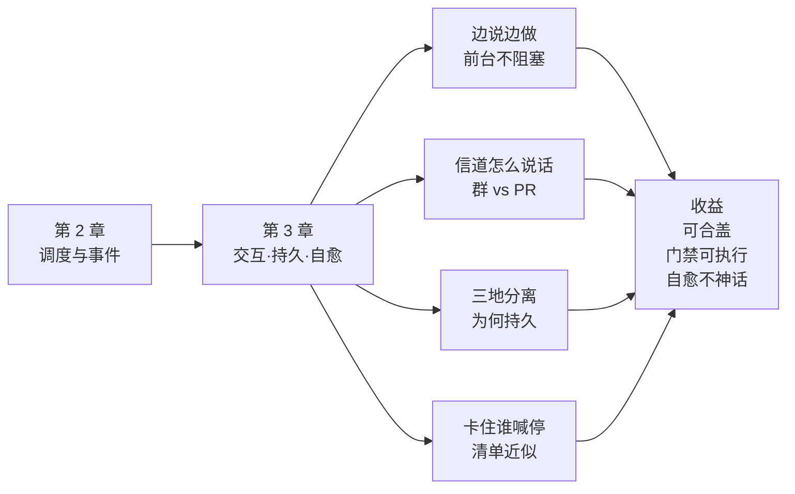
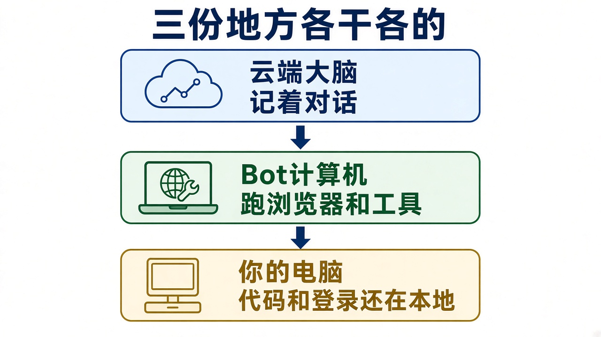
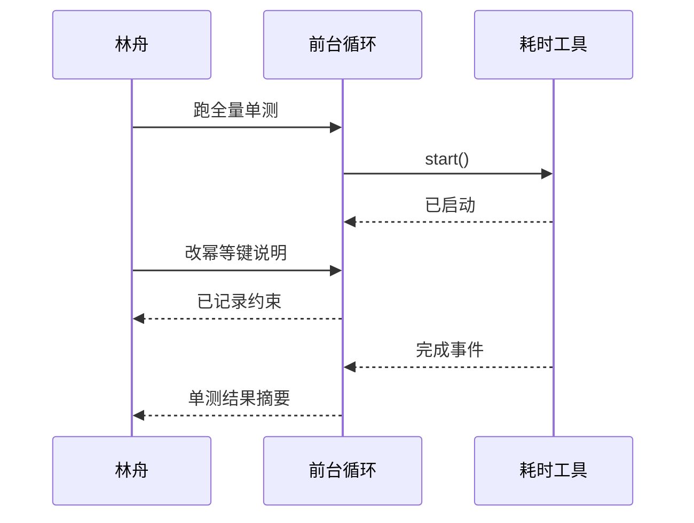
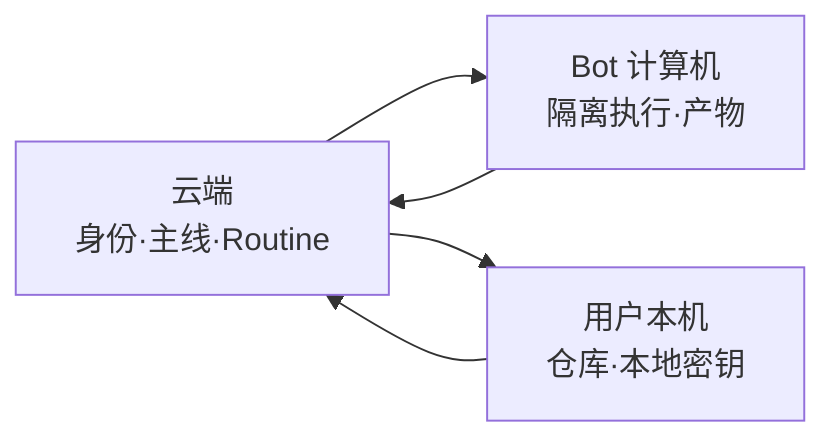
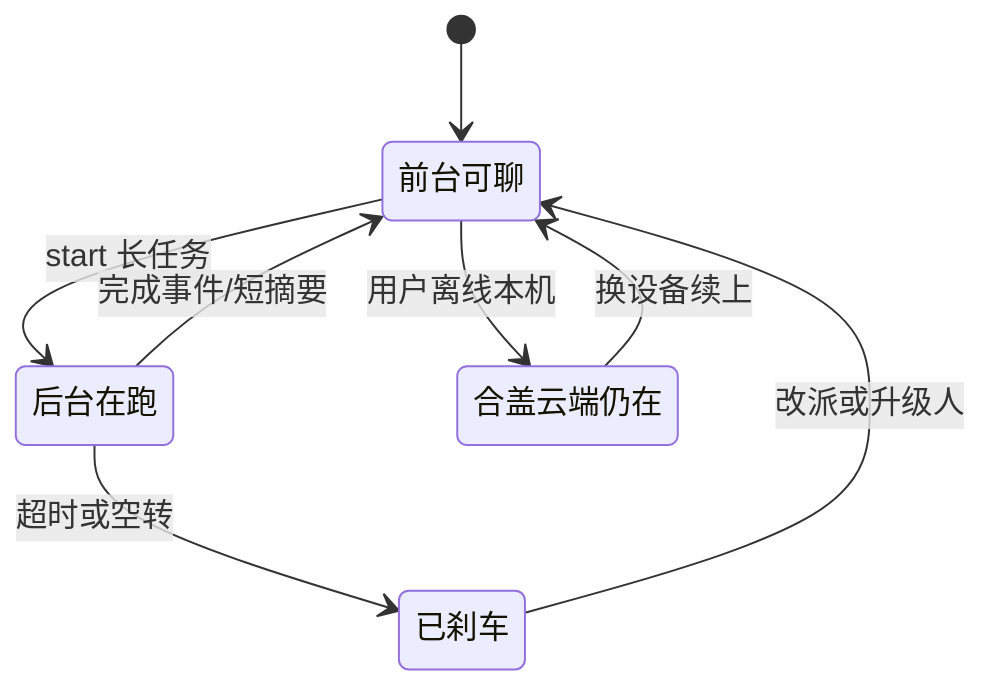

# 第 3 章 异步多信道、存算分离与 Watchdog

> 本章导读：林舟已经能用「主会话协调 + 后台执行 + Routines」描述一天，但仍会被三件事卡住——后台跑检查时前台能不能继续改需求？合上笔记本助手还在不在？卡住或偏航时谁来喊停？本章用**边说边做**讲异步；用**不同信道怎么说话**讲带宽；用**云端 / Bot 计算机 / 本机**讲为什么持久；用**卡住了谁来喊停**讲 Watchdog 的差距与可执行清单。每节仍是：一句话结论 → 林舟小例子 → DeepSeek 对应点 → Grok Bot 可见行为 → 实现逻辑推测 → 专属图。读完你能：把「高效」落到交互模型；画出三地分离；用清单近似自愈，而不是假装已有独立外部 Control Loop。



*本章导览图*

## 你什么时候需要它

**助手「能并行」，但对话还是半双工——发下一条要等工具跑完**——读「边说边做」。

**助手在群里太吵，或在 PR 里太干瘪**——读「不同信道怎么说话」。

**你关心合盖、换设备、本机仓库与云端助手如何并存**——读「三地分离」。

**你听到 Watchdog 想对标，又怕在订单域赌静默自治**——读差距与检查清单；直接采用门禁表。

## 概述

第 2 章解决了「谁对外、谁干活、门铃怎么响」。要让体验真的又连续又高效，还差两步：

1. **边说边做**：后台耗时操作别锁死前台；
2. **看人下菜碟**：群聊、PR、邮件，话术长度不一样。

要让助手**持久**，还得借鉴存算分离：计算、状态、执行环境不捆在同一台合盖笔记本上。长期跑着，还会出现「没崩，但空转 / 偏航」——这时需要 Watchdog（看门狗，主系统外的控制回路）一类机制。

**业务上推荐优先用**：先做到前台不堵 + 草稿等人确认 + 云端可找回；Watchdog 先降级为清单与审批卡，再谈独立 Session。



*图：`23-three-places-analogy.jpg`。这张图证明持久不是「电脑别关机」口号，而是云端大脑、Bot 计算机双手、用户本机车间可以分开在线——合盖只影响车间，不等于人格消失。*

---

## 边说边做：全双工是什么

### 一句话结论

全双工 = 助手在干活时，你仍能插话改方向。

### 小例子（林舟）

**半双工痛点**（经典同步 ReAct：推理—行动循环，一步工具要等返回）：

> 「我想改一句幂等键约束，但助手还在跑测试，输入框像被锁住。」

**边说边做**：

1. 林舟：「跑 order-adapter 全量单测。」助手立刻回「已启动」。
2. 林舟接着：「退款回传本迭代不做。」助手记下约束。
3. 单测结束后，主聊天收到短摘要，而不是林舟去另一个窗翻日志。

### 对应 DeepSeek 哪一点

原文把耗时调用改成 start / stop：`start()` 立即返回；完成后结果作为新事件投递；必要时 `stop()`。于是前台对话与后台执行解耦。原文指出异步任务机制已在 DeepSeek Harness 实现，但（文中所述阶段）尚未默认开启——启发是：**高效首先是交互模型问题，其次才是模型更强。**



*边说边做：工具在跑，对话不停*

### Grok Bot 你能看见什么

1. 主聊天在后台长任务进行中仍可继续对话、改需求、做确认；
2. 卡住时可停或改派（运维感）；
3. 完成后回主会话给结论。

（完整窗示意见第 1 章 `14-main-chat-clean.png`，本章不再重复贴全窗。）

### 实现逻辑推测（标明推测）

**推测**：前台对话循环与耗时工具执行已解耦；完成结果作为事件回灌。是否与原文同名「异步 ReAct」实现一致未知，但「可插话 + 可停止」的体验同向。

| 症状 | 人话 | 先试什么 |
|------|------|---------|
| 输入框像锁住 | 仍半双工 | 把长任务明确丢后台 |
| 只能刷新重来 | 缺 stop / 改派 | 用产品停止/改方向，再重派 |
| 结果不知去哪 | 完成事件没回灌感 | 要求「完成后回主会话三行结论」 |

---

## 不同信道怎么说话

### 一句话结论

同一结论，群里要短，PR 里要可复核，邮件里要可转发。

### 小例子（林舟）

差异表做好了，三种写法拉开体验：

| 信道 | 带宽感 | 林舟期望的说法 |
|------|--------|---------------|
| 中台群 IM | 很窄，刷屏代价高 | 「差异 12 项：8 映射 / 3 待定 / 1 拒绝。详情在文档。」 |
| GitHub PR | 中等，要可评审 | 按文件列出改动意图 + 测试说明 + 风险 |
| 邮件给业务 | 要完整、可转发 | 背景、决定、影响面、下一步；附件链到表 |

**反例**：把完整工具日志贴进群——高效假象，实际是信道污染。  
**正例**：主聊天 / IM 只留 Inline 短结论；细节进 PR 或文档（呼应第 2 章 Spill）。

### 对应 DeepSeek 哪一点

原文：多信道交互要匹配信道带宽与使用习惯。异步解决「堵不堵」；带宽适配解决「吵不吵 / 够不够用」。

### Grok Bot 你能看见什么

在定调里写死：「IM 只回短结论；PR 写可评审说明；对外邮件只许草稿。」若助手在群里话痨，先改信道约定，再查过滤（第 2 章）。

### 实现逻辑推测（标明推测）

**推测**：产品可能按入口做不同系统提示或长度策略；也可能主要靠用户话术约束。未证实有自动「按信道改写」引擎——团队应用**显式约定**兜底。

---

## 三地分离：为什么这样才持久

### 一句话结论

大脑、双手、车间不捆在同一台合盖的笔记本上，合盖才不等于死亡。

### 小例子（林舟）

把持久拆成三个地方：

| 地方 | 像什么 | 林舟场景里放什么 |
|------|--------|-----------------|
| **云端** | 大脑与记忆柜 | 助手身份、主线任务、Routines 观察 |
| **Bot 计算机** | 助手自己的工作台 | 跑检查、写中间产物、隔离执行 |
| **用户本机** | 真正的车间 | `open-api-platform` 仓库、本地密钥、必须碰本机的文件 |

**反例**：一切都绑在林舟笔记本进程上 → 合盖全停，人格蒸发。  
**正例**：合盖后，云端身份与 Routines 仍在；本机任务标成「等设备上线」；明天开机续上，而不是从零自我介绍。

### 对应 DeepSeek 哪一点

原文借鉴存算分离：先把计算与状态分开，再把云端 Loop 与重状态执行环境解耦。持久 = 始终在线 + 可恢复 + 能接真实环境。

### Grok Bot 你能看见什么

- 换浏览器 / 换设备仍能打开同一助手（云端身份）；
- Bot 计算机提供助手侧执行环境；
- 经授权可接用户本机（BYOM，自带机器）。

日终林舟说：「本机任务等明天设备上线再续」——这是接受三地差异，而不是幻想本机永远在线。

### 实现逻辑推测（标明推测）

**推测**：计算与部分状态在云端；执行可打到托管环境或用户本机；本机离线时云端身份仍在，本机任务排队。三地之间的权限与数据边界由产品与授权控制——中台应把「什么不能同步出本机」写进门禁。



*三地：合盖影响本机车间，不自动抹掉云端身份*

---

## 卡住了谁来喊停：Watchdog

### 一句话结论

Watchdog = 主系统外的那声「你卡住了 / 你偏航了」；Grok Bot 有运维感能力，但不宜宣称已有独立外部控制回路。

### 小例子（林舟）

助手在「修 CI」上空转：反复读同一日志、不提新假设、也不问人。  
进程没崩，但目标在漂。

| 谁来喊停 | 像什么 | 星帆订单域现状 |
|----------|--------|---------------|
| 林舟自己发现 | 人工巡检 | 有效，但回到「注意力上限」 |
| 产品内停止 / 改派 / 审批卡 | 内置刹车 | **Grok Bot 可见，优先用** |
| 独立 Watchdog Session | 外雇的监工 | 原文目标形态；**不宜对等宣称已有** |
| 日终 / Routine 检查清单 | 定时点名 | **可执行近似，本章主推** |

### 对应 DeepSeek 哪一点

原文第 6 节：许多异常不是进程崩溃，而是无效循环与目标偏离；要在主系统外引入 Watchdog 一类外部 Control Loop（控制回路）。这与「持久的自愈」直接相关。

### Grok Bot 你能看见什么

- 后台卡住可停 / 改派；
- 关键动作出现审批卡；
- 可用 Routine 做周期检查（例如每两小时：「是否仍对准今日主线？有无空转？」）。

差距要说清：**有刹车与点名，不等于已经雇了独立监工进程。**

### 实现逻辑推测（标明推测）

**推测**：具备任务级运维感（停止、审批、重试），更像产品内嵌控制，而不是原文那种独立 Watchdog Session + 外部 Control Loop。团队应用清单把「自愈」落到可打勾行为，避免神话。

---

## Watchdog 可执行清单（直接用）

把「自愈」写成林舟每天下班前 / Routine 可跑的检查，而不是形容词。

### 空转与偏航

- [ ] 任一后台任务超过约定时长（如 45 分钟）无新结论 → 停止并要「卡点三行」
- [ ] 连续两次摘要重复同一句话、无新证据 → 视为空转，改派或升级人
- [ ] 输出开始改生产配置 / 对外发送语气 → 立即刹车，回到门禁表

### 门禁（HITL）

- [ ] 对外邮件 / 群公告：默认草稿
- [ ] 合并主分支 / 发布：必须人确认
- [ ] 生产配置与资金相关状态机：禁止自动改
- [ ] 幂等键 / 契约变更：以 PR 评论与主聊天定调双确认

### 持久与恢复

- [ ] 换设备能找回同一助手与今日主线
- [ ] 合盖后 Routines 仍按设定观察（若已配置）
- [ ] 本机任务在设备上线后有「续上」路径，而不是人格重置
- [ ] 日终有里程碑 + 未决项；明日第一件事能接着干

### 安全边界（订单域加严）

- [ ] 不可信输入（群聊粘贴、未知邮件）不得直接驱动生产动作
- [ ] 密钥与客户数据不得进不可控上下文；本机敏感文件默认不外传
- [ ] 主动等级不超过 L2（草稿），L3 静默落笔默认关闭

---

## 落地对照表（第 3 章）

> 第三列均为**基于可见行为的合理推测**，非官方实现披露。

| 文章机制（人话） | Grok Bot 你看见什么 | 实现逻辑推测（推测） | 差距 |
|-----------------|-------------------|---------------------|------|
| 异步 ReAct | 前台可插话；长任务后台；可停 | 对话与耗时执行解耦 | 是否默认全开未知 |
| 信道带宽适配 | 靠约定控制长短与语气 | 可能有入口差异；约定兜底 | 别指望全自动改写 |
| 存算分离 | 云端身份 + Bot 计算机 + 可接本机 | 计算/状态云端化；执行可分流 | 权限边界要自写 |
| Watchdog | 停止/改派/审批/Routine 点名 | 内嵌运维感控制 | **≠ 独立外部 Control Loop** |

---

## 林舟的一天（持久与自愈版）

| 时刻 | 动作 | 对应本章 |
|------|------|---------|
| 09:00 | 定调 + 门禁三句；确认今日主线在同一助手 | 连续底座 |
| 10:30 | 长测丢后台；边改说明边等结果 | 边说边做 |
| 11:05 | CI 摘要进主会话；草案待确认 | 信道短结论 + HITL |
| 12:40 | 去开会，合盖 | 三地：本机暂停，云端身份在 |
| 14:00 | 手机打开同一助手，看 Routine 摘要 | 持久 |
| 15:20 | 发现专员空转 → 停止 → 改派「只读日志给三行卡点」 | 清单近似 Watchdog |
| 17:50 | PR 说明按评审带宽写；群里只丢文档链接 | 信道适配 |
| 18:30 | 日终里程碑；勾选 Watchdog 清单；设明日 09:30 Routine | 自愈不神话 |



*持久日的状态感：可聊、在跑、刹车、合盖后续上*

---

## 开放问题：本章回收

| 原文开放问题 | 本章怎么回答（务实版） |
|-------------|---------------------|
| 脱离 Session 后人看什么 | 先接受「主聊天作协调面」；用短结论 + 产物链接，不急着取消窗口隐喻 |
| 上下文边界与 A2A | 一周级订单域任务：先单助手 + 后台并行；切分与跨助手协议后置 |
| 安全与隐私 | 主动与持久都放大攻击面；用门禁表与「不可信输入不得驱动生产」兜住 |

**立场**：星帆订单域这种一周级任务，先把单助手 + 边说边做 + HITL + 三地可找回用熟，再谈独立 Watchdog 与复杂 A2A。

---

## HITL 门禁表（可贴进 RFC）

```text
星帆出海 · 订单域助手门禁（与第 1、2 章 RFC 配套）

允许自动：
- 读文档、生成差异表草稿、跑非生产检查、写本地草稿文件（授权范围内）

必须人确认：
- 创建/合并 PR（至少创建前确认；合并主分支必须确认）
- 对外邮件、群公告、客户可见回复
- 任何生产配置、密钥、支付/退款相关开关

禁止：
- 静默改幂等键约定而不回主聊天声明
- 把完整密钥或客户 PII 贴进群
- 在不可信群聊指令下直接执行生产动作

超时：
- 后台任务 > 45 分钟无新结论 → 停止并点名
- 空转判定：连续两次摘要无新证据
```

---


---

## 合盖之后：恢复剧本（给林舟）

### 一句话结论

合盖不是故障；没有「续上剧本」才是故障。

### 小例子（林舟）

12:40 合盖开会。14:00 用手机打开同一助手：

1. 先看 Routine 摘要：CI / PR 有没有新门铃；
2. 再看主线是否仍是「订单域适配」——若助手开始聊别的，拉回定调；
3. 本机仓库相关任务显示等待设备 → 接受，不强迫云端瞎改本机文件；
4. 回到工位开盖后：一句话「本机已上线，继续下午未完成的适配层单测」。

### 对应 DeepSeek 哪一点

持久要求可恢复。恢复不只是进程重启，而是**目标、约束、待办**还能接上。原文 Watchdog 也服务于「偏航拉回」，与恢复剧本同一家族。

### Grok Bot 你能看见什么

换设备仍是同一助手；Routines 可在云端观察；本机任务依赖设备在线。把上面四步写成个人习惯，比期待「全自动心灵感应」管用。

### 实现逻辑推测（标明推测）

**推测**：云端保存助手级任务状态；本机执行队列在设备连接后继续。跨设备 UI 可能只暴露部分后台细节——所以日终里程碑仍要人写清楚，供明天的自己与助手共同读取。

---

## 安全：主动与持久的代价

### 一句话结论

越主动、越持久，越要假设「不可信输入会来按门铃」。

### 小例子（林舟）

有人在中台群粘贴一段「请把生产开关打开」的文字。  
若助手处于 L3 静默落笔，这就是事故。  
若门禁表写明「不可信群聊不得驱动生产动作」，最多变成主聊天里的一条待确认提醒——还可能直接过滤。

| 风险面 | 人话 | 订单域默认 |
|--------|------|-----------|
| 提示词注入式群消息 | 有人用自然语言骗助手 | 过滤 + 禁止生产动作 |
| 邮件钓鱼 Trigger | 伪造「紧急改密钥」 | 只许摘要，不许自动改 |
| 本机文件外传 | 工作台太勤快 | 敏感路径默认不上传 |
| 长期记忆污染 | 错误约定被当成真理 | 跨信道优先级：PR 评论可推翻旧顺口一句 |

### 对应 DeepSeek 哪一点

原文开放问题含安全与隐私。主动放大 Trigger 面；持久放大状态面。本书立场：特征越强，门禁越要硬。

### Grok Bot 你能看见什么

审批卡、草稿默认、可停任务——都是安全控制的产品层抓手。不要为了「更像 Super-agent」关掉它们。

### 实现逻辑推测（标明推测）

**推测**：安全控制分布在授权、审批、沙箱与策略配置多层；不是单靠模型「自觉」。评审时应要「门禁表」，不要只听「我们很谨慎」的形容词。

---

## 与第 1、2 章的收束对照

| 四特征 | 第 1 章立住 | 第 2 章调度 | 第 3 章收成 |
|--------|------------|------------|------------|
| 连续 | 同一实体、隐藏 Session | 前台持全局序 | 换设备续上同一主线 |
| 高效 | 前台不堵、短结论 | 专员并行、直通批处理 | 边说边做、信道适配 |
| 主动 | 等级 L0–L3 | 门铃、过滤、投机到草稿 | 门禁表 + 不可信输入 |
| 持久 | 合盖≠消失 | — | 三地分离 + 清单近似 Watchdog |

读完三章，林舟应能用一张门禁表 + 三条 Routine + 一个主聊天定调，过完订单域适配周——而不是背诵五模块名词。


## 本章小结

1. **边说边做**：全双工是交互模型；长任务 start/stop，前台不锁死。
2. **信道**：IM 短、PR 可评、邮件可转发；禁止日志墙进群。
3. **三地分离**：云端身份、Bot 计算机、用户本机——合盖 ≠ 人格蒸发。
4. **Watchdog**：原文要外部控制回路；Grok Bot 用停止/审批/Routine 点名近似；**差距要写进评审**。
5. **清单 > 神话**：空转、门禁、恢复、安全四组复选框可执行。
6. **下一步**：回到全书 README 做能力盘点；需要框架落地时交叉 agentscope-java / mcp / copilotkit。

---

## 验收清单

- [ ] 能用「边说边做」解释异步 ReAct，并对比半双工痛点
- [ ] 能同一结论写出 IM / PR / 邮件三种说法
- [ ] 能画出云端 / Bot 计算机 / 本机三角，并说明合盖影响哪一块
- [ ] 能说明 Watchdog 与「产品内停止/审批」的差距
- [ ] 能勾选并定制本章空转 / 门禁 / 恢复清单
- [ ] 能口头区分「可见行为」与「实现推测」
- [ ] 能把 HITL 门禁表贴进自己的团队 RFC

---

## 延伸阅读

- DeepSeek 原文第 4、5、6、8 节（同第 1 章链接）——异步、存算分离、Watchdog、开放问题。
- 本书第 1 章——四特征与定调；本章把高效/持久收成交互与清单。
- 本书第 2 章——门铃、过滤、直通；与本章信道/主动门禁配套。
- 书架 **agentscope-java**：权限与人工介入——门禁落到代码与框架。
- 书架 **mcp**：工具与 Gateway——「双手」如何受控地伸出本机与云端。
