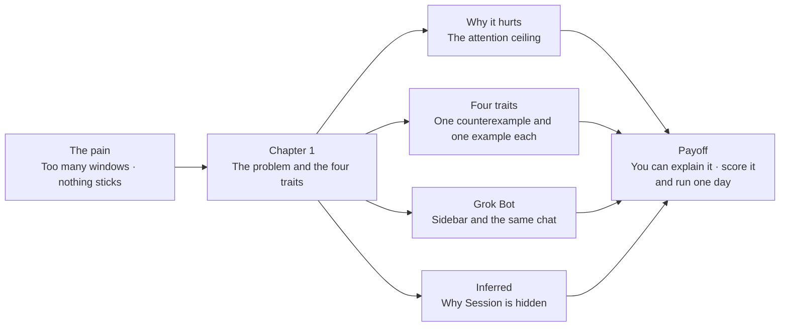
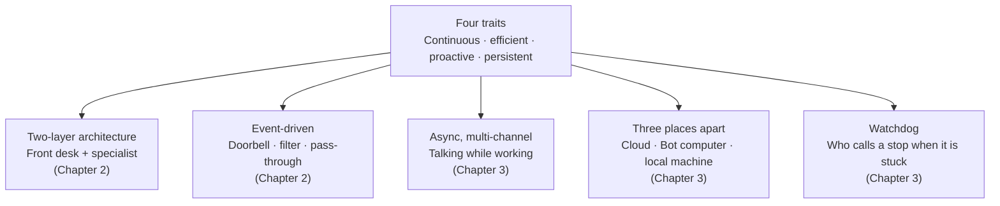
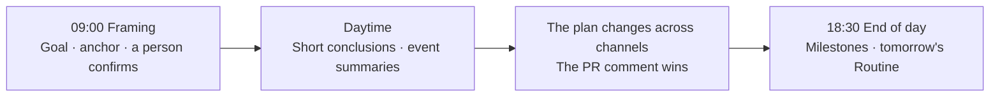
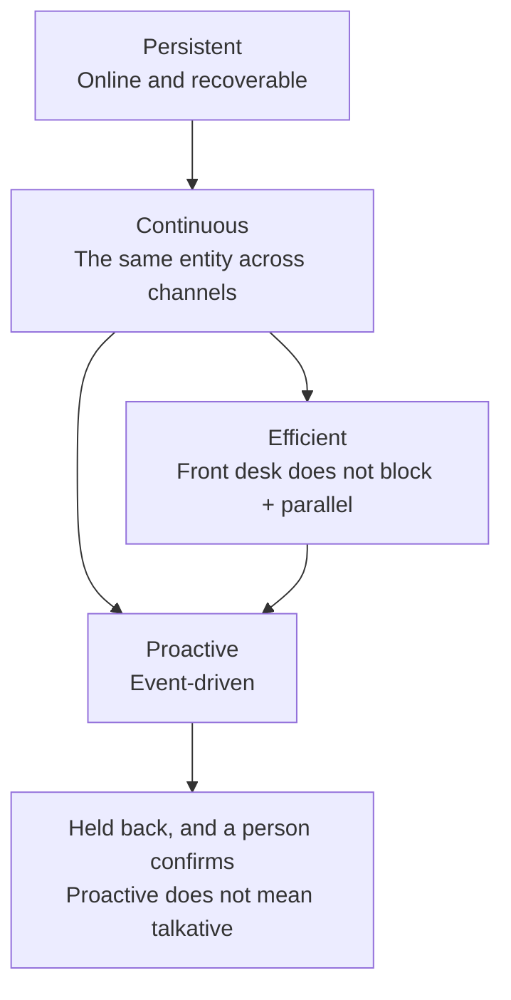

# Chapter 1 The problem and the four traits: from a single session to a continuous entity

> Chapter guide: Lin Zhou (林舟) is a fictional platform engineer at Xingfan (星帆出海). This week he has to finish the order-domain adaptation in `open-api-platform`: match the channel, write the adaptation layer, open a PR, watch CI, and answer the design argument in the group. He used to keep several chat windows and local sessions open at once, and he had to remember for himself whether plan A had already been said. This chapter uses an everyday analogy to make clear why that hurts, then splits the four traits: continuous, efficient, proactive, and persistent. Each section lands on a Grok Bot surface you can see, and marks **inferred implementation** (a reasonable inference from visible behavior, not an official disclosure). **Stance: this text is not a DeepSeek product manual. Grok Bot is the comparison instance. It is not a replica of the paper.** By the end you can tell a colleague why the ceiling on many tasks is a person's attention, score your own assistant against the four traits, and write the day's framing lines from the running example.



*Map of this chapter*

## When you need it

Three situations, three ways to read.

**You are choosing a tool, you have heard Super-agent, and you want to know what problem it solves.** Read "Why it hurts" and "The four traits." Get a shared language first, then decide whether to read Chapter 2 and Chapter 3.

**You already have an assistant (Grok Bot, for example) and you want to see how far it is from continuous, efficient, proactive, and persistent.** Jump to "What you can see in Grok Bot" in each section, and to the comparison tables. Those are decision sections, not a sermon.

**This week you have to push a multi-track engineering task like the order-domain adaptation.** Read the framing lines in the running example, and put "the same assistant," "the front desk does not block," "Routines," and "a person confirms" on the day's schedule. Router, events, and Watchdog are in Chapter 2 and Chapter 3.

What comes later: this chapter only sets the problem and the traits. **The two-layer architecture and events are in Chapter 2.** **Async work, keeping compute and state apart, and Watchdog are in Chapter 3.**

## Overview

Start with an ordinary day.

You are in three group chats, two email threads, and a phone call with the plumber. What wears you out is not that each job is hard. **You have to be your own switchboard:** who said what, who to answer first, and whether the plan changed.

An agent (an AI assistant that can act with tools) is the same. A single job — read the repo, change the code, run the tests — is already something the model does well. The bottleneck moved: **can a person watch enough parallel lines at once?**

The mainstream design still takes a single **Session** (one independent conversation) as the unit. Sessions do not know each other. When the user pushes several pieces of work in parallel, they have to switch by hand and remember the context themselves. The DeepSeek Harness team observed that one person can usually follow only about **3–5** active Sessions at once. So:

| What you look at | Who the ceiling sits on |
| --- | --- |
| Whether one job can be done | The model's ability |
| Whether several jobs can move together | **A person's attention** |

If you only add a CLI, a connector, or a message entry to a local agent, it can "hear" the outside world and still:

1. The main loop sticks on one long tool call, and a new message cannot get in.
2. Details of several tasks crowd into the same context and interfere with each other.
3. Close the laptop lid, and the agent stops.

The paper calls the shape that gets past those limits a **Super-agent**: a **continuous entity** that keeps context across conversations and pushes several complex tasks at the same time without them interfering with each other.

This book reads the WeChat article "Super-agent Design Exploration: Toward a More Autonomous Agent System" (DeepSeek Harness team, checked 2026-11-07), then compares it with **Grok Bot**. Keep two sentences:

1. **The source already says so:** that article is a discussion of engineering ideas. It is **not** a manual for DeepSeek's current product.
2. **This book is the same:** Grok Bot is used to land the abstract traits in one working day. It does **not** claim that Grok Bot implements every module in the paper.

### The four traits (the plain version first)

| Trait | In plain words | What you do when it is missing |
| --- | --- | --- |
| **Continuous** | Change groups, change PRs, and it still feels like the same assistant | "Did Session X already say plan B?" |
| **Efficient** | The front desk can still talk, and the background can run several jobs in parallel | A new instruction waits until the current tool finishes |
| **Proactive** | It follows up when the environment has something to say, and stays quiet when it does not | Every item waits for a person to @ it, or it floods the screen when nothing matters |
| **Persistent** | Close the lid, change devices, and the main line is still there | Close the laptop, and the assistant's identity evaporates |

### The five modules (opened in the next two chapters)



*How the five modules hold up the four traits (grouped from the source's structure)*

**Prefer this first:** write the four traits down as the team's experience standard, then decide whether to build a scheduler. Do not start by copying the paper's five modules.


*Figure: `21-four-traits-analogy.jpg`. An everyday picture of what continuous, efficient, proactive, and persistent each feel like. This figure shows that the four traits are lived feelings, not a list of jargon.*

---

## Why it hurts: the attention ceiling

### The conclusion in one sentence

A single job is already strong enough. When several jobs move together, the bottleneck is a person's attention. The model is already able to do the job.

### A small example (Lin Zhou)

On Monday morning Lin Zhou has all of these open:

- Local agent Session A: writing the `OrderGateway` adaptation skeleton.
- Session B: looking up the channel's field docs.
- Chat window C: arguing the idempotency key with a colleague.
- The phone: CI went red, and he wants to ask about it in passing.

By 15:00 he has forgotten that Session A said, that morning, "start with the channel order number + shop ID." The plan has split into three memories. **Lin Zhou himself became the switchboard.**

### Which point in the DeepSeek article

The source's problem: the quality of one task is decided by the model. The throughput of many tasks is decided by a person's attention. A common ceiling is about 3–5 active Sessions. A Super-agent pushes "context management and concurrent execution" down into a system responsibility, so the user side can fade the Session out of view.

### What you can see in Grok Bot

Open the main chat of the same assistant and say the day's main line clearly. Throw long tasks to the background. Do not create, for the same order domain, another assistant that does not remember the morning's agreement. The sidebar can hold several assistants, but **one main line is bound to one entity** (see the crops later).

### Inferred implementation

**Inferred.** The product places "assistant identity" above the conversation. You face the same bot. Underneath there may still be several execution contexts, folded away from the user. That points the same way as "a Session should be an implementation detail." It does **not** mean the source code no longer has a Session.

### Adding a connector does not cure a structural illness

| Common patch | How it feels | What the structure still lacks |
| --- | --- | --- |
| Connect IM / a GitHub webhook | "The assistant can hear the group" | The main loop can still block synchronously |
| Add MCP / CLI tools | "It has more hands" | Details of several tasks still crowd one window |
| A prompt that says "please open a sub-agent" | "It seems to divide the work" | On the spot, the model may never delegate |

Chapter 2 explains why a structural front desk plus a back-office specialist beats delegation that exists only in the prompt.

---

## Trait 1: continuous — change places, and it is still the same person

### The conclusion in one sentence

Continuous does not mean "the session id is the same." It means you do not have to be the memory clerk.

### A small example (Lin Zhou)

**Counterexample.** In the morning the main chat agrees that the idempotency key is `channel order number + shop ID`. In the afternoon Lin Zhou asks in another window, "which one?" The assistant is blank and asks him to paste the context again.

**Example.** In the afternoon a PR comment changes it to `channel + out_trade_no`. Back in the same assistant's main chat, it adjusts the code notes to "the PR comment wins." Lin Zhou does not retell the whole morning.

### Which point in the DeepSeek article

The source's test sentence: "I do not have to wonder whether Y is in the context of Session X." Across IM, GitHub, email, and other channels, it still feels like the same agent.

### What you can see in Grok Bot

The chat body is where you talk to "the same person." The sidebar is the entry to different assistants with different jobs.


*Figure: `31-crop-chat-body.png` (a crop of the chat body). This figure shows that "continuous" means the task context continues in the same chat body. It does not mean opening another full window that does not know this one.*


*Figure: `30-crop-sidebar-only.png` (a crop of the sidebar). This figure shows that the product allows several assistant entities. **The boundary of continuous** is "one main line, one entity." It is not "the sidebar can create a new assistant, so open another one in the afternoon that forgot the morning's agreement."*

| How you use it | Does it fit "continuous"? |
| --- | --- |
| Personal errands on assistant A, the Xingfan order domain on assistant B | Reasonable: a boundary of responsibility |
| The same order domain split across three assistants that do not know each other | Not reasonable: a split you created |
| The main assistant coordinates, and a back-office specialist does the work | Closer to the front desk / background of Chapter 2 |

### Inferred implementation

**Inferred.** There is a long-lived identity and task memory at assistant level, and every entry routes to the same logical entity. Underneath there may still be several execution contexts, folded away from the user. The product hides the Session concept on purpose, so the user does not become a human Router. If the UI labeled Session everywhere, people would start counting windows again.

---

## Trait 2: efficient — the front desk does not block, and the background can run in parallel

### The conclusion in one sentence

Efficient means you can cut in at any time, and several jobs do not pollute each other.

### A small example (Lin Zhou)

**Counterexample.** The assistant is running the full unit tests, and the input box feels locked. Lin Zhou wants to add "do not do the refund callback yet," and he can only wait.

**Example.** The tests run in the background. Lin Zhou edits the idempotency-key note in the main chat. When the run finishes, the main chat receives a short conclusion, not a wall of logs.

### Which point in the DeepSeek article

The source's "efficient" has two layers. At the interaction layer, you can send the next message at any time. At the execution layer, several tasks run in parallel with isolated context. Later the book uses async ReAct (talking while working) to hold that up (Chapter 3).

### What you can see in Grok Bot

While the main chat keeps talking, a long background task can keep going. When it finishes, the conclusion comes back to the main chat. Tell the assistant: "The main chat replies with a table only: channel field / platform field / action. Logs stay in the background."

### Inferred implementation

**Inferred.** The front-desk conversation loop and the slow tool execution are already decoupled (an async task, or a background worker). The finished result is fed back into the main chat as an event. The long task runs in an isolated context, so it does not pollute the main conversation's details, and the other way around.

| Symptom | The plain reason | What to try first |
| --- | --- | --- |
| A new instruction waits until the compile finishes | The front desk is blocked | Throw the long task to the background |
| One window edits three modules and they pollute each other | Execution is not isolated | One main line at a time |
| The reply is stuffed with tool logs | The channel is too noisy | Ask for a short conclusion |

---

## Trait 3: proactive — follow up when it matters, stay quiet when it does not

### The conclusion in one sentence

The other half of proactive is quiet. Proactive does not mean talkative.

### A small example (Lin Zhou)

**Counterexample.** The platform group is discussing a team outing. The assistant writes a long reply, "I can book the restaurant for you." Noisy, and expensive.

**Example.** CI goes red. A summary enters the main chat, and a fix draft is prepared in the background. Lin Zhou nods before it is merged into the branch. The team-outing message: ignore it.

### Which point in the DeepSeek article

The source: input moves from "a person types prompts one by one" to semi-structured events in the environment (group chat, email, CI, review). The agent filters noise. When nothing is needed, it stays quiet. The source even showed a case that opened a fix PR with nobody @-ing it. That is an **upper-bound reference**. It is not the platform default.

### What you can see in Grok Bot

Routines (scheduled tasks: the assistant acts on a timer, or on GitHub, Slack, email, and similar triggers) can push CI and PR summaries in. At the product layer, remember the behavior you want first. A screenshot of the Routines panel waits until that panel is actually open. This book does not pass an unconfirmed full-window shot off as the panel.

Initiative levels (suggested for the order domain):

| Level | Behavior | Xingfan suggestion |
| --- | --- | --- |
| L0 Passive | Responds only to what you type | The baseline. Throughput is not enough |
| L1 Summary | CI / PR / email summaries enter the main chat | **The default to adopt** |
| L2 Draft | The background prepares a patch, a PR description, an email draft | Adopt it. A person confirms |
| L3 Silent write | Opens a PR, posts to a group, or changes production with nobody confirming | **Forbidden by default** |

### Inferred implementation

**Inferred.** There is a Trigger (the entry for an event from the environment) and a policy-configuration layer. The default leans toward "can be turned off, and can be expected." Strong initiative (opening a PR in silence) is not the default posture. Filtering may be a combination of program rules and a model judgment.

---

## Trait 4: persistent — the lid is closed, and the main line is still there

### The conclusion in one sentence

Persistent means it is not tied to the one laptop whose lid is closing.

### A small example (Lin Zhou)

**Counterexample.** Lin Zhou closes the laptop and goes to a meeting. He comes back and the local agent has stopped entirely. The context looks like a personality reset.

**Example.** The cloud can still find the same assistant. Routines keep watching as configured. Repo tasks on the local machine continue when the device comes back online. The assistant is not gone.

### Which point in the DeepSeek article

The source: compute can scale, state can persist, and the execution environment can be attached when needed. A long run also has to recover from faults. The full triangle and Watchdog (a control loop outside the main system) are in Chapter 3.

### What you can see in Grok Bot

Change browser or device, and you can still open the same assistant. The Bot computer provides the assistant's own execution environment. With authorization, it can attach the user's machine. Closing the lid does not mean the assistant is gone.

### Inferred implementation

**Inferred.** Compute and part of the state live in the cloud. Execution can reach a hosted environment or the user's own machine (BYOM, Bring Your Own Machine). When the local machine is offline, the cloud identity is still there, and local tasks queue. "Stop / approve / retry" at task level feels like operations. It should **not** be treated as equal to an independent Watchdog Session.


*Figure: `14-main-chat-clean.png`. The book places one full window here, and only here, to show that the user always has one stable coordination entry. Later chapters use crops and analogy figures, so the same full window is not pasted again.*

---

## A quick comparison of the four traits

| Trait | The article, in plain words | How you use Grok Bot |
| --- | --- | --- |
| Continuous | Change channels, and it is still the same one | The same assistant continues across the main chat and inbound events. One main line, one entity |
| Efficient | Talking while working. Specialists in parallel | The front desk does not block. Long background tasks run in parallel. Ask for a short conclusion |
| Proactive | Event-driven. Filter the noise | Routines pull summaries and drafts. Small talk stays quiet. A person confirms the critical actions |
| Persistent | Compute and state kept apart, plus self-healing | Recoverable in the cloud. A Bot computer. Can attach the local machine. A checklist approximates self-healing |

> **Statement.** If you expand an "inferred implementation" column, mark every cell as a reasonable inference from visible behavior. It is **not** an official disclosure of the implementation.

---

## Score yourself against the failure symptoms

Lin Zhou can tick these in an iteration review.

### Continuous

- [ ] After a PR comment changes the plan, the assistant back in the main chat knows which version wins
- [ ] I do not keep a private note of which window said what
- [ ] The same order domain is not split across several assistants that do not know each other

### Efficient

- [ ] While a check runs in the background, I can still cut into the main chat
- [ ] The default summary is a short conclusion, not a wall of logs
- [ ] Parallel tasks do not mix the field table with the team-outing discussion

### Proactive

- [ ] A red CI, or a critical PR comment, reaches the waiting surface
- [ ] A team-outing discussion does not trigger a long reply
- [ ] External email and group announcements stop at a draft by default

### Persistent

- [ ] On another device I can still find the same assistant and the main line
- [ ] After the lid closes, Routines can still watch as configured (if they were configured)
- [ ] A local-machine task continues after the device comes online. It is not a personality reset

---

## Running example: Lin Zhou's language skeleton (this chapter)

This chapter only gives **what to say**. How to schedule it is in Chapter 2 and Chapter 3.

### 09:00 Framing (continuous, plus the gate)

> "Today's main line: order-domain adaptation in open-api-platform. The channel field table is in the group file. The platform order interface follows `OrderGateway`. The plan starts with idempotency on 'channel order number + shop ID'. If someone objects on the PR, the comment wins. External email may only be a draft. Production config must not change automatically."

| The half sentence you said | What it maps to |
| --- | --- |
| "Today's main line…" | Continuous: give the entity a stable goal |
| "Follow `OrderGateway`" | Continuous: anchor the source of truth |
| "If the PR objects, the comment wins" | Continuous: priority across channels |
| "External email may only be a draft…" | Proactive, held back, plus a person confirms |

### 10:30 Ask only for a short table (efficient)

> "The main chat replies with a table only: channel field / platform field / action. Logs stay in the background."

### 11:05 CI goes red (proactive, L1/L2)

The summary enters the main chat. A fix draft may be prepared in the background. Lin Zhou confirms before it is merged into the working branch.

### 16:20 Group noise (the quiet side)

The team-outing discussion: the assistant should stay quiet. If it is talkative, write the filter into the team agreement (Chapter 2).

### 18:30 End of day (the practical persistent version)

> "Summarize three milestones plus the open items. Tomorrow morning a Routine pulls the CI and PR-comment summaries. After I close the lid, local-machine tasks wait until the device comes online tomorrow."



*Lin Zhou's language skeleton for one day (this chapter)*

---

## Where it differs from a stronger chatbot

| What you look at | A stronger single-window chat | Super-agent (the article) | Grok Bot comparison (this book) |
| --- | --- | --- | --- |
| The basic unit | A single Session you can see | A continuous entity. The Session is a detail | The main chat is the coordination surface. The background can run in parallel |
| Who drives it | A person types | Events, plus a person typing | Routines, plus the main chat |
| Parallelism | Usually a person opens more windows | Specialists run in isolation | Long background tasks run in parallel |
| When it fails | Refresh and start over | Watchdog / recovery | Stop, reassign, approve. A checklist approximates it |
| Where the person is | Watching step by step | Decisions and acceptance | The person-confirms gate table |

**Prefer this first:** write the four traits down as the experience standard, then talk about building your own Router. Do not start by copying the five modules.

---

## Three days Lin Zhou is most likely to trip on (counterexamples)

### The day the windows multiply

In the morning assistant A talks about fields. At noon he creates B "to focus on the code." In the evening the phone's default assistant is asked about CI. The idempotency key splits into three copies.

**Correction.** One main line and one entity for the day. Open the same assistant on the phone too.

### The day delegation lives only in the prompt

The system note says "please prefer to open a sub-task." The main chat still runs the long tests itself, and new messages keep interrupting it.

**Correction.** Isolate the work with a real background task at the product layer. Do not leave it to luck in the prompt (Chapter 2).

### The day strong initiative crashes

The assistant "helpfully" opens a fix PR directly, but the idempotency key is still the old plan A. Review blows up.

**Correction.** Speculative execution stops at a draft. Creating a PR waits for a person by default.



*The four traits depend on each other: persistent holds up continuous; continuous holds up efficient and proactive; proactive has to come with restraint*

---

## A team RFC section you can paste

```text
Title: Xingfan · assistant working-method RFC (draft)
Scope: order-domain adaptation in open-api-platform
Comparison: the DeepSeek four traits; the landing instance is Grok Bot
Stance: not a vendor manual; do not write inference down as fact

1. Continuous
- One business main line is bound to one assistant entity.
- Conflict priority: PR comment > spoken word in the group > an offhand line in an old chat (unless someone explicitly takes it back).
- Do not split the same main line across several assistants that do not know each other.

2. Efficient
- The front desk can be interrupted at any time. Slow work goes to the background by default.
- The main chat defaults to a short conclusion: conclusion / risk / next step.
- Do not paste a full tool log into IM.

3. Proactive
- Allowed: summaries and drafts for CI, PRs, and designated email.
- Forbidden: a production-config change, an external group blast, or a merge to the main branch, with nobody confirming.
- Small talk and team outings are ignored by default.

4. Persistent
- Closing the lid does not mean the assistant is gone. A local-machine task may wait for the device to come online.
- The end of the day must have milestones and open items.
- Approximate Watchdog with a checklist first. Do not claim an independent external control loop.
```

---

## Chapter summary

1. **The pain:** the ceiling on many tasks is a person's attention. Adding connectors does not cure a structural illness.
2. **Four traits:** continuous, efficient, proactive, persistent. Counterexamples, examples, and a self-check list are the most useful form.
3. **Initiative has levels:** a platform team defaults to L1 summaries plus L2 drafts. L3, a silent write, is usually too expensive for the order domain.
4. **Grok Bot:** the same chat shows continuous. The sidebar is a boundary, not an excuse. Background parallelism shows efficient. Routines show proactive. Finding it again in the cloud shows persistent.
5. **Inference must be marked:** hiding the Session so the user does not become the switchboard is an inference from visible behavior.
6. **Next:** Chapter 2 uses "front desk / back-office specialist" to open up Router/Worker and events.

---

## Acceptance checklist

- [ ] You can explain, with an everyday example, why "the ceiling on many tasks = a person's attention"
- [ ] You can recite the four traits, and give one failure symptom for each
- [ ] You can say why "add a connector" is not enough
- [ ] You can map Grok Bot: how to use continuous, efficient, proactive, and persistent (including the sidebar boundary)
- [ ] You can say out loud the difference between "visible behavior" and "inferred implementation"
- [ ] You can write your own three person-confirms sentences from Lin Zhou's framing (send externally, merge a PR, production config)
- [ ] You can state this chapter's stance: not a DeepSeek manual. Grok Bot is the comparison instance

---

## Further reading

- DeepSeek Harness team, WeChat article "Super-agent Design Exploration: Toward a More Autonomous Agent System" (https://mp.weixin.qq.com/s/zoS7GlReWPhfCjENGxXCdg , checked 2026-11-07). The basis for the problem and the four traits. The opening states that it is not a product manual.
- Chapter 2 of this book, "Two-layer Router/Worker and event-driven design." Front desk / back-office specialist, the doorbell, and filtering.
- Chapter 3 of this book, "Async multi-channel, keeping compute and state apart, and Watchdog." Talking while working, three places apart, and who calls a stop when it is stuck.
- The **agentscope-java** book on this shelf: permissions and human intervention, when you want a person-confirms gate on a Java agent platform.
- The **mcp** book on this shelf: platform interface, then tool, then Gateway. Order-domain adaptation often comes with turning the work into tools. That is the matching pair of "hands."
