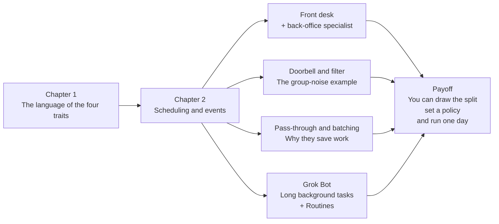
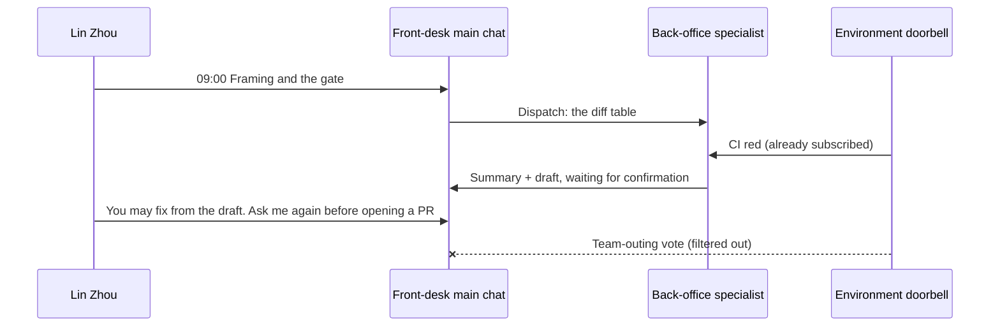

# Chapter 2 Two-layer Router/Worker and event-driven design

> Chapter guide: After Chapter 1 sets the four traits, Lin Zhou asks at once: "How do you split the bottom so it stays both continuous and efficient? When the group gets noisy, how do you keep it from deafening people?" This chapter uses **front desk / back-office specialist** to open up Router and Worker, uses the **doorbell** to open up events, and uses **group-chat noise** to open up filtering and subscriptions. Each section still goes: one-sentence conclusion, a small Lin Zhou example, the matching DeepSeek point, visible Grok Bot behavior, inferred implementation, and one figure of its own. By the end you can draw, for a colleague, who speaks to the outside and who keeps their head down; set a Trigger policy a platform team can accept; and turn "pass-through / filter / hold speculative execution back" into the language of one day.

*Map of this chapter*

## When you need it

**You agree that "the ceiling on many tasks = a person's attention," and you do not know how the system should split.** Read the two sections on the front desk and the back-office specialist.

**The assistant can do the work, but a busy group is noisy and expensive, or CI keeps blowing up the main chat.** Read the doorbell, the filter, and pass-through.

**You want the assistant to "do it in the background first, and deliver it when it is worth delivering," and you are afraid a false-positive initiative will wreck the order domain.** Read speculative execution and the row that holds it back.

**You are writing a team agreement.** Use "Lin Zhou's day (the scheduling version)" at the end, and the comparison tables.

## Overview

Start with a hotel front desk.

Guests talk only to the **front desk**: directions, a changed booking, a complaint. The people who actually check the room, carry the bags, and fix the air conditioner are the **back-office specialists**. If every specialist ran out and shouted at the guest, the lobby would turn into a market. If the front desk did every job by hand, the front desk would collapse, and the guests would queue.

An agent system is stuck on the same tradeoff:

| Extreme | Continuity (does it feel like the same person?) | Throughput (can it run in parallel?) | How it feels |
| --- | --- | --- | --- |
| Everything goes into the same conversation | Highest | Low (serial) | Details stew in one pot, and the work is slow |
| Every message opens a new conversation | Low | Highest | Several robots flood the screen, and you cannot remember who is who |
| **Front desk + background** | High (the front desk holds the global order) | High (specialists run in isolation) | One person on the outside, several people working on the inside |

The source picks the third: a resident **Router** (the routing layer that receives and dispatches on the outside) plus context-isolated **Workers**, the layer that keeps its head down on a concrete task. On the user side, the Session fades. A Session should be a system detail, not a load on your attention.

Initiative changes the drive as well. The main input moves from "a person types line by line" to semi-structured events in the environment, a **Trigger** (the doorbell). Around one event, the source talks in order about two-level filtering, subscription and pass-through, Inline and Spill (a short note kept in front, and a long write-up filed away), and speculative execution.

**Prefer this first:** get used to "the main chat only interacts and dispatches, and long tasks go to the background," then add Routine filters on top. Do not start by chasing "open a PR with nobody @-ing it."

*Figure: `22-router-analogy.jpg`. This figure shows that Router/Worker is a division of everyday work first: the front desk faces out, the specialist faces in. You do not have to see those two English switches in the UI.*

---

## The front desk: who the Router is

### The conclusion in one sentence

The Router is the resident point of global order. It only receives, dispatches, and takes notes. It does not keep its head down moving bricks.

### A small example (Lin Zhou)

Lin Zhou tells the main chat: "Build the field-diff table, and watch tonight's CI."

A good front desk notes the goal, hands "build the table" and "watch CI" to the background, and replies only "arranged; I will call you when the table is ready."

A bad front desk starts a ten-minute tool run itself. During that run Lin Zhou cannot get in "do not do the refund callback yet."

### Which point in the DeepSeek article

The source: the Router takes human interaction from every entry. It is the global **sequence point**, the coordination point, and the memory. So it does not become a bottleneck, it **does not execute concrete tasks directly**, and it may not even carry heavy execution tools. It differs from the Lead of a common agent team. The weight is the high-level relation and dispatch between tasks, not the step split inside one task.

| What you look at | The Lead of a common agent team | The Super-agent Router |
| --- | --- | --- |
| The weight | Role collaboration inside one complex task | Dispatch and relation between tasks |
| The load | Often has to go deep into the details | Kept light on purpose |
| Who speaks outside | Sometimes several roles all produce output | **Only the front desk speaks outside** |

### What you can see in Grok Bot

The main chat is approximately the front desk. You frame the day here, change direction, and accept the result. Long research, file edits, and checks should show up as background progress, then a summary back in the main chat.

### Inferred implementation

**Inferred.** At the product layer, the "main chat" carries the Router's outward duty. There is not necessarily a process named Router. A light model plus a strong dispatch prompt might also hold up the front desk. The source's experiment suggests that delegation by prompt alone is unstable (see later in this chapter).

*Figure: `02-router-worker.jpg` (the book's architecture sketch, used once in this chapter). This figure shows, logically, "one outward entry + several isolated execution sessions." It matches Section 2 of the source article. It is not a same-named module in the Grok Bot source.*

---

## The back-office specialist: who the Worker is

### The conclusion in one sentence

A Worker is a specialist in an isolated context. One job, one room. When it is done, the conclusion goes back to the front desk.

### A small example (Lin Zhou)

**Counterexample.** The same window edits the field mapping, writes unit tests, and answers the team outing. Attention thins, and tool results pollute each other.

**Example.** "Build the diff table" goes to specialist A. "Fix the red CI" goes to specialist B. By default the two do not "talk to each other." Both conclusions come back to the main chat, and Lin Zhou (or the front desk) merges the decision.

### Which point in the DeepSeek article

The source: the Worker layer isolates context and can run concurrently. Tasks on the same layer do not talk to each other by default, which avoids a flood of robots and the loss of global constraints. The two layers are **logical duties**. The implementation does not have to use two process names.

### What you can see in Grok Bot

You can push several background lines at once: research, code changes, checks. The summary is a short conclusion. Do not treat "open another assistant in the sidebar" as a Worker. That is usually another front desk, not a specialist.

### Inferred implementation

**Inferred.** A long task runs in an isolated context (similar to a Worker). The completion event is fed back into the main chat. Several assistants in the sidebar are more like several Router entities. Misusing them hurts "continuous."

---

## An event is a doorbell: what a Trigger is

### The conclusion in one sentence

An event is the environment ringing the doorbell. It is not a person retelling the whole request out loud.

### A small example (Lin Zhou)

CI goes red, a PR gets a new comment, a designated email arrives. Those are doorbells.

A team-outing vote, a flood of stickers. Those are doorbells too, and most of them should be thrown out by the front desk as flyers.

### Which point in the DeepSeek article

The source: initiative requires the drive to move from "a person types line by line" to semi-structured events in the environment (Trigger). On an event's life, filter first, then decide whether it enters the Router or passes through to a Worker.

### What you can see in Grok Bot

Routines can trigger the assistant on a timer, or from GitHub, Slack, email, and similar sources. What you configure is "which doorbells are worth answering," not "let the assistant comment on every group message."

> A note on the Routines passage: this book uses behavior and analogy to make the goal clear. A shot of the assistant-info / Routines panel waits until that panel is actually open. **This book does not cite** an unconfirmed full-window shot as the panel.

### Inferred implementation

**Inferred.** There is a Trigger intake and a policy-configuration layer. The default leans toward something you can turn off and can expect. Strong initiative (opening a PR with nobody confirming) is not the default posture.

---

## Filtering: what to do with group-chat noise

### The conclusion in one sentence

Filtering means block the noise first, then spend money thinking. The other half of proactive is still quiet.

### A small example (Lin Zhou)

The platform group has a few hundred messages a day:

| What the doorbell says | Should it enter the main chat? | The plain reason |
| --- | --- | --- |
| CI failed on order-adapter | Yes | It is directly on the main line |
| "Which place for Friday's team outing?" | No | Noise. A reply is expensive and noisy |
| A PR comment changes the idempotency key | Yes | The plan changed across channels. Continuous needs it |
| A run of stickers | No | No new information |

If Lin Zhou turns the filter off, the assistant writes three pages of advice about the team outing. That is talkative. It is not proactive.

### Which point in the DeepSeek article

The source's two-level filter: a cheap Fast Path (a rule, or a light judgment) blocks first. What does not pass then enters the Slow Path (a more expensive model judgment). The aim is lower cost and less interruption.

### What you can see in Grok Bot

When you configure Routines, write down "care only about: CI, PRs on the named repo, and email whose subject contains OrderGateway." Group small talk does not trigger a long reply by default. If it is still talkative, write the filter list into the team RFC.

### Inferred implementation

**Inferred.** On the product side there may be a combination of a rule allow-list and a second judgment by the model. The default posture is low interruption. The exact algorithm is not disclosed. When you compare, talk about behavior only.

*Figure: `03-event-compute-split.jpg` (the event-side sketch, used once in this chapter. Chapter 3 does not paste the same figure again to talk about events). This figure shows how an event splits after it arrives, and gives a structural feel for filtering and pass-through.*

---

## Subscribed pass-through and batching: why they save work

### The conclusion in one sentence

If it can go straight to a specialist, do not bother the front desk every time. If the doorbells can be packed, do not ask once per ring.

### A small example (Lin Zhou)

**Pass-through.** Lin Zhou has already subscribed to "CI for order-adapter." CI goes red, and it goes straight to the "fix CI" specialist to prepare a summary and a draft. The front desk is called only when a decision is needed.

**The cost of not passing through.** Every CI log bothers the front desk first, and the front desk retells it. Latency is high, tokens are expensive, and it is easy to interrupt the framing Lin Zhou is editing.

**Batching.** Eight small PR-comment fixes of the same kind arrive within ten minutes. They merge into one "comment summary" before they reach the front desk, instead of eight interruptions.

### Which point in the DeepSeek article

The source: a subscribed pass-through lets a matching event skip the Router's busy path and reach the relevant Worker. Under a multi-task load, batching often **spends tokens to buy stable latency**. The experiment side also compared "structural delegation" with "delegation by prompt only." The latter is unstable.

### What you can see in Grok Bot

Make "watch CI / pull the PR summary" a Routine, instead of typing "please look at CI" in the main chat every time. The main chat keeps the decisions. Repeated watching goes into a routine task. Long background tasks running in parallel are the product-layer version of "a specialist is working."

### Inferred implementation

**Inferred.** Routines are approximately a productized Trigger subscription. Background tasks are approximately Worker-like execution. Whether batching and pass-through are implemented internally under the paper's names is unknown. The experience of "the main chat is interrupted less by routine noise" points the same way. Structural isolation in the background is usually more stable than a prompt that says "please prefer a sub-agent."

| Practice | Where it saves | The risk |
| --- | --- | --- |
| Subscribed pass-through | Bothers the front desk less, and cuts latency | A wrong subscription misses something, or subscribes to too much |
| Batching | Fewer interruptions, and more stable latency | A merge window that is too wide dulls an urgent event |
| Delegation by prompt only | Cheap to change the copy | On the spot it does not delegate. The structure is an illusion |

---

## Inline and Spill: the short note and the long write-up

### The conclusion in one sentence

The front desk keeps only the short note it can decide on. The long process goes into the archive, and is recalled along the chain when needed.

### A small example (Lin Zhou)

Research for the diff table produces 20 pages of notes.

**Inline** (the short note kept in front): the main chat keeps only "a three-column conclusion plus two risks."

**Spill** (the long write-up filed away): the detailed comparison goes into a background archive. When Lin Zhou asks "why did we drop the shop-ID column back then," it is recalled along the chain, instead of pasting 20 pages into IM.

### Which point in the DeepSeek article

The source uses Inline and Spill, plus chained recall, to handle Router memory that keeps growing. Light on the outside, and able to retrieve long-range detail on the inside.

### What you can see in Grok Bot

The request "the main chat replies with a table only… logs stay in the background" is the product-layer Inline discipline. Do not paste a full tool log into the group.

### Inferred implementation

**Inferred.** The main chat's context has a length and a display policy. Long artifacts land on the task-artifact or file side. Whether the paper's Spill mechanism exists under that name is unknown. "A short conclusion, plus an artifact you can look back at" points the same way.

---

## Speculative execution: prepare first, and hold the delivery back

### The conclusion in one sentence

The background may prepare first. Before it reaches the real world, the order domain waits for a person to nod, by default.

### A small example (Lin Zhou)

CI goes red. The specialist has already written a fix patch and a PR description (speculative execution: it judged the work worth doing, and started).

**An acceptable delivery:** the draft stops at "waiting for confirmation."

**Not acceptable:** opening a PR, posting to a group, or changing production with nobody confirming. A false positive is extremely expensive in a contract domain.

### Which point in the DeepSeek article

The source talks about speculative execution raising throughput, and it also admits that initiative amplifies risk. This book marks the source's "open a PR with nobody @-ing it" as an upper-bound reference, and marks "a draft, plus a person confirms" as the platform default.

### What you can see in Grok Bot

The background may prepare a patch and a description. A critical action shows an approval card, or waits until you say "you may open it" in the main chat. The team agreement is fixed: sending externally, merging to the main branch, and production config all require a person to confirm.

### Inferred implementation

**Inferred.** The product's default HITL (Human-in-the-Loop: a person confirms before the action lands) leans conservative. Speculation stops more often at "prepared" than at "a silent write." Do not read "it can work in the background" as "it is already authorized to act outside."

---

## A landing comparison (Chapter 2)

> Every cell in the third column is **a reasonable inference from visible behavior**, not an official disclosure of the implementation.

| Mechanism in the article (plain words) | What you see in Grok Bot | Inferred implementation |
| --- | --- | --- |
| The Router faces out as one | The main chat frames, changes direction, and accepts | The main chat carries the outward sequence-point duty |
| Workers run in isolation | Long background tasks in parallel, summarized as a short conclusion | Long tasks execute in an isolated context |
| The Trigger doorbell | Routines fire on a timer, GitHub, email, and similar sources | A Trigger and a policy-configuration layer exist |
| Two-level filtering | Small talk does not flood the screen. Only a key summary gets in | A possible combination of rules and a model judgment |
| Subscribed pass-through | Routine watching goes into a Routine, and interrupts the main chat less | Routines are approximately a productized subscription |
| Batching | Summaries merge, instead of every item making noise | There may be merging or throttling. A same-named batch step is not confirmed |
| Inline and Spill | A short conclusion in front. Detail in the artifact | A policy that separates display from artifacts |
| Speculative execution | A draft can be prepared. Critical actions wait for a person | Default HITL. Not a silent write |

---

## Lin Zhou's day (the scheduling version)

| Time | What Lin Zhou says / how he configures it | The point in this chapter |
| --- | --- | --- |
| 09:00 | Framing, plus the three HITL sentences (same as Chapter 1) | The front desk holds the global order |
| 09:15 | A Routine: subscribe to order-adapter CI and to PR comments on that repo | Doorbell, plus the feel of pass-through |
| 10:30 | "Throw the diff table to the background. The main chat replies with a three-column table only." | Worker + Inline |
| 11:05 | CI goes red. The summary enters the main chat. The draft is prepared in the background | Initiative after filtering, plus speculation that stops at a draft |
| 14:00 | A PR comment changes the idempotency key. The front desk updates the global constraint, and the specialist follows | Continuous, plus Router memory |
| 16:20 | The team-outing message: no action | Filter / quiet |
| 18:30 | Three milestones at the end of the day. Tomorrow's Routine pulls the summary | An end-of-day close with the feel of batching |

*One day, scheduling version: the front desk holds the order, the specialist works, and the doorbell passes a filter*

---

## Why structure beats prompt delegation

The source's experiment (a synthetic load; the author says it is only a reference) leaves three product intuitions. This chapter collects them into conclusions you can execute:

1. **Structure over an on-the-spot prompt.** Delegation should land as a background task or a sub-execution, not as a lucky "please prefer a sub-agent."
2. **Pass-through is a cost optimization.** Get the routing right first, then cut the front desk's load.
3. **Spending tokens to buy stable latency** is often worth it when there are many tasks (batching).

For Lin Zhou: rather than writing the system note as a novel, configure three Routines plus one team habit, "a long task must go to the background."

---

## Structural delegation versus prompt delegation: Lin Zhou's comparison (product layer)

### The conclusion in one sentence

Writing "please open a sub-task" into the note does not mean the system really has a specialist's room.

### A small example (Lin Zhou)

Lin Zhou ran a two-day comparison (an informal experiment, only to build the team's intuition):

| Day | What he did | What happened |
| --- | --- | --- |
| A | The system note said "please prefer a sub-agent for long tasks" | The main chat still ran the long tests itself. New messages queued or interrupted it |
| B | Explicit: "Throw the diff table to the background. Use a Routine for CI. The main chat only decides." | The front desk could be interrupted. Summaries got shorter. The team outing no longer triggered a long text |

### Which point in the DeepSeek article

The source's experiment shows that delegation by prompt alone is unstable. A structured Router/Worker and pass-through are closer to the target experience. The author says the synthetic load is only a reference. This book borrows the product intuition. It does not copy a curve and treat it as a metric.

### What you can see in Grok Bot

Land the structure with product capabilities: long background tasks, Routines, and a short conclusion in the main chat. Write fewer novel-style system prompts. Write more conventions you can execute.

### Inferred implementation

**Inferred.** A prompt can only "suggest" delegation. A background task and a Routine are the structure you can observe. In a team review, look at behavior. Do not look for the word Worker inside the prompt.

---

## One table for setting Trigger policy (you can take it to a meeting)

Sort the doorbells into four buckets, and tick the rows in the meeting:

| Bucket | Examples | Default action | Who approves a change to the default |
| --- | --- | --- | --- |
| Must answer | Main-repo CI red, an order-domain PR comment, an on-call email | The summary enters the main chat. A draft may be prepared in the background | Lin Zhou / tech lead |
| May subscribe | A dependency security notice, a PR in a neighboring domain | A Routine daily summary. Do not interrupt immediately | The person on duty |
| Drop by default | Team outing, stickers, an unrelated @all | Ignore | No approval needed |
| Forbidden to automate | An external group blast, a merge to the main branch, a production-config change | A draft at most. A person must confirm | A written agreement inside the group |

This table is the initiative levels from Chapter 1, carried into the scheduling layer. Without this table, the more Routines you configure, the more it looks like a talkative generator.

---

## Front-desk lines, for scheduling

Understanding the main line does not depend on memorizing these. They are useful in a meeting:

| What you want | You can tell the main chat |
| --- | --- |
| Dispatch a specialist | "Throw this to the background. When it is done, reply with the conclusion and the risk only." |
| Turn a doorbell on | "Set a Routine for me: every day at 09:30, pull the order-adapter CI and the unread PR-comment summary." |
| Turn the noise off | "Ignore platform-group small talk and team outings. Do not reply on your own." |
| Hold speculation back | "You may prepare the fix first. You must ask me before opening a PR." |
| Inline discipline | "The main chat must not paste a full log. Three lines of conclusion." |

## Chapter summary

1. **The analogy:** Router = front desk. Worker = back-office specialist. Event = doorbell.
2. **The split:** the front desk holds the global order and faces out as one. Specialists run in isolation. The same layer does not shout at itself by default.
3. **Filtering:** group noise uses an allow-list and a quiet side. Proactive does not mean talkative.
4. **Pass-through and batching:** routine doorbells bother the front desk less. Merged summaries buy stable latency.
5. **Speculation:** you may prepare. Delivery waits for a person. The order domain forbids a silent write by default.
6. **Grok Bot:** the main chat, plus long background tasks, plus Routines, is the same experience at the product layer. Cite a Routines-panel figure only after it is confirmed.
7. **Next:** Chapter 3 covers talking while working, three places kept apart, and who calls a stop when it is stuck.

---

## Acceptance checklist

- [ ] You can explain the Router and Worker split with the front-desk / specialist analogy
- [ ] You can say why putting everything in one window falls short, and why a new window per message falls short
- [ ] You can name three doorbells that should ring and three flyers that should be dropped (group noise)
- [ ] You can explain what subscribed pass-through saves, and what batching saves
- [ ] You can map Grok Bot: which layer the main chat, a background task, and Routines each resemble
- [ ] You can say out loud the difference between "visible behavior" and "inferred implementation"
- [ ] You can write the order domain's line that holds speculative execution back (a draft is allowed; a silent PR is not)

---

## Further reading

- Sections 2 and 3 of the DeepSeek source (the same link as Chapter 1). The basis for the two-layer architecture and event-driven design.
- Chapter 1 of this book. The four traits and the framing lines. This chapter is the scheduling expansion of that.
- Chapter 3 of this book. Async multi-channel, keeping compute and state apart, and Watchdog.
- **agentscope-java** on this shelf: sub-agents and permissions, when you want the Worker feel to land in a framework.
- **copilotkit** on this shelf: the human-collaboration UI. HITL cards are related to the front-desk experience.
