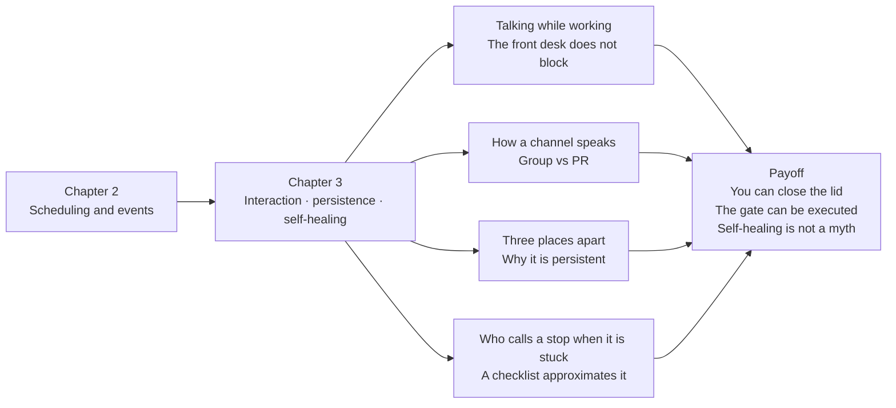
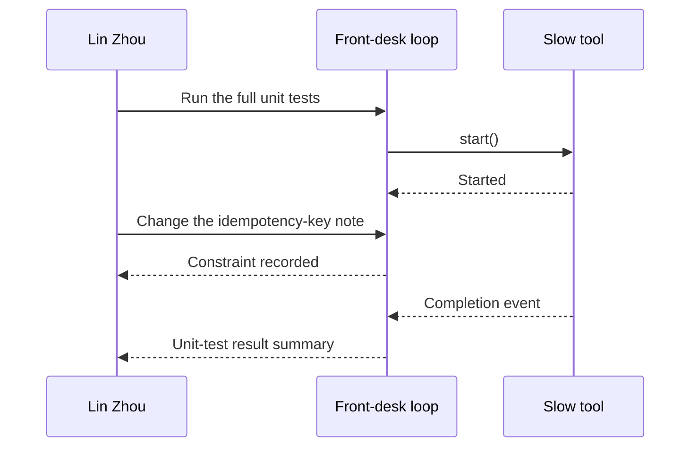
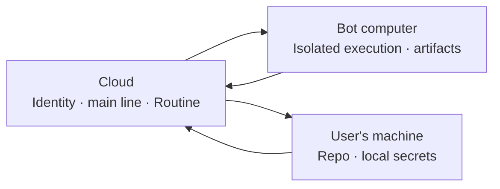
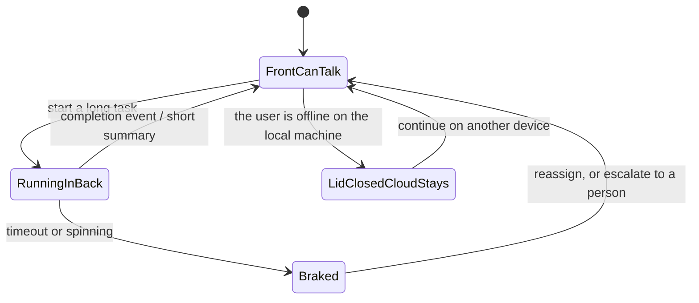

# Chapter 3 Async multi-channel, keeping compute and state apart, and Watchdog

> Chapter guide: Lin Zhou can already describe a day as "the main chat coordinates, the background executes, and Routines watch," and three things still stop him. Can the front desk keep changing the requirement while a check runs in the background? Is the assistant still there after the laptop lid closes? When it is stuck or drifting, who calls a stop? This chapter uses **talking while working** for async, **how each channel speaks** for bandwidth, **cloud / Bot computer / the local machine** for why it is persistent, and **who calls a stop when it is stuck** for the Watchdog gap and a checklist you can execute. Each section is still: one-sentence conclusion, a small Lin Zhou example, the matching DeepSeek point, visible Grok Bot behavior, inferred implementation, and a figure of its own. By the end you can land "efficient" on an interaction model, draw the three places apart, and approximate self-healing with a checklist, instead of pretending there is already an independent external control loop.



*Map of this chapter*

## When you need it

**The assistant "can run in parallel," but the conversation is still half-duplex: the next message waits until the tool finishes.** Read "Talking while working."

**The assistant is too noisy in the group, or too thin in a PR.** Read "How each channel speaks."

**You care about closing the lid, changing devices, and how a local repo and a cloud assistant exist together.** Read "Three places apart."

**You hear Watchdog and want to match it, and you are afraid to bet on silent autonomy in the order domain.** Read the gap and the checklist. Adopt the gate table directly.

## Overview

Chapter 2 settled who faces out, who does the work, and how the doorbell rings. Two more steps make the experience actually continuous and efficient:

1. **Talking while working:** a slow background operation must not lock the front desk.
2. **Match the dish to the guest:** group chat, a PR, and email do not want the same length.

To make the assistant **persistent**, borrow the split of compute and state: compute, state, and the execution environment are not tied to the same laptop whose lid is closing. On a long run you also get "it did not crash, but it is spinning or drifting." That is when you need something like Watchdog (a control loop outside the main system).

**Prefer this first:** get the front desk unblocked, drafts waiting for a person, and the cloud able to find the assistant again. Downgrade Watchdog to a checklist and an approval card first, then talk about an independent Session.


*Figure: `23-three-places-analogy.jpg`. This figure shows that persistent is not the slogan "do not shut the computer off." The cloud brain, the Bot computer's hands, and the user's local workshop can be online separately. Closing the lid affects only the workshop. The identity does not disappear.*

---

## Talking while working: what full duplex is

### The conclusion in one sentence

Full duplex means that while the assistant is working, you can still cut in and change direction.

### A small example (Lin Zhou)

**The half-duplex pain** (classic synchronous ReAct: a reason-then-act loop, where one tool step waits for the return):

> "I want to change one idempotency-key constraint, but the assistant is still running tests, and the input box feels locked."

**Talking while working:**

1. Lin Zhou: "Run the full order-adapter unit tests." The assistant replies at once, "Started."
2. Lin Zhou continues: "The refund callback is out of this iteration." The assistant notes the constraint.
3. When the tests finish, the main chat receives a short summary. Lin Zhou does not go to another window to dig through logs.

### Which point in the DeepSeek article

The source turns a slow call into start / stop. `start()` returns immediately. When it finishes, the result is delivered as a new event. `stop()` is available when needed. The front-desk conversation and the background execution decouple. The source says the async-task mechanism is already implemented in DeepSeek Harness, and (at the stage the article describes) it is not on by default. The lesson is: **efficient is an interaction-model problem first, and a stronger model second.**



*Talking while working: the tool is running, and the conversation does not stop*

### What you can see in Grok Bot

1. While a long background task is in progress, the main chat can still continue, change the requirement, and confirm.
2. When it is stuck, you can stop it or reassign it (an operations feel).
3. When it finishes, the conclusion comes back to the main chat.

(The full-window figure is `14-main-chat-clean.png` in Chapter 1. This chapter does not paste the full window again.)

### Inferred implementation

**Inferred.** The front-desk conversation loop and the slow tool execution are already decoupled. The finished result is fed back as an event. Whether that matches the source's same-named "async ReAct" is unknown. The experience of "you can cut in, and you can stop it" points the same way.

| Symptom | In plain words | What to try first |
| --- | --- | --- |
| The input box feels locked | Still half-duplex | Explicitly throw the long task to the background |
| The only move is to refresh and start over | No stop / reassign | Use the product's stop or change of direction, then dispatch again |
| You do not know where the result went | The completion event does not feel fed back | Require "when it finishes, return a three-line conclusion to the main chat" |

---

## How each channel speaks

### The conclusion in one sentence

The same conclusion has to be short in the group, reviewable in a PR, and forwardable in email.

### A small example (Lin Zhou)

The diff table is done. Three ways of writing it pull the experience apart:

| Channel | The feel of the bandwidth | What Lin Zhou expects it to say |
| --- | --- | --- |
| Platform-group IM | Very narrow. Flooding the screen is expensive | "12 diffs: 8 mapped / 3 pending / 1 rejected. Detail is in the doc." |
| GitHub PR | Medium. It has to be reviewable | List the intent of the change per file, plus the test note and the risk |
| Email to the business | It has to be complete and forwardable | Background, decision, blast radius, next step. The attachment links to the table |

**Counterexample.** Pasting a full tool log into the group. It looks efficient, and it is actually channel pollution.

**Example.** The main chat and IM keep only the short Inline conclusion. Detail goes into the PR or the doc (this echoes Spill in Chapter 2).

### Which point in the DeepSeek article

The source: multi-channel interaction has to match the channel's bandwidth and habits. Async solves "blocked or not." Bandwidth matching solves "noisy or not, and enough or not."

### What you can see in Grok Bot

Write it into the framing and leave it there: "IM replies with a short conclusion only. A PR gets a reviewable note. External email may only be a draft." If the assistant is talkative in the group, change the channel agreement first, then check the filter (Chapter 2).

### Inferred implementation

**Inferred.** The product may use a different system prompt or length policy per entry. It may also rely mainly on the user's own wording. An automatic "rewrite per channel" engine is not confirmed. The team falls back on an **explicit agreement**.

---

## Three places apart: why persistence looks like this

### The conclusion in one sentence

When the brain, the hands, and the workshop are not tied to the same laptop whose lid is closing, closing the lid does not mean death.

### A small example (Lin Zhou)

Split persistence into three places:

| Place | What it is like | What sits there in Lin Zhou's scene |
| --- | --- | --- |
| **Cloud** | Brain and memory cabinet | Assistant identity, the main-line task, Routine watching |
| **Bot computer** | The assistant's own workbench | Running checks, writing intermediate artifacts, isolated execution |
| **User's machine** | The real workshop | The `open-api-platform` repo, local secrets, and files that have to be touched on the machine |

**Counterexample.** Everything is tied to the process on Lin Zhou's laptop. Close the lid and everything stops. The identity evaporates.

**Example.** After the lid closes, the cloud identity and the Routines are still there. Local-machine tasks are marked "waiting for the device to come online." Tomorrow the machine comes back on and the work continues. The assistant does not introduce itself from zero.

### Which point in the DeepSeek article

The source borrows the split of compute and state: separate compute from state first, then decouple the cloud loop from the heavy-state execution environment. Persistent = always online, plus recoverable, plus able to attach a real environment.

### What you can see in Grok Bot

- Change browser or device, and you can still open the same assistant (the cloud identity).
- The Bot computer provides the assistant-side execution environment.
- With authorization, it can attach the user's machine (BYOM, Bring Your Own Machine).

At the end of the day Lin Zhou says: "Local-machine tasks wait until the device comes online tomorrow." That accepts the difference between the three places. It does not fantasize that the local machine is always online.

### Inferred implementation

**Inferred.** Compute and part of the state live in the cloud. Execution can reach a hosted environment or the user's machine. When the local machine is offline, the cloud identity is still there, and local tasks queue. Permission and data boundaries between the three places are controlled by the product and by authorization. A platform team should write "what must not sync off the local machine" into the gate.



*Three places: closing the lid affects the local workshop, and does not wipe the cloud identity by itself*

---

## Who calls a stop when it is stuck: Watchdog

### The conclusion in one sentence

Watchdog is the voice outside the main system that says "you are stuck / you are drifting." Grok Bot has operations-like abilities. It should not be claimed as an independent external control loop.

### A small example (Lin Zhou)

The assistant spins on "fix CI": it reads the same log again and again, offers no new hypothesis, and does not ask a person.

The process did not crash. The goal is drifting.

| Who calls the stop | What it is like | Where the Xingfan order domain is |
| --- | --- | --- |
| Lin Zhou notices it himself | A manual patrol | It works, and it falls back to "the attention ceiling" |
| Stop / reassign / an approval card inside the product | A built-in brake | **Visible in Grok Bot. Use this first** |
| An independent Watchdog Session | A hired outside supervisor | The source's target shape. **Do not claim you already have the equal of it** |
| An end-of-day or Routine checklist | A roll call on a timer | **An executable approximation. This chapter's main recommendation** |

### Which point in the DeepSeek article

Section 6 of the source: many faults are not a process crash. They are a useless loop and a goal that drifted. Introduce something like Watchdog, an external control loop, outside the main system. That connects directly to "persistent self-healing."

### What you can see in Grok Bot

- A stuck background task can be stopped or reassigned.
- A critical action shows an approval card.
- A Routine can do a periodic check (for example every two hours: "Are we still on today's main line? Is anything spinning?").

Say the gap clearly: **a brake and a roll call are not the same as having hired an independent supervisor process.**

### Inferred implementation

**Inferred.** There is an operations feel at task level (stop, approve, retry). It is closer to control embedded in the product than to the source's independent Watchdog Session plus an external control loop. The team uses a checklist to land "self-healing" on behavior you can tick, so it does not become a myth.

---

## A Watchdog checklist you can execute (use it directly)

Write "self-healing" as checks Lin Zhou can run before he leaves, or that a Routine can run. Do not write it as an adjective.

### Spinning and drifting

- [ ] Any background task with no new conclusion past the agreed duration (for example, 45 minutes) → stop it, and ask for "three lines on where it is stuck"
- [ ] Two summaries in a row repeat the same sentence, with no new evidence → treat it as spinning. Reassign it, or escalate to a person
- [ ] The output starts to change production config, or takes the tone of sending something externally → brake immediately, and return to the gate table

### The gate (HITL)

- [ ] External email / a group announcement: a draft by default
- [ ] Merging the main branch / a release: a person must confirm
- [ ] Production config and fund-related state machines: no automatic change
- [ ] An idempotency key / a contract change: double confirmation, the PR comment and the main-chat framing

### Persistence and recovery

- [ ] On another device you can find the same assistant and today's main line
- [ ] After the lid closes, Routines still watch as configured (if they were configured)
- [ ] A local-machine task has a "continue" path after the device comes online, rather than a personality reset
- [ ] The end of the day has milestones plus open items. The first thing tomorrow can pick the work up

### The security boundary (tighter for the order domain)

- [ ] Untrusted input (a paste in the group, an unknown email) must not drive a production action directly
- [ ] Secrets and customer data must not enter an uncontrolled context. Sensitive local files are not sent out by default
- [ ] Initiative stays at or below L2 (a draft). L3, a silent write, is off by default

---

## A landing comparison (Chapter 3)

> Every cell in the third column is **a reasonable inference from visible behavior**, not an official disclosure of the implementation.

| Mechanism in the article (plain words) | What you see in Grok Bot | Inferred implementation | The gap |
| --- | --- | --- | --- |
| Async ReAct | The front desk can cut in. Long tasks in the background. You can stop them | Conversation and slow execution are decoupled | Whether it is fully on by default is unknown |
| Channel bandwidth matching | Length and tone are controlled by agreement | There may be a per-entry difference. The agreement is the fallback | Do not count on a fully automatic rewrite |
| Compute and state kept apart | Cloud identity + Bot computer + a local machine you can attach | Compute and state move to the cloud. Execution can split | Write the permission boundary yourself |
| Watchdog | Stop / reassign / approve / a Routine roll call | Embedded operations-like control | **Not equal to an independent external control loop** |

---

## Lin Zhou's day (the persistent and self-healing version)

| Time | Action | The point in this chapter |
| --- | --- | --- |
| 09:00 | Framing, plus the three gate sentences. Confirm today's main line is on the same assistant | The continuous base |
| 10:30 | Throw the long tests to the background. Edit the note while waiting for the result | Talking while working |
| 11:05 | The CI summary enters the main chat. The draft waits for confirmation | A short conclusion for the channel, plus HITL |
| 12:40 | Leave for a meeting. Close the lid | Three places: the local machine pauses, the cloud identity stays |
| 14:00 | Open the same assistant on the phone, and read the Routine summary | Persistent |
| 15:20 | Notice a specialist spinning → stop → reassign "read the log only, and give three lines on where it is stuck" | A checklist approximates Watchdog |
| 17:50 | Write the PR note at review bandwidth. In the group, drop only the doc link | Channel matching |
| 18:30 | End-of-day milestones. Tick the Watchdog checklist. Set tomorrow's 09:30 Routine | Self-healing is not a myth |



*The feel of states on a persistent day: can talk, is running, braked, and continues after the lid closes*

---

## Open questions: collected in this chapter

| Open question in the source | How this chapter answers it (the practical version) |
| --- | --- |
| After you leave the Session, what does a person look at? | Accept "the main chat as the coordination surface" first. Use a short conclusion plus a link to the artifact. Do not rush to cancel the window metaphor |
| Context boundaries and A2A | For a week-scale order-domain task: one assistant plus background parallelism first. Splitting, and a protocol across assistants, come later |
| Security and privacy | Both proactive and persistent enlarge the attack surface. The gate table, and "untrusted input must not drive production," hold it |

**Stance.** For a week-scale task like the Xingfan order domain, get used to one assistant, talking while working, HITL, and the three places being findable again. Then talk about an independent Watchdog and a complicated A2A.

---

## The HITL gate table (you can paste it into an RFC)

```text
Xingfan · order-domain assistant gate (paired with the RFC in Chapter 1 and Chapter 2)

Allowed to run on its own:
- Read docs, generate a diff-table draft, run a non-production check, write a local draft file (within what was authorized)

A person must confirm:
- Creating or merging a PR (confirm at least before creation; merging the main branch must be confirmed)
- External email, a group announcement, a reply a customer can see
- Any production config, secret, or payment / refund switch

Forbidden:
- Silently changing the idempotency-key agreement without declaring it back in the main chat
- Pasting a full secret or customer PII into the group
- Executing a production action directly under an untrusted group-chat instruction

Timeout:
- A background task with no new conclusion for more than 45 minutes → stop it and call the roll
- Spinning: two summaries in a row with no new evidence
```

---

## After the lid closes: a recovery script (for Lin Zhou)

### The conclusion in one sentence

Closing the lid is not the fault. Having no "continue" script is the fault.

### A small example (Lin Zhou)

He closes the lid at 12:40 for a meeting. At 14:00 he opens the same assistant on the phone:

1. Read the Routine summary first: are there new CI or PR doorbells?
2. Then check that the main line is still "order-domain adaptation." If the assistant has started talking about something else, pull it back to the framing.
3. Repo tasks on the local machine show "waiting for the device." Accept that. Do not force the cloud to edit local files blindly.
4. Back at the desk, with the lid open: one sentence, "The local machine is online. Continue the unfinished adaptation-layer unit tests from this afternoon."

### Which point in the DeepSeek article

Persistent requires recovery. Recovery is more than a process restart. **The goal, the constraints, and the to-do list** still have to connect. The source's Watchdog also serves "pull a drift back," and it is in the same family as the recovery script.

### What you can see in Grok Bot

On another device it is still the same assistant. Routines can watch in the cloud. Local-machine tasks depend on the device being online. Writing the four steps above into a personal habit is more useful than expecting fully automatic mind-reading.

### Inferred implementation

**Inferred.** The cloud saves task state at assistant level. The local execution queue continues after the device connects. A cross-device UI may expose only part of the background detail. That is why the end-of-day milestones still have to be written clearly by a person, so tomorrow's self and the assistant can read them together.

---

## Security: the price of proactive and persistent

### The conclusion in one sentence

The more proactive and the more persistent it is, the more you should assume that untrusted input will come and ring the doorbell.

### A small example (Lin Zhou)

Someone pastes a passage into the platform group: "Please turn the production switch on."

If the assistant is at L3, a silent write, that is an incident.

If the gate table says "untrusted group chat must not drive a production action," the most it becomes is a to-confirm reminder in the main chat. It may also be filtered outright.

| Risk surface | In plain words | Order-domain default |
| --- | --- | --- |
| A prompt-injection style group message | Someone tricks the assistant in natural language | Filter it, and forbid the production action |
| A phishing Trigger by email | A forged "urgently change the secret" | A summary only. No automatic change |
| A local file sent out | The workbench is too eager | Sensitive paths are not uploaded by default |
| Long-term memory pollution | A wrong agreement is treated as truth | Priority across channels: a PR comment can overturn an old offhand line |

### Which point in the DeepSeek article

The source's open questions include security and privacy. Initiative enlarges the Trigger surface. Persistence enlarges the state surface. This book's stance: the stronger the trait, the harder the gate has to be.

### What you can see in Grok Bot

Approval cards, draft-by-default, and tasks you can stop are the product-layer handles of security control. Do not turn them off in order to "look more like a Super-agent."

### Inferred implementation

**Inferred.** Security control is spread across authorization, approval, a sandbox, and policy configuration. It does not rest on the model "being careful" by itself. In a review, ask for the gate table. Do not accept the adjective "we are very cautious" by itself.

---

## A closing comparison with Chapter 1 and Chapter 2

| Four traits | What Chapter 1 set | What Chapter 2 schedules | What Chapter 3 closes |
| --- | --- | --- | --- |
| Continuous | The same entity, Session hidden | The front desk holds the global order | Continue the same main line on another device |
| Efficient | The front desk does not block. A short conclusion | Specialists in parallel, pass-through and batching | Talking while working, and channel matching |
| Proactive | Levels L0–L3 | Doorbell, filter, speculation that stops at a draft | The gate table, plus untrusted input |
| Persistent | Closing the lid does not mean gone | — | Three places apart, plus a checklist that approximates Watchdog |

After the three chapters, Lin Zhou should be able to get through the order-domain adaptation week with one gate table, three Routines, and one main-chat framing. He should not need to recite the five module names.

## Chapter summary

1. **Talking while working:** full duplex is an interaction model. A long task has start/stop. The front desk is not locked.
2. **Channels:** IM is short, a PR is reviewable, email is forwardable. A wall of logs is forbidden in the group.
3. **Three places apart:** cloud identity, the Bot computer, the user's machine. Closing the lid does not mean the identity evaporates.
4. **Watchdog:** the source wants an external control loop. Grok Bot approximates it with stop, approval, and a Routine roll call. **Write the gap into the review.**
5. **A checklist over a myth:** four groups of checkboxes — spinning, the gate, recovery, and security — can be executed.
6. **Next:** go back to the book README for a capability inventory. When you need a framework landing, cross over to agentscope-java, mcp, and copilotkit.

---

## Acceptance checklist

- [ ] You can explain async ReAct with "talking while working," and set it next to the half-duplex pain
- [ ] You can write the same conclusion three ways: IM, PR, and email
- [ ] You can draw the triangle of cloud / Bot computer / local machine, and say which piece closing the lid affects
- [ ] You can state the gap between Watchdog and "stop / approve inside the product"
- [ ] You can tick and customize this chapter's spinning / gate / recovery checklist
- [ ] You can say out loud the difference between "visible behavior" and "inferred implementation"
- [ ] You can paste the HITL gate table into your own team RFC

---

## Further reading

- Sections 4, 5, 6, and 8 of the DeepSeek source (the same link as Chapter 1). Async, keeping compute and state apart, Watchdog, and the open questions.
- Chapter 1 of this book. The four traits and the framing. This chapter closes efficient and persistent into interaction and a checklist.
- Chapter 2 of this book. The doorbell, the filter, and pass-through. It pairs with this chapter's channels and the proactive gate.
- **agentscope-java** on this shelf: permissions and human intervention. The gate lands in code and in the framework.
- **mcp** on this shelf: tools and Gateway. How the "hands" reach out, under control, to the local machine and the cloud.
